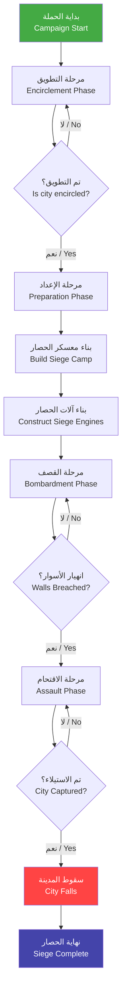
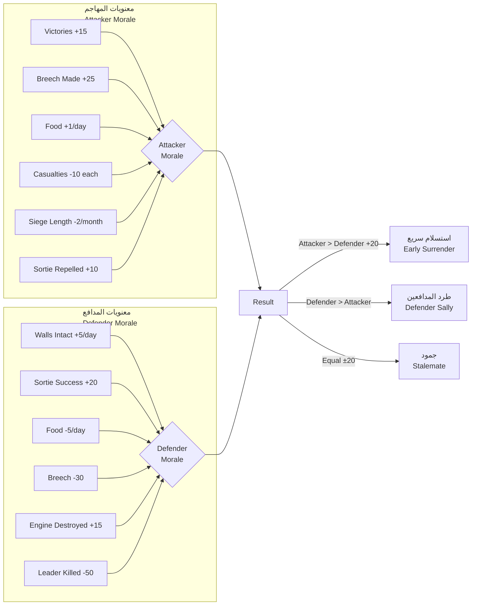

# نظام حرب الحصار — Siege Warfare System

> **النظام 17 — نظام حرب الحصار المتكامل ل Season 6: حصار بورصة (1326)**

---

## 1. نظرة عامة — Overview

نظام حرب الحصار هو أحد أهم الأنظمة في الموسم السادس من لعبة "قيام الدولة العثمانية". يحاكي هذا النظام الحصار الطويل الذي فرضه العثمانيون على مدينة بورصة البيزنطية بين عامي 1317 و1326 ميلادية. يمثل هذا الحصار نقطة التحول الكبرى — من إمارة صغيرة (Beylik) إلى دولة ناشئة (Empire).

يجمع نظام الحصار بين:
- **الإدارة الاستراتيجية**: إدارة معسكر الحصار والإمدادات والموارد
- **الهندسة العسكرية**: بناء أبراج الحصار والمجانيق والأنفاق
- **التكتيكات القتالية**: اقتحام الأسوار والقتال على الجدران
- **الحرب النفسية**: إضعاف معنويات المدافعين وإجبار المدينة على الاستسلام

---

## 2. أنواع الحصار — Siege Types

يمكن للاعب اختيار أحد أربعة أنواع من الحصار، ولكل منها أهدافه ومتطلباته ومخاطره:

| النوع | Siege Type | الهدف الأساسي | المدة المتوقعة | الخسائر المتوقعة | متطلبات خاصة |
|-------|-----------|--------------|----------------|-----------------|--------------|
| حصار كامل | Full Siege | إجبار المدينة على الاستسلام | 6-12 جولة | متوسطة-عالية | تطويق كامل + 4 جدران مراقبة |
| حصار مراقبة | Observation | منع الإمدادات والمراقبة | 3-6 جولات | منخفضة | 2 جدران مراقبة + سرية فرسان |
| اقتحام عاجل | Storm Assault | فتح ثغرة في الأسوار باقتحام سريع | 1-2 جولة | عالية جداً | أبراج حصار + سلالم + كبش ضرب |
| حصار بحري | Blockade | قطع خطوط الإمداد البحرية | 4-8 جولات | منخفضة-متوسطة | أسطول بحري + موانئ محاصرة |

### 2.1 الحصار الكامل — Full Siege
الحصار الكامل هو النمط الأساسي لحصار بورصة. يقوم اللاعب بتطويق المدينة بالكامل، وبناء معسكرات محصنة، وقطع جميع خطوط الإمداد، وقصف الأسوار بشكل منهجي حتى تنهار دفاعات المدينة.

**شروط فرض الحصار الكامل:**
- السيطرة على جميع الطرق المؤدية إلى المدينة (4 نقاط طريق)
- بناء 4 أبراج مراقبة لتغطية محيط المدينة
- توفر 2000+ من الإمدادات الغذائية لمعسكر الحصار
- وجود جيش لا يقل عن 3000 جندي

### 2.2 حصار المراقبة — Observation Siege
حصار خفيف يهدف إلى مراقبة تحركات العدو ومنع وصول الإمدادات الصغيرة. يستخدم عندما لا يكون الجيش جاهزاً للحصار الكامل.

### 2.3 الاقتحام العاجل — Storm Assault
هجوم مباشر على الأسوار دون تحضير طويل. فعال فقط ضد المدن ضعيفة الدفاع أو بعد إضعاف الدفاعات بشدة. يحمل خسائر فادحة.

### 2.4 الحصار البحري — Blockade
عند توفر أسطول بحري، يمكن فرض حصار بحري لمنع وصول الإمدادات عبر البحر. هذا النوع تكميلي للحصار الكامل ويزيد من فعالية تجويع المدينة.

---

## 3. مراحل الحصار — Siege Phases



### 3.1 مرحلة التطويق — Encirclement Phase (الجولات 1-3)
تبدأ الحملة بتحرك الجيش العثماني نحو بورصة. يجب على اللاعب تأمين الطرق المؤدية إلى المدينة وقطع خطوط الإمداد البيزنطية.

**المهام الرئيسية:**
- تأمين 4 نقاط طريق استراتيجية حول بورصة
- بناء معسكرات أمامية (Forward Camps) لحماية خطوط الإمداد العثمانية
- صد الهجمات البيزنطية الأولى (عادةً فرسان الإمبراطورية)
- جمع المعلومات عن دفاعات المدينة (عدد الحامية، حالة الأسوار، المخزون الغذائي)

**المكافآت عند إكمال التطويق:**
- رفع المعنويات العثمانية بنسبة +15%
- خفض معنويات المدافعين بنسبة -10%
- زيادة فعالية التجويع بنسبة +25%

### 3.2 مرحلة الإعداد — Preparation Phase (الجولات 4-8)
بعد تطويق المدينة، يبدأ اللاعب في بناء معسكر الحصار الرئيسي وتجميع آلات الحصار.

**المهام الرئيسية:**
- بناء معسكر الحصار الرئيسي (Main Siege Camp)
- حفر الخنادق (3 مستويات)
- بناء أبراج الحصار والمجانيق والسلالم
- حفر أنفاق الحفر (Sapping Tunnels)
- تخزين الذخيرة والإمدادات

### 3.3 مرحلة القصف — Bombardment Phase (الجولات 5-12+)
تبدأ مرحلة القصف بعد تجهيز آلات الحصار. يقوم اللاعب بقصف الأسوار بشكل منهجي لإحداث ثغرات.

**أنواع القصف:**
- **قصف مركز**: توجيه جميع آلات الحصار نحو نقطة واحدة على السور (فعالية عالية، وقت قصير)
- **قصف موزع**: استهداف أجزاء متعددة من السور (تشتيت دفاعات العدو، وقت أطول)
- **قصف استراتيجي**: استهداف أبراج الدفاع والبوابات أولاً (تمهيد للاقتحام)

### 3.4 مرحلة الاقتحام — Assault Phase
عند إحداث ثغرة كافية في السور (HP الجدار < 20%)، يمكن للاعب بدء مرحلة الاقتحام.

**أنواع الاقتحام:**
- **اقتحام الثغرة (Breach Assault)**: هجوم مركز على الثغرة في السور
- **اقتحام الجدران (Wall Assault)**: استخدام السلالم وأبراج الحصار لاقتحام الجدران
- **هجوم متعدد المحاور (Multi-axis Assault)**: هجوم من عدة اتجاهات في وقت واحد

### 3.5 مرحلة السقوط — Fall Phase
عند السيطرة على 60%+ من أسوار المدينة أو وصول الحامية إلى 20% من قوتها الأصلية، تبدأ مرحلة السقوط.

**خيارات ما بعد السقوط:**
- **الاستسلام المشروط**: يسمح للحامية بالمغادرة مقابل تسليم المدينة
- **الاقتحام الكامل**: الاستيلاء على المدينة بالقوة (خسائر مدنية، غنائم أقل)
- **التفاوض على الاستسلام**: شروط استسلام مشرفة (مثل ما حدث تاريخياً مع بورصة)

---

## 4. إدارة معسكر الحصار — Siege Camp Management

### 4.1 تخطيط المعسكر — Camp Layout
يتكون معسكر الحصار من عدة مناطق، لكل منها وظيفتها:

| المنطقة | Zone | الوظيفة | الحجم (خلايا) | المباني المسموحة |
|---------|------|---------|--------------|-----------------|
| المنطقة الأمامية | Forward Zone | حماية المعسكر | 4×8 | أبراج مراقبة، متاريس، خنادق |
| المنطقة الوسطى | Central Zone | القيادة والإدارة | 6×8 | خيمة القيادة، مستودعات، مخبز |
| منطقة الحرفيين | Artisan Zone | بناء وإصلاح الآلات | 4×6 | ورشة نجارة، حدادة، مخازن خشب |
| منطقة الإمدادات | Supply Zone | تخزين الطعام والذخيرة | 4×4 | مخازن غذاء، مخازن ذخيرة، مستشفى ميداني |
| منطقة الخيول | Cavalry Zone | إيواء الخيول | 6×6 | إسطبلات، مرابط، مدرب خيول |

### 4.2 دفاعات المعسكر — Camp Defenses
يمكن تحصين معسكر الحصار بالمنشآت التالية:

- **خنادق محيطة (Perimeter Trenches)**: تقلل سرعة هجمات العدو بنسبة -40%
- **متاريس خشبية (Wooden Palisades)**: توفر غطاء للمدافعين (+50 دفاع)
- **أبراج مراقبة (Watchtowers)**: تزيد مدى الرؤية وتكشف هجمات العدو مبكراً
- **فخاخ وخنادق ذئبية (Pit Traps)**: تلحق الضرر بالمهاجمين في الليل

### 4.3 الإمدادات — Supplies
إدارة الإمدادات هي مفتاح نجاح الحصار الطويل:

| المورد | Resource | الكمية الابتدائية | الاستهلاك اليومي | تأثير النفاد |
|--------|----------|------------------|-----------------|-------------|
| الطعام | Food | 10000 وحدة | 200/يوم (لكل 1000 جندي) | انخفاض المعنويات، فرار الجنود |
| الخشب | Wood | 5000 وحدة | 50-150/يوم (حسب البناء) | توقف بناء آلات الحصار |
| الحجر | Stone | 3000 وحدة | 20-100/يوم (حسب القصف) | توقف القصف |
| الحديد | Iron | 2000 وحدة | 30-80/يوم | توقف إصلاح الآلات |
| الذخيرة | Ammo | 500 قذيفة | 10-50/يوم (حسب القصف) | توقف القصف |

---

## 5. نظام التجويع — Starvation Mechanics

### 5.1 مخزون غذاء الحامية — Garrison Food Supply
لكل مدينة محاصرة مخزون غذائي يحدد مدة صمودها:

```
Garrison Food = Base_Supply × (1 + Storage_Efficiency) + Civilian_Penalty
```

- **المخزون الأساسي (Base_Supply)**: 8000 وحدة لبورصة
- **كفاءة التخزين (Storage_Efficiency)**: +0% إلى +30%
- **عقوبة المدنيين (Civilian_Penalty)**: كل 1000 مدني يستهلكون 50 وحدة غذاء/يوم

### 5.2 عتبات الاستسلام — Surrender Thresholds
عند انخفاض مخزون الغذاء إلى مستويات حرجة، تظهر خيارات الاستسلام:

| مستوى الغذاء المتبقي | التأثير | احتمال الاستسلام |
|---------------------|---------|-----------------|
| 50-100% | لا تأثير | 0% |
| 25-50% | بدء نقص الغذاء، انخفاض معنويات الحامية | 10% |
| 10-25% | مجاعة، فرار المدنيين، تمرد محتمل | 30% |
| 5-10% | مجاعة حادة، انهيار دفاعي | 60% |
| 0-5% | استسلام وشيك | 90% |

### 5.3 تجويع المدنيين — Civilian Starvation
عندما ينخفض الغذاء إلى أقل من 25%، تبدأ آثار التجويع على السكان المدنيين:
- **فرار المدنيين (Civilian Flight)**: يهرب 5-15 مدنياً يومياً
- **التمرد (Civilian Uprising)**: احتمال 5% يومياً لاندلاع تمرد داخل المدينة
- **الأوبئة (Disease Outbreak)**: احتمال 3% يومياً لانتشار الأمراض

---

## 6. نظام المعنويات — Morale System



### 6.1 معنويات المهاجم — Attacker Morale
تتراوح معنويات المهاجم من 0 إلى 100. تبدأ عند 50 في بداية الحصار.

**العوامل المؤثرة:**
- **الانتصارات الصغرى**: +5 لكل مناوشة ناجحة
- **إحداث ثغرة**: +25 (حدث لمرة واحدة)
- **الإمدادات الجيدة**: +1/يوم (طالما الغذاء > 50%)
- **الخسائر**: -10 لكل 100 جندي يسقطون
- **طول الحصار**: -2/شهر (يبدأ بعد الشهر الثالث)
- **صد طلعة**: +10

### 6.2 معنويات المدافع — Defender Morale
تتراوح معنويات المدافع من 0 إلى 100. تبدأ عند 70 (بورصة محصنة جيداً).

**العوامل المؤثرة:**
- **الأسوار سليمة**: +5/يوم
- **طلعة ناجحة**: +20
- **الجوع**: -5/يوم (عندما الغذاء < 25%)
- **ثغرة في السور**: -30 (لحظي)
- **تدمير آلة حصار**: +15 (لحظي)
- **مقتل قائد**: -50 (لحظي)

### 6.3 تأثيرات المعنويات — Morale Effects

| مستوى المعنويات | المهاجمون | المدافعون |
|-----------------|-----------|------------|
| 80-100 | هجومي (+20% ضرر) | صامدون (+15% دفاع) |
| 60-79 | عادي | عادي |
| 40-59 | متردد (-10% سرعة) | قلق (-10% دفاع) |
| 20-39 | خائف (احتمال فرار 5%) | منهار (احتمال استسلام 10%) |
| 0-19 | فرار جماعي (احتمال 20%) | استسلام وشيك (احتمال 40%) |

---

## 7. طلعات المدافعين — Defender Sorties

### 7.1 أنواع الطلعات — Sortie Types

| النوع | الهدف | قوة الهجوم | توقيت الهجوم |
|-------|-------|-----------|-------------|
| طلعة صغيرة (Raid) | إمدادات المهاجم | 50-100 جندي | ليلي |
| طلعة متوسطة (Sortie) | آلات الحصار | 200-400 جندي | فجر/غسق |
| طلعة كبرى (Major Sally) | معسكر الحصار بأكمله | 500-1500 جندي | أي وقت |
| هجوم انتحاري (Suicide Charge) | قائد المهاجم | 100-300 جندي نخبة | ليلي |

### 7.2 محفزات الطلعات — Sortie Triggers
يقوم المدافع بطلعة عندما:

1. **عتبة المعنويات**: معنويات المدافع > 70 لمدة 3 أيام متتالية
2. **تدمير آلة حصار كبرى**: يتم تدمير مجنيق أو برج حصار — فرصة 40% لطلعة
3. **مؤقت زمني**: كل 7 أيام حصار — فرصة 25% لطلعة صغيرة
4. **وصول إمدادات**: إذا وصلت إمدادات إلى المدينة — فرصة 50% لطلعة
5. **يأس**: عندما الغذاء < 10% — فرصة 30% لطلعة يائسة

---

## 8. نظام المدة — Duration System

### 8.1 تأثير طول الحصار
كلما طال الحصار، زادت آثاره السلبية على الجانبين:

| المدة (بالأسابيع) | المهاجم | المدافع |
|-------------------|---------|---------|
| 1-4 | لا تأثيرات سلبية | دفاعات كاملة |
| 5-8 | -5% معنويات، -5% إمدادات | -10% غذاء، -5% معنويات |
| 9-12 | -10% معنويات، -5% صحة الجنود | -25% غذاء، أمراض محتملة |
| 13-16 | -15% معنويات، فرار محتمل | مجاعة، تمرد محتمل |
| 17+ | فرار جماعي محتمل | استسلام شبه مؤكد |

### 8.2 التأثيرات الموسمية — Seasonal Effects

| الموسم | التأثير على المهاجم | التأثير على المدافع |
|--------|---------------------|---------------------|
| الربيع (March-May) | +10% سرعة بناء، طقس معتدل | +10% زراعة داخلية |
| الصيف (June-August) | -10% إمدادات (حرارة)، +5% أمراض | -5% معنويات (حرارة) |
| الخريف (September-November) | +5% تحصين (تربة جافة للحفر) | +10% تخزين غذاء |
| الشتاء (December-February) | -25% سرعة بناء، -15% صحة الجنود، +500 وحدة وقود/يوم | -20% دفاع (جدران باردة)، مجاعة أسرع |

**ملاحظة تاريخية**: بدأ حصار بورصة في شتاء 1317 واستمر حتى ربيع 1326 — تسعة فصول شتاء متتالية. يعكس النظام صعوبة الحصار الطويل في الشتاء.

---

## 9. واجهة المستخدم — UI Elements

### 9.1 شريط الحصار — Siege Bar
يظهر في أعلى الشاشة ويعرض:
- **أيام الحصار**: العدد الإجمالي للأيام منذ بداية الحصار
- **حالة الأسوار**: شريط متدرج يظهر صحة كل قطاع من السور
- **المعنويات**: مقياس مزدوج يظهر معنويات المهاجم والمدافع
- **الغذاء المتبقي للمدينة**: أيقونة خبز تظهر المخزون التقريبي

### 9.2 خريطة الحصار — Siege Map
خريطة تكتيكية تظهر:
- مواقع أبراج الحصار والمجانيق
- حالة الخنادق والأنفاق
- تحركات العدو داخل المدينة
- نقاط ضعف الدفاعات

### 9.3 قائمة الأحداث — Event Log
سجل زمني للأحداث المهمة:
- اكتمال بناء آلة حصار
- طلعة مدافعين
- تدمير قطاع من السور
- وصول إمدادات أو تعزيزات

---

## 10. مثال سيناريو — Example Scenario: حصار بورصة

**الإعدادات الابتدائية:**
- المدينة: بورصة (Bursa) — Tier 3 Byzantine city
- الحامية: 2000 جندي بيزنطي بقيادة الحاكم
- الأسوار: 8 قطاعات، كل قطاع 5000 HP
- الغذاء المخزون: 12000 وحدة (يكفي 4-6 أشهر)
- المدنيون: 15000 نسمة

**الجيش العثماني:**
- القائد: أورهان بك (Orhan Bey) — Tier 3 Commander
- الجنود: 5000 مشاة + 1000 فارس + 500 رماة
- آلات الحصار: 2 مجانيق + 3 منجنيق صغير + 1 كبش ضرب + 2 برج حصار

**التسلسل المتوقع:**
1. **الجولة 1-3**: تطويق المدينة وتأمين الطرق
2. **الجولة 4-7**: بناء معسكر الحصار وآلات القصف
3. **الجولة 8-14**: قصف الأسوار وإحداث ثغرة
4. **الجولة 15-18**: محاولات اقتحام متعددة
5. **الجولة 19-22**: انهيار دفاعات بورصة والتفاوض على الاستسلام

---

> **تاريخ آخر تحديث**: 2026-06-20
