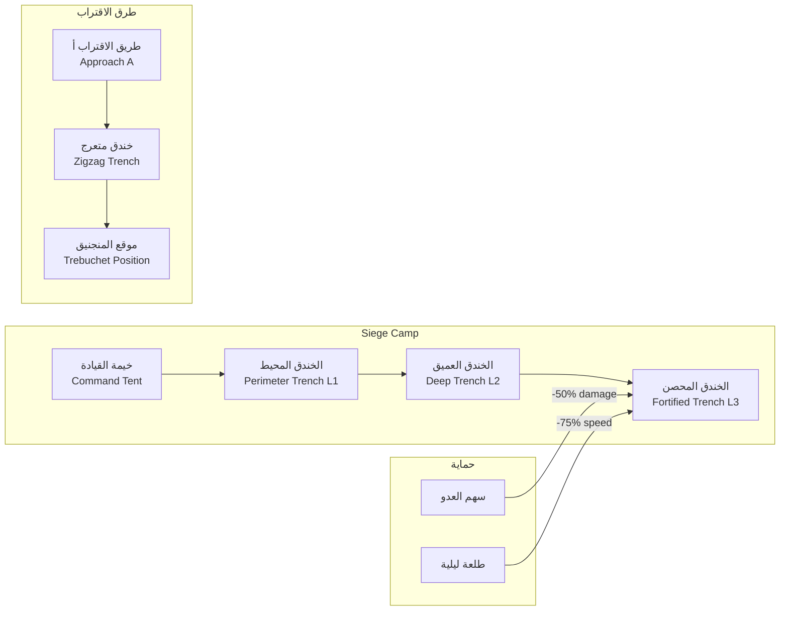
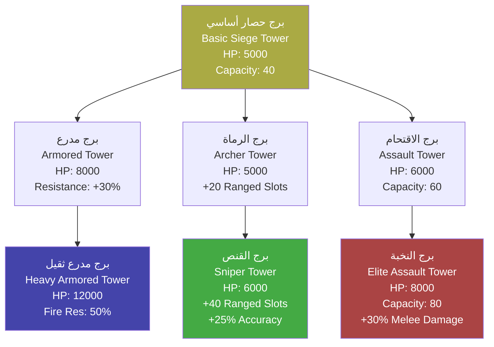

# منشآت الحصار — Besieging Structures

> **الهندسة العسكرية العثمانية في حصار بورصة — بناء الموانع والمعدات الحصاربة**

---

## 1. نظرة عامة — Overview

تعتبر منشآت الحصار العمود الفقري لأي حملة حصار ناجحة. في نظام حصار بورصة، يقوم اللاعب ببناء وتطوير شبكة معقدة من المنشآت الهجومية والدفاعية حول المدينة المحاصرة. تتراوح هذه المنشآت من الخنادق البسيطة إلى أبراج الحصار الضخمة التي يبلغ ارتفاعها 30 متراً.

كل منشأة لها:
- **تكلفة بناء** (مواد + عمل + وقت)
- **نقاط صحة (HP)** قابلة للتدمير من قبل المدافعين
- **مستويات تطوير (Tiers)** يمكن ترقيتها
- **طاقم تشغيل (Crew)** مطلوب للتشغيل

---

## 2. الخنادق — Trenches

### 2.1 نظرة عامة
الخنادق هي خط الدفاع الأول لمعسكر الحصار. تحمي الجنود والمعدات من طلقات العدو وطلعاته الليلية.

### 2.2 مستويات الخنادق — Trench Levels

#### المستوى 1: خندق ضحل — Shallow Trench
خندق سطحي بعمق متر واحد. يوفر حماية أساسية للمشاة.

| الخاصية | القيمة |
|---------|--------|
| HP | 200 |
| تكلفة البناء (Wood) | 100 وحدة |
| تكلفة البناء (Stone) | 0 |
| وقت البناء | 4 ساعات (1/6 يوم) |
| العمال المطلوبون | 10 |
| الحماية للمشاة | +20 دفاع |
| الحماية للخيول | لا |
| سرعة الحركة داخله | 75% من السرعة العادية |
| احتمال الانهيار | 0% (ضحل جداً) |
| مدى الرؤية داخله | 90% من الطبيعي |

#### المستوى 2: خندق عميق — Deep Trench
خندق بعمق 2.5 متر. يمكن للجنود الوقوف فيه دون أن تُرى رؤوسهم.

| الخاصية | القيمة |
|---------|--------|
| HP | 500 |
| تكلفة الترقية (Wood) | 250 وحدة |
| تكلفة الترقية (Stone) | 50 وحدة |
| وقت الترقية | 8 ساعات (1/3 يوم) |
| العمال المطلوبون | 20 |
| الحماية للمشاة | +50 دفاع |
| الحماية للخيول | خيول فقط إذا نزل الفارس |
| سرعة الحركة داخله | 60% من السرعة العادية |
| احتمال الانهيار | 5% (أمطار غزيرة ترفع إلى 15%) |
| مدى الرؤية داخله | 60% من الطبيعي |

#### المستوى 3: خندق محصن — Fortified Trench
خندق عميق مع تعزيزات خشبية وجدران ترابية. يوفر حماية ممتازة.

| الخاصية | القيمة |
|---------|--------|
| HP | 1200 |
| تكلفة الترقية (Wood) | 500 وحدة |
| تكلفة الترقية (Stone) | 200 وحدة |
| تكلفة الترقية (Iron) | 50 وحدة |
| وقت الترقية | 16 ساعة (2/3 يوم) |
| العمال المطلوبون | 30 |
| الحماية للمشاة | +100 دفاع |
| الحماية للرماة | +75 دفاع + 25% دقة |
| سرعة الحركة داخله | 50% من السرعة العادية |
| احتمال الانهيار | 3% |
| مدى الرؤية داخله | 50% من الطبيعي |

### 2.3 شبكة الخنادق — Trench Network

---

## 3. المتاريس الخشبية — Wooden Palisades

### 3.1 نظرة عامة
المتاريس الخشبية هي جدران خشبية محصنة تحمي معسكر الحصار. يمكن بناؤها بسرعة وتوفر حماية جيدة ضد هجمات المشاة.

### 3.2 أنواع المتاريس

| النوع | HP | تكلفة الخشب | وقت البناء | العمال | الطول | الحماية |
|-------|-----|------------|-----------|-------|-------|---------|
| متراس بسيط (Simple Palisade) | 300 | 150 | 3 ساعات | 8 جنود | 10 أمتار | +30 دفاع خلفه |
| متراس معزز (Reinforced Palisade) | 600 | 350 | 6 ساعات | 15 جندياً | 10 أمتار | +60 دفاع + غطاء للرماة |
| متراس محصن (Fortified Palisade) | 1200 | 600 + 100 حجر | 12 ساعة | 25 جندياً | 10 أمتار | +100 دفاع + أبراج مراقبة صغيرة |

### 3.3 مميزات إضافية
- **منصة رماية (Firing Step)**: يمكن للرماة الوقوف خلف المتراس وإطلاق السهام (+15% دقة)
- **بوابات المتراس (Palisade Gates)**: يمكن فتحها للسماح بطلعات العثمانيين
- **إصلاح المتراس**: يكلف 50 خشب و 30 دقيقة لكل 100 HP مستعادة

---

## 4. الدروع المتحركة — Mantlets

### 4.1 نظرة عامة
الدروع المتحركة (Mantlets) هي حواجز خشبية كبيرة على عجلات يستخدمها الجنود للتقدم نحو الأسوار تحت النيران.

### 4.2 أنواع الدروع المتحركة

| النوع | الحجم | HP | سرعة الحركة | الحماية | يكفي لـ | تكلفة الخشب | وقت البناء |
|-------|------|-----|-------------|---------|---------|------------|-----------|
| درع صغير (Small Mantlet) | 2×2 م | 400 | 100% سرعة الجندي | +40 دفاع | 4 جنود | 80 | 2 ساعة |
| درع متوسط (Medium Mantlet) | 3×3 م | 800 | 70% سرعة الجندي | +70 دفاع | 8 جنود | 200 | 4 ساعات |
| درع كبير (Large Mantlet) | 4×5 م | 1500 | 50% سرعة الجندي | +120 دفاع + غطاء علوي | 15 جندياً | 400 + 50 حديد | 8 ساعات |

### 4.3 آلية الاستخدام
1. يختار اللاعب وحدة المشاة
2. يأمرهم بدفع الدرع المتحرك (Click on Mantlet → "Push")
3. تتحرك الوحدة ببطء خلف الدرع نحو السور
4. تطلق أبراج السور النار على الدرع
5. عند وصول الدرع إلى السور، يمكن للجنود تسلق السلالم بأمان نسبي

---

## 5. أبراج الحصار — Siege Towers

### 5.1 نظرة عامة
أبراج الحصار هي هياكل خشبية ضخمة بارتفاع 30 متراً تستخدم لتسوية الارتفاع مع أسوار المدينة. يمكن للجنود العبور من البرج مباشرة إلى السور.

### 5.2 المواصفات الأساسية

| الخاصية | القيمة |
|---------|--------|
| الارتفاع | 30 متراً |
| الطول | 12 متراً × 8 أمتار عرضاً |
| HP الأساسي | 5000 |
| السعة | 40 جندياً (مشاة خفيفة) أو 25 (مشاة ثقيلة) |
| تكلفة البناء الأساسية | 2000 خشب + 500 حديد + 300 حبل |
| وقت البناء | 72 ساعة (3 أيام) |
| العمال المطلوبون | 60 |
| سرعة الحركة | 10% سرعة الجندي (بطيء جداً) |
| مقاومة النار | 20% (قابل للاشتعال) |

### 5.3 مسار التطوير — Upgrade Path

### 5.4 تفاصيل الترقيات

#### البرج المدرع — Armored Tower (تكلفة: 800 خشب + 300 حديد + 24 ساعة)
- يضيف صفائح حديدية للجوانب الأمامية
- يزيد HP من 5000 إلى 8000
- يقلل ضرر النار بنسبة 30%

#### برج الرماة — Archer Tower (تكلفة: 400 خشب + 200 حديد + 18 ساعة)
- يضيف طابقين إضافيين للرماة
- يزيد عدد فتحات الرماية من 10 إلى 20
- الرماة في البرج يحصلون على +25% مدى

#### برج الاقتحام — Assault Tower (تكلفة: 600 خشب + 150 حديد + 20 ساعة)
- يقوى الهيكل ليتحمل وزناً أكبر
- يزيد السعة من 40 إلى 60 جندياً
- يضيف منحدر هبوط أوسع

---

## 6. كبش الضرب — Battering Ram

### 6.1 نظرة عامة
الكبش هو أداة خشبية ثقيلة تستخدم لكسر البوابات. يتكون من جذع شجرة ضخم برأس حديدي يعلق في هيكل متحرك.

### 6.2 أنواع الكباش

#### الكبش القياسي — Standard Ram

| الخاصية | القيمة |
|---------|--------|
| HP | 2000 |
| ضرر ضد البوابات | 150/ضربة |
| سرعة الضرب | ضربة كل 5 ثوانٍ |
| الطاقم | 10 جنود |
| تكلفة البناء | 500 خشب + 150 حديد |
| وقت البناء | 12 ساعة |
| سرعة الحركة | 30% سرعة الجندي |
| غطاء علوي | سقف خشبي (+25 دفاع للطاقم) |

#### الكبش الثقيل — Heavy Ram

| الخاصية | القيمة |
|---------|--------|
| HP | 4000 |
| ضرر ضد البوابات | 300/ضربة |
| سرعة الضرب | ضربة كل 7 ثوانٍ |
| الطاقم | 20 جندياً |
| تكلفة البناء | 1200 خشب + 400 حديد |
| وقت البناء | 24 ساعة |
| سرعة الحركة | 20% سرعة الجندي |
| غطاء علوي | سقف حديدي (+50 دفاع للطاقم) |

### 6.3 حماية الطاقم
طاقم الكبش معرض لنيران المدافعين:
- **نار السهام العادية**: 30% فرصة إصابة الطاقم
- **الزيت المغلي**: 70% فرصة إصابة، 50-100 ضرر نار
- **رمي الحجارة**: 20% فرصة إصابة، 100-200 ضرر

---

## 7. المجانيق — Trebuchets

### 7.1 المنجنيق القياسي — Standard Trebuchet

| الخاصية | القيمة |
|---------|--------|
| HP | 3000 |
| الضرر ضد الأسوار | 200/قذيفة |
| الضرر ضد الوحدات | 75/قذيفة (نصف القطر 5م) |
| المدى | 100-300 متر |
| الدقة | 70% |
| وقت إعادة التحميل | 20 ثانية |
| الطاقم | 6 جنود |
| تكلفة البناء | 800 خشب + 300 حديد + 200 حبل |
| وقت البناء | 36 ساعة |

### 7.2 المنجنيق العملاق "الفاتح" — The Giant Trebuchet "Al-Fatih"
منجنيق أسطوري بني خصيصاً لحصار بورصة. سمي "الفاتح" تيمناً بالفتح القادم.

| الخاصية | القيمة |
|---------|--------|
| HP | 8000 |
| الضرر ضد الأسوار | 800/قذيفة |
| الضرر ضد الوحدات | 300/قذيفة (نصف القطر 10م) |
| المدى | 150-500 متر |
| الدقة | 85% |
| وقت إعادة التحميل | 45 ثانية |
| الطاقم | 12 جندياً |
| تكلفة البناء | 3000 خشب + 1500 حديد + 800 حبل + 500 حجر نادر |
| وقت البناء | 120 ساعة (5 أيام) |
| متطلبات خاصة | مهندس حصار Tier 3 + 1000 خبرة حصار |
| ذخيرة خاصة | قذائف حجرية عملاقة (Giant Stones) — ضرر +50% ضد الأبراج |

**ملاحظة تاريخية**: "الفاتح" هو منجنيج خيالي مستوحى من المجانيق العملاقة التي استخدمها العثمانيون لاحقاً في فتح القسطنطينية (1453). في السرد القصصي للعبة، يعتبر "الفاتح" أول تجربة عثمانية لبناء منجنيق فائق الحجم، وهي تجربة أفادتهم في حصارات المستقبل.

---

## 8. أنفاق الحفر — Sapping Tunnels

### 8.1 نظرة عامة
أنفاق الحفر (Sapping) هي أنفاق سرية تحفر تحت أسوار المدينة بهدف انهيارها. تعتبر من أخطر وأكثر طرق الحصار فعالية.

### 8.2 آلية الحفر — Digging Mechanics

| الخاصية | القيمة |
|---------|--------|
| سرعة الحفر الأساسية | 2 متر/ساعة |
| العمق المطلوب لانهيار السور | 15 متراً (يحتاج 7.5 ساعة حفر) |
| الطاقم المطلوب | 5 عمال (يمكن زيادته إلى 15 لتسريع 2x) |
| تكلفة الحفر | 50 خشب (لدعامات النفق) لكل 5 أمتار |
| احتمال الانهيار المبكر | 10% أساسي (يرتفع مع سوء التربة) |

### 8.3 احتمال الانهيار — Collapse Chance
يتأثر احتمال انهيار النفق بعوامل متعددة:

| العامل | التأثير على احتمال الانهيار |
|--------|---------------------------|
| نوع التربة (طين) | +15% |
| نوع التربة (صخرية) | -10% |
| أمطار غزيرة | +20% |
| زلزال (هجوم قوي على السور) | +25% |
| طاقم ذو خبرة (Tier 2) | -10% |
| طاقم ذو خبرة (Tier 3) | -20% |
| دعامات خشبية معززة | -15% |

### 8.4 اكتشاف النفق — Tunnel Detection
يمكن للمدافعين اكتشاف الأنفاق عبر:
- **أصوات الحفر**: تسمع على بعد 5 أمتار من السور (احتمال اكتشاف 10%/يوم)
- **أوعية الماء**: وضع أوعية ماء على السور — تموجات الماء تشير إلى حفر قريب
- **الجواسيس**: جواسيس المدينة يمكنهم إبلاغ قائد الحامية بمكان النفق
- **طلعة مضادة**: المدافعون يحفرون نفقاً مضاداً لاعتراض النفق العثماني

### 8.5 تأثير انهيار السور — Wall Collapse Effect
عند نجاح النفق وانهيار السور:
- ينهار قطاع كامل من السور (Segment HP يصبح 0)
- تموت جميع الوحدات الموجودة على ذلك القطاع (200-500 ضرر لكل وحدة)
- يُحدث فجوة بعرض 8 أمتار للاقتحام
- تنخفض معنويات المدافعين بمقدار -40
- ترتفع معنويات المهاجمين بمقدار +30

### 8.6 دفاعات ضد الأنفاق — Counter-Sapping
يمكن للمدافعين:
- حفر نفق مضاد (Counter-Tunnel) لاعتراض النفق العثماني
- إغراق النفق (إذا كان قريباً من مصدر ماء)
- بناء جدار أساسي تحت الأرض (Underground Wall) لمنع الحفر

---

## 9. جدول إجمالي للمنشآت — Master Structures Table

| المنشأة | HP | تكلفة الخشب | تكلفة الحديد | تكلفة الحجر | وقت البناء | العمال | Tier |
|---------|-----|------------|-------------|------------|-----------|-------|------|
| خندق ضحل (L1) | 200 | 100 | 0 | 0 | 4 ساعات | 10 | 1 |
| خندق عميق (L2) | 500 | 250 | 0 | 50 | 8 ساعات | 20 | 2 |
| خندق محصن (L3) | 1200 | 500 | 50 | 200 | 16 ساعة | 30 | 3 |
| متراس بسيط | 300 | 150 | 0 | 0 | 3 ساعات | 8 | 1 |
| متراس معزز | 600 | 350 | 0 | 0 | 6 ساعات | 15 | 2 |
| متراس محصن | 1200 | 600 | 0 | 100 | 12 ساعة | 25 | 3 |
| درع صغير | 400 | 80 | 0 | 0 | 2 ساعة | 4 | 1 |
| درع متوسط | 800 | 200 | 0 | 0 | 4 ساعات | 8 | 2 |
| درع كبير | 1500 | 400 | 50 | 0 | 8 ساعات | 15 | 3 |
| برج حصار أساسي | 5000 | 2000 | 500 | 0 | 72 ساعة | 60 | 2 |
| برج مدرع | 8000 | +800 | +300 | 0 | +24 ساعة | +10 | 3 |
| كبش قياسي | 2000 | 500 | 150 | 0 | 12 ساعة | 10 | 2 |
| كبش ثقيل | 4000 | 1200 | 400 | 0 | 24 ساعة | 20 | 3 |
| منجنيق قياسي | 3000 | 800 | 300 | 0 | 36 ساعة | 6 | 2 |
| "الفاتح" العملاق | 8000 | 3000 | 1500 | 500 | 120 ساعة | 12 | 4 |

---

## 10. مثال سيناريو: بناء معسكر الحصار قبل اقتحام بورصة

### الإعداد
يقرر أورهان بك بناء معسكر حصار متكامل جنوب شرق بورصة، على بعد 500 متر من الأسوار.

### المرحلة 1: الأيام 1-3 (التطويق الأولي)
- بناء 4 متاريس بسيطة لحماية محيط المعسكر (600 خشب، 12 ساعة)
- حفر خندق ضحل حول المعسكر (100 خشب، 4 ساعات)
- بناء خيمة القيادة ومخازن الإمدادات (واجهة، لا توجد إحصائيات)

### المرحلة 2: الأيام 4-10 (الإعداد للقصف)
- بناء منجنيقين قياسيين (1600 خشب + 600 حديد، 72 ساعة)
- تطوير الخندق إلى عميق (250 خشب، 8 ساعات)
- بناء مخزن ذخيرة لتخزين 500 قذيفة حجرية (400 خشب، 12 ساعة)

### المرحلة 3: الأيام 11-20 (القصف والتحضير للاقتحام)
- بناء برجي حصار أساسيين (4000 خشب + 1000 حديد، 72 ساعة لكل برج — يمكن البناء بالتوازي)
- بناء كبش ضرب قياسي (500 خشب + 150 حديد، 12 ساعة)
- بدء حفر نفق تحت السور الجنوبي الشرقي (يحتاج 7.5 ساعة حفر)

### المرحلة 4: الاقتحام
عند اكتمال البرجين وإحداث ثغرة في السور، يبدأ الهجوم النهائي على بورصة.

---

> **تاريخ آخر تحديث**: 2026-06-20
