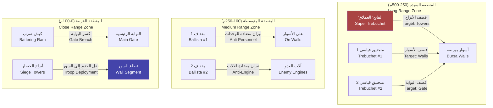

# مدفعية الحصار — Siege Artillery

> **آلات القصف العثمانية — من المجانيق إلى "الفاتح" العملاق**

---

## 1. نظرة عامة — Overview

تشكل مدفعية الحصار العمود الفقري لأي حملة حصار منهجية. في Season 6: حصار بورصة، يعتمد الجيش العثماني على آلات القصف الميكانيكية — المجانيق (Trebuchets) والمقاذيف (Ballistae) والكباش (Battering Rams) — لتدمير دفاعات المدينة وإحداث ثغرات للاقتحام.

تتنوع آلات القصف في:
- **نوع الضرر**: ضد الأسوار (Wall Damage)، ضد الوحدات (Anti-Personnel)، ضد الآلات (Anti-Engine)
- **المدى**: قريب (<100م)، متوسط (100-300م)، بعيد (>300م)
- **الدقة**: دقيقة (90%+)، متوسطة (70-89%)، غير دقيقة (<70%)
- **السرعة**: سرعة القصف (معدل إطلاق القذائف)

---

## 2. المنجنيق — Trebuchet

### 2.1 الوصف
المنجنيق (Trebuchet) هو سلاح القصف الثقيل الأساسي للعثمانيين. يستخدم ثقل موازن (Counterweight) لرمي قذائف حجرية بزاوية عالية، مما يسمح بإصابة الأهداف خلف الأسوار.

### 2.2 الإحصائيات الأساسية

| الخاصية | القيمة |
|---------|--------|
| HP | 3000 |
| الضرر ضد الجدران (Wall Damage) | 200/قذيفة |
| الضرر ضد الأبراج (Tower Damage) | 250/قذيفة |
| الضرر ضد الوحدات (Unit Damage) | 75-150 ضمن نصف قطر 5م |
| المدى الأدنى | 100 متر |
| المدى الأقصى | 300 متر |
| الدقة الأساسية | 70% |
| الدقة مع طاقم مدرب (Tier 3) | 85% |
| وقت إعادة التحميل | 20 ثانية |
| وقت إعادة التحميل (طاقم Tier 3) | 14 ثانية |
| عدد القذائف في الدقيقة | 3 |
| الطاقم المطلوب | 6 جنود (يمكن تشغيله بـ 4 بفعالية 60%) |
| نصف قطر الانفجار | 5 أمتار |
| تكلفة البناء | 800 خشب + 300 حديد + 200 حبل |
| زاوية القذف | 35-55 درجة |

### 2.3 أنواع القذائف — Ammo Types

#### القذيفة الحجرية — Stone Projectile
| الخاصية | القيمة |
|---------|--------|
| الوزن | 80-120 كجم |
| الضرر ضد الجدران | 200 |
| الضرر ضد الوحدات | 75-150 |
| احتمال كسر الحجر | 10% (تتحطم قبل الاصطدام) |
| تكلفة التصنيع | 30 حجر لكل قذيفة |
| تأثير إضافي | لا |

#### القذيفة النارية — Fire Projectile (Incendiary)
قذيفة حجرية ملفوفة بالقماش المشبع بالزيت والكبريت. تشتعل عند الإطلاق.

| الخاصية | القيمة |
|---------|--------|
| الوزن | 90-110 كجم |
| الضرر ضد الجدران | 150 + 50 ضرر نار (Damge over Time: 20/ثانية لمدة 10 ثوانٍ) |
| الضرر ضد الوحدات | 100-200 ضرر نار |
| الضرر ضد المباني الخشبية | 300 ضعف (!) |
| احتمال إشعال حريق | 40% لكل مبنى خشبي في نصف القطر |
| تكلفة التصنيع | 30 حجر + 10 زيت + 5 قماش |
| تأثير إضافي | يخفض معنويات المدافعين -5 عند إصابة منطقة مأهولة |

#### القذيفة المسممة — Diseased Carcass Projectile (Biological Warfare)
جثة حيوان نافقة ملفوفة بالسموم والمواد المتحللة. تهدف إلى نشر الأمراض داخل المدينة.

| الخاصية | القيمة |
|---------|--------|
| الوزن | 70-90 كجم |
| الضرر ضد الجدران | 50 (خفيف — غير مصممة لكسر الجدران) |
| الضرر ضد الوحدات | 10 مباشر + 50 ضرر سم (Poison DoT: 5/ثانية لمدة 10 ثوانٍ) |
| احتمال نشر الطاعون | 30% — إذا نجح، ينتشر الطاعون في المنطقة |
| تأثير الطاعون | -20% صحة سكان المنطقة، -10% معنويات يومياً، -5% غذاء (موت العمال) |
| مدة تأثير الطاعون | 7-14 يوماً (يمكن علاجه بالطب) |
| تكلفة التصنيع | 10 حجر + 1 جثة + 5 سم |
| تأثير إضافي | ينقص معنويات المدافعين -15 — رعب نفسي شديد |

**ملاحظة أخلاقية**: في سياق اللعبة، استخدام القذائف المسممة هو خيار مظلم (Dark Choice) يؤثر على تطور الدولة العثمانية في الحملات المستقبلية. استخدامه يمنح مكافآت تكتيكية فورية لكنه يخفض سمعة العثمانيين الدوليين.

---

## 3. المقذاف — Ballista

### 3.1 الوصف
المقذاف (Ballista) هو سلاح قوس عملاق يطلق سهاماً خشبية ضخمة. يستخدم ضد الوحدات (Anti-Personnel) بشكل أساسي، ويمكنه أيضاً استهداف آلات الحصار المعادية.

### 3.2 الإحصائيات الأساسية

| الخاصية | القيمة |
|---------|--------|
| HP | 1500 |
| الضرر ضد الوحدات (Unit Damage) | 100-200/قذيفة (يخترق 3 وحدات في خط مستقيم) |
| الضرر ضد الآلات (Engine Damage) | 75/قذيفة |
| المدى الأقصى | 250 متر |
| الدقة | 85% (أفضل من المنجنيق) |
| الدقة مع طاقم مدرب | 92% |
| وقت إعادة التحميل | 10 ثوانٍ |
| عدد القذائف في الدقيقة | 6 |
| الطاقم المطلوب | 3 جنود |
| تكلفة البناء | 400 خشب + 200 حديد + 100 حبل |
| زاوية القذف | 0-15 درجة (شبه مستقيم) |

### 3.3 أنواع الذخيرة — Ballista Ammo

#### السهم العادي — Standard Bolt
| الخاصية | القيمة |
|---------|--------|
| الضرر | 100-200 للهدف الأول، 50-100 للهدف الثاني، 25-50 للهدف الثالث |
| الاختراق | يخترق 3 وحدات كحد أقصى |
| التكلفة | 10 خشب + 5 حديد لكل سهم |

#### السهم الناري — Flaming Bolt
| الخاصية | القيمة |
|---------|--------|
| الضرر المباشر | 75-150 |
| ضرر النار الإضافي | 30/ثانية لمدة 8 ثوانٍ |
| احتمال إشعال حريق | 25% ضد المباني الخشبية |
| التكلفة | 10 خشب + 5 حديد + 5 زيت |

#### حربة المقذاف — Harpoon Bolt
سهم برأس حربة عريض يثبت في الهدف ويسحبه.

| الخاصية | القيمة |
|---------|--------|
| الضرر | 150-250 (للأهداف الكبيرة: +50) |
| تأثير خاص | يبطئ الهدف -30% سرعة لمدة 3 ثوانٍ |
| ضد الفرسان | يطرح الفارس من حصانه (Knockdown) |
| التكلفة | 10 خشب + 15 حديد (مكلف) |
| الاستخدام المثالي | ضد أبراج الحصار والكباش |

---

## 4. كبش الضرب — Battering Ram

(تم شرحه بالتفصيل في ملف 02، لكن نضيف هنا تفاصيل القتال)

| الخاصية | كبش قياسي (Standard Ram) | كبش ثقيل (Heavy Ram) |
|---------|------------------------|---------------------|
| ضرر ضد البوابات | 150/ضربة | 300/ضربة |
| ضرر ضد الجدران | 30/ضربة (غير فعال) | 60/ضربة (غير فعال) |
| ضرر ضد الوحدات | 75/ضربة (يدفعهم جانباً) | 150/ضربة (يسحقهم) |
| سرعة الضرب | 5 ثوانٍ | 7 ثوانٍ |
| اختراق البوابة (عدد الضربات لبوابة خشبية HP 2000) | 14 ضربة (~70 ثانية) | 7 ضربات (~49 ثانية) |

---

## 5. طاقم التشغيل — Crew Requirements

### 5.1 متطلبات الطاقم لكل آلة

| الآلة | الحد الأدنى للطاقم | الطاقم الأمثل | طاقم Tier 1 | طاقم Tier 2 | طاقم Tier 3 |
|-------|-------------------|--------------|------------|------------|------------|
| منجنيق | 4 | 6 | 60% فعالية | 80% فعالية | 100% فعالية |
| مقذاف | 2 | 3 | 65% فعالية | 85% فعالية | 100% فعالية |
| كبش ضرب | 8 | 10 | 70% فعالية | 85% فعالية | 100% فعالية |
| "الفاتح" | 8 | 12 | 50% فعالية | 75% فعالية | 100% فعالية |

### 5.2 تأثير خبرة الطاقم — Crew Experience Effects

| الخبرة | سرعة إعادة التحميل | الدقة | الضرر | فرصة الأعطال |
|--------|-------------------|-------|-------|-------------|
| Tier 1 (غير مدرب) | 100% الوقت الأساسي | -15% دقة | -10% ضرر | 10% |
| Tier 2 (مدرب) | 85% الوقت الأساسي | 0% | 0% | 5% |
| Tier 3 (خبير) | 70% الوقت الأساسي | +15% دقة | +15% ضرر | 2% |

### 5.3 تدريب الطاقم
يمكن تدريب الطاقم عبر:
- **الخبرة الميدانية**: كل 50 قذيفة تطلق تزيد خبرة الطاقم بمقدار 1 (مستوى Tier 2 يحتاج 100 قذيفة، Tier 3 يحتاج 300)
- **التدريب في المعسكر**: 3 أيام تدريب تحول الطاقم من Tier 1 إلى Tier 2
- **مهندس حصار**: وجود مهندس حصار (Siege Engineer) مع الطاقم يضاعف سرعة اكتساب الخبرة

---

## 6. نيران الرد — Counter-Battery Fire

### 6.1 آلية نيران الرد
عندما تطلق آلات الحصار العثمانية النار على أسوار بورصة، قد ترد المدافع البيزنطية بنيران مضادة تهدف إلى تدمير آلات الحصار.

### 6.2 احتمالية نيران الرد

| مستوى دفاع المدينة | احتمال الرد | الآلات المستهدفة |
|-------------------|------------|-----------------|
| دفاعات ضعيفة (<25%) | 10% | أي آلة في المدى |
| دفاعات متوسطة (25-50%) | 25% | المنجنيق أولاً |
| دفاعات قوية (50-75%) | 40% | المنجنيق + المقذاف |
| دفاعات كاملة (>75%) | 60% | جميع الآلات |

### 6.3 أنواع المدافع المضادة

#### المنجنيق الدفاعي (Defensive Trebuchet)
| الخاصية | القيمة |
|---------|--------|
| العدد (بورصة) | 3 |
| HP لكل منها | 4000 |
| الضرر ضد آلات الحصار | 150/قذيفة |
| الدقة ضد الآلات | 50% (أقل دقة لأنها تطلق من خلف الأسوار) |
| المدى | 350 متر |

#### قاذف السهام الدفاعي (Defensive Ballista)
| الخاصية | القيمة |
|---------|--------|
| العدد (بورصة) | 5 |
| HP لكل منها | 2000 |
| الضرر ضد طاقم الآلات | 100-200 |
| الدقة ضد الطاقم | 70% |
| المدى | 200 متر |

### 6.4 حماية آلات الحصار
يمكن حماية آلات الحصار من نيران الرد عبر:
- **الخنادق المحصنة**: تقلل ضرر القذائف بنسبة -40%
- **الأكياس الرملية (Sandbags)** حول الآلة: +250 HP للآلة
- **الغطاء الترابي (Earth Mound)**: +500 HP للآلة — لكن يبني لمدة 12 ساعة
- **شبكة التمويه (Camouflage Netting)**: تقلل احتمال اكتشاف الآلة بنسبة -25%

---

## 7. "الفاتح" — المنجنيق العملاق الأسطوري

### 7.1 قصة "الفاتح"
"الفاتح" (Al-Fatih — The Conqueror) هو منجنيق عملاق بناه المهندس العثماني "إبراهيم الحصاري" خصيصاً لحصار بورصة. اسمه يرمز إلى الفتح القادم (Fateh — فتح) وكان أول تجربة عثمانية لبناء منجنيق بهذا الحجم.

### 7.2 الإحصائيات الفريدة

| الخاصية | القيمة |
|---------|--------|
| HP | 8000 |
| الضرر ضد الجدران | 800/قذيفة |
| الضرر ضد الأبراج | 1000/قذيفة |
| الضرر ضد الوحدات | 300-600 ضمن نصف قطر 10م |
| المدى | 150-500 متر |
| الدقة | 85% |
| الوقت بين القذائف | 45 ثانية |
| الطاقم المطلوب | 12 جندياً + مهندس حصار |
| الوزن الإجمالي | 25 طناً |
| ارتفاع المنجنيق | 18 متراً |
| طول الذراع | 15 متراً |
| وزن الثقل الموازن | 10 أطنان |
| وزن القذيفة | 200-300 كجم |

### 7.3 متطلبات البناء

| المورد | الكمية |
|--------|--------|
| خشب (Wood) | 3000 |
| حديد (Iron) | 1500 |
| حبل (Rope) | 800 |
| حجر نادر (Special Stone) | 500 |
| وقت البناء | 120 ساعة (5 أيام) |
| خبرة مهندس الحصار | Tier 3 على الأقل |
| خبرة حصار إجمالية | 1000+ نقطة |

### 7.4 الذخيرة الخاصة

#### القذيفة العملاقة — Giant Stone
| الخاصية | القيمة |
|---------|--------|
| الوزن | 250 كجم |
| الضرر ضد الجدران | 800 |
| الضرر ضد الأبراج | 1200 (مضاعف ضد الأبراج!) |
| نصف قطر التدمير | 12 متراً |
| احتمال انهيار قطاع كامل من السور | 15% (بقذيفة واحدة) |

#### القذيفة الحارقة العملاقة — Giant Fire Stone
| الخاصية | القيمة |
|---------|--------|
| الوزن | 220 كجم (وزن أقل بسبب إضافة الزيت) |
| الضرر ضد الجدران | 600 + 100 ضرر نار (DoT 50/ثانية لمدة 10 ثوانٍ) |
| نصف قطر الحريق | 15 متراً — يشتعل كل شيء في المنطقة |
| احتمال إشعال حريق كبير | 70% |
| احتمال إشعال برج | 85% |

#### ذخيرة الحدث — Event Ammo: "حجر الفتح" (Stone of Conquest)
قذيفة خاصة تُستخدم مرة واحدة فقط، تظهر في حدث قصصي أثناء حصار بورصة.
- **الضرر**: 2000 ضد أي هدف
- **التأثير**: يضمن انهيار قطاع السور المستهدف فوراً
- **التكلفة**: مجانية (قصة)
- **التوقيت**: الجولة 18+ من الحصار (عندما يصل الحصار إلى ذروته الدرامية)

### 7.5 الأهمية السردية — Narrative Significance
"الفاتح" ليس مجرد سلاح — إنه رمز لطموح الدولة العثمانية الناشئة. بناؤه يتطلب استثماراً هائلاً من الموارد، لكنه يختصر أسابيع من القصف. في السرد، يظهر "الفاتح" كدليل على أن العثمانيين بدأوا يفكرون كدولة إمبراطورية، وليس كإمارة صغيرة.

---

## 8. إدارة الذخيرة — Ammo Management UI

### 8.1 واجهة إدارة الذخيرة
تظهر واجهة إدارة الذخيرة عند النقر على أي آلة حصار، وتعرض:

```
═══════════════════════════════════════
  إدارة الذخيرة — Ammo Management
═══════════════════════════════════════
  
  [المنجنيق 1 — Trebuchet #1]
  
  ┌─ الذخيرة المتاحة ──────────────────┐
  │ ● حجر (Stone):         45 قذيفة    │
  │ ● نار (Fire):          20 قذيفة    │
  │ ● مسمم (Diseased):      5 قذيفة    │
  └─────────────────────────────────────┘
  
  ┌─ إنتاج الذخيرة ────────────────────┐
  │  ورشة حجر: +5 قذائف/يوم            │
  │  ورشة نار: +2 قذيفة/يوم            │
  │  [تسريع الإنتاج] (يكلف 50 ذهب)     │
  └─────────────────────────────────────┘
  
  [تغيير نوع القذيفة: ▼]
═══════════════════════════════════════
```

### 8.2 إنتاج الذخيرة
- **القذائف الحجرية**: تنتج في ورشة الحجر (Stone Workshop) — 5 قذائف/يوم
- **القذائف النارية**: تنتج في ورشة النار (Fire Workshop) — 2 قذيفة/يوم (تتطلب زيت)
- **القذائف المسممة**: تنتج في خيمة خاصة (Special Workshop) — 1 قذيفة/يومين (تتطلب جثثاً وسموماً)

---

## 9. تموضع المدفعية — Artillery Placement



---

## 10. ملاحظات التوازن — Balance Notes

### 10.1 فعالية التكلفة (Cost Efficiency)

| الآلة | تكلفة البناء | الضرر/دقيقة (معدل) | فعالية التكلفة (ضرر لكل 100 وحدة مورد) |
|-------|-------------|-------------------|--------------------------------------|
| منجنيق قياسي | 1300 | 600 (3 قذائف × 200) | 46.15 |
| منجنيق ناري | 1300 + وقود | 450 + 200 DoT | 50+ |
| مقذاف | 700 | 900 (6 سهام × 150) | 128.6 (لكن لا يضر الجدران) |
| كبش قياسي | 650 | 1800 (12 ضربة × 150) | 276.9 (لكن يحتاج الوصول للبوابة) |
| "الفاتح" | 5300 | 1067 (1.33 قذيفة × 800) | 20.1 (منخفض لكن الضرر مركز) |

### 10.2 نصائح للاعبين
1. **لا تهمل المقاذيف**: رغم أنها لا تضر الجدران، فإنها تحمي آلات الحصار من طلعات المدافعين
2. **نوع القذائف**: استخدم القذائف النارية ضد الأبراج الخشبية والقذائف الحجرية ضد الجدران الحجرية
3. **حماية "الفاتح"**: كونه أغلى آلة في اللعبة، أحط بعدة طبقات من الخنادق والمتاريس
4. **توقيت القصف**: القصف ليلاً أقل دقة (-20%) لكنه يخفض معنويات المدافعين أكثر (-5 إضافية)

### 10.3 موازنة المطورين — Developer Balancing
- يجب ألا تكون المجانيق قوية جداً لدرجة أن الحصار ينتهي بسرعة
- يجب أن يواجه اللاعب معضلة: بناء آلات متعددة أم آلة واحدة قوية
- طلعات المدافعين الليلية يجب أن تشكل تهديداً حقيقياً لآلات الحصار
- "الفاتح" يجب أن يكون ممتعاً ومكافئاً، لكن ليس إجباريًا لإكمال الحصار

---

> **تاريخ آخر تحديث**: 2026-06-20
