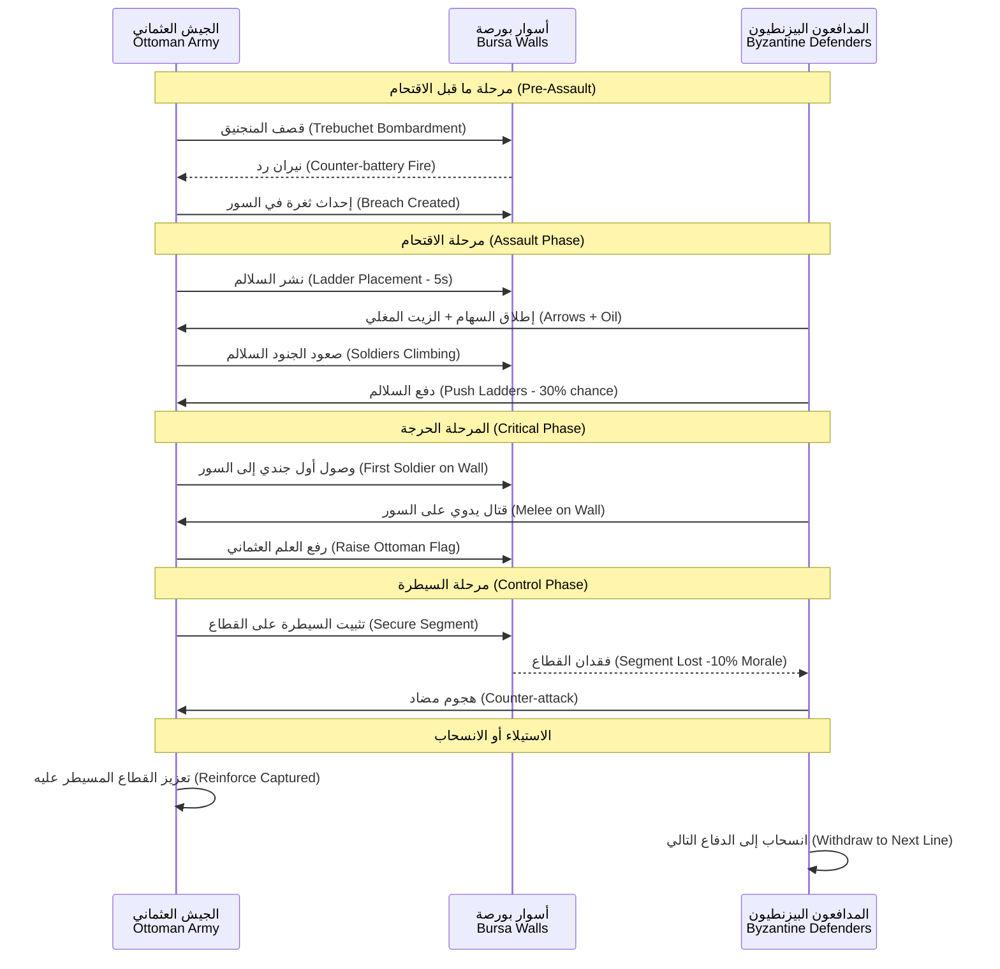

# القتال على الأسوار — Wall Combat

> **اقتحام أسوار بورصة — من السلالم إلى الزيت المغلي — دماء على الحجارة**

---

## 1. نظرة عامة — Overview

القتال على الأسوار هو ذروة حرب الحصار. بعد أسابيع من القصف والحفر، يصل اللاعب إلى اللحظة الحاسمة — اقتحام جدران بورصة. يتميز هذا النظام بتفاصيل دقيقة تحاكي التحديات الحقيقية للقتال على الأسوار في العصور الوسطى: صعود السلالم تحت نيران العدو، صد هجمات المدافعين بالزيت المغلي، والقتال اليدوي على قمم الجدران.

---

## 2. تسلق السلالم — Ladder Climbing

### 2.1 آلية التسلق
السلالم (Siege Ladders) هي أبسط وأسرع طريقة لصعود الأسوار، لكنها الأكثر خطورة.

**نشر السلالم (Ladder Placement)**:
1. تصل وحدة المشاة إلى قاعدة السور
2. ينشر 4 جنود السلالم (يستغرق 5 ثوانٍ — الجنود عرضة للنيران خلال هذه الفترة)
3. يبدأ الجنود في صعود السلالم

**خصائص السلالم**:

| الخاصية | القيمة |
|---------|--------|
| الطول | 8-15 متراً (حسب ارتفاع السور) |
| HP | 500 (يمكن تدميرها) |
| سعة التسلق | 3 جنود في وقت واحد |
| وقت الصعود لكل جندي | 3 ثوانٍ |
| عرضة للنيران أثناء الصعود | نعم — -75% درع |
| يمكن دفعها من الأعلى | نعم — فرصة 30% لكل مدافع |
| تكلفة البناء | 50 خشب لكل 5 سلالم |
| عدد السلالم المطلوبة لهجوم واسع | 8-12 سهماً لكل قطاع |

### 2.2 وحدات التسلق — Climbing Units

| نوع الوحدة | سرعة التسلق | فعالية القتال على السور | فرصة السقوط |
|-----------|------------|----------------------|------------|
| مشاة خفيفة (Light Infantry) | 2.5 ثانية | +50% فعالية | 10% |
| مشاة ثقيلة (Heavy Infantry) | 4.5 ثانية | -30% فعالية | 30% |
| رماة (Archers) | 3 ثوانٍ | +25% دقة على السور | 15% |
| نخبة (Elite/Janissary-like) | 2 ثانية | +75% فعالية | 5% |

### 2.3 خطر السلم — Ladder Hazards

عند صعود السلم، يواجه الجنود:
1. **نيران المدافعين**: سهام وزيت مغلي
2. **دفع السلم**: مدافع يمكنه دفع السلم للخلف (30% فرصة لكل مدافع على القطاع)
3. **كسر السلم**: إذا انخفض HP السلم إلى 0، ينهار ويموت الجنود الذين عليه
4. **السقوط**: إصابة جندي على السلم قد تسبب سقوطه (وضرب من يتحته)

---

## 3. الزيت المغلي — Boiling Oil

### 3.1 آلية الزيت المغلي
الزيت المغلي (Boiling Oil) هو أحد أسلحة الدفاع الأكثر فتكاً. يوضع في مراجل (Cauldrons) على طول السور ويُسكب على المهاجمين عند الاقتراب.

### 3.2 مراجل الزيت — Oil Cauldrons

| الخاصية | القيمة |
|---------|--------|
| HP للمرجَل | 300 |
| سعة الزيت | 100 لتر |
| عدد المراجل في كل قطاع | 2-4 (حسب تحصين القطاع) |
| الضرر لكل سكب | 200-400 (+ 50 ضرر نار DoT لمدة 5 ثوانٍ) |
| نصف القطر | 5 أمتار × 3 أمتار عرضاً |
| أضرار إضافية | يلغي الدروع (+300% ضرر ضد المدرعين) |
| التبريد (Cooldown) | 60 ثانية لإعادة التسخين |
| تكلفة ملء المرجل | 50 زيت (يجب إنتاجه أو استيراده) |

### 3.3 استراتيجيات الزيت
- **لمدافع**: احفظ الزيت للهجمات الكبيرة — لا تستخدمه ضد وحدات صغيرة
- **للمهاجم**: استهدف المراجل بالمقاذيف (Ballistae) قبل الاقتحام — تدمير المرجل يمنع استخدامه
- **توقيت السكب**: أفضل توقيت هو عندما تكون وحدات العدو مزدحمة عند قاعدة السور

### 3.4 الزيت المغلي ضد آلات الحصار
| الآلة | تأثير الزيت المغلي |
|-------|-------------------|
| سلم الحصار | يدمر السلم فوراً (HP -500) |
| برج الحصار | 100-200 ضرر + فرصة 20% لاشتعال النار |
| كبش الضرب | 75-150 ضرر للطاقم (يخترق الغطاء) |
| درع متحرك | 200-300 ضرر (يحرق الخشب) |

---

## 4. فتح الثغرات — Breach Assaults

### 4.1 آلية الاقتحام عبر الثغرات
عند انهيار قطاع من السور (HP = 0 أو انهيار ناجح للنفق)، تتشكل ثغرة (Breach) بعرض 8-12 متراً. يمكن للجنود الاقتحام من خلالها.

### 4.2 صعوبة الاقتحام

| عرض الثغرة | صعوبة الاقتحام | فرصة النجاح لكل موجة | المدافعون المحتملون |
|-----------|---------------|---------------------|-------------------|
| ضيقة (<4م) | صعب جداً | 20% | 20-30 مدافعاً |
| متوسطة (4-8م) | صعب | 40% | 10-20 مدافعاً |
| واسعة (8-12م) | متوسط | 60% | 5-15 مدافعاً |
| منهارة بالكامل (>12م) | سهل | 80% | 0-10 مدافعين |

### 4.3 إغلاق الثغرة — Breach Repair
يمكن للمدافعين إغلاق الثغرة بمتاريس مؤقتة (Hasty Barricades):
- **وقت البناء**: 30 ثانية (إذا كان هناك مدافعون)
- **HP للمتراس**: 1000
- **يمكن تدميره**: نعم — بالمقاذيف أو الهجمات المباشرة

---

## 5. الاستيلاء على قطاعات السور — Wall Capture

### 5.1 نظام الأعلام — Flag System
ينقسم كل سور إلى قطاعات (Segments). كل قطاع له علم (Flag) يحدد من يسيطر عليه:

```
[المعسكر العثماني] 
    │
    ▼
┌────┬────┬────┬────┬────┬────┬────┬────┐
│ S1 │ S2 │ S3 │ S4 │ S5 │ S6 │ S7 │ S8 │  ← قطاعات السور (8 قطاعات)
│ 🟢 │ 🟢 │ 🟡 │ 🔴 │ 🔴 │ 🔴 │ 🔴 │ 🔴 │  ← ألوان السيطرة
└────┴────┴────┴────┴────┴────┴────┴────┘
     │     │                                 
     │     └─ 🟡 تحت الهجوم (Contested)
     │     
     └─ 🟢 مسيطر عليه عثمانياً (Captured)

🔴 = بيزنطي (Byzantine)
🟡 = متنازع عليه (Contested)
🟢 = عثماني (Ottoman)
```

### 5.2 آلية السيطرة على القطاعات
1. تصل وحدات عثمانية إلى قطاع من السور (بالسلالم أو الأبراج أو الثغرة)
2. تبدأ معركة على القطاع — كلما زاد عدد الوحدات العثمانية مقابل البيزنطية، زادت سرعة تغيير العلم
3. عند اكتمال تغيير العلم (3:1 نسبة القوات، لمدة 10 ثوانٍ مستمرة)، يتحول القطاع إلى العثمانيين
4. القطاع المسيطر عليه يمنح مكافآت:
   - نقطة إعادة انتشار (Spawn Point) للوحدات العثمانية
   - -10% معنويات للمدافعين (لكل قطاع يتم الاستيلاء عليه)
   - نقاط نحو النصر الإجمالي في الحصار

### 5.3 مكافآت السيطرة على الأسوار

| عدد القطاعات المسيطر عليها | المكافأة |
|---------------------------|----------|
| 2 قطاعات | فتح بوابة صغيرة (Postern Gate) |
| 4 قطاعات | -20% معنويات المدافعين + فتح البوابة الرئيسية |
| 6 قطاعات | استسلام وشيك — +30% فرصة استسلام يومي |
| 8 قطاعات (كل الأسوار) | النصر — انهيار الدفاعات بالكامل |

---

## 6. أبراج السهام — Arrow Towers

### 6.1 الوصف
أبراج السهام (Arrow Towers) هي أبراج دفاعية تطلق السهام تلقائياً على الوحدات المعادية في مداها.

### 6.2 إحصائيات أبراج بورصة

| البرج | HP | الضرر/ثانية | المدى | التغطية | طاقم |
|-------|-----|------------|-------|---------|------|
| برج زاوية (Corner Tower) | 6000 | 25-40 | 150م | 270° (3 اتجاهات) | 10 رماة |
| برج رئيسي (Main Tower) | 8000 | 35-50 | 180م | 360° (4 اتجاهات) | 15 رماة |
| برج بوابة (Gate Tower) | 4000 | 20-30 | 120م | 180° (اتجاهان) | 8 رماة |
| برج صغير (Small Tower) | 3000 | 15-25 | 100م | 180° | 5 رماة |

### 6.3 تدمير الأبراج
- الأبراج هي الأولوية القصوى للمجانيق (Trebuchets)
- عند تدمير برج، يفقد المدافعون مصدر نيران قيم
- يمكن للمدافعين إصلاح الأبراج (50 حجر/ثانية، حتى 200 HP/ثانية)

### 6.4 ترقية الأبراج (للمدافع — AI)
يمكن للمدافع (AI) ترقية الأبراج:
| الترقية | التكلفة | التأثير |
|---------|---------|---------|
| تعزيز الجدران | 200 حجر | +2000 HP للبرج |
| رماة إضافيون | 50 ذهب | +5 رماة للبرج |
| سهام حارقة | 20 زيت | +10 ضرر نار/ثانية |
| غطاء حجري | 300 حجر | -50% ضرر من المجانيق |

---

## 7. الدفاع عن البوابات — Gate Defense

### 7.1 أنواع البوابات

| البوابة | HP | مستوى التحصين | وقت الكسر بالكبش القياسي | وقت الإصلاح |
|---------|-----|--------------|----------------------|------------|
| بوابة خشبية (Wooden Gate) | 2000 | ضعيف | 14 ضربة (~70 ثانية) | 30 ثانية |
| بوابة معززة (Reinforced Gate) | 4000 | متوسط | 27 ضربة (~135 ثانية) | 45 ثانية |
| بوابة حديدية (Iron Gate) | 7000 | قوي | 47 ضربة (~235 ثانية) | 60 ثانية |
| بوابة منزلقة (Portcullis) | 5000 | قوي جداً | 34 ضربة (~170 ثانية) | لا يمكن إصلاحها |

### 7.2 إصلاح البوابات
يمكن للمدافعين إصلاح البوابات أثناء تعرضها للهجوم:
- **تكلفة الإصلاح**: 20 خشب + 10 حجر كل 500 HP
- **سرعة الإصلاح**: 100 HP/ثانية لكل 5 عمال
- **خطر الإصلاح**: العمال معرضون لنيران المقاذيف العثمانية

### 7.3 حرق البوابات
يمكن استخدام القذائف النارية لإشعال البوابات الخشبية:
- **احتمال الاشتعال**: 40% لكل قذيفة نارية تصيب البوابة
- **ضرر الحريق**: 50/ثانية لمدة 20 ثانية
- **إطفاء الحريق**: يمكن للمدافعين إطفاء الحريق بـ 10 جنود لمدة 10 ثوانٍ

---

## 8. فعالية الوحدات على الأسوار — Unit Effectiveness

### 8.1 معدلات الفعالية

| نوع الوحدة | على الأرض | على السور (هجوم) | على السور (دفاع) | تسلق سلالم |
|-----------|----------|----------------|-----------------|-----------|
| مشاة خفيفة | 100% | 150% (+50%) | 100% | 100% |
| مشاة ثقيلة | 100% | 70% (-30%) | 130% (+30%) | 50% (-50%) |
| رماة | 100% | 125% (+25%) | 150% (+50%) | 80% (-20%) |
| رماح (Spearmen) | 100% | 110% (+10%) | 140% (+40%) | 60% (-40%) |
| نخبة (Elite) | 100% | 175% (+75%) | 150% (+50%) | 120% (+20%) |
| مدافع (Swordsman) | 100% | 120% (+20%) | 120% (+20%) | 90% (-10%) |

### 8.2 سبب الفروق
- **المشاة الخفيفة**: أخف وزناً، أسرع حركة على الأسوار، توازن أفضل
- **المشاة الثقيلة**: دروع ثقيلة تعيق الحركة على الأسوار الضيقة، لكنها ممتازة في الدفاع
- **الرماة**: موقع مرتفع يمنحهم أفضلية في الرماية، لكنهم ضعفاء في القتال اليدوي
- **النخبة**: مدربون على جميع أنواع القتال — أفضل وحدات الأسوار

---

## 9. المكافآت الدفاعية — Defensive Bonuses

### 9.1 أفضليات الارتفاع — Height Advantage
الوحدات على الأسوار تحصل على مكافآت ضد الوحدات في الأسفل:

| المكافأة | القيمة |
|---------|--------|
| ضرر إضافي (مهاجم من أعلى) | +25% |
| دقة رماية (من أعلى) | +20% |
| مدى الرماية (من أعلى) | +15% |
| درع (من الأعلى — غطاء شبه كامل) | +30% |

### 9.2 الغطاء — Cover
أسوار بورصة توفر أنواعاً مختلفة من الغطاء:

| نوع الغطاء | مكافأة الدفاع | ملاحظات |
|-----------|--------------|---------|
| شُرُفات (Battlements/Crenellations) | +75 درع | غطاء كامل للجندي القرفصاء |
| أبراج | +100 درع | غطاء شبه كامل |
| فتحات الرماية (Arrow Slits) | +150 درع | غطاء كامل + مجال رماية |
| لا غطاء (على السور بدون شُرُفات) | 0 | الوضع الأكثر خطورة |

### 9.3 فتحات القتل — Murder Holes
فتحات في السقف فوق البوابات يمكن من خلالها إلقاء المقذوفات على المهاجمين:

| الخاصية | القيمة |
|---------|--------|
| الضرر لكل إلقاء | 100-200 |
| نوع الضرر | خارق + سحق |
| الهدف | الوحدات تحت البوابة مباشرة |
| إعادة الاستخدام | 15 ثانية |

---

## 10. السقوط من الأسوار — Falling Damage

### 10.1 آلية السقوط
عند إصابة جندي على حافة السور، هناك احتمال أن يسقط.

### 10.2 معادلة السقوط
```
Fall_Chance = Base_Chance (15%) × Weight_Factor × Hit_Stagger
```

### 10.3 عوامل السقوط

| العامل | التأثير |
|--------|---------|
| وزن الوحدة (خفيف) | +10% فرصة السقوط |
| وزن الوحدة (ثقيل) | -15% فرصة السقوط |
| ضربة قوية (Stagger) | +40% فرصة السقوط |
| صاعق (Knockback) | +60% فرصة السقوط |
| قرب الحافة | +0-30% (حسب القرب) |
| درع ثقيل يمنع السقوط؟ | لا — لكن يقلل ضرر السقوط |

### 10.4 ضرر السقوط

| ارتفاع السقوط | الضرر | النتيجة |
|--------------|-------|---------|
| 0-5 أمتار (سور منخفض) | 50-100 | إصابة طفيفة |
| 5-10 أمتار (سور متوسط) | 150-300 | إصابة خطيرة |
| 10-15 متراً (سور عالي) | 300-500 | إصابة قاتلة غالباً |
| 15+ متراً (برج عالي) | 500-1000 | موت شبه مؤكد |

صيغة ضرر السقوط:
```
Fall_Damage = Height × 20 + Random(0, Height × 10)
```

---

## 11. تسلسل اقتحام الأسوار — Wall Assault Sequence



---

## 12. مثال: اقتحام الأسوار الداخلية لبورصة — Final Breach

### الموقف
بعد 6 أشهر من الحصار، تمكن العثمانيون من إحداث ثغرة بعرض 10 أمتار في السور الجنوبي الشرقي. الآن يشن أورهان بك الهجوم النهائي.

### القوات المشاركة

**العثمانيون (المهاجم):**
- 500 مشاة خفيفة (Tier 2)
- 200 مشاة ثقيلة (Tier 2)
- 300 رماة (Tier 2)
- 100 نخبة (Tier 3 — حرس أورهان)
- برج حصار واحد + 8 سلالم + كبش ضرب

**البيزنطيون (المدافع):**
- 300 مشاة (Tier 2 — منهكون)
- 100 رماة (Tier 2)
- 50 نخبة (حامية القلعة الداخلية)
- 3 مراجل زيت (واحد منها مدمر)
- بوابة داخلية بقوة 4000 HP

### التسلسل المتوقع
1. **قصف تمهيدي**: 3 مجانيق تقصف الثغرة لمدة 5 دقائق لقتل المدافعين حولها
2. **تقدم الأبراج**: برج الحصار يتقدم نحو قطاع مجاور للثغرة (يستغرق 3 دقائق)
3. **اقتحام الثغرة**: 200 مشاة خفيفة تقتحم الثغرة — تواجه 100 مدافع
4. **صعود السلالم**: 4 سلالم تنشر على قطاعين مجاورين (5 ثوانٍ لكل سلم — عرضة للنيران)
5. **معركة السور**: وصول النخبة العثمانية يقلب الموازين
6. **فتح البوابة**: بعد السيطرة على 4 قطاعات، تفتح البوابة الرئيسية
7. **الاقتحام العام**: 300 جندي剩下的 يقتحمون المدينة
8. **السقوط**: انسحاب الحامية إلى القلعة الداخلية والتفاوض على الاستسلام

---

> **تاريخ آخر تحديث**: 2026-06-20
