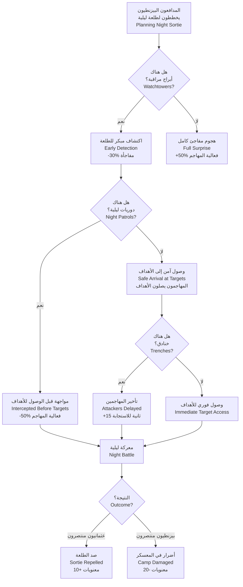

# الطلعات الليلية — Night Sorties

> **هجمات الظلام — مداهمة معسكر الحصار تحت جنح الليل**

---

## 1. نظرة عامة — Overview

الطلعات الليلية (Night Sorties) هي هجمات مفاجئة يشنها المدافعون على معسكر الحصار تحت غطاء الظلام. تشكل هذه الهجمات أحد أكبر التهديدات لآلات الحصار وإمدادات العثمانيين. في حصار بورصة التاريخي، كانت الطلعات الليلية البيزنطية سبباً رئيسياً في إطالة أمد الحصار.

نظام الطلعات الليلية يجمع بين:
- **التخفي والرؤية**: ضعف الرؤية ليلاً يجعل التكتيكات مختلفة تماماً
- **الإضاءة**: إدارة مصادر الضوء (نيران المعسكر، المشاعل، القنابل المضيئة)
- **المفاجأة**: هجمات غير متوقعة تتطلب استعداداً دائماً
- **الحماية**: تنظيم الحراس والدوريات الليلية لحماية المعسكر

---

## 2. أنواع الطلعات الليلية — Sortie Types

| النوع | الحجم | الهدف | وقت التنفيذ | مدة الهجوم | مستوى الخطورة |
|-------|-------|-------|-------------|------------|--------------|
| غارة صغيرة (Raid) | 20-50 جندياً | إمدادات الطعام | 02:00-04:00 | 5-10 دقائق | منخفض |
| هجوم على المهندسين (Engineer Hunt) | 30-60 جندياً | قتل المهندسين | 23:00-01:00 | 10-15 دقيقة | متوسط |
| حرق الآلات (Engine Burn) | 50-100 جندي | تدمير المجانيق والكباش | 01:00-03:00 | 15-20 دقيقة | عالي |
| هجوم كبير (Major Sortie) | 100-300 جندي | معسكر الحصار بأكمله | 03:00-05:00 | 20-30 دقيقة | عالي جداً |
| هجوم انتحاري (Suicide Raid) | 30-50 نخبة | قتل القائد العثماني | أي وقت ليلي | 10-15 دقيقة | شديد |

---

## 3. أهداف الطلعات — Target Priorities

### 3.1 أهداف المهاجمين (المدافعين البيزنطيين)
عند شن طلعة ليلية، يختار المدافع (AI) أهدافه وفق الأولوية التالية:

```mermaid
flowchart TD
    A["بداية الطلعة الليلية<br/>Night Sortie Begins"] --> B{"هل هناك<br/>مجانيق نشطة؟<br/>Active Trebuchets?"}
    B -- "نعم" --> C["الهدف: المنجنيق<br/>Target: Trebuchet<br/>1st Priority"]
    B -- "لا" --> D{"هل هناك<br/>أبراج حصار؟<br/>Siege Towers?"}
    D -- "نعم" --> E["الهدف: برج الحصار<br/>Target: Siege Tower<br/>2nd Priority"]
    D -- "لا" --> F{"هل هناك<br/>مهندسون يعملون؟<br/>Engineers Working?"}
    F -- "نعم" --> G["الهدف: قتل المهندسين<br/>Target: Engineers<br/>3rd Priority"]
    F -- "لا" --> H{"هل هناك<br/>مخازن إمدادات؟<br/>Supply Depots?"}
    H -- "نعم" --> I["الهدف: حرق الإمدادات<br/>Target: Supplies<br/>4th Priority"]
    H -- "لا" --> J["الهدف: أي وحدة عثمانية<br/>Target: Any Ottoman Unit<br/>5th Priority"]
    
    C --> K["هل تم التدمير؟<br/>Destroyed?"]
    K -- "نعم" --> D
    E --> L["هل تم التدمير؟<br/>Destroyed?"]
    L -- "نعم" --> F
    G --> M["هل مات المهندسون؟<br/>Dead?"]
    M -- "نعم" --> H
    I --> N["هل احترقت؟<br/>Burned?"]
    N -- "نعم" --> J
    
    style A fill:#334,color:#fff
    style C fill:#a44,color:#fff
    style E fill:#a64,color:#fff
```

### 3.2 تفاصيل الأهداف

#### آلات الحصار (Siege Engines) — الأولوية الأولى
- المنجنيق: يستغرق حرق المنجنيق 30 ثانية من النار المستمرة
- الكبش: أسهل في الحرق — 15 ثانية فقط
- المقذاف: 20 ثانية
- "الفاتح": 60 ثانية (مقاوم للنار)

#### المهندسون (Engineers) — الأولوية الثانية
- كل مهندس يُقتل يوقف بناء آلة لمدة 24 ساعة (يجب تدريب بديل)
- إذا قتل المهندس الرئيسي، تفقد كل تقدم بناء الآلة (-50%)
- المهندسون المدربون (Tier 3) لا يمكن استبدالهم بسهولة

#### الإمدادات (Supplies) — الأولوية الثالثة
- إمدادات الطعام المحترقة تضيع بشكل دائم
- الخشب والحديد المحترق يخسر 75% من قيمته
- الذخيرة تنفجر إذا احترقت (تسبب أضراراً في محيطها)

---

## 4. حرق الآلات — Burning Engines

### 4.1 آلية الحرق
عند وصول مهاجم إلى آلة حصار، يمكنه إشعالها باستخدام المشاعل (Torches).

| الخاصية | القيمة |
|---------|--------|
| وقت الإشعال | 5 ثوانٍ من الاقتراب المستمر |
| ضرر النار الأولي | 50/ثانية |
| ضرر النار (DoT) | 25/ثانية (يزيد 5/ثانية كل 5 ثوانٍ) |
| مدة الاحتراق إذا لم يُخمد | 120 ثانية (ثم تُدمر الآلة) |
| احتمال انتشار الحريق | 20% لكل مجاورة (لآلات قريبة) |

### 4.2 إطفاء الحريق
يمكن للوحدات العثمانية إطفاء الحريق:
- **عدد الجنود المطلوب**: 5 جنود لكل آلة
- **وقت الإطفاء**: 10 ثوانٍ (إذا كان هناك 5 جنود)
- **فعالية الإطفاء**: +2x مع وجود دلاء ماء (Water Buckets — تكلف 5 خشب)
- **خطر الإطفاء**: جنود الإطفاء عرضة للهجوم

### 4.3 الإصلاح بعد الحريق

| مستوى الضرر | وقت الإصلاح | التكلفة | ملاحظات |
|------------|------------|---------|---------|
| حرق بسيط (<25% HP) | 2 ساعة | 50 خشب | الآلة تعمل بنسبة 75% |
| حرق متوسط (25-50% HP) | 6 ساعات | 150 خشب + 50 حديد | الآلة لا تعمل أثناء الإصلاح |
| حرق شديد (50-75% HP) | 12 ساعة | 300 خشب + 100 حديد | إعادة بناء نصفية |
| تدمير كامل (100% HP → 0) | 36 ساعة | 75% تكلفة البناء الأصلية | إعادة بناء كاملة |

---

## 5. قتل المهندسين — Killing Engineers

### 5.1 تأثير قتل المهندسين
المهندسون (Engineers) هم العمود الفقري لبناء آلات الحصار. فقدانهم له تأثير كبير:

| المهندس المقتول | التأثير |
|----------------|---------|
| مهندس عادي (Tier 1) | -5% تقدم في المشاريع الحالية، +24 ساعة لتدريب بديل |
| مهندس مدرب (Tier 2) | -15% تقدم في المشاريع الحالية، +48 ساعة لتدريب بديل |
| مهندس خبير (Tier 3) | -30% تقدم في المشاريع الحالية، +72 ساعة (أو استقدام من إسطنبول) |
| كبير المهندسين (Master Engineer) | -50% تقدم في جميع المشاريع، الحاجة لاستقدام مهندس جديد (7 أيام) |

### 5.2 حماية المهندسين
يمكن حماية المهندسين عبر:
- **تخصيص حراس شخصيين**: 5 جنود يحرسون كل مهندس
- **خيام محصنة**: +100 دفاع للمهندسين داخل الخيام
- **العمل نهاراً فقط**: يقلل خطر الهجوم الليلي لكن يبطئ البناء
- **نظام الإنذار المبكر**: أجراس تحذر المهندسين من الهجوم (5 ثوانٍ للهروب)

---

## 6. الرؤية في الظلام — Night Vision & Visibility

### 6.1 مدى الرؤية الليلي

| الظروف | مدى الرؤية (المهاجم الليلي) | مدى الرؤية (المدافع الليلي - العثماني) |
|--------|---------------------------|--------------------------------------|
| ليل بدون قمر | 15 متراً | 30 متراً (حراس المعسكر) |
| ليل مع قمر خافت | 25 متراً | 40 متراً |
| ليل مع قمر كامل | 40 متراً | 60 متراً |
| غائم/ممطر | 10 متراً | 20 متراً |
| ضباب + ليل | 5 أمتار | 10 أمتار |

### 6.2 تأثير مصادر الإضاءة

| مصدر الضوء | نصف قطر الإضاءة | تأثير على الرؤية | تأثير على الاختفاء |
|-----------|----------------|-----------------|-------------------|
| نار المعسكر (Campfire) | 20 متراً | يضيء المنطقة | يكشف الوحدات في النطاق |
| مشعل (Torch) | 10 أمتار | يضيء المنطقة المحيطة | يكشف حامل المشعل فقط |
| قنبلة مضيئة (Flares) | 50 متراً | يضيء مساحة كبيرة لمدة 30 ثانية | يكشف كل شيء في النطاق |
| نار مشتعلة (Burning Engine) | 30 متراً | يضيء المنطقة المحيطة | يكشف المنطقة ويجذب الانتباه |
| ظلام كامل | 0 | لا شيء | يخفي جميع الوحدات |

### 6.3 تعديلات القتال الليلي

| الجانب | الهجوم | الدفاع | الدقة | سرعة الحركة |
|--------|-------|-------|-------|------------|
| المهاجم الليلي (البيزنطي) | +25% (مفاجأة) | -10% | -15% | +10% (خفيف) |
| المدافع (العثماني — غير منتبه) | -30% | -30% | -40% | -20% |
| المدافع (العثماني — منتبه/حراس) | -10% | -10% | -15% | -5% |
| المدافع (عثماني — مع مشعل) | 0% | 0% | -5% | -10% |

---

## 7. نظام الحراسة — Watch System

### 7.1 تنظيم النوبات الليلية — Watch Rotation
يمكن للاعب تنظيم نظام الحراسة الليلي لحماية المعسكر:

| نوبة الحراسة | التوقيت | عدد الجنود | تأثير الإرهاق |
|-------------|---------|-----------|-------------|
| الأولى (First Watch) | 20:00-00:00 | 200 جندي | -5% فعالية لليوم التالي |
| الثانية (Middle Watch) | 00:00-04:00 | 300 جندي | -10% فعالية لليوم التالي |
| الثالثة (Dawn Watch) | 04:00-08:00 | 250 جندي | -8% فعالية لليوم التالي |

### 7.2 مستويات اليقظة — Alertness Levels

| المستوى | وصف | الكشف | مكافأة القتال |
|---------|------|-------|-------------|
| هادئ (Calm) | لا توقع هجوم | -20% كشف | لا مكافأة |
| منتبه (Alert) | توقع هجوم محتمل | 0% كشف | +10% قتال ليلي |
| حذر (Vigilant) | توقع هجوم وشيك | +25% كشف | +20% قتال ليلي |
| استنفار (Full Alert) | هجوم مؤكد | +50% كشف | +35% قتال ليلي |

### 7.3 الإرهاق — Fatigue
الجنود الذين ينامون أقل يكونون أقل فعالية في اليوم التالي:

| ساعات النوم | فعالية اليوم التالي | ملاحظات |
|------------|-------------------|---------|
| 8 ساعات (كاملة) | 100% | لا حراسة |
| 6 ساعات | 95% | نوبة واحدة |
| 4 ساعات | 85% | نوبتان |
| 2 ساعات | 70% | ثلاث نوبات |
| 0 ساعات (استنفار كامل) | 50% | خطر فرار أو تمرد |

---

## 8. حماية معسكر الحصار — Camp Protection

### 8.1 التدابير الدفاعية

| الإجراء | التكلفة | التأثير | وقت التنفيذ |
|---------|---------|---------|------------|
| خنادق محيطة | 200 خشب | -40% سرعة المهاجم | 6 ساعات |
| أبراج مراقبة (4) | 400 خشب | +30% كشف الطلعات | 12 ساعة |
| دوريات ليلية | 100 جندي | +25% كشف، استجابة أسرع | مستمر |
| كلاب حراسة (Watch Dogs) | 50 ذهب | +40% كشف (تسمع من بعيد) | — |
| أجراس إنذار | 30 خشب | تحذير فوري للمعسكر | ساعة واحدة |
| مصائد (Pit Traps) | 100 خشب | 100-300 ضرر للمهاجمين | 4 ساعات |

### 8.2 فعالية الإجراءات

---

## 9. وحدات القتال الليلي — Night Combat Units

### 9.1 تعديلات الوحدات ليلاً

| الوحدة | الضرر ليلاً | الدقة ليلاً | الحركة ليلاً | ملاحظات خاصة |
|--------|-----------|-----------|------------|-------------|
| مشاة خفيفة | 100% | 90% | 110% | تكيف سريع مع الظلام |
| مشاة ثقيلة | 80% | 70% | 80% | ضوضاء الدروع تكشفهم |
| رماة | 70% | 60% | 100% | صعوبة الرؤية في الظلام |
| رماة نخبة (Elite Archers) | 90% | 80% | 100% | تدربوا على الرمي الليلي |
| فرسان | 60% | 50% | 60% | الخيول تخاف في الظلام |
| مهاجمون ليليون خاصون (Night Raiders — وحدة بيزنطية) | 150% | 100% | 130% | مدربون خصيصاً للهجمات الليلية |

### 9.2 وحدات مضادة للطلعات الليلية

| الوحدة | التكلفة | الفعالية ضد الطلعات | ملاحظات |
|--------|---------|-------------------|---------|
| حارس معسكر (Camp Guard) | 30 ذهب/جندي | +40% كشف، +25% قتال ليلي | متخصص في حراسة المعسكر |
| كلب حرب (War Dog) | 20 ذهب/وحدة | +50% كشف، يهاجم تلقائياً | 5 كلاب لكل سرية حراسة |
| جندي مشعل (Torch Bearer) | 5 ذهب/جندي | يضيء محيط 10م | عرضة للقنص |

---

## 10. مثال تاريخي — Historical Note: طلعات بورصة الليلية

**خلفية تاريخية**: خلال حصار بورصة (1317-1326)، شنّت الحامية البيزنطية عدة طلعات ليلية ناجحة ضد المعسكرات العثمانية. أشهر هذه الطلعات كانت بقيادة القائد البيزنطي "ساروز" (Saroz) الذي تمكن من حرق إحدى آلات الحصار العثمانية الكبرى.

**تأثيرها على اللعبة**: تعكس الطلعات الليلية في اللعبة هذه الأحداث التاريخية. بعد كل طلعة ليلية ناجحة، تتأخر خطة الحصار العثمانية بيومين إلى أسبوع، مما يطيل الحصار ويزيد من معاناة الجيش العثماني.

**الدرس التاريخي**: فشل البيزنطيون في كسر الحصار نهائياً بسبب نقص القوات — لم يكن لديهم عدد كافٍ من الجنود لاستغلال نجاحاتهم الليلية. في اللعبة، هذا يعني أن الطلعات الليلية تضعف المهاجم لكنها نادراً ما تنهي الحصار.

---

## 11. نصائح للاعب — Player Tips

1. **لا تهمل الحراسة الليلية**: الطلعة الليلية الواحدة يمكن أن تدمر منجنيقاً بنيَ على مدى 3 أيام
2. **وازن بين النوم والحراسة**: لا تجعل كل جنودك يسهرون — سيحتاجون لقوتهم في اليوم التالي
3. **استخدم الكلاب**: كلاب الحراسة رخيصة وفعالة جداً في كشف المتسللين
4. **أضئ المعسكر بحكمة**: النيران تكشف المهاجمين لكنها تجعل جنودك أهدافاً سهلة للرماة
5. **احمِ المهندسين**: هم أغلى مواردك — ضعهم في خيام محصنة في وسط المعسكر
6. **كن مستعداً للطلعة الكبرى**: بعد أسبوع من الهدوء، توقع هجوماً كبيراً

> **تاريخ آخر تحديث**: 2026-06-20
