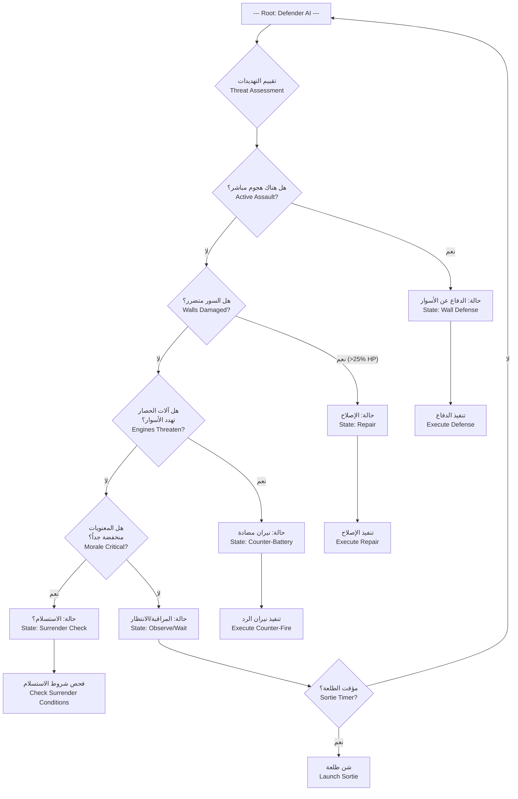
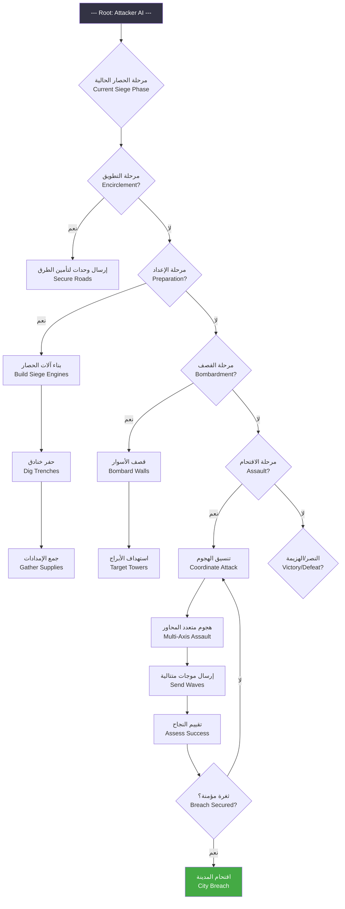

# ذكاء الحصار الاصطناعي — Siege AI

> **أنماط سلوك AI المهاجم والمدافع — من التكتيكات البسيطة إلى الخداع الاستراتيجي**

---

## 1. نظرة عامة — Overview

نظام AI الحصار هو العقل المدبر لسلوك كل من المدافعين البيزنطيين (عندما يهاجم اللاعب) والمهاجمين العثمانيين (في الحملات الأخرى أو عندما يكون اللاعب مدافعاً). يهدف هذا النظام إلى تقديم تحدٍ واقعي وممتع عبر ثلاثة مستويات صعوبة (Easy/Normal/Hard).

---

## 2. AI المدافع — Defender AI

### 2.1 شجرة سلوك المدافع — Defender Behavior Tree



### 2.2 أولويات استهداف المدافع — Defender Target Priorities

| الأولوية | الهدف | الشرط | وزن القرار (Normal) |
|----------|-------|-------|---------------------|
| 1 (الأعلى) | المنجنيق (Trebuchet) | إذا كان المنجنيق نشطاً وفي المدى | 100 |
| 2 | برج الحصار (Siege Tower) | إذا كان البرج على بعد <50م من السور | 90 |
| 3 | كبش الضرب (Battering Ram) | إذا كان الكبش يهاجم بوابة | 85 |
| 4 | المقذاف (Ballista) | إذا كان المقذاف يقتل المدافعين على السور | 70 |
| 5 | الدرع المتحرك (Mantlet) | إذا كان الدرع يقترب من السور | 50 |
| 6 | المشاة (Infantry) | إذا كانوا داخل نطاق 30م من السور | 30 |
| 7 | الإمدادات (Supplies) | فقط في الطلعات الليلية (يصبح 80) | 10 (ليلًا: 80) |

### 2.3 سلوك إصلاح الأسوار — Wall Repair Behavior

يقوم AI المدافع بإصلاح الأسوار المتضررة. يعتمد سلوك الإصلاح على مستوى الصعوبة:

| مستوى الصعوبة | عتبة الإصلاح | سرعة الإصلاح | عدد العمال | فعالية الإصلاح |
|--------------|------------|-------------|-----------|--------------|
| Easy | عندما HP < 30% | 50 HP/ثانية | 5 | يوقف الإصلاح عند التعرض للنار |
| Normal | عندما HP < 50% | 100 HP/ثانية | 10 | يستمر رغم النيران (إن أمكن) |
| Hard | عندما HP < 75% | 150 HP/ثانية | 15 | يصلح حتى أثناء القصف، يعطي الأولوية لأكثر قطاع تضرراً |

**منطق إصلاح AI (Hard):**
```
1. تقييم جميع قطاعات السور
2. اختيار القطاع الأكثر تضرراً (HP الأدنى)
3. إذا كان HP القطاع < 75% → إرسال عمال الإصلاح
4. إذا كان القطاع يتعرض للقصف → إرسال درع بشري (وحدات تحمي العمال)
5. إذا تم إصلاح القطاع > 90% → الانتقال إلى القطاع التالي الأكثر تضرراً
```

### 2.4 شروط الطلعات — Sally Out Conditions

يقوم المدافع بالطلعة (Sally Out) عندما تتحقق الشروط التالية:

| الشرط | Easy | Normal | Hard |
|-------|------|--------|------|
| معنويات المدافع > 70 لمدة 3 أيام | لا يحدث أبداً | يحدث | يحدث |
| تدمير آلة حصار كبرى | 20% فرصة | 40% فرصة | 60% فرصة |
| مؤقت زمني (كل 7 أيام) | 15% فرصة | 25% فرصة | 35% فرصة |
| وصول إمدادات إلى المدينة | 25% فرصة | 50% فرصة | 75% فرصة + فورية |
| الغذاء < 10% (طلعة يائسة) | 15% فرصة | 30% فرصة | 50% فرصة |
| عدد المهاجمين ≤ 50% من قوتهم الأصلية | لا يحدث | 20% فرصة | 40% فرصة | 
| اكتشاف نفق حفر (Sapping Tunnel) | 10% فرصة | 30% فرصة | 50% فرصة + طلعة فورية مضادة |

---

## 3. AI المهاجم — Attacker AI (عندما يكون اللاعب مدافعاً)

### 3.1 شجرة سلوك المهاجم — Attacker Behavior Tree



### 3.2 استراتيجيات القصف — Bombardment Strategies

| مستوى الصعوبة | استراتيجية القصف | التركيز | فعالية القصف |
|--------------|-----------------|---------|-------------|
| Easy | عشوائي — يضرب أي قطاع | لا تركيز | 50% |
| Normal | مركز — يركز على قطاع واحد حتى الثغرة | قطاع واحد | 75% |
| Hard | ذكي — يضرب عدة قطاعات لتشتيت الإصلاح، ثم يركز على الأضعف | 2-3 قطاعات | 90% |

**تكتيك AI Hard:**
```
1. قصف خفيف على 3 قطاعات مختلفة (لتشتيت عمال الإصلاح)
2. بعد 10 قذائف على كل قطاع → تحديد القطاع الذي أصلح بأقل سرعة
3. تركيز كل القصف على ذلك القطاع حتى الثغرة
4. إرسال هجوم وهمي (Feint) على قطاع آخر بالتزامن مع الاقتحام الحقيقي
```

### 3.3 حماية آلات الحصار — Engine Protection

AI المهاجم يحمي آلات حصاره:

| الإجراء | Easy | Normal | Hard |
|---------|------|--------|------|
| حراس حول المجانيق | لا | 10 جنود | 20 جندياً + خندق |
| دروع متحركة لحماية الكبش | لا | 2 درع | 4 دروع + رماة |
| إصلاح الآلات المتضررة | لا يصلح | يصلح بعد المعركة | يصلح فوراً |
| إبعاد الآلات عن الخطر | لا | إذا HP < 25% | إذا HP < 50% |
| هجوم مضاد على نيران الرد | لا | نادراً | دائماً (يستهدف مدفعية العدو) |

---

## 4. الخداع التكتيكي — Tactical Deception (Hard Mode Only)

في مستوى الصعوبة Hard، يستخدم AI تقنيات الخداع التكتيكي:

### 4.1 الهجمات الوهمية — Feints
- **الوصف**: يرسل AI المهاجم مجموعة صغيرة (50-100 جندي) لمهاجمة قطاع معين من السور، بينما الهجوم الحقيقي على قطاع آخر
- **الكشف**: يمكن اكتشاف الخداع بالاستطلاع (Recon) — إذا كانت القوات المهاجمة صغيرة جداً مقارنة بالضجة، فهو خداع
- **العقوبة**: إذا انخدع اللاعب وأرسل قواته للقطاع الخطأ، يفقد الوقت والفرصة

### 4.2 الانسحاب الوهمي — False Retreat
- **الوصف**: يهاجم AI بقوة ثم ينسحب بشكل غير منظم، لاستدراج اللاعب إلى مطاردته خارج الأسوار
- **الفخ**: عند مطاردة AI، تنقض وحدات كمينة مخفية على قوات اللاعب
- **الخطر**: خسارة 30-50% من قوات الدفاع في كمين ناجح

### 4.3 القصف المزدوج — Double Bombardment
- **الوصف**: يبدأ AI بقصف قطاع A، وبعد أن يرسل اللاعب عمال الإصلاح إلى A، يحول القصف فجأة إلى قطاع B
- **الهدف**: إيقاع عمال الإصلاح خارج الغطاء، وقتلهم بالقصف المفاجئ

### 4.4 الهجوم الليلي المنظم — Coordinated Night Attack
- **الوصف**: هجوم ليلي منظم يشمل:
  1. سرية تخريب تحرق إمدادات اللاعب (لتشتيت الانتباه)
  2. هجوم رئيسي على بوابة جانبية
  3. قناصة يقتلون قادة الدفاع
- **التنسيق**: جميع الهجمات متزامنة خلال 30 ثانية

---

## 5. جداول القرار — Decision Tables

### 5.1 جدول قرار المدافع عند اكتشاف خطر

| الموقف | Easy | Normal | Hard |
|--------|------|--------|------|
| آلة حصار تقترب من السور | إطلاق نار فقط | نيران مركزة + طلعة صغيرة | نيران مركزة + طلعة + كمين |
| ثغرة في السور | إرسال 50% قوات الاحتياط | إرسال 75% قوات الاحتياط + بناء متراس | إرسال 100% + بناء متراس + هجوم مضاد |
| نفق حفر | تجاهل (10% اكتشاف) | إرسال دورية (30% اكتشاف) | حفر نفق مضاد فوراً (90% اكتشاف) |
| هجوم على بوابة | إغلاق البوابة فقط | إغلاق + زيت مغلي + رماة | إغلاق + زيت + رماة + طلعة جانبية |
| قصف مستمر | إصلاح بعد القصف | إصلاح أثناء القصف + دروع بشرية | إصلاح + دروع + نيران مضادة + تشتيت |

### 5.2 جدول قرار المهاجم بناءً على دفاعات اللاعب

| دفاعات اللاعب | Easy | Normal | Hard |
|--------------|------|--------|------|
| دفاع قوي على قطاع واحد | الهجوم على القطاع القوي (غباء) | تجنب القطاع القوي، هجوم على الضعيف | هجوم وهمي على القوي، هجوم حقيقي على الضعيف |
| دفاع ضعيف متساوٍ | هجوم عشوائي | هجوم مركز على نقطة واحدة | هجوم على نقطتين لتشتيت الدفاع |
| أسوار سليمة بالكامل | قصف سريع واقتحام (خسائر كبيرة) | قصف منهجي لمدة 3-5 أيام | قصف + حفر نفق + هجوم منسق |
| أسوار مدمرة | اقتحام فوري | اقتحام منظم بموجات | اقتحام منظم + طلعات جانبية لمنع إعادة التجمع |

---

## 6. تكيف AI مع استراتيجيات اللاعب — Adaptation

### 6.1 نظام التعلم — Learning System (Hard Mode Only)

في وضع Hard، يتعلم AI من سلوك اللاعب ويكيّف استراتيجيته:

| سلوك اللاعب | تكيف AI |
|------------|---------|
| اللاعب يركز كل القصف على برج واحد | AI يرسل المزيد من قوات الإصلاح لذلك البرج ويبني غطاءً حوله |
| اللاعب يستخدم الكثير من الرماة | AI يستخدم دروعاً ثقيلة ويقترب بالدروع المتحركة |
| اللاعب يعتمد على طلعات الفرسان | AI يحفر خنادق وفخاخاً للخيول |
| اللاعب يهمل الحراسة الليلية | AI يشن طلعات ليلية متكررة |
| اللاعب يصلح الأسوار بسرعة | AI يركز القصف على قطاعات متعددة |
| اللاعب يستخدم النق Tunnel بكثرة | AI يستخدم أجهزة كشف الأنفاق (أوعية ماء + جواسيس) |

### 6.2 عتبات التكيف
- **التكيف البطيء (Slow Adaptation)**: Normal — يتكيف AI بعد 3-4 مرات من تكرار نفس الاستراتيجية
- **التكيف السريع (Fast Adaptation)**: Hard — يتكيف AI بعد 1-2 مرة
- **لا تكيف**: Easy — لا يتعلم، يستخدم نفس الإستراتيجية طوال الحصار

---

## 7. مقارنة مستويات الصعوبة — Difficulty Comparison

| الخاصية | Easy | Normal | Hard |
|---------|------|--------|------|
| **المدافع** | | | |
| هدف AI المدافع | إطالة الحصار فقط | الدفاع المنهجي | الدفاع الذكي |
| سرعة إصلاح الأسوار | 50 HP/ثانية | 100 HP/ثانية | 150 HP/ثانية |
| تكرار الطلعات | نادر (كل 14 يوم) | معتدل (كل 7 أيام) | متكرر (كل 3-5 أيام) |
| فعالية الطلعات | 40% | 60% | 85% |
| نيران الرد | 10% احتمال | 25% احتمال | 45% احتمال |
| اكتشاف الأنفاق | 10% | 30% | 75% |
| مضاعف HP الأسوار | 0.8x | 1.0x | 1.3x |
| مضاعف موارد المدينة | 0.7x | 1.0x | 1.5x |
| الخداع التكتيكي | لا | نادر | متكرر (ماهر) |
| **المهاجم (في حال كان اللاعب مدافعاً)** | | | |
| تنسيق الهجمات | ضعيف — هجمات متفرقة | جيد — هجمات منسقة | ممتاز — هجمات متعددة المحاور |
| حماية آلات الحصار | ضعيفة | متوسطة | قوية جداً |
| استراتيجية القصف | عشوائية | مركزة | ذكية + خادعة |
| سرعة بناء آلات الحصار | 0.7x | 1.0x | 1.2x |
| سرعة حفر الأنفاق | 0.5x | 1.0x | 1.3x |

---

## 8. خريطة حرارية لأداء AI — AI Performance Heat Map

```
                          قوة اللاعب (Player Strength)
                    ضعيف      متوسط      قوي      خبير
                    ─────     ─────     ─────     ─────
Easy     المهاجم   🟢 سهل    🟢 سهل    🟢 سهل    🟡 متوسط
         المدافع   🟢 سهل    🟢 سهل    🟡 متوسط   🔴 صعب
Normal   المهاجم   🟢 سهل    🟡 متوسط   🔴 صعب    🔴 صعب
         المدافع   🟡 متوسط   🟡 متوسط   🔴 صعب    🔴🔴 صعب جداً
Hard     المهاجم   🔴 صعب    🔴🔴 صعب   🔴🔴 صعب   🟣 شبه مستحيل
         المدافع   🔴🔴 صعب   🔴🔴 صعب   🟣 شبه مستحيل 🟣 شبه مستحيل
```

---

## 9. ملاحظات للمطورين — Developer Debugging Notes

### 9.1 متغيرات التصحيح (Debug Variables)

```
siege_ai.debug = true						// تفعيل سجل AI
siege_ai.log_level = "info"|"verbose"|"all"			// مستوى التسجيل
siege_ai.force_behavior = "repair"|"sally"|"bombard"|"assault"	// فرض سلوك معين
siege_ai.disable_learning = true/false				// تعطيل تكيف AI
siege_ai.show_priority_targets = true				// إظهار أهداف AI
siege_ai.override_difficulty = "easy"|"normal"|"hard"		// تجاوز مستوى الصعوبة
```

### 9.2 اختبار AI — AI Testing Scenarios

| سيناريو الاختبار | ما يختبره | النتيجة المتوقعة |
|-----------------|-----------|-----------------|
| هجوم بدون قصف مسبق | رد فعل AI على الهجوم المفاجئ | Easy: ذعر، Normal: تنظيم دفاع، Hard: هجوم مضاد فوري |
| قصف مكثف على قطاع واحد | أولويات AI في الإصلاح | Easy: يصلح القطاع، Normal: يصلح + يحمي، Hard: يصلح + هجوم على المنجنيق |
| إرسال موجات متتالية | إدارة AI للموارد | Easy: يستنفذ كل القوات بسرعة، Hard: يحتفظ باحتياط |
| التوقف عن القصف | هل يبادر AI بالهجوم؟ | Easy: لا، Normal: بعد 3 أيام، Hard: بعد يوم واحد + خداع |
| إضعاف AI (تخفيض HP) | عتبة الاستسلام | Easy: يستسلم بسرعة، Normal: يقاوم، Hard: يقاوم حتى النهاية |

### 9.3 أداء AI — Performance Notes

- **تحديث شجرة السلوك**: كل 0.5 ثانية في الوضع الطبيعي، كل 0.25 ثانية في Hard
- **حد أقصى للقرارات**: 100 قرار في الثانية لمنع استهلاك CPU
- **AI المدافع عن الأسوار**: يستخدم نظام الأولويات (Priority Queue) — لا يعيد حساب كل شيء كل إطار
- **الخداع التكتيكي**: يتم حسابه مسبقاً (Pre-computed) قبل 5 ثوانٍ من التنفيذ لتجنب التأخير

---

## 10. تخصيص AI — Custom AI Settings

يمكن للمطورين تخصيص سلوك AI عبر ملف التكوين `siege_ai_config.json`:

```json
{
  "defender_ai": {
    "repair_threshold": 0.5,
    "sally_morale_threshold": 70,
    "sally_cooldown_days": 7,
    "counter_battery_chance": 0.25,
    "tunnel_detection_chance": 0.3,
    "use_feints": false
  },
  "attacker_ai": {
    "siege_phase_speed": 1.0,
    "focus_fire": true,
    "protect_engines": true,
    "assault_coordination": "balanced",
    "use_deception": false,
    "learning_rate": 0.1
  },
  "difficulty_profiles": {
    "easy": { "mult_health": 0.8, "mult_resources": 0.7, "mult_repair_speed": 0.5 },
    "normal": { "mult_health": 1.0, "mult_resources": 1.0, "mult_repair_speed": 1.0 },
    "hard": { "mult_health": 1.3, "mult_resources": 1.5, "mult_repair_speed": 1.5 }
  }
}
```

---

## 11. الخلاصة — Summary

نظام AI الحصار يقدم:
- **ثلاثة مستويات صعوبة** تتراوح من السهل إلى التحدي القاسي
- **شجرتي سلوك** مختلفتين للمدافع والمهاجم
- **نظام خداع تكتيكي** في المستوى Hard يجعل كل حصار تجربة فريدة
- **تكيف مع استراتيجيات اللاعب** لمنع استغلال نمط واحد
- **قابلية تخصيص كاملة** للمطورين لتعديل سلوك AI

الهدف هو جعل كل حصار بورصة تجربة مختلفة، بحيث يحتاج اللاعب إلى التفكير والتكيف بدلاً من حفظ نمط هجومي واحد.

---

> **تاريخ آخر تحديث**: 2026-06-20
