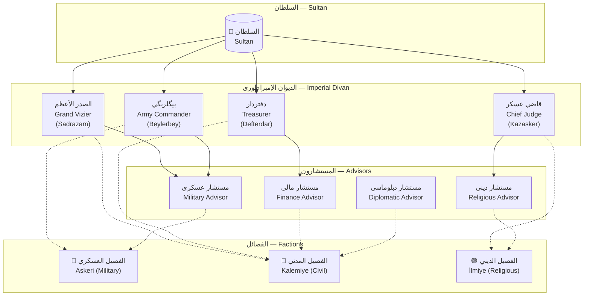
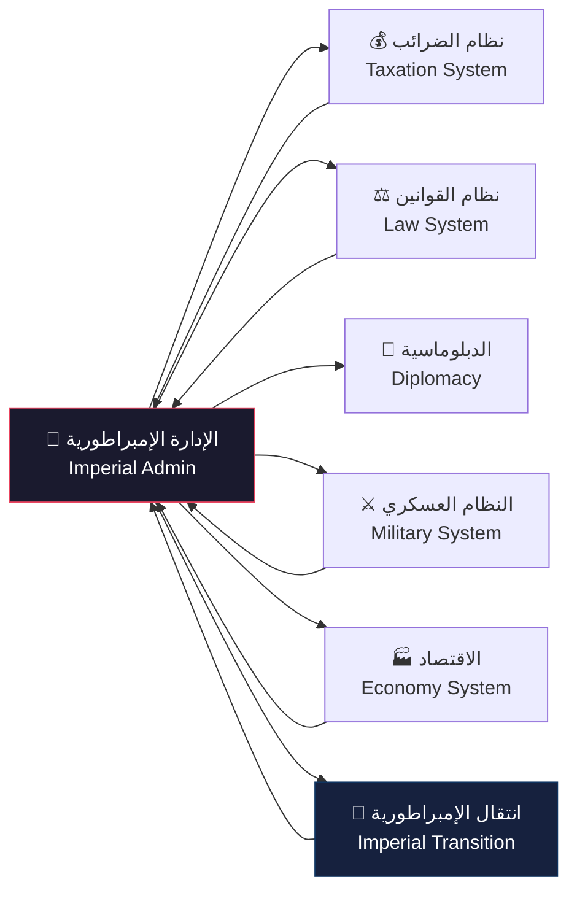

# نظام الإدارة الإمبراطورية — Imperial Administration System Overview

> **النظام 18 من أنظمة اللعبة — موسم 6: حصار بورصة (1326)**

## 1. مقدمة — من القبيلة إلى الدولة

في المواسم السابقة (1-5)، كان نظام الحكم في اللعبة يعتمد على **مجلس القبيلة (Tribal Council)** — وهو نظام بسيط يديره الشيخ مع وجهاء القبيلة. كان القرار يتخذ عبر المشورة المباشرة، وكانت البيروقراطية شبه معدومة. لكن مع توسع الدولة العثمانية وفتح المدن الكبرى، أصبح من المستحيل إدارة الأراضي الشاسعة عبر النظام القبلي القديم.

**حصار بورصة (1326)** يمثل نقطة التحول. فتح بورصة — أول عاصمة عثمانية — يتطلب تحولاً جذرياً في هيكل الحكم. لم يعد الشيخ مجرد زعيم قبيلة، بل أصبح **سلطاناً** يحتاج إلى **ديوان إمبراطوري (Imperial Divan)** لإدارة شؤون الدولة المتنامية.

> **"الملك لا يُحمل بالعصا وحدها، بل بالقلم والسيف معاً."**

عند فتح بورصة، يُفتح نظام الإدارة الإمبراطورية بالكامل، ليحل محل نظام مجلس القبيلة السابق.

---

## 2. الديوان الإمبراطوري — Imperial Divan

الديوان هو المجلس الأعلى للحكم في الدولة العثمانية. يتكون من أربعة مناصب رئيسية، كل منها مسؤول عن قطاع حيوي من الدولة:

| المنصب | English Title | المسؤولية | التأثير على اللعبة |
|--------|--------------|-----------|-------------------|
| الصدر الأعظم | Grand Vizier (Sadrazam) | إدارة الدولة وتنسيق الديوان | +Administration Efficiency, +Building Speed |
| قاضي عسكر | Chief Judge (Kazasker) | القضاء والعدالة والتعليم | +Justice Speed, -Unrest, +Edict Duration |
| دفتردار | Treasurer (Defterdar) | المالية والضرائب والتجارة | +Tax Income, +Trade Bonus, +Corruption Detection |
| بيگلربگي | Army Commander (Beylerbey) | الجيش والحملات والحصون | +Army Morale, +Recruitment Speed, +Siege Bonus |

### 2.1 متى يُفتح الديوان؟

- **الشرط الأساسي**: فتح مدينة بورصة (Bursa Conquest)
- **الشرط الثانوي**: وجود 5+ أراضٍ خاضعة للسيطرة
- **الشرط الثالث**: مستوى السمعة (Prestige) ≥ 50
- عند تحقق الشروط، يظهر حدث **"تأسيس الديوان الإمبراطوري"** مع مشهد سينمائي قصير

---

## 3. واجهة الإدارة — Administration UI

### 3.1 شاشة الديوان (Divan Screen)

تنقسم شاشة الديوان إلى عدة أقسام:

```
┌─────────────────────────────────────────────────────┐
│  الديوان الإمبراطوري — Imperial Divan    [إغلاق]    │
├─────────────────────────────────────────────────────┤
│  [أعضاء الديوان]  [الفرمانات]  [الخزينة]  [القوانين] │
├─────────────────────────────────────────────────────┤
│                                                     │
│  ┌─────┐ ┌─────┐ ┌─────┐ ┌─────┐                   │
│  │الصدر │ │قاضي │ │دفتر │ │بيگلر│                   │
│  │الأعظم│ │عسكر │ │دار  │ │بگي  │                   │
│  └─────┘ └─────┘ └─────┘ └─────┘                   │
│                                                     │
│  السمعة: 85/100    الذهب: 12,450    النفوذ: 67       │
│  سعة القوانين: 3/5     نسبة الفساد: 12%              │
│                                                     │
│  آخر اجتماع: يوم 45 من الحصار                       │
│  الاجتماع القادم: بعد 3 أشهر                        │
└─────────────────────────────────────────────────────┘
```

### 3.2 التبويبات (Tabs)

| التبويب | المحتوى |
|---------|---------|
| أعضاء الديوان (Council) | عرض الأعضاء الحاليين، إحصائياتهم، ولائهم |
| الفرمانات (Edicts) | إصدار الفرمانات، عرض النشطة، إلغاء الفرمانات |
| الخزينة (Treasury) | الميزانية، الضرائب، الإنفاق، القروض |
| القوانين (Laws) | القوانين السارية، الشخصية القانونية للدولة |

---

## 4. الموارد — Resources

### 4.1 أنواع الموارد

| المورد | English | الوظيفة | الحد الأقصى |
|--------|---------|---------|-------------|
| 🏅 السمعة | Prestige | فتح الفرمانات القوية، التأثير الدبلوماسي، شرعية الحكم | 0-200 (قابل للزيادة عبر الأحداث) |
| 🪙 الذهب | Gold | الإنفاق على كل شيء: الجيش، البناء، المرتبات | غير محدود |
| 📜 النفوذ | Influence | إصدار الفرمانات، التعيينات، الإقناع السياسي | 0-100 (يتجدد شهرياً) |
| ⚖️ سعة القانون | Law Capacity | عدد الفرمانات النشطة في وقت واحد | 3-10 (قابل للزيادة) |

### 4.2 موارد إضافية

- **الولاء (Loyalty)**: خاص بكل عضو في الديوان (0-100). يؤثر على الفساد وكفاءة العمل.
- **الفساد (Corruption)**: نسبة مئوية (0-100%). تزيد من الخسائر وتقلل الكفاءة.
- **الاستقرار (Stability)**: مؤشر عام لحالة الدولة (يتأثر بالقوانين والأحداث).

---

## 5. تأثير الخيارات الإدارية — How Admin Choices Affect Gameplay

كل قرار في الديوان يؤثر على جوانب متعددة من اللعبة:

### 5.1 الاقتصاد (Economy)
- **الضرائب المرتفعة**: ذهب أكثر لكن استياء وتمرد محتمل
- **الضرائب المنخفضة**: رضا الشعب لكن تمويل أقل للجيش
- **الاستثمار في التجارة**: أرباح طويلة المدى لكن تكلفة فورية

### 5.2 الجيش (Military)
- **تجنيد إجباري**: جيش كبير لكن استياء الفلاحين
- **جيش محترف**: جيش نخبة لكن تكلفة عالية
- **الإنفاق على الحصون**: دفاع أفضل لكن تكلفة بناء وصيانة

### 5.3 الدبلوماسية (Diplomacy)
- **الهدايا الدبلوماسية**: تحسين العلاقات لكن استنزاف الخزينة
- **الزواج السياسي**: تحالف قوي لكن تكلفة مهر باهظة
- **فرض الجزية**: إضعاف الخصم لكن خطر الحرب

### 5.4 الثقافة (Culture)
- **التسامح الديني**: استقرار المدن المفتوحة لكن استياء المتشددين
- **دعم العلماء**: تقدم تكنولوجي لكن تكلفة مالية
- **بناء المساجد والمدارس**: زيادة السمعة والاستقرار طويل المدى

---

## 6. مقارنة: المجلس القبلي vs الديوان الإمبراطوري

| الخاصية | Tribal Council (Seasons 1-5) | Imperial Divan (Season 6+) |
|----------|----------------------------|---------------------------|
| عدد الأعضاء | 3-5 شيوخ قبيلة | 4 وزراء + مستشارون |
| طريقة اتخاذ القرار | تصويت بسيط | نقاش + تصويت مرجح |
| التخصص | عام (كل عضو يتكلم في كل شيء) | متخصص (كل وزير في مجاله) |
| الفساد | غير موجود (نظام شرف) | موجود (يحتاج مراقبة) |
| القوانين | عرف قبلي (غير مكتوب) | فرمانات مكتوبة (Kanun) |
| السمعة | غير مقاسة | نظام Prestige متكامل |
| سعة القوانين | غير محدودة (عرفية) | محدودة (Law Capacity) |
| الفصائل | غير موجودة | 3 فصائل (عسكري، قلمي، علمي) |
| الإطاحة بالحاكم | نادرة جداً | ممكنة عبر انقلاب ديواني |
| البيروقراطية | لا توجد | موجودة (تأخير في التنفيذ) |

### 6.1 مزايا الانتقال

عند الانتقال من المجلس القبلي إلى الديوان الإمبراطوري، يحصل اللاعب على:
1. **+30% كفاءة جمع الضرائب** (Tax Efficiency)
2. **+25% سرعة البناء** (Building Speed)
3. **فتح شجرة الفرمانات** (Edict Skill Tree)
4. **إمكانية تعيين مستشارين** (Advisors)
5. **نظام دبلوماسي متقدم** (Advanced Diplomacy)

---

## 7. الهيكل الإداري — Administration Hierarchy



---

## 8. العلاقة مع الأنظمة الأخرى — System Relationships

نظام الإدارة الإمبراطورية يتفاعل مع عدة أنظمة أخرى في اللعبة:



### 8.1 أنظمة مترابطة

| النظام | التأثير المتبادل |
|--------|-----------------|
| Taxation System | الضرائب تغذي الخزينة، والخزينة تسمح بتطبيق القوانين |
| Law System | القوانين تحدد صلاحيات الديوان، والديوان يصدر القوانين |
| Military System | الجيش ينفذ سياسات الديوان، والديوان يمول الجيش |
| Succession System | اختيار الوريث يؤثر على استقرار الديوان |
| City Management | المدن توفر موارد للخزينة، والديوان يطور المدن |

---

## 9. مستويات التطور الإداري — Administration Tiers

يتطور نظام الإدارة عبر اللعبة في 5 مراحل:

| Tier | الاسم | الشرط | المكافآت |
|------|-------|-------|----------|
| 1 | مجلس القبيلة (Tribal Council) | بداية اللعبة | أساسي |
| 2 | الديوان المبكر (Early Divan) | فتح بورصة | +4 مناصب وزارية |
| 3 | الديوان الموسع (Expanded Divan) | 10+ أراضٍ | +مستشارون، +Law Capacity |
| 4 | الديوان الإمبراطوري (Imperial Divan) | تتويج سلطان | +منصب كابودان باشا |
| 5 | الديوان العالمي (Global Divan) | فتح 3 عواصم | +منصب ريس الكتاب، +Nişancı |

---

## 10. نصائح استراتيجية — Strategic Tips

1. **لا تهمل الولاء**: عضو الديوان ذو الولاء المنخفض (<40) سيبدأ في سرقة الخزينة وتسريب المعلومات للأعداء.
2. **وازن الفصائل**: إذا سيطر فصيل واحد على الديوان، ستحصل على عقوبات في المجالات الأخرى.
3. **استثمر في السمعة مبكراً**: السمعة العالية تفتح فرمانات قوية وتزيد شرعية حكمك.
4. **راقب سعة القوانين**: لا تصدر فرمانات أكثر مما تستطيع إدارته — الفوضى القانونية تكلف استقراراً.
5. **كُن حذراً مع القروض**: الفائدة على القروض تتراكم بسرعة. استخدمها فقط للضرورات القصوى.

---

> **تاريخ آخر تحديث**: 2026-06-20
