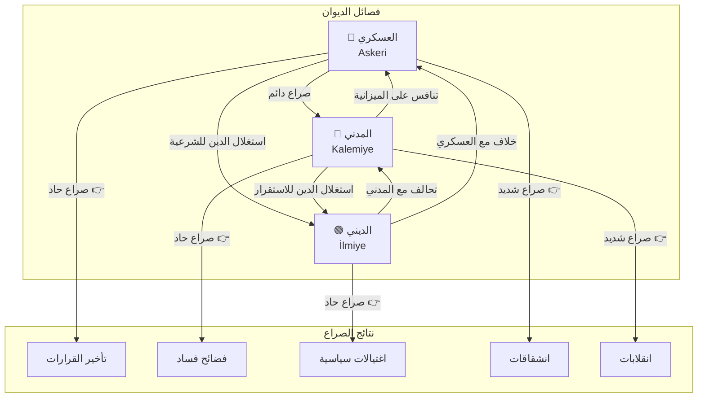

# نظام الإدارة الإمبراطورية — Divan Council System

> **الديوان الإمبراطوري — قلب الدولة النابض**

## 1. مقدمة عن الديوان

الديوان هو المجلس الأعلى للحكم في الدولة العثمانية. يعقد اجتماعاته بشكل دوري (كل 3 أشهر في اللعبة) ويناقش شؤون الدولة من حرب وسلام ومال وقضاء. بعد فتح بورصة، يصبح الديوان الأداة الرئيسية لإدارة الإمبراطورية.

كل عضو في الديوان له **إحصائيات (Stats)** خاصة به تؤثر على أدائه. تتراوح هذه الإحصائيات بين 1-100 وتتغير بمرور الوقت حسب الأحداث والقرارات.

---

## 2. أعضاء الديوان — Council Members in Detail

### 2.1 الصدر الأعظم — Grand Vizier (Sadrazam)

الصدر الأعظم هو الرجل الثاني في الدولة بعد السلطان. يدير جلسات الديوان وينسق بين الوزارات.

| الإحصائية | English | النطاق | التأثير |
|-----------|---------|--------|---------|
| المهارة الإدارية | Administration | 1-100 | سرعة تنفيذ الأوامر - فعالية البيروقراطية |
| الولاء | Loyalty | 0-100 | خطر الخيانة - كفاءة العمل |
| مقاومة الفساد | Corruption Resistance | 1-100 | تقليل الفساد في الحكومة |
| الكاريزما | Charisma | 1-100 | فعالية الدبلوماسية - هيبة الدولة |

**الأسماء المقترحة**: علاء الدين باشا (ابن عثمان)، جندرلي قره خليل، أحمد باشا

**المكافآت عند التعيين**:
- +10% سرعة البناء (لكل 20 نقطة Administration)
- +5% فعالية الدبلوماسية (لكل 25 نقطة Charisma)
- -2% فساد شهري (لكل 20 نقطة Corruption Resistance)

### 2.2 قاضي عسكر — Chief Judge (Kazasker)

القاضي المسؤول عن النظام القضائي والتعليمي. يدير المحاكم ويعين القضاة في المدن.

| الإحصائية | English | النطاق | التأثير |
|-----------|---------|--------|---------|
| المهارة القضائية | Justice | 1-100 | سرعة البت في القضايا - جودة الأحكام |
| سرعة الفرمان | Edict Speed | 1-100 | تقليل وقت تنفيذ الفرمانات |
| تقليل الاضطرابات | Unrest Reduction | 1-100 | خفض خطر التمرد في المدن |
| السمعة | Reputation | 1-100 | تأثير الأحكام على الرأي العام |

**الأسماء المقترحة**: جمال الدين، شمس الدين، مولانا فخر الدين

**المكافآت عند التعيين**:
- -5% اضطرابات المدن (لكل 20 نقطة Unrest Reduction)
- +15% سرعة إصدار الفرمانات (لكل 25 نقطة Edict Speed)
- +1 Law Capacity عند Justice ≥ 80

### 2.3 دفتردار — Treasurer (Defterdar)

المسؤول عن المالية العامة: الضرائب، التجارة، الخزينة، المرتبات.

| الإحصائية | English | النطاق | التأثير |
|-----------|---------|--------|---------|
| كفاءة الضرائب | Tax Efficiency | 1-100 | كمية الذهب المجموعة من الضرائب |
| مكافأة التجارة | Trade Bonus | 1-100 | أرباح إضافية من الطرق التجارية |
| اكتشاف الفساد | Corruption Detection | 1-100 | فرصة اكتشاف الفساد شهرياً |
| الاقتصاد | Economy | 1-100 | تكاليف أقل للبناء والصيانة |

**الأسماء المقترحة**: خير الدين، سنان الدين، محمد باشا

**المكافآت عند التعيين**:
- +15% دخل الضرائب (لكل 20 نقطة Tax Efficiency)
- +10% دخل التجارة (لكل 25 نقطة Trade Bonus)
- فحص فساد تلقائي شهري (نسبة = Corruption Detection %)

### 2.4 بيگلربگي — Army Commander (Beylerbey)

القائد الأعلى للجيش. مسؤول عن التجنيد، التدريب، والحملات العسكرية.

| الإحصائية | English | النطاق | التأثير |
|-----------|---------|--------|---------|
| معنويات الجيش | Army Morale | 1-100 | أداء الجنود في المعركة |
| سرعة التجنيد | Recruitment Speed | 1-100 | سرعة تدريب وحدات جديدة |
| مكافأة الحصار | Siege Bonus | 1-100 | فعالية حصون العدو |
| الخبرة الحربية | War Experience | 1-100 | خطط معركة أفضل - تقليل الخسائر |

**الأسماء المقترحة**: أورخان بك، سليم بك، غازي عبد الرحمن

**المكافآت عند التعيين**:
- +5% معنويات الجيش (لكل 15 نقطة Army Morale)
- -10% وقت التجنيد (لكل 20 نقطة Recruitment Speed)
- +5% ضرر الحصار (لكل 25 نقطة Siege Bonus)

---

## 3. آلية التعيين والعزل — Appointment & Removal Mechanics

### 3.1 التعيين (Appointment)

يمكن تعيين عضو جديد في الديوان عبر:
1. **فتح الشاغر**: الموت، الاستقالة، العزل
2. **اختيار المرشح**: تظهر قائمة بالمرشحين المتاحين (2-4 خيارات)
3. **تكلفة التعيين**: 500 Gold + 10 Influence
4. **مدة التعيين**: 10 دقائق (أو حتى العزل)

### 3.2 العزل (Removal)

عزل عضو الديوان يتطلب:
- **سبب**: فساد مثبت، خيانة، ولاء منخفض (<25)
- **تكلفة العزل**: 300 Gold + 15 Influence
- **عقوبة السمعة**: -10 Prestige إذا كان العزل بدون سبب مقنع
- **رد فعل الفصيل**: -15 علاقة مع فصيل العضو

### 3.3 نظام الولاء — Loyalty System

الولاء (Loyalty) يتأثر بعدة عوامل:

| العامل | التأثير | ملاحظات |
|--------|---------|---------|
| الهدية (Gift) | +5 إلى +20 | تكلفة 200-1000 Gold |
| السياسات الناجحة | +3 إلى +10 | حسب أهمية السياسة |
| الزواج السياسي | +15 إلى +25 | يربط العضو بالأسرة الحاكمة |
| المنافسة مع عضو آخر | -5 إلى -15 | يحدث تلقائياً بين الأعضاء |
| تجاهل رأي العضو | -10 إلى -20 | إذا لم يُستشر في مجاله |
| الفساد المكتشف | -20 إلى -40 | إذا تم اكتشاف فساده |
| هزيمة عسكرية | -10 إلى -25 | يؤثر على Beylerbey بشكل خاص |

**مستويات الولاء وتأثيرها**:

| مستوى الولاء | الوصف | التأثيرات |
|-------------|-------|-----------|
| 0-20 | خائن (Traitor) | يخطط للانقلاب، يسرب الأسرار، يسرق الخزينة |
| 21-40 | غير مخلص (Disloyal) | كفاءة منخفضة -30%، رشوة محتملة |
| 41-60 | محايد (Neutral) | أداء طبيعي، قد يرفض بعض الأوامر |
| 61-80 | مخلص (Loyal) | +15% كفاءة، دفاع عن قراراتك في الديوان |
| 81-100 | شديد الإخلاص (Devoted) | +30% كفاءة، تحذير من المؤامرات، رفض الرشوة |

---

## 4. المستشارون — Advisors

كل منصب في الديوان يمكن أن يكون له **مستشار (Advisor)** يعين كمساعد. هناك 3 أنواع من المستشارين لكل منصب:

### 4.1 مستشارو الصدر الأعظم

| النوع | English | المكافآت | صفات الولاء |
|-------|---------|---------|-------------|
| البيروقراطي | Bureaucrat | +15% Admin Speed, +10% Building Speed | ولاء مرتفع (60-80)، حساس للروتين |
| الدبلوماسي | Diplomat | +20% Diplomacy, +15% Treaty Effectiveness | ولاء متوسط (45-70)، طموح |
| الوطني | Nationalist | +25% Prestige Gain, +10% Army Morale | ولاء متقلب (30-80)، يكره الأجانب |

### 4.2 مستشارو القاضي عسكر

| النوع | English | المكافآت | صفات الولاء |
|-------|---------|---------|-------------|
| العالم | Scholar | +20% Research Speed, +15% Justice | ولاء عال (70-90)، زاهد |
| الفقيه | Jurist | +25% Edict Duration, +1 Law Capacity | ولاء متوسط (50-75)، محافظ |
| المصلح | Reformer | -20% Unrest, +10% Tolerance | ولاء منخفض (30-60)، جريء |

### 4.3 مستشارو الدفتردار

| النوع | English | المكافآت | صفات الولاء |
|-------|---------|---------|-------------|
| التاجر | Merchant | +25% Trade Income, +15% Caravan Speed | ولاء متوسط (40-65)، جشع |
| المحاسب | Accountant | +20% Tax Income, +30% Corruption Detection | ولاء عال (65-85)، دقيق |
| المغامر | Adventurer | +30% War Booty, +15% Mine Income | ولاء منخفض (25-50)، مخاطر |

### 4.4 مستشارو البيگلربگي

| النوع | English | المكافآت | صفات الولاء |
|-------|---------|---------|-------------|
| القائد المخضرم | Veteran | +20% Army Morale, +15% Siege | ولاء عال (60-80)، محترم |
| المهندس الحربي | War Engineer | +25% Fortification, +20% Siege Defense | ولاء متوسط (45-70)، عملي |
| قائد المرتزقة | Mercenary Leader | +30% Recruitment Speed, -20% Army Cost | ولاء منخفض (20-50)، مخلص للمال |

### 4.5 كيفية الحصول على المستشارين

| الطريقة | التكلفة | فرصة النجاح |
|---------|---------|-------------|
| التوظيف (Recruit) | 200 Gold + 5 Influence | 60% أساسي |
| الترقية (Promote) | 100 Gold | 80% (من جيشك أو بيروقراطيتك) |
| حدث (Event) | مجاني | 100% (عند وقوع الحدث) |
| جائزة حرب | 0 Gold | 50% (أسير حرب يتحول إلى مستشار) |

---

## 5. فصائل الديوان — Divan Factions

الديوان منقسم إلى 3 فصائل رئيسية، لكل منها أجندته الخاصة:

### 5.1 الفصيل العسكري — Askeri (Military)

- **اللون**: 🔴 أحمر
- **الأعضاء**: Beylerbey، مستشار عسكري، بعض القادة
- **الأهداف**: التوسع العسكري، الحروب، الغنائم
- **المكافآت إذا كان مسيطراً**: +20% Army Morale، +15% Siege Damage، -10% Diplomacy
- **المخاطر**: حروب متكررة، استنزاف الخزينة، عداء دبلوماسي

### 5.2 الفصيل المدني — Kalemiye (Civil)

- **اللون**: 🔵 أزرق
- **الأعضاء**: Sadrazam، Defterdar، مستشارون ماليون
- **الأهداف**: الاستقرار، التجارة، البناء، الضرائب
- **المكافآت إذا كان مسيطراً**: +20% Tax Income، +15% Building Speed، -10% Army Morale
- **المخاطر**: جمود عسكري، ضعف دفاعي، تراجع التوسع

### 5.3 الفصيل الديني — İlmiye (Religious)

- **اللون**: 🟢 أخضر
- **الأعضاء**: Kazasker، مستشار ديني، بعض العلماء
- **الأهداف**: العدالة، التعليم، الشريعة، السمعة
- **المكافآت إذا كان مسيطراً**: +25% Prestige، +20% Justice Speed، -15% Tax Income
- **المخاطر**: تراجع الاقتصاد، صراعات دينية، هجرة غير المسلمين

### 5.4 مقياس نفوذ الفصائل — Faction Influence Meter

```
الفصيل العسكري  [████████░░░░░░░░░░░░] 40%
الفصيل المدني   [████████░░░░░░░░░░░░] 35%
الفصيل الديني   [█████░░░░░░░░░░░░░░░] 25%
```

**التوازن المثالي**: لا يتجاوز أي فصيل 50%. إذا تجاوز فصيل 60%، يحدث:
- -10 Stability
- -5 Happiness للفصائل الأخرى
- أحداث سلبية متكررة

**إذا انخفض فصيل عن 10%**:
- محاولة انقلاب من الفصيل المقهور
- هجرة الكفاءات من هذا المجال
- -20% كفاءة في مجال الفصيل

### 5.5 صراعات الفصائل — Faction Conflicts



---

## 6. أحداث اجتماعات الديوان — Council Meeting Events

كل اجتماع ديوان (كل 3 أشهر) قد يحدث أحد الأحداث التالية:

### 6.1 أحداث عادية (60% فرصة)

| الحدث | الوصف | الخيارات |
|-------|-------|---------|
| نقاش الميزانية | أعضاء يطلبون زيادة ميزانياتهم | موافقة (+10 Loyalty)، رفض (-5 Loyalty) |
| تقرير أسبوعي | عرض إنجازات كل وزارة | مشاهدة إحصاءات، أو تجاهل |
| شكوى شعبية | ممثلون عن الشعب يقدمون شكوى | استجابة (+5 Stability)، تجاهل (-5 Stability) |

### 6.2 أحداث خاصة (30% فرصة)

| الحدث | الوصف | العواقب |
|-------|-------|---------|
| مناظرة (Debate) | عضوان يتناقشان في سياسة ما | اختر أحد الجانبين، تخسر ولاء الجانب الآخر |
| طارئ (Emergency) | هجوم مفاجئ، مجاعة، تمرد | قرار سريع بدون مناقشة كاملة |
| اكتشاف فساد | دليل على فساد أحد الأعضاء | خيار: محاكمة (تبريد فصيل)، أو تغطية (فساد ينتشر) |

### 6.3 أحداث نادرة (10% فرصة)

| الحدث | الوصف | العواقب |
|-------|-------|---------|
| محاولة انقلاب | فصيل يحاول الإطاحة بالسلطان | فرصة 30% نجاح إذا ولاء الفصيل <30 |
| اغتيال | محاولة اغتيال عضو ديوان | فقدان عضو، فرصة للحرب الأهلية |
| تدخل إلهي | نبوءة أو علامة دينية | +20 Prestige، -10 Stability (خرافات) |

---

## 7. الديوان أثناء حصار بورصة — Season 6 Context

خلال حصار بورصة (1326)، يكون الديوان في حالة حرب. الأدوار تتغير:

### 7.1 مساهمات الأعضاء في الحرب

| العضو | المساهمة في الحصار | الميكانيك |
|-------|-------------------|-----------|
| الصدر الأعظم (علاء الدين باشا) | تنسيق الإمدادات واللوجستيات | -15% وقت الحصار |
| قاضي عسكر | الحفاظ على الاستقرار في الأراضي الخلفية | -40% خطر تمرد أثناء الحصار |
| دفتردار | تأمين تمويل الحملة | +25% Ganimet (الغنائم) بعد الحصار |
| بيگلربگي (أورخان بك) | قيادة جيش الحصار مباشرة | +30% Siege Damage، +20% Army Morale |

### 7.2 فرمانات خاصة بالحصار

أثناء حصار بورصة، يُفتح 3 فرمانات مؤقتة:

| الفرمان | التأثير | المدة |
|---------|---------|-------|
| تعبئة عامة (General Mobilization) | +50% Recruitment Speed، +20% Army Maintenance Cost | مدة الحصار |
| استدعاء المتطوعين (Call for Volunteers) | +15% Army Size، -10% Army Quality | مدة الحصار |
| وعد بالغنائم (Promise of Spoils) | +25% Army Morale، +30% War Booty | مدة الحصار + 6 أشهر |

### 7.3 مثال: جلسة الديوان أثناء الحصار

```
═══════════════════════════════════════════════════
جلسة الديوان — الشهر الثالث من حصار بورصة
═══════════════════════════════════════════════════

أورخان بك (بيگلربگي): "والله يا سلطان، أسوار بورصة منيعة.
نحتاج إلى المزيد من الرماة والمنجنيق."

علاء الدين باشا (صدر أعظم): "الإمدادات تصل ببطء.
الطرق وعرة والمطر يهطل بغزارة."

دفتردار: "الخزينة تنفد يا مولاي. 8000 دينار متبقية.
نحتاج 3000 إضافية لشهرين آخرين."

قاضي عسكر: "الأهالي في القرى المحيطة يشتكون من تجنيد
أبنائهم. أرسلت القضاة لتهدئة الأمور."

السلطان: "نستمر في الحصار. دفتردار، رفع الضرائب 10%.
قاضي عسكر، اطمئن الناس بوعد الغنائم.
أورخان، ابدأ هجوماً شاملاً بعد أسبوعين."

═══════════════════════════════════════════════════
النتائج:
- تم رفع الضرائب: +500 Gold/شهر، -5 Stability
- وعد الغنائم: +15% Army Morale
- الهجوم الشامل: -20% HP للحامية
═══════════════════════════════════════════════════
```

---

## 8. نصائح لإدارة الديوان

1. **التناوب**: لا تترك عضواً واحداً في منصبه لأكثر من 20 سنة — الطموح يتحول إلى خيانة.
2. **التوازن الفصائلي**: حافظ على نسبة كل فصيل بين 20%-45%.
3. **الهدايا الذكية**: أهدِ الأعضاء منخفضي الولاء قبل جلسات الديوان المهمة.
4. **الزواج السياسي**: أفضل وسيلة لرفع الولاء بشكل دائم.
5. **التفتيش المفاجئ**: استخدم خيار التفتيش على الدفتردار مرة كل سنتين على الأقل.

---

> **تاريخ آخر تحديث**: 2026-06-20
