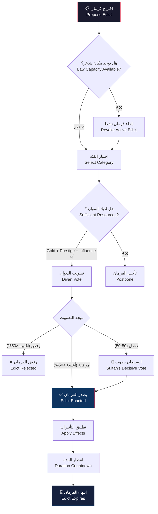
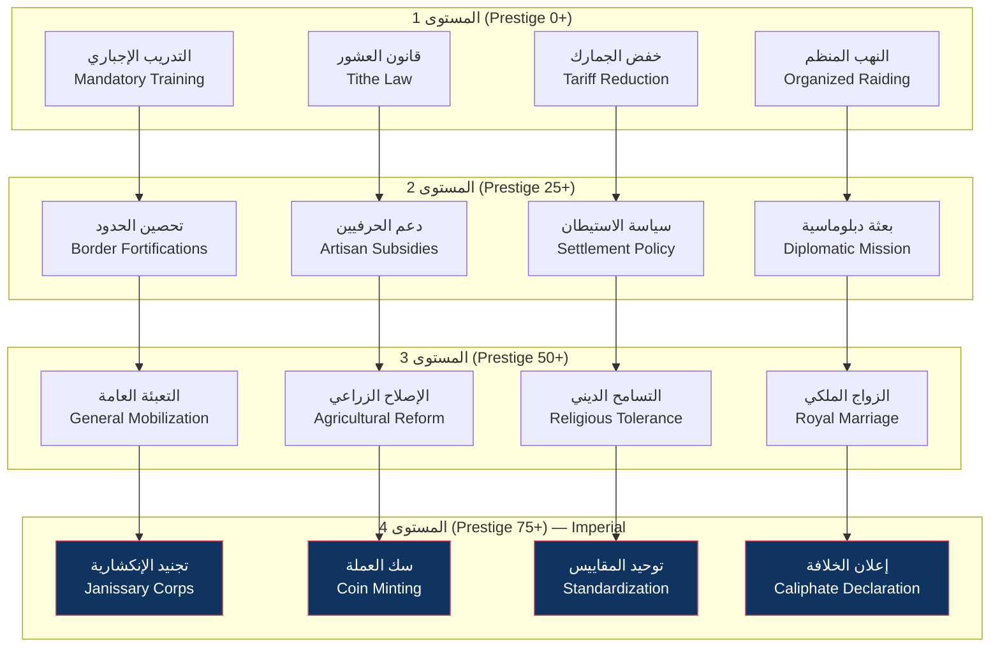

# نظام الإدارة الإمبراطورية — Law and Edicts System

> **القانون هو سلطان السلطان — Kanun Üstündür**

## 1. مقدمة عن النظام القانوني

بعد تأسيس الديوان الإمبراطوري، تنتقل الدولة من **القانون العرفي (Customary Law)** — الذي كان سائداً في فترة القبيلة — إلى **القانون المكتوب (Kanun)**. الفرمانات (Edicts) هي الأدوات التي يشكل بها السلطان سياسات الدولة.

النظام القانوني هو العمود الفقري للإدارة الإمبراطورية. كل فرمان تصدره له تكلفة، ومدة، وفوائد، وعيوب، وتأثير على شخصية الدولة (State Character).

---

## 2. آلية إصدار الفرمانات — Edict Issuance

### 2.1 العملية الأساسية

### 2.2 تكاليف إصدار الفرمان

| المورد | التكلفة الأساسية | العوامل المؤثرة |
|--------|-----------------|-----------------|
| 🪙 Gold | 200-1500 (حسب القوة) | حالة الاقتصاد، مستوى الضرائب |
| 🏅 Prestige | 5-40 (حسب القوة) | مستوى السمعة الحالي |
| 📜 Influence | 5-25 (حسب القوة) | نفوذ الفصائل |
| ⏱️ وقت الإصدار | 1-6 أشهر | Kazasker's Edict Speed |

### 2.3 سعة القانون — Law Capacity

Law Capacity تحدد عدد الفرمانات النشطة في وقت واحد.

| الطريقة | زيادة Law Capacity |
|---------|-------------------|
| أساسي | 3 (بداية فتح النظام) |
| Kazasker ب Justice ≥ 80 | +1 |
| البحث (Research) | +1 (مقابل 2000 Gold) |
| حدث (Event) | +1 (حدث نادر) |
| Imperial Edicts (بعد التتويج) | +2 |
| **الحد الأقصى** | **10** |

---

## 3. فئات الفرمانات — Edict Categories

### 3.1 الفرمانات العسكرية — Military Edicts

تخص الجيش والحصون والتسليح.

| اسم الفرمان | English | التكلفة | الفوائد | العيوب | المدة |
|-------------|---------|---------|---------|--------|-------|
| التعبئة العامة | General Mobilization | 800G + 20P + 15I | +40% Recruitment Speed, +25% Army Size | +30% Army Maintenance, -10 Stability | 12 شهر |
| تحصين الحدود | Border Fortifications | 600G + 10P + 10I | +30% Defense in Border Battles, +20% Fort HP | +15% Building Cost | 24 شهر |
| التدريب الإجباري | Mandatory Training | 400G + 5P + 5I | +15% Army Quality, +10% Morale | -5% Population Growth | دائم (قابل للإلغاء) |
| تجنيد الإنكشارية | Janissary Corps | 1000G + 25P + 20I | +25% Elite Unit Cap, +20% Siege | -15% Tax Income (امتيازات) | دائم |
| النهب المنظم | Organized Raiding | 300G + 15P + 5I | +40% Ganimet, +10% Army Morale | -15 Diplomacy مع الجيران | 6 أشهر |

### 3.2 الفرمانات الاقتصادية — Economic Edicts

تخص المال والتجارة والموارد.

| اسم الفرمان | English | التكلفة | الفوائد | العيوب | المدة |
|-------------|---------|---------|---------|--------|-------|
| سك العملة | Coin Minting | 500G + 15P + 10I | +20% Tax Income, +10% Trade | +10% Inflation (على المدى الطويل) | دائم |
| خفض الجمارك | Tariff Reduction | 300G + 10P + 10I | +25% Trade Volume, +15% Merchant Happiness | -10% Trade Tax Income | 18 شهر |
| احتكار الملح | Salt Monopoly | 400G + 5P + 5I | +15% Gold/Turn | -5 Stability، -10 Influence | دائم |
| دعم الحرفيين | Artisan Subsidies | 350G + 10P + 8I | +20% Production Speed, +15% Building Quality | -200 Gold/Turn | 12 شهر |
| الإصلاح الزراعي | Agricultural Reform | 600G + 20P + 12I | +30% Food Production, +10% Population Growth | -300 Gold/Turn (أول 6 أشهر) | دائم |

### 3.3 الفرمانات الاجتماعية — Social Edicts

تخص السكان والدين والمجتمع.

| اسم الفرمان | English | التكلفة | الفوائد | العيوب | المدة |
|-------------|---------|---------|---------|--------|-------|
| التسامح الديني | Religious Tolerance | 500G + 30P + 20I | +25% Non-Muslim Happiness, +15% Population Growth | -10% Religious Unity, -5% Influence للفصيل الديني | دائم |
| سياسة الاستيطان | Settlement Policy | 400G + 15P + 10I | +20% Settlement Growth, +10% Territory Development | -10% Nomad Relations | دائم |
| توحيد المقاييس | Standardization of Measures | 300G + 20P + 8I | +15% Trade Efficiency, +10% Tax Income | -200 Gold (تكاليف أولية) | دائم |
| قانون العشور | Tithe Law (Öşür) | 250G + 10P + 5I | +20% Farm Income, +15% Religious Authority | -5% Non-Muslim Happiness | دائم |
| حظر الترف | Luxury Ban | 200G + 5P + 15I | +10% Gold Reserve, +15% Army Morale (تقشف) | -10% Trade Income, -10 Merchant Happiness | 12 شهر |

### 3.4 الفرمانات الدبلوماسية — Diplomatic Edicts

تخص العلاقات الخارجية والتحالفات.

| اسم الفرمان | English | التكلفة | الفوائد | العيوب | المدة |
|-------------|---------|---------|---------|--------|-------|
| إعلان الهدنة | Truce Declaration | 200G + 10P + 5I | +20 Diplomacy مع عدو واحد، -10% War Exhaustion | -10% Army Morale | 12 شهر |
| بعثة دبلوماسية | Diplomatic Mission | 400G + 15P + 15I | +30 Relations مع دولة، فتح تحالف محتمل | خطر فشل البعثة (20%) | 6 أشهر |
| الزواج الملكي | Royal Marriage | 800G + 25P + 10I | +40 Relations، تحالف عسكري محتمل | تكلفة مهر باهظة | دائم |
| فرض الجزية | Tribute Demand | 300G + 10P + 5I | +200-800 Gold (لمرة واحدة)، +5 Prestige | -30 Relations، خطر حرب (40%) | 3 أشهر |
| العزلة الدبلوماسية | Diplomatic Isolation | 100G + 5P + 20I | +10% Stability، -15% Foreign Influence | -20 Relations مع الجميع | 12 شهر |

---

## 4. نظام السمعة — Prestige System

### 4.1 مصادر السمعة

| المصدر | مقدار Prestige | التكرار |
|--------|----------------|---------|
| فتح مدينة | +15 إلى +50 | كل فتح |
| بناء مسجد جامع | +10 | كل بناء |
| بناء مدرسة | +5 | كل بناء |
| إصدار فرمان ناجح | +3 إلى +15 | كل إصدار |
| انتصار عسكري كبير | +10 إلى +30 | كل معركة |
| حدث زواج ملكي | +10 | كل زواج |
| استضافة حفل | +5 إلى +20 | كل حفل |
| وفاة سلطان عادل | +25 | مرة واحدة |

### 4.2 مستويات السمعة وتأثيراتها

| المستوى | النطاق | اللقب | التأثيرات |
|---------|--------|-------|-----------|
| 1 | 0-24 | أمير (Emir) | أساسي |
| 2 | 25-49 | بك (Bey) | +5% Army Morale، فتح فرمانات المستوى 2 |
| 3 | 50-74 | سلطان (Sultan) | +10% Diplomacy، فتح فرمانات المستوى 3 |
| 4 | 75-99 | سلطان أعظم (Grand Sultan) | +15% Tax Income، فتح Imperial Edicts |
| 5 | 100-124 | خاقان (Hakan) | +20% Army Size، +1 Law Capacity |
| 6 | 125-149 | قيصر (Caesar) | +25% Prestige Gain، دعوة بيزنطية |
| 7 | 150+ | ذو القرنين (Dhul-Qarnayn) | كل التأثيرات السابقة + أحداث خاصة |

### 4.3 اضمحلال السمعة — Prestige Decay

السمعة تتناقص بمرور الوقت إذا لم يتم تجديدها:

| الحالة | الاضمحلال/الشهر |
|--------|-----------------|
| في حالة سلم | -2 Prestige |
| في حالة حرب دفاعية | -1 Prestige |
| في حالة حرب هجومية | 0 Prestige |
| في حالة فتح جديد | +3 Prestige (شهر واحد بعد الفتح) |
| مجاعة أو كارثة | -5 Prestige |
| وفاة سلطان | -15 Prestige (فوري) |

---

## 5. شخصية الدولة — State Character

القوانين التي تصدرها تشكل شخصية الدولة (State Character). هناك 4 مسارات رئيسية:

### 5.1 المسارات

| الشخصية | الشعار | الفرمانات المطلوبة | المكافآت | الاستفادة من |
|---------|--------|-------------------|---------|-------------|
| ⚔️ عسكري (Militaristic) | "السيف أبلغ من القلم" | 5+ فرمانات عسكرية | +25% Army Morale، +20% Recruitment | غزوات متكررة |
| 🏛️ تجاري (Mercantile) | "التجارة تفتح ما لا تفتح الحروب" | 5+ فرمانات اقتصادية | +30% Trade Income، +20% Trade Routes | طرق تجارية |
| 🕌 ديني (Theocratic) | "الدين أساس الملك" | 5+ فرمانات اجتماعية/دينية | +30% Prestige، +20% Religious Unity | بناء مساجد |
| 🤝 دبلوماسي (Diplomatic) | "الحرب الأخيرة هي السلام الدائم" | 5+ فرمانات دبلوماسية | +25% Diplomacy، تحالفات أسهل | معاهدات |

### 5.2 تغيير الشخصية

- تغيير الشخصية يتطلب **إلغاء 3 فرمانات** من الشخصية الحالية
- ثم **إصدار 3 فرمانات** من الشخصية الجديدة
- تكلفة تغيير الشخصية: -15 Stability (اضطراب)
- فترة انتقالية: 6 أشهر بدون مكافآت شخصية

### 5.3 تأثير الشخصية على النهايات

| الشخصية | النهاية المحتملة |
|---------|-----------------|
| عسكري | فتح القسطنطينية — النهاية العسكرية العظمى |
| تجاري | السيطرة على طريق الحرير — النهاية الاقتصادية |
| ديني | قيادة العالم الإسلامي — النهاية الدينية |
| دبلوماسي | الإمبراطورية العالمية — نهاية التوازن |

---

## 6. نظام تعارض الفرمانات — Edict Conflict System

بعض الفرمانات **متعارضة (Mutually Exclusive)** — لا يمكن تفعيلها معاً:

### 6.1 أزواج متعارضة

| الفرمان الأول | الفرمان الثاني | سبب التعارض |
|--------------|----------------|-------------|
| التسامح الديني | قانون العشور | العشور تفرض ضرائب دينية ثقيلة على غير المسلمين |
| تجنيد الإنكشارية | خفض الجيش | الإنكشارية تتطلب ميزانية ضخمة |
| التعبئة العامة | إعلان الهدنة | لا يمكن التعبئة والتهدئة في نفس الوقت |
| دعم الحرفيين | حظر الترف | الحظر يقتل الطلب على المنتجات الحرفية |
| العزلة الدبلوماسية | بعثة دبلوماسية | العزلة تمنع إرسال البعثات |

### 6.2 فروق متعارضة (مستوى أدنى)

بعض الفرمانات تقلل من فعالية فرمانات أخرى:

| الفرمان | يتعارض مع | عقوبة الفعالية |
|---------|-----------|----------------|
| التسامح الديني | قانون العشور | -50% فعالية العشور |
| النهب المنظم | خفض الجمارك | -30% فعالية التجارة |
| احتكار الملح | دعم الحرفيين | -25% إنتاج الحرفيين |

---

## 7. إلغاء الفرمانات — Revoking Edicts

### 7.1 تكاليف الإلغاء

| حالة الإلغاء | التكلفة | التأثير الإضافي |
|-------------|---------|-----------------|
| إلغاء مبكر (قبل منتصف المدة) | 50% من تكلفة الإصدار | -10 Prestige، -5 Stability |
| إلغاء في الوقت المناسب | 25% من تكلفة الإصدار | -5 Prestige |
| انتهاء المدة تلقائياً | 0 | 0 |
| إلغاء قسري (تمرد/انقلاب) | 0 | +15 Prestige (التخلص من قانون سيء) لكن -20 Stability |

### 7.2 عواقب الإلغاء

- **فقدان المكافآت**: تختفي جميع مكافآت الفرمان فوراً
- **إلغاء العيوب**: تختفي جميع عيوب الفرمان فوراً
- **تأثير على الفصائل**: -5 إلى -15 علاقة مع الفصيل الذي دعم الفرمان
- **Cooldown**: لا يمكن إصدار نفس الفرمان لمدة 12 شهراً بعد الإلغاء

---

## 8. شجرة الفرمانات — Edict Tech Tree

---

## 9. مثال: نظام قانوني متكامل

**مثال: دولة عسكرية في زمن الحرب**

| الفرمانات النشطة (5/5 سعة) | التأثيرات |
|---------------------------|-----------|
| التعبئة العامة (12 شهراً) | +40% Recruitment، +25% Army Size، +30% Maintenance |
| تحصين الحدود (24 شهراً) | +30% Border Defense، +20% Fort HP، +15% Building Cost |
| التدريب الإجباري (دائم) | +15% Army Quality، +10% Morale، -5% Population Growth |
| النهب المنظم (6 أشهر) | +40% Ganimet، +10% Morale، -15 Diplomacy |
| احتكار الملح (دائم) | +15% Gold/Turn، -5 Stability، -10 Influence |

**المحصلة**:
- +65% Army Morale
- +80% Recruitment Speed
- +40% Ganimet
- +30% Border Defense
- -15 Diplomacy مع الجميع
- State Character: عسكري (Militaristic) — مكافآت إضافية
- خطر التمرد: +15% (بسبب Stability المنخفض)

---

## 10. نصائح قانونية

1. **لا تصدر فرمانات متعارضة**: اقرأ وصف كل فرمان بعناية — بعضها يلغي فعالية البعض الآخر.
2. **راقب سعة القوانين**: الوصول إلى الحد الأقصى (Full Capacity) يسبب -5 Stability شهرياً.
3. **التوقيت المناسب**: أصدر فرمانات الحرب قبل الحملة بثلاثة أشهر (وقت كافٍ للتفعيل).
4. **التوازن الفصائلي**: إذا سيطر فصيل واحد، ستجد صعوبة في تمرير فرمانات تخالف مصلحته.
5. **السمعة مورد استراتيجي**: لا تنفق كل Prestige على فرمانات — احتفظ باحتياطي 30+ للأحداث الطارئة.

---

> **تاريخ آخر تحديث**: 2026-06-20
