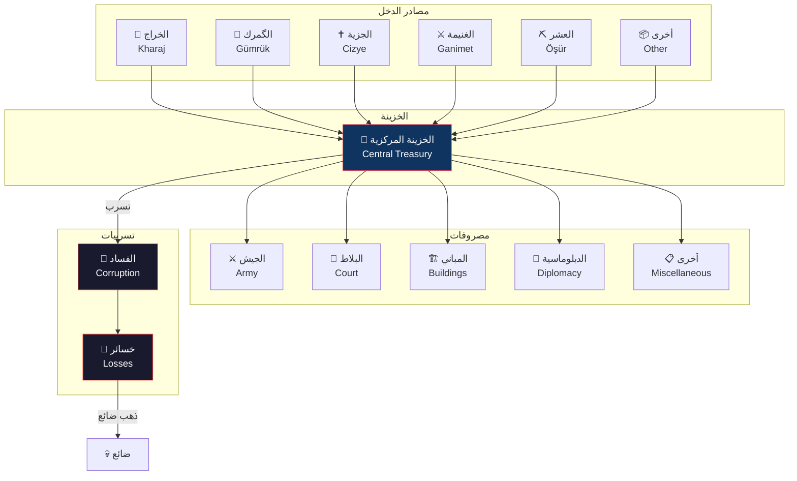

# نظام الإدارة الإمبراطورية — Treasury and Taxation System

> **"الدرهم يجر الدينار، والدينار يجر المملكة" — مثل عثماني**

## 1. مقدمة عن النظام المالي

الخزينة هي شريان الدولة. بدون الذهب، لا جيش، لا بناء، لا دبلوماسية. نظام الضرائب والخزينة في الموسم 6 يمثل نقلة نوعية عن النظام القبلي البسيط في المواسم السابقة.

بعد فتح بورصة وتأسيس الديوان، يتحكم اللاعب في **5 أنواع ضرائب** مختلفة، كل منها له تأثيره على الاقتصاد والمجتمع. كما تظهر نفقات جديدة تتطلب موازنة دقيقة بين الإيرادات والمصروفات.

---

## 2. أنواع الضرائب — Tax Types

### 2.1 خراج (Kharaj) — ضريبة الأراضي

الضريبة الأساسية، تُفرض على الأراضي الزراعية والمزروعات.

| المستوى | English Level | المعدل | الدخل الشهري | التأثير على الفلاحين |
|---------|--------------|--------|-------------|---------------------|
| 1 | Very Low | 5% | 50 × عدد الأراضي | +10% فلاحين سعداء |
| 2 | Low | 10% | 100 × عدد الأراضي | +5% فلاحين سعداء |
| 3 | Moderate | 15% | 150 × عدد الأراضي | محايد |
| 4 | High | 20% | 200 × عدد الأراضي | -10% فلاحين غاضبين |
| 5 | Very High | 30% | 300 × عدد الأراضي | -25% فلاحين غاضبين، خطر تمرد |

**عوامل مؤثرة**:
- خصوبة الأرض (Fertility): ×0.5 إلى ×1.5
- وجود مبانٍ زراعية: +25% لكل مبنى ري
- موسم الجفاف: -30% لمدة الموسم

### 2.2 گمرك (Gümrük) — ضريبة التجارة

تُفرض على البضائع العابرة عبر الطرق التجارية.

| المستوى | English Level | المعدل | الدخل الشهري | التأثير على التجار |
|---------|--------------|--------|-------------|-------------------|
| 1 | Very Low | 3% | 30 × عدد الطرق | +15% حجم التجارة |
| 2 | Low | 6% | 60 × عدد الطرق | +5% حجم التجارة |
| 3 | Moderate | 10% | 100 × عدد الطرق | محايد |
| 4 | High | 15% | 150 × عدد الطرق | -15% حجم التجارة |
| 5 | Very High | 25% | 250 × عدد الطرق | -30% حجم التجارة |

**عوامل مؤثرة**:
- وجود أسواق: +50 Gold لكل سوق
- طريق حرير قريب: ×2 الدخل
- حرب مع جار تجاري: -50%

### 2.3 جزية (Cizye) — ضريبة غير المسلمين

ضريبة على السكان غير المسلمين مقابل حمايتهم وإعفائهم من الخدمة العسكرية.

| المستوى | English Level | الدخل الشهري | التأثير على غير المسلمين |
|---------|--------------|-------------|------------------------|
| 1 | Symbolic | 20 × عدد غير المسلمين | +10% ولاء |
| 2 | Standard | 50 × عدد غير المسلمين | محايد |
| 3 | Heavy | 80 × عدد غير المسلمين | -10% ولاء، -5% هجرة |
| 4 | Oppressive | 120 × عدد غير المسلمين | -20% ولاء، -15% هجرة |
| 5 | Exorbitant | 180 × عدد غير المسلمين | -35% ولاء، -30% هجرة، خطر تمرد |

**ملاحظة**: لا يمكن فرض Cizye إذا كان Edict "التسامح الديني" نشطاً.

### 2.4 غنيمة (Ganimet) — غنائم الحرب

نسبة مئوية من الغنائم تعود للخزينة بدلاً من توزيعها على الجنود.

| النسبة | English | دخل/معركة | التأثير على الجيش |
|--------|---------|-----------|------------------|
| 10% | Minimal Crown Share | Low | +15% Army Morale (الجنود يأخذون نصيباً أكبر) |
| 25% | Standard Crown Share | Medium | محايد |
| 50% | Equal Split | Medium-High | -10% Army Morale |
| 75% | Heavy Crown Share | High | -20% Army Morale |
| 90% | Maximum Crown Share | Very High | -35% Army Morale، خطر تمرد عسكري |

**ميكانيك**: Ganimet متغير — يعتمد على حجم العدو المهزوم وثراء المدينة المفتوحة.

### 2.5 عشر (Öşür) — العشور/ضريبة المناجم

نسبة من إنتاج المناجم والمحاجر.

| المستوى | English Level | الدخل الشهري | التأثير على الإنتاج |
|---------|--------------|-------------|-------------------|
| 1 | Light Tithe | 10% من إنتاج المناجم | محايد |
| 2 | Standard Tithe | 20% من إنتاج المناجم | -5% إنتاج |
| 3 | Heavy Tithe | 35% من إنتاج المناجم | -15% إنتاج |

---

## 3. واجهة منزلقات الضرائب — Tax Slider UI

```
┌─────────────────────────────────────────────────────┐
│  إدارة الضرائب — Tax Management                      │
├─────────────────────────────────────────────────────┤
│                                                     │
│  الخراج (Kharaj)    [منخفض ●━━━━━━━━━━○━━━━━━━━━● عالٍ] │
│  الدخل: 1200 Gold/شهر    ❤  الفلاحون: سعداء          │
│                                                     │
│  الگمرك (Gümrük)    [منخفض ○━━━━━━━━━●━━━━━━━━━━○ عالٍ] │
│  الدخل: 600 Gold/شهر     🏪 التجار: محايدون          │
│                                                     │
│  الجزية (Cizye)     [منخفض ○━━━━━━━━○━━━━━●━━━━━━○ عالٍ] │
│  الدخل: 400 Gold/شهر     ✝  غير المسلمين: غاضبون     │
│                                                     │
│  الغنيمة (Ganimet)  [قليل ●━━━━━━━━━━━━○━━━━━━━━━○ كثير] │
│  الدخل: متغير           ⚔  الجيش: راضٍ               │
│                                                     │
│  العشر (Öşür)       [خفيف ●━━━━━━━━━━━━○━━━━━━━━━○ ثقيل] │
│  الدخل: 300 Gold/شهر     ⛏  المناجم: نشطة            │
│                                                     │
│  ┌─────────────────────────────────────────────────┐ │
│  │  إجمالي الدخل الشهري: 3,100 Gold               │ │
│  │  إجمالي الإنفاق الشهري: 2,450 Gold             │ │
│  │  الفائض: 650 Gold/شهر 🟢                       │ │
│  │  الخزينة الحالية: 12,450 Gold                  │ │
│  └─────────────────────────────────────────────────┘ │
└─────────────────────────────────────────────────────┘
```

---

## 4. فئات الإنفاق — Expenditure Categories

### 4.1 الإنفاق العسكري (Army)

| البند | التكلفة الشهرية الأساسية | العوامل المؤثرة |
|-------|-------------------------|-----------------|
| صيانة الجيش | 10 Gold/وحدة | نوع الوحدة (مشاة 10، فرسان 25، منجنيق 50) |
| رواتب القادة | 100-300 Gold/قائد | مستوى القائد |
| صيانة الحصون | 50 Gold/حصن | مستوى الحصن |
| تجنيد (لمرة واحدة) | 50-200 Gold/وحدة | نوع الوحدة ووقت التدريب |
| تطوير الأسلحة | 500-2000 Gold (لمرة) | مستوى التطوير |

### 4.2 إنفاق البلاط (Court)

| البند | التكلفة الشهرية | ملاحظات |
|-------|----------------|---------|
| رواتب الديوان | 200 Gold/عضو | يزيد مع الخبرة |
| مراسم واحتفالات | 100-500 Gold (متقطع) | أحداث عشوائية |
| الحرس الشخصي | 100 Gold/شهر | يحمي من الاغتيالات |
| جوائز وهدايا | 50-200 Gold (حسب الحاجة) | رفع ولاء الأعضاء |

### 4.3 الإنفاق على المباني (Buildings)

| البند | English | التكلفة | المدة |
|-------|---------|---------|-------|
| بناء مسجد | Mosque Construction | 2000 Gold | 6 أشهر |
| بناء سوق | Market Construction | 1500 Gold | 4 أشهر |
| بناء حصن | Fort Construction | 3000 Gold | 8 أشهر |
| بناء طريق | Road Construction | 500 Gold/قطعة | شهران |
| صيانة المباني | Building Maintenance | 50-200 Gold/مبنى/شهر | شهرياً |
| تطوير المباني | Building Upgrade | 50% من تكلفة البناء | +50% وقت البناء |

### 4.4 الإنفاق الدبلوماسي (Diplomacy)

| البند | التكلفة | التأثير |
|-------|---------|---------|
| هدايا دبلوماسية | 200-1000 Gold | +10 إلى +30 Relations |
| مهر زواج | 1000-3000 Gold | تحالف +40 Relations |
| رشوة مسؤول عدو | 500-1500 Gold | تخريب، معلومات |
| بعثة تجارية | 300 Gold | +15 Trade Relations |

---

## 5. موازنة الميزانية — Budget Balancing

### 5.1 شاشة الميزانية

```
┌─────────────────────────────────────────────────────┐
│  الميزانية الشهرية — Monthly Budget        [تعديل]   │
├─────────────────────────────────────────────────────┤
│                                                     │
│  📈 الإيرادات (Income)                              │
│  ───────────────────────────────────────             │
│  الخراج (Kharaj)         1,200 Gold   38%           │
│  الگمرك (Gümrük)           600 Gold   19%           │
│  الجزية (Cizye)            400 Gold   13%           │
│  الغنيمة (Ganimet)         600 Gold   19% (متوسط)   │
│  العشر (Öşür)              300 Gold   10%           │
│  الإيرادات الأخرى          100 Gold    3%           │
│  ───────────────────────────────────────             │
│  الإجمالي:               3,200 Gold  100%           │
│                                                     │
│  📉 المصروفات (Expenditure)                         │
│  ───────────────────────────────────────             │
│  الجيش (Army)             1,200 Gold   46%           │
│  البلاط (Court)             400 Gold   15%           │
│  المباني (Buildings)        500 Gold   19%           │
│  الدبلوماسية (Diplomacy)    250 Gold   10%           │
│  أخرى (Miscellaneous)       250 Gold   10%           │
│  ───────────────────────────────────────             │
│  الإجمالي:               2,600 Gold  100%            │
│                                                     │
│  💰 الفائض/العجز: +600 Gold/شهر 🟢                  │
│                                                     │
│  ⚠️ تحذيرات:                                       │
│  • الإنفاق العسكري مرتفع (46% > 40% الموصى به)      │
│  • الفلاحون غير راضين عن مستوى الخراج                │
└─────────────────────────────────────────────────────┘
```

### 5.2 مؤشرات التحذير

| المؤشر | الحالة | التحذير |
|--------|--------|---------|
| عجز شهري (Deficit) | الإنفاق > الإيرادات | 🟡 تحذير أصفر |
| عجز مزمن | 3+ أشهر متتالية من العجز | 🟠 تحذير برتقالي — خسارة Prestige |
| إفلاس وشيك | الخزينة < 500 Gold | 🔴 تحذير أحمر — بيع ممتلكات |
| إفلاس | الخزينة = 0 | ❌ إفلاس — انهيار الدولة |

---

## 6. نظام الفساد — Corruption Mechanic

الفساد هو العدو الخفي للخزينة. كلما زاد الفساد، زادت الخسائر.

### 6.1 نسبة الفساد (0-100%)

| المستوى | النسبة | التأثير |
|---------|--------|---------|
| نزيه (Honest) | 0-10% | لا تأثير |
| طفيف (Minor) | 11-25% | -5% دخل الضرائب |
| متوسط (Moderate) | 26-50% | -15% دخل، -10% كفاءة |
| عالٍ (High) | 51-75% | -30% دخل، -20% كفاءة، أحداث فساد متكررة |
| مستشري (Endemic) | 76-100% | -50% دخل، -40% كفاءة، انهيار محتمل |

### 6.2 مصادر الفساد

| المصدر | مقدار الفساد | ملاحظات |
|--------|-------------|---------|
| عضو ديوان بولاء <40 | +5%/شهر/عضو | يسرق من الخزينة |
| ضرائب مرتفعة جداً | +3%/شهر | الإغراء يزيد |
| حرب طويلة (>12 شهراً) | +10% | الفوضى تغذي الفساد |
| فرمان "احتكار الملح" نشط | +5%/شهر | الاحتكار يولد فساداً |
| عدم وجود قاضي عسكر | +8%/شهر | لا رقابة قضائية |
| وفاة سلطان | +15% (فوري) | فراغ سلطة |
| كل 1000 Gold في الخزينة | +1% | المال يفسد |

### 6.3 إجراءات مكافحة الفساد

| الإجراء | التكلفة | تخفيض الفساد | المخاطر |
|---------|---------|-------------|---------|
| تفتيش مفاجئ | 200 Gold | -10% | غضب الأعضاء (-5 Loyalty) |
| محاكمة فاسد | 300 Gold | -15% + استرداد أموال | غضب فصيل العضو |
| إصلاح إداري | 800 Gold + 15 Influence | -25% (دائم) | 6 أشهر للتنفيذ |
| تعيين مفتش عام | 500 Gold/شهر | -5%/شهر | منصب جديد في الديوان |
| تخفيض الضرائب | تخفيض الإيرادات | -3%/شهر | نقص الذهب |

---

## 7. الأموال الطارئة — Emergency Funds

### 7.1 القروض (Loans)

عندما تحتاج إلى ذهب سريع، يمكنك الاقتراض من التجار.

| حجم القرض | المبلغ | الفائدة الشهرية | مدة السداد |
|-----------|--------|-----------------|------------|
| صغير (Small) | 1,000 Gold | 5% (50 Gold/شهر) | 24 شهراً |
| متوسط (Medium) | 3,000 Gold | 8% (240 Gold/شهر) | 36 شهراً |
| كبير (Large) | 6,000 Gold | 12% (720 Gold/شهر) | 48 شهراً |
| طارئ (Emergency) | 10,000 Gold | 20% (2,000 Gold/شهر) | 60 شهراً |

**عواقب التخلف عن السداد**:
- بعد 3 أشهر من التأخير: -20 Prestige
- بعد 6 أشهر: تغريم 50% من الخزينة
- بعد 12 شهراً: إعلان إفلاس — نهاية اللعبة (Game Over)

### 7.2 الكنوز (Treasures)

مصادر ذهب لمرة واحدة:

| المصدر | المبلغ | متى |
|--------|--------|-----|
| فتح مدينة كبيرة | 2,000-5,000 Gold | كل فتح |
| كنز تحت القصر | 1,000-3,000 Gold | حدث عشوائي |
| تبرع تجار | 500-1,500 Gold | علاقات تجارية عالية |
| ميراث | 1,000-4,000 Gold | وفاة قريب ثري |
| غرامات ومصادرات | 200-800 Gold | محاكمات ناجحة |

---

## 8. تدفق الذهب — Gold Flow Diagram



---

## 9. مثال: ميزانية حصار بورصة (1326)

### 9.1 سياق الحملة

- **المدة**: 7 أشهر (الموسم 6)
- **القوة المهاجمة**: 8,000 جندي (2,000 فرسان، 5,000 مشاة، 1,000 رماة، 10 منجنيق)
- **القوة المدافعة**: 3,000 داخل بورصة

### 9.2 الميزانية التقديرية

| البند | التكلفة/شهر | التكلفة الإجمالية (7 أشهر) |
|-------|-------------|--------------------------|
| صيانة الجيش | 1,400 Gold | 9,800 Gold |
| رواتب القادة | 600 Gold | 4,200 Gold |
| ذخيرة المنجنيق | 200 Gold | 1,400 Gold |
| إمدادات الحصار | 300 Gold | 2,100 Gold |
| جوائز للجنود | 400 Gold | 2,800 Gold |
| **المجموع** | **2,900 Gold/شهر** | **20,300 Gold** |

### 9.3 الإيرادات المتوقعة أثناء الحصار

| المصدر | الدخل/شهر |
|--------|-----------|
| الخراج (بعد رفعه للحرب) | 1,500 Gold |
| الگمرك | 400 Gold |
| الجزية | 300 Gold |
| العشر | 250 Gold |
| غنائم المعارك الجانبية | 800 Gold (متوسط) |
| **المجموع** | **3,250 Gold/شهر** |

### 9.4 النتيجة

ميزانية الحصار تحقق فائضاً قدره **350 Gold/شهر** — ولكن هذا لا يشمل النفقات غير المتوقعة (إصلاحات، هجمات مضادة، خسائر). يُنصح بامتلاك احتياطي **15,000 Gold** قبل بدء حصار كبير.

> "حصار بورصة لم يكن مجرد معركة عسكرية، بل كان اختباراً لقدرة الدولة العثمانية الناشئة على تمويل حرب كبرى."

---

## 10. نصائح مالية

1. **احتياطي الذهب**: احتفظ دائماً بـ 5,000 Gold كحد أدنى للطوارئ.
2. **الضرائب المتدرجة**: ارفع الضرائب في زمن الحرب، اخفضها في زمن السلم.
3. **استثمر في الأسواق**: كل سوق تبنيها يزيد دخل الگمرك بنسبة 10%.
4. **راقب الفساد**: إذا تجاوز الفساد 30%، فأنت تخسر أكثر مما تدرك.
5. **القروض حلاً أخيراً**: الفائدة المركبة تؤدي إلى دوامة ديون — اقترض فقط لإنقاذ الموقف.
6. **التوازن**: لا تجعل الإنفاق العسكري يتجاوز 50% من الميزانية في أوقات السلم.

---

> **تاريخ آخر تحديث**: 2026-06-20
