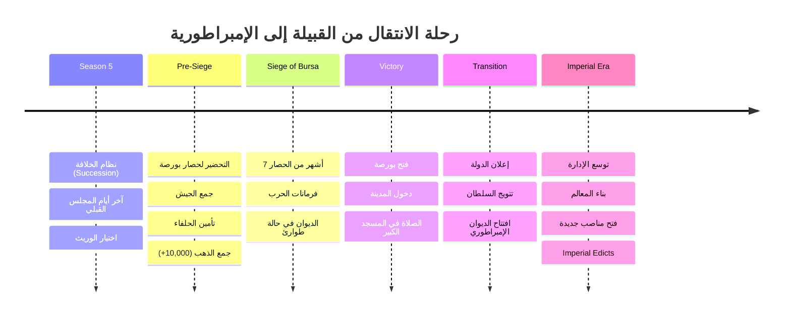
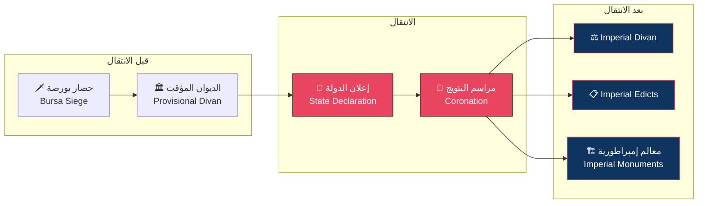

# نظام الإدارة الإمبراطورية — Imperial Transition System

> **"من بك إلى سلطان، من قبيلة إلى إمبراطورية"**

## 1. مقدمة — لماذا الانتقال؟

في الموسم السادس، تصل الدولة العثمانية إلى مفترق طرق تاريخي. فتح بورصة ليس مجرد انتصار عسكري — إنه تحول وجودي. من إمارة صغيرة (Beylik) إلى دولة إقليمية (Sultanate). من حكم قبلي إلى حكم إمبراطوري.

هذا الملف يوثق **آلية الانتقال (Transition Mechanic)** — كيف تتحول الدولة، وما الذي يتغير، وكيف تؤثر اختيارات اللاعب السابقة (خاصة نظام الخلافة في الموسم 5) على شكل الإمبراطورية الجديدة.

---

## 2. شروط التفعيل — Trigger Conditions

### 2.1 الشروط الأساسية

| الشرط | English | التفصيل |
|-------|---------|---------|
| فتح بورصة | Bursa Conquest | يجب أن تكون بورصة تحت سيطرتك |
| المساحة الدنيا | Minimum Territory | 5+ مناطق خاضعة للسيطرة |
| السمعة الدنيا | Minimum Prestige | 50+ Prestige |
| نظام الخلافة | Succession System | يجب إكمال موسم الخلافة (5) |
| الوقت | Timing | بعد 3-12 شهراً من فتح بورصة (حسب اختيارك) |

### 2.2 الشروط الإضافية (اختيارية، تمنح مكافآت أفضل)

| الشرط | المكافأة الإضافية |
|-------|-------------------|
| 8+ مناطق | +10 Prestige عند الانتقال |
| 75+ Prestige | لقب أعلى (Sultan بدلاً من Bey) |
| خزينة 10,000+ Gold | +500 Gold هدايا للوفود |
| تحالف مع بيليك آخر | +15 Diplomatic Relations مع الجميع |
| زواج سياسي نشط | +10 Stability بعد الانتقال |

### 2.3 فحص الجاهزية

عند استيفاء الشروط الأساسية، يظهر إشعار:

```
═══════════════════════════════════════════════════
📜 حدث: تأسيس الدولة
═══════════════════════════════════════════════════

"بورصة الآن في أيدينا. المدينة أكبر وأغنى من أي مكان
حكمناه من قبل. يا سلطان، الدولة تحتاج إلى هيكل جديد.
القبيلة لم تعد كافية."

الشروط مستوفاة:
✅ بورصة محررة
✅ 7 مناطق تحت السيطرة
✅ السمعة: 68/100
✅ خزينة كافية: 12,450 Gold

[🗡️  أعلن الدولة الآن]  [⏳ انتظر 6 أشهر للاستعداد]
```

---

## 3. حدث الانتقال — The Transition Event

### 3.1 المشهد السينمائي (Cinematic)

عند اختيار "أعلن الدولة الآن"، تبدأ كت سينمائية مدتها 60 ثانية:

1. **المشهد الأول**: جيش عثماني يدخل بورصة من الباب الشرقي
2. **المشهد الثاني**: خطبة في مسجد بورصة الكبير — "لا إله إلا الله..."
3. **المشهد الثالث**: الديوان يجتمع في قصر بورصة — أول جلسة رسمية
4. **المشهد الرابع**: تتويج السلطان (أو تتويج أورخان إذا كان عثمان قد توفي)

### 3.2 الحوار السردي (Narrative Dialogue)

```
═══════════════════════════════════════════════════
~ مشهد الانتقال ~
═══════════════════════════════════════════════════

علاء الدين باشا: "الحمد لله الذي أتم علينا فتح بورصة.
يا أمير المؤمنين، لقد آن الأوان لنعلن الدولة."

عثمان غازي: "منذ أن خرجنا من سوغوت ونحن نحلم بهذا اليوم.
بورصة ستكون عاصمتنا. ومن هنا ننطلق."

أورخان بك: "والدي، لقد حان وقت الانتقال من القبيلة إلى الدولة.
الجيش جاهز، والخزينة ممتلئة، والشعب معنا."

قاضي عسكر: "أعددنا خطبة الجمعة لإعلان الدولة رسمياً.
ووجهنا الدعوات للأمراء المجاورين."

دفتردار: "طبعنا عملة جديدة تحمل اسم الدولة.
500 قطعة ذهبية جاهزة للتوزيع في الاحتفال."

═══════════════════════════════════════════════════
يختار اللبان:
[1] إعلان الدولة الآن — تكاليف أقل، مكافآت أقل
[2] الانتظار 6 أشهر للتحضير — تكاليف أعلى، مكافآت أفضل
[3] إعلان هادئ بدون احتفال — تكلفة منخفضة، سمعة أقل
═══════════════════════════════════════════════════
```

### 3.3 نتائج كل خيار

| الخيار | التكلفة | المكافآت | التبعات |
|--------|---------|---------|---------|
| إعلان فوري | 1,000 Gold | +20 Prestige، +10 Stability | -10 علاقات مع بعض الأمراء (لم يُدعوا) |
| انتظار 6 أشهر | 3,000 Gold | +40 Prestige، +20 Stability، +20 Relations | خطر هجوم أثناء الانتظار (20%) |
| إعلان هادئ | 500 Gold | +10 Prestige، +5 Stability | -5 Prestige (احتفال متواضع) |

---

## 4. عناصر واجهة جديدة — New UI Elements

### 4.1 أيقونة التاج (Crown Icon)

بعد الانتقال، تظهر أيقونة 👑 **التاج** في شريط الموارد العلوي، بجانب الذهب والسمعة.

### 4.2 تبويب الإمبراطورية (Empire Tab)

يُفتح تبويب جديد في القائمة الرئيسية:

| التبويب الجديد | المحتوى |
|----------------|---------|
| 📊 Empire | خريطة الإمبراطورية، مقاطعات، حكام الأقاليم |
| 👑 Crown | شجرة العائلة، الورثة، السمعة الأسرية |
| 🏛️ Monuments | بناء المعالم الإمبراطورية (مسجد، مستشفى، تمثال) |

### 4.3 وضع خريطة الإمبراطورية (Imperial Map Mode)

وضع جديد للخريطة يظهر:
- **حدود الإمبراطورية** باللون الأحمر
- **المقاطعات** مقسمة بألوان داخلية
- **طرق التجارة** الإمبراطورية
- **الحصون الإمبراطورية** (حصون من المستوى 3+)
- **الأعداء المحتملون** (حدود وامضة)

---

## 5. المناصب الإمبراطورية الجديدة — New Imperial Positions

بعد الانتقال، تتوسع الحكومة بـ 3 مناصب جديدة:

### 5.1 كابودان باشا — Kapudan Pasha (Grand Admiral)

**مسؤول عن**: الأسطول الحربي، الموانئ، التجارة البحرية.

| الإحصائية | English | النطاق | التأثير |
|-----------|---------|--------|---------|
| القيادة البحرية | Naval Command | 1-100 | +0.5% Ship HP لكل نقطة |
| سرعة الأسطول | Fleet Speed | 1-100 | +0.3% Ship Speed لكل نقطة |
| التجارة البحرية | Sea Trade | 1-100 | +1% Trade Income لكل 5 نقاط |

**شروط فتح المنصب**:
- امتلاك ميناء (بورصة/مودانيا)
- +75 Prestige
- دفع 1,000 Gold

### 5.2 رئيس الكتاب — Reisülküttab (Chief of Chancery)

**مسؤول عن**: العلاقات الخارجية، المعاهدات، المراسلات الدبلوماسية.

| الإحصائية | English | النطاق | التأثير |
|-----------|---------|--------|---------|
| الدبلوماسية | Diplomacy | 1-100 | +0.5 Relations/شهر لكل 10 نقاط |
| سرعة المعاهدات | Treaty Speed | 1-100 | -1% وقت التفاوض لكل نقطة |
| التشفير | Encryption | 1-100 | -1% كشف أسرار الدولة لكل نقطة |

**شروط فتح المنصب**:
- 5+ دول مكتشفة
- +50 Prestige
- دفع 800 Gold

### 5.3 نيشانجي — Nişancı (Chancellor of the Tughra)

**مسؤول عن**: الختم السلطاني (Tuğra)، التوثيق الرسمي، الأرشفة.

| الإحصائية | English | النطاق | التأثير |
|-----------|---------|--------|---------|
| البيروقراطية | Bureaucracy | 1-100 | -0.5% وقت تنفيذ لكل نقطة |
| الأرشفة | Archiving | 1-100 | +1% Bonus من تاريخ الدولة لكل 20 نقطة |
| الشرعية | Legitimacy | 1-100 | +0.5% Prestige Gain لكل 10 نقاط |

**شروط فتح المنصب**:
- +60 Prestige
- بناء قصر إمبراطوري
- دفع 600 Gold

---

## 6. مراسم التتويج — Coronation Ceremony

### 6.1 إذا كان عثمان حياً — تتويج عثمان

| اللقب | English | التكلفة | المكافآت | متطلبات السمعة |
|-------|---------|---------|---------|----------------|
| باديشاه | Padishah | 3,000 Gold | +30% Army Morale، +20% Siege Damage | 50+ |
| سلطان | Sultan | 2,500 Gold | +20% Tax Income، +15% Diplomacy | 40+ |
| هان / خاقان | Hakan / Khan | 2,000 Gold | +25% Population Growth، +20% Territory | 30+ |

### 6.2 إذا كان عثمان قد توفي — تتويج أورخان

إذا توفي عثمان خلال الموسم 5 (نظام الخلافة)، فإن أورخان يتولى الحكم وتكون مراسم تتويجه مختلفة:

| اللقب | English | التكلفة | المكافآت | متطلبات السمعة |
|-------|---------|---------|---------|----------------|
| سلطان أورخان | Sultan Orhan | 2,000 Gold | +25% Army Morale، +15% Building Speed | 40+ |
| غازي أورخان | Gazi Orhan | 1,500 Gold | +35% War Bonus، -10% Diplomacy | 30+ |
| أورخان الأول | Orhan I | 3,000 Gold | +20% لكل المجالات (متنوع) | 60+ |

### 6.3 المدعوون (Dignitaries)

| الضيف | العلاقة | الهدية المتوقعة | إذا لم يُدعَ |
|-------|---------|----------------|-------------|
| بيليك كارهسي (Karasi) | جارة | 300 Gold | -20 Relations |
| بيليك صاروخان (Saruhan) | جارة | 200 Gold | -15 Relations |
| بيليك أيدين (Aydın) | جارة | 250 Gold | -15 Relations |
| ممثل بيزنطة | عدو/محايد | 500 Gold (طلب سلام) | +5 War Exhaustion |
| درويش شيخ | مهم | بركة دينية (+10 Prestige) | -5 Prestige |

### 6.4 الهدايا والتبريكات

أثناء المراسم، تصل هدايا من الأمراء والتجار:
- **هدايا ذهبية**: 500-2,000 Gold (حسب العلاقات)
- **قطع أثرية**: +5 Prestige لكل قطعة
- **خيول عربية**: +10% Cavalry Bonus (مؤقت)
- **سيوف مرصعة**: +5% Army Morale (مؤقت)

---

## 7. نظام الإرث — Legacy System

بعد الانتقال، تظهر عناصر إرث عثمان غازي — مؤسس الدولة.

### 7.1 مباني الإرث (Legacy Buildings)

| المبنى | التكلفة | وقت البناء | المكافأة |
|--------|---------|-----------|---------|
| تمثال عثمان غازي | 1,500 Gold | 6 أشهر | +5 Prestige/شهر، +10% Army Morale |
| مسجد عثمان غازي | 3,000 Gold | 12 شهراً | +10 Prestige/شهر، +15% Religious Unity |
| مستشفى عثمان غازي (İmarethane) | 2,500 Gold | 8 أشهر | +10% Population Growth، +15% Stability |
| مدرسة عثمان غازي | 2,000 Gold | 10 أشهر | +15% Research Speed، +20% Justice |

**ملاحظة**: لا يمكن بناء هذه المباني إلا مرة واحدة لكل لعبة، وفقط بعد الانتقال.

### 7.2 تعاليم عثمان (Osman's Teachings)

تعتمد على خيارات اللاعب في نظام الخلافة (Season 5):

| الاختيار في الموسم 5 | التعليمة | المكافأة بعد الانتقال |
|---------------------|---------|---------------------|
| "القوة أولاً" | عثمان يقول: "السيف أبلغ من القلم" | +15% Army Morale بشكل دائم |
| "العدل أساس الملك" | عثمان يقول: "اعدل تدم..." | +15% Justice، -10% Unrest |
| "الدين والدنيا" | عثمان يقول: "الدين رأس المال" | +15% Religious Unity، +10% Prestige |
| "العلم سلاح" | عثمان يقول: "تعلم ولو في الصين" | +15% Research Speed، +10% Diplomacy |

### 7.3 ذكرى عثمان السنوية (Annual Commemoration)

كل سنة في تاريخ وفاة عثمان (تقريباً)، يحدث حدث سنوي:

```
═══════════════════════════════════════════════════
📜 ذكرى عثمان غازي — السنة 1 بعد الانتقال
═══════════════════════════════════════════════════

"اليوم نحيي ذكرى مؤسس دولتنا، عثمان بن أرطغرل.
رحم الله من قرأ الفاتحة لروحه."

التأثيرات:
+5 Prestige
+10% Army Morale (لمدة شهر)
-10% Unrest (لمدة شهر)

الخيارات:
[1] إقامة احتفال كبير (500 Gold) → +10 Prestige إضافية
[2] توزيع طعام على الفقراء (300 Gold) → +5 Stability
[3] قراءة القرآن في المساجد (100 Gold) → +5 Religious Unity
═══════════════════════════════════════════════════
```

---

## 8. الجدول الزمني للانتقال — Transition Timeline



### 8.1 المراحل التفصيلية



---

## 9. تغييرات حلقة اللعب الأساسية — Core Gameplay Loop Changes

### 9.1 قبل الانتقال (حلقة اللعب في الموسم 1-5)

```
جمع الموارد → بناء الجيش → فتح الأراضي → إدارة القبيلة → (تكرار)
```

بسيطة، مباشرة، تركز على البقاء والتوسع.

### 9.2 بعد الانتقال (حلقة اللعب في الموسم 6+)

```
جمع الموارد ← إدارة الديوان ← إصدار الفرمانات ← موازنة الفصائل ←
بناء الإمبراطورية ← دبلوماسية ← حروب كبرى ← إرث ← (تكرار)
```

أكثر تعقيداً، مع طبقات إضافية من الإدارة والسياسة الداخلية.

### 9.3 ما الذي يتغير بالضبط؟

| العنصر | قبل الانتقال | بعد الانتقال |
|--------|-------------|-------------|
| الحكومة | مجلس قبيلة (3-5 أعضاء) | ديوان إمبراطوري (4 وزراء + 3 مناصب جديدة) |
| القوانين | عرف قبلي (غير مكتوب) | فرمانات مكتوبة (Law Capacity محدود) |
| الضرائب | ضريبة واحدة | 5 أنواع ضرائب |
| الجيش | جيش قبلي | جيش نظامي + إنكشارية لاحقاً |
| الدبلوماسية | محدودة (جيران فقط) | موسعة (دول إقليمية، بيزنطة) |
| السمعة | غير مقاسة | نظام Prestige متكامل |
| الأهداف | البقاء والتوسع | بناء إمبراطورية دائمة |
| التحديات | مجاعات، غزوات | فساد، فصائل، انقلابات |

### 9.4 المهام الجديدة (New Mission Types)

| نوع المهمة | مثال |
|-----------|------|
| Imperial Expansion | "وسع الإمبراطورية إلى 15 منطقة" |
| Internal Consolidation | "اخفض الفساد إلى أقل من 10%" |
| Diplomatic Victory | "أبرم 3 تحالفات مع دول جارة" |
| Economic Hegemony | "اجمع 50,000 Gold في الخزينة" |
| Legacy Building | "ابن جميع معالم عثمان غازي الأربعة" |

---

## 10. نصائح للانتقال السلس

1. **جهز الخزينة**: لا تبدأ الانتقال بأقل من 8,000 Gold — المراسم باهظة الثمن.
2. **ارفع السمعة**: 60+ Prestige يمنحك خيارات أفضل في التتويج.
3. **حافظ على الولاء**: أعضاء الديوان ذوو الولاء المرتفع يسهلون الانتقال.
4. **اختر التوقيت المناسب**: لا تعلن الدولة وأنت في حالة حرب مع بيليك قوي.
5. **خطط للإرث**: اختياراتك في الموسم 5 تحدد تعاليم عثمان — اختر بحكمة.
6. **كن مستعداً للفوضى**: الأشهر الثلاثة الأولى بعد الانتقال هي الأكثر اضطراباً (-10 Stability مؤقت).

---

> **تاريخ آخر تحديث**: 2026-06-20
