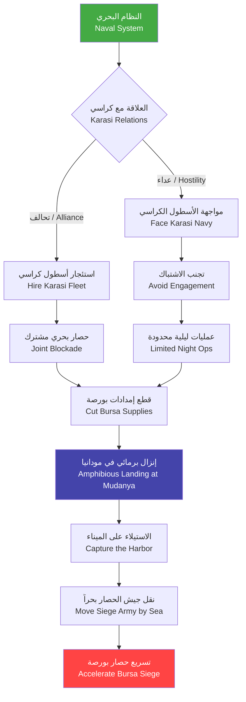
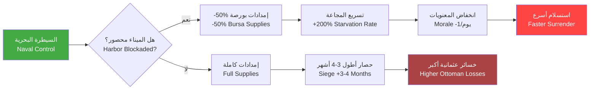

# نظام الحرب البحرية — Naval Warfare System Overview

> **النظام 19 — نظام الحرب البحرية والساحلية لـ Season 6: حصار بورصة (1326) — العمليات البحرية في بحر مرمرة**

---

## 1. نظرة عامة — Overview

يلعب الأسطول العثماني في Season 6 دوراً محدوداً لكنه حاسم. في هذه المرحلة المبكرة من تاريخ الدولة العثمانية، لا يمتلك العثمانيون أسطولاً بحرياً كبيراً. تعتمد قوتهم البحرية على قوارب صغيرة (Kayık) مخصصة للنقل النهري والساحلي، بينما تسيطر إمارة كراسي (Karasi Beylik) على بحر مرمرة بأسطولها المتطور.

يمثل النظام البحري في حصار بورصة جانباً تكميلياً للحصار البري. الهدف الأساسي هو:
- **منع وصول الإمدادات البيزنطية عبر البحر** (Naval Blockade)
- **إنزال القوات العثمانية خلف خطوط العدو** (Amphibious Assault)
- **الاستيلاء على ميناء مودانيا (Mudanya)** كقاعدة بحرية عثمانية
- **التعامل مع أسطول إمارة كراسي** دبلوماسياً أو عسكرياً



---

## 2. السياق الاستراتيجي — Strategic Context: بحر مرمرة

### 2.1 المناطق البحرية — Sea Zones

ينقسم بحر مرمرة في اللعبة إلى 4 مناطق بحرية (Sea Zones)، لكل منها خصائصها:

| المنطقة | Sea Zone | السيطرة | العمق | خطورة الطقس | النشاط التجاري | القواعد البحرية |
|---------|----------|---------|-------|-------------|---------------|----------------|
| الساحل الشمالي | North Coast | بيزنطة | ضحل (1-20م) | منخفضة | تجاري مكثف | القسطنطينية |
| الساحل الجنوبي | South Coast | كراسي | متوسط (20-50م) | متوسطة | صيد + تجارة | باليكسير، أدرميت |
| خليج إزميت | Gulf of Izmit | بيزنطة | ضحل (5-30م) | منخفضة | عسكري | إزميت |
| الممر الغربي | Western Passage | كراسي/بيزنطة | عميق (50-100م) | عالية | استراتيجي | مودانيا (بورصة) |

### 2.2 أنماط الرياح — Wind Patterns

تؤثر الرياح على سرعة السفن وقدرتها على المناورة. في Season 6، تعمل أنماط الرياح التالية:

| الموسم | الاتجاه السائد | سرعة الرياح | التأثير على السفن الصغيرة | التأثير على سفن كراسي |
|--------|---------------|-------------|--------------------------|----------------------|
| الربيع (مارس-مايو) | شمالي شرقي | 10-20 كم/س | -5% Speed | - لا تأثير |
| الصيف (يونيو-أغسطس) | شمالي | 5-15 كم/س | طبيعي | +5% Speed |
| الخريف (سبتمبر-نوفمبر) | جنوبي غربي | 15-30 كم/س | -15% Speed | -5% Speed |
| الشتاء (ديسمبر-فبراير) | متقلب | 25-50 كم/س | -30% Speed، خطر الغرق | -15% Speed |

### 2.3 أهمية بحر مرمرة لبورصة — Strategic Importance

بورصة مدينة ساحلية تبعد 25 كم عن بحر مرمرة. ميناؤها الرئيسي هو **مودانيا (Mudanya)**، الذي يمثل شريان الإمداد الحيوي للمدينة. طالما بقي ميناء مودانيا مفتوحاً، يمكن للبيزنطيين:

- إرسال **2000+ وحدة غذاء** شهرياً إلى بورصة
- إنزال **500 جندي** كتعزيزات كل أسبوعين
- تصدير الحرير والسلع الفاخرة لتمويل الحامية
- الحفاظ على خط اتصال مع القسطنطينية

قطع هذا الشريان هو الهدف الاستراتيجي الأول للأسطول العثماني.

---

## 3. أنواع السفن — Ship Types (Season 6)

### 3.1 القوارب الصغيرة — Kayık (Small Boat)

العمود الفقري للأسطول العثماني المبكر. قوارب خشبية صغيرة تستخدم للتجديف مع إمكانية تركيب شراع صغير.

| الخاصية | Property | القيمة |
|---------|----------|--------|
| HP | 300 |
| Damage | 5 (رمي السهام) |
| Range | 20 متر |
| Speed | 6 عقدة (تجديف) / 8 عقدة (شراع) |
| Armor | 5 (خشب رقيق) |
| Capacity | 10 جنود |
| طاقم التشغيل | 4 بحارة + 2 مجدفين |
| تكلفة البناء | 200 Wood + 50 Gold |
| وقت البناء | 3 أيام داخل اللعبة |
| مقاومة الطقس | ضعيفة — يتضرر في البحر الهائج |
| مدى الساحل المسموح | 2 كم من الشاطئ (ضحل فقط) |

**الترقيات المتاحة:**
- **هيكل مقوى (Reinforced Hull)**: +100 HP، +5 Armor — التكلفة: 100 Wood
- **مجاديف إضافية (Extra Oars)**: +1 Speed (تجديف) — التكلفة: 50 Gold
- **شراع صغير (Small Sail)**: +1.5 Speed (رياح مواتية) — التكلفة: 30 Gold + 20 Cloth

### 3.2 سفن النقل — Transport Ships

سفن أكبر حجماً مخصصة لنقل القوات والمعدات. لا يمتلك العثمانيون هذا النوع في بداية Season 6، لكن يمكن الحصول عليه عبر التحالف مع كراسي أو بناءه بعد الاستيلاء على مودانيا.

| الخاصية | Property | القيمة |
|---------|----------|--------|
| HP | 800 |
| Damage | 10 (أقواس ثقيلة) |
| Range | 35 متر |
| Speed | 4 عقدة |
| Armor | 15 (خشب مضاعف) |
| Capacity | 40 جندي أو 10 خيول + 20 جندي |
| طاقم التشغيل | 8 بحارة + 6 مجدفين |
| تكلفة البناء | 500 Wood + 200 Gold + 50 Cloth |
| مقاومة الطقس | متوسطة — يمكنها الإبحار في بحر هائج |
| مدى الإبحار | 20 كم من الشاطئ |

### 3.3 سفن المستقبل — Future Ships (Roadmap)

سيتم إضافة أنواع السفن التالية في المواسم القادمة:

| السفينة | Ship Type | الموسم المتوقع | الدور |
|---------|-----------|---------------|------|
| سفينة حربية (Galley) | War Galley | Season 7 | قتال بحري متقدم |
| فوستا (Fusta) | Fusta | Season 8 | سفينة خفيفة سريعة |
| قرقور (Karak) | Carrack | Season 9 | سفينة تجارية/حربية كبيرة |
| سفينة إطفاء (Fire Ship) | Fire Ship | Season 10 | هجمات انتحارية بحرية |

---

## 4. أسطول إمارة كراسي — Karasi Beylik Navy

### 4.1 قوة كراسي البحرية — Naval Strength

تتمتع إمارة كراسي بأقوى أسطول بحري في الأناضول الغربية. تسيطر على 75% من الساحل الجنوبي لبحر مرمرة.

| الفئة | Category | العدد | النوع |
|-------|----------|-------|-------|
| سفن حربية | War Galleys | 12 | سفن تجديف بطول 25م |
| سفن نقل | Transports | 8 | سفن شراعية للقوات |
| قوارب صغيرة | Kayıks | 25 | للاستطلاع والدوريات |
| زوارق سريعة | Fast Boats | 6 | للمناورة والهجمات المباغتة |
| **المجموع** | **Total** | **51 سفينة** | |

**قدرات أسطول كراسي:**
- **Speed**: 7-10 عقدة (حسب نوع السفينة)
- **طاقم إجمالي**: ~1500 بحار
- **قدرة إنزال**: 2000 جندي في موجة واحدة
- **مدى العمليات**: كامل بحر مرمرة + مضيق الدردنيل

### 4.2 سلوك كراسي الذكي — Karasi AI Behavior

يتصرف أسطول كراسي بناءً على وضع العلاقة مع اللاعب:

| العلاقة | السلوك البحري | النشاط |
|---------|--------------|--------|
| حليف (Alliance) | دعم العمليات العثمانية + حماية الساحل | دوريات مشتركة، نقل القوات |
| محايد (Neutral) | حماية المياه الإقليمية فقط | لا يتعرض للسفن العثمانية لكن لا يساعد |
| عدائي (Hostile) | مهاجمة السفن العثمانية + حصار الساحل العثماني | غارات على القواعد الساحلية |
| تابع (Vassal) | وضع الأسطول تحت تصرف العثمانيين | استئجار السفن بذهب |

### 4.3 خيارات التعامل مع كراسي — Dealing with Karasi

**الخيار 1: التحالف (مكلف لكن آمن)**
- متطلب: علاقة 60+ مع كراسي
- التكلفة: 500 Gold + هدية سنوية 200 Gold
- الفائدة: استئجار 10 سفن نقل + 3 سفن حربية

**الخيار 2: الحياد المسلح (متوازن)**
- متطلب: علاقة 30-60
- التكلفة: لا شيء
- القيود: لا يمكن استخدام موانئ كراسي

**الخيار 3: الغزو البحري (مكلف جداً)**
- متطلب: جيش 3000+ + أسطول 20+ قارب
- المخاطرة: خسائر فادحة في البحر
- المكافأة: السيطرة الكاملة على بحر مرمرة

---

## 5. أبراج الدفاع الساحلية — Coastal Defense Towers

### 5.1 أنواع الأبراج — Tower Types

يمكن للاعب بناء أبراج دفاعية على الساحل بعد الاستيلاء على مناطق ساحلية:

| البرج | Tower Type | HP | Damage | Range | التكلفة | القدرات الخاصة |
|-------|-----------|-----|--------|-------|---------|---------------|
| برج مراقبة | Watchtower | 500 | 0 | رؤية 80م | 100 Wood + 50 Stone | يكشف السفن على بعد 200م |
| برج النبالة | Arrow Tower | 800 | 15/ثانية | 50م | 200 Wood + 100 Stone | يهاجم السفن القريبة من الشاطئ |
| برج منجنيق صغير | Light Ballista Tower | 1200 | 40/طلقة | 80م | 300 Wood + 200 Stone | يبطئ السفن المصابة (-20% Speed) |
| برج ناري | Fire Tower | 1000 | 25/ثانية (منطقة) | 40م | 400 Wood + 250 Stone | يضر بعدة سفن في منطقة واحدة |

### 5.2 التفاعل مع الوحدات البحرية — Interaction with Naval Units

- **مدى التهديد**: السفن التي تقترب ضمن مدى البرج تتعرض لنيران آلية
- **دقة النيران**: 70% ضد السفن البطيئة، 40% ضد السفن السريعة
- **أولوية الأبراج**: تفضل استهداف سفن النقل أولاً
- **تدمير الأبراج**: يمكن تدميرها بواسطة القصف البحري (3-5 طلقات من منجنيق سفينة حربية)

---

## 6. نظام الطقس — Weather System

يؤثر الطقس بشكل كبير على العمليات البحرية. يتم تحديث حالة الطقس كل جولة (يوم داخل اللعبة):

| حالة الطقس | Weather | التكرار (سنوياً) | التأثير على الملاحة | التأثير على القتال البحري | التأثير على الإنزال |
|-----------|---------|-----------------|---------------------|------------------------|--------------------|
| هادئ | Calm | 35% | طبيعي | طبيعي | ممكن |
| رياح معتدلة | Moderate Wind | 30% | +10% Speed | -10% دقة الرماية | ممكن |
| بحر هائج | Rough Sea | 20% | -50% Speed، 10% ضرر هيكلي/جولة | -30% دقة | خطر (30% خسائر) |
| ضباب | Fog | 10% | رؤية 30م | مفاجأة (+50% دقة القصف الأول) | ممكن (تخفي) |
| عاصفة | Storm | 5% | -70% Speed، 30% ضرر هيكلي/جولة | غير ممكن | مستحيل |

### 6.1 توقعات الطقس — Weather Forecast

يمكن للاعب استشارة "خبير الطقس" (Weather Advisor) في المخيم للحصول على توقعات 3 أيام مسبقاً:

```
مثال:
اليوم 1: رياح معتدلة (احتمال 90%)
اليوم 2: بحر هائج (احتمال 70%) ← تحذير: غير مناسب للإنزال
اليوم 3: ضباب (احتمال 60%) ← فرصة للتسلل
```

---

## 7. مقارنة القوات البحرية — Naval Power Comparison

### 7.1 العثمانيون vs كراسي vs بيزنطة — Season 6

| المعيار | العثمانيون (Ottomans) | إمارة كراسي (Karasi) | الإمبراطورية البيزنطية (Byzantines) |
|---------|---------------------|--------------------|-----------------------------------|
| **عدد السفن** | 8-12 (قوارب فقط) | 51 (متنوعة) | 30+ (سفن حربية بشكل رئيسي) |
| **أكبر سفينة** | Kayık (قارب صغير) | War Galley (25م) | Dromon (سفينة حربية 30م) |
| **قدرة النقل الإجمالية** | 100-120 جندي | 2000+ جندي | 1500+ جندي |
| **Speed المتوسطة** | 6-7 عقدة | 7-9 عقدة | 5-7 عقدة |
| **خبرة الطاقم** | مبتدئ (0-1 موسم) | محترف (10+ مواسم) | متمرس (5+ مواسم) |
| **مدى العمليات** | 5 كم من الساحل | كامل بحر مرمرة | كامل بحر مرمرة + بحر إيجة |
| **القواعد البحرية** | لا يوجد | 3 موانئ رئيسية | 5+ موانئ |
| **قدرة بناء السفن** | محدودة (قوارب فقط) | متقدمة (جميع الأنواع) | متقدمة (جميع الأنواع) |
| **ميزانية الأسطول الشهرية** | 50 Gold | 300 Gold | 500 Gold |

### 7.2 نقاط القوة والضعف — Strengths and Weaknesses

**العثمانيون:**
- ✅ مرونة عالية في المياه الضحلة
- ✅ سهولة الإخفاء في الخلجان الصغيرة
- ✅ تكلفة تشغيل منخفضة
- ❌ قدرة قتالية بحرية ضعيفة
- ❌ لا يمكن挑战 أسطول كراسي في معركة بحرية مباشرة

**كراسي:**
- ✅ تفوق عددي ونوعي واضح
- ✅ خبرة طويلة في الملاحة
- ✅ قدرة على فرض حصار بحري كامل
- ❌ يمكن تحييدهم دبلوماسياً
- ❌ أسطولهم مكلف في الاستئجار

**بيزنطة:**
- ✅ أسطول حربي متطور
- ✅ قواعد بحرية متعددة
- ✅ دعم من القسطنطينية
- ❌ أسطولهم منشغل بحماية العاصمة
- ❌ لا يمكنهم تخصيص أكثر من 30% من أسطولهم لبورصة

---

## 8. التفاعل مع حصار بورصة — Interaction with Bursa Siege

### 8.1 كيف يؤثر النظام البحري على الحصار



### 8.2 الجدول الزمني للعمليات البحرية — Naval Operations Timeline

| الجولة | اليوم | العملية البحرية | التأثير على الحصار |
|-------|-------|----------------|-------------------|
| 1-3 | 1-9 | بناء القوارب وتدريب البحارة | لا تأثير |
| 4-6 | 10-18 | مهاجمة مودانيا (إنزال برمائي) | بدء قطع الإمدادات (-20%) |
| 7-10 | 19-30 | فرض الحصار البحري | -50% إمدادات |
| 11-14 | 31-42 | صيانة الحصار + منع الكاسرات | -70% إمدادات |
| 15-18 | 43-54 | تحرير مودانيا للتعزيزات العثمانية | نقل جيش الحماية بحراً |
| 19-22 | 55-66 | الدعم البحري للاقتحام النهائي | قصف ساحلي للأسوار |

---

## 9. موارد وتكاليف النظام البحري — Naval System Resources

### 9.1 تكاليف بناء الأسطول — Fleet Construction Costs

| العنصر | التكلفة الأساسية | المواد المطلوبة | الوقت |
|--------|-----------------|-----------------|-------|
| قارب كاييك واحد (Kayık) | 200 Wood + 50 Gold | 10 أشجار + حبال | 3 أيام |
| ترقية طاقم (Crew Training) | 100 Gold | — | 5 أيام |
| ميناء صغير (Small Port) | 500 Wood + 300 Stone + 200 Gold | 50 عامل | 15 يوماً |
| رصيف بحري (Dock) | 300 Wood + 150 Stone | 30 عامل | 10 أيام |

### 9.2 تكاليف الصيانة الشهرية — Monthly Upkeep

| الوحدة | التكلفة الشهرية | الموارد |
|-------|----------------|---------|
| Kayık واحد | 10 Gold | طعام الطاقم |
| بحار واحد | 2 Gold | — |
| رصيف بحري | 25 Gold | صيانة الخشب |
| ميناء صغير | 50 Gold | 10 Wood للإصلاحات |

---

## 10. القيود والمخاطر — Limitations and Risks

1. **موسمية العمليات**: لا يمكن القيام بعمليات بحرية في الشتاء (ديسمبر-فبراير) بسبب العواصف المستمرة
2. **نقص الخبرة**: البحارة العثمانيون مبتدئون — -20% إلى جميع القدرات البحرية في أول 5 جولات
3. **الاعتماد على كراسي**: بدون تحالف مع كراسي، لا يمكن للعثمانيين فرض حصار بحري فعال
4. **خطر الكاسرات**: 15% احتمال كل جولة أن تحاول سفينة بيزنطية كسر الحصار
5. **هجمات مضادة**: إذا ضعف الأسطول العثماني، قد يشن البيزنطيون هجوماً بحرياً مضاداً

---

## 11. ملخص — Summary

يمثل النظام البحري في Season 6 عنصراً **تكميلياً استراتيجياً** وليس أساسياً. اللاعب الذي يهمل الجانب البحري سيواجه حصاراً أطول وأكثر كلفة. اللاعب الذي يستثمر في الأسطول ويحسن إدارة العلاقة مع كراسي سيتمكن من:

- **تقصير مدة حصار بورصة بنسبة 40-50%**
- **تقليل خسائر الجيش العثماني بنسبة 30%**
- **فتح جبهة ثانية لإرباك البيزنطيين**
- **تأمين قاعدة بحرية للموسم القادم**

> **نصيحة استراتيجية**: ابدأ ببناء 8-10 قوارب Kayık في أول 3 جولات. في نفس الوقت، أرسل مبعوثاً إلى كراسي لعقد تحالف. لا تحاول مواجهة الأسطول البيزنطي في معركة بحرية مباشرة — انتظر حتى تضعف دفاعاتهم الساحلية قبل المناورة الكبرى.

---

> **تاريخ آخر تحديث**: 2026-06-20
