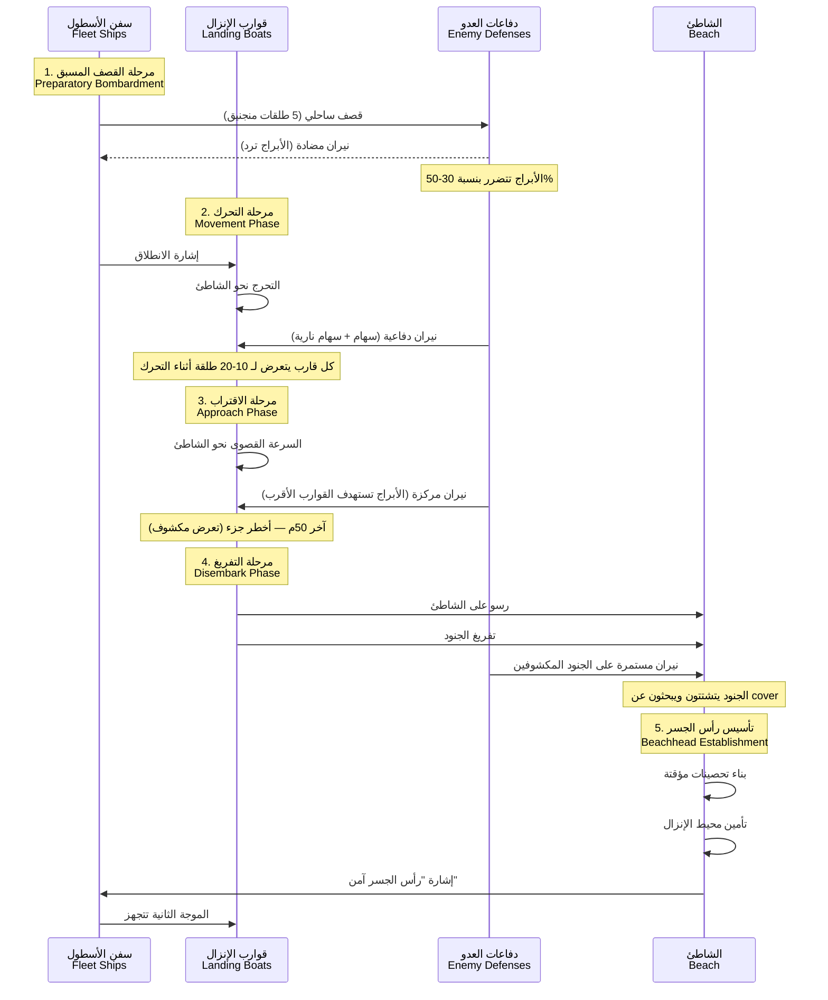
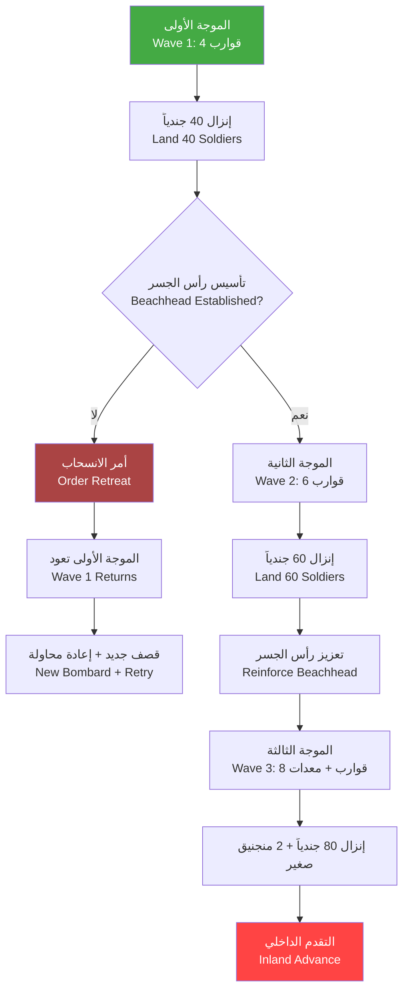

# العمليات البرمائية — Amphibious Operations

> **النظام 19 — إنزال القوات العثمانية على سواحل بحر مرمرة ودورها في حصار بورصة**

---

## 1. نظرة عامة — Overview

العمليات البرمائية في Season 6 تمثل أحد أكثر التحديات التكتيكية تعقيداً للاعب. مع أسطول محدود وقوات مشاة غير مدربة على الإنزال البحري، يجب على اللاعب التخطيط بعناية لكل عملية إنزال.

الهدف الأساسي من العمليات البرمائية هو **قطع خطوط الإمداد البحرية لبورصة** عن طريق إنزال قوات خلف خطوط العدو والاستيلاء على ميناء مودانيا (Mudanya) والمناطق الساحلية المحيطة به.

---

## 2. أنواع مناطق الإنزال — Landing Zone Types

### 2.1 الشاطئ — Beach Landing

الخيار الأكثر أماناً للقوات، لكنه الأكثر توقعاً من قبل العدو.

| الخاصية | Property | القيمة |
|---------|----------|--------|
| صعوبة الإنزال | Landing Difficulty | سهل — 0% خسائر أثناء التفريغ |
| سرعة التفريغ | Unload Speed | 5 ثوانٍ لكل قارب |
| سرعة تشتت القوات | Dispersal Speed | سريعة |
| تعرض للرمي | Exposure to Fire | عالٍ — مكشوف بالكامل |
| مدى الرؤية من الدفاعات | Defensive Visibility | 100% (العدو يراك بوضوح) |
| مفاجأة تكتيكية | Tactical Surprise | 0% — العدو يستعد لك |
| مناسب لـ | Suitable For | المشاة الثقيلة — معدات الحصار |

**أمثلة على شواطئ الإنزال:**
- شاطئ مودانيا الغربي (West Mudanya Beach) — رمال ناعمة، عرض 200م
- شاطئ تيريلي (Tirilye Beach) — صغير لكن محمي
- شاطئ أرمودلو (Armutlu Beach) — بعيد عن بورصة لكن آمن

### 2.2 الجرف — Cliff Landing

إنزال جريء يتطلب تسلق القوات للجرف تحت نيران العدو. يوفر عنصر المفاجأة لكنه مكلف.

| الخاصية | Property | القيمة |
|---------|----------|--------|
| صعوبة الإنزال | Landing Difficulty | صعب — 20% خسائر أثناء التسلق |
| سرعة التفريغ | Unload Speed | 15 ثانية لكل قارب (ينتظر حتى يتسلق الجنود) |
| سرعة تشتت القوات | Dispersal Speed | بطيئة — يصطفون على حافة الجرف |
| تعرض للرمي | Exposure to Fire | متوسط — الجرف يوفر cover |
| مدى الرؤية من الدفاعات | Defensive Visibility | 30% — صعوبة رؤية الجنود عند قاعدة الجرف |
| مفاجأة تكتيكية | Tactical Surprise | 70% — العدو لا يتوقع إنزالاً هنا |
| مناسب لـ | Suitable For | الرماة — وحدات التسلق الخاصة (المشاة الخفيفة) |

**متطلبات الإنزال على الجرف:**
- حبال التسلق (Climbing Ropes) — 5 لكل قارب — التكلفة: 20 Gold لعشرة حبال
- جنود مدربون على التسلق — تدريب إضافي 3 أيام + 50 Gold لكل سرية
- طقس هادئ — الرياح القوية تمنع التسلق

**أمثلة على الجروف:**
- جرف مودانيا الشرقي (East Mudanya Cliff) — ارتفاع 25م، صخري
- جرف زيتين باغ (Zeytinbağı Cliff) — ارتفاع 15م + غطاء شجر زيتون

### 2.3 الميناء — Harbor Landing

الخيار الأفضل إذا كان الميناء غير محمي بشكل كافٍ. يسمح بإنزال القوات والمعدات الثقيلة مباشرة على الرصيف.

| الخاصية | Property | القيمة |
|---------|----------|--------|
| صعوبة الإنزال | Landing Difficulty | سهل جداً — 0% خسائر |
| سرعة التفريغ | Unload Speed | 2 ثانية لكل جندي |
| سرعة تشتت القوات | Dispersal Speed | فورية — ينتشرون في شوارع الميناء |
| تعرض للرمي | Exposure to Fire | منخفض — المباني توفر cover |
| مدى الرؤية من الدفاعات | Defensive Visibility | 60% |
| مفاجأة تكتيكية | Tactical Surprise | 50% إذا هاجمت ليلاً |
| مناسب لـ | Suitable For | جميع أنواع القوات + معدات الحصار الثقيلة |

**متطلبات إنزال الميناء:**
- تحييد الدفاعات الساحلية أولاً (قصف من السفن أو هجوم بري متزامن)
- وجود مرشد محلي يعرف الميناء (يمكن استئجاره من التجار)
- السيطرة على سلسلة البوابة (Chain Boom) — إن وجدت

---

## 3. قوارب النقل — Transport Boats

### 3.1 المواصفات الأساسية — Base Stats

| الخاصية | Property | القيمة (Kayık) | القيمة (سفينة نقل متوسطة) |
|---------|----------|---------------|--------------------------|
| HP | 300 | 800 |
| Armor | 5 | 15 |
| Speed (محملة) | Loaded Speed | 4 عقدة | 3 عقدة |
| Speed (فارغة) | Empty Speed | 7 عقدة | 5 عقدة |
| Capacity | 10 جنود | 40 جندي |
| Load time | 8 ثوانٍ | 15 ثانية |
| Unload time | 5 ثوانٍ | 10 ثوانٍ |
| عرض الهدف (Target Size) | كبير (قارب صغير يسهل إصابته) | كبير جداً |
| مقاومة النيران | 5 — صاعق واحد يسبب 30% ضرر | 30 — أكثر مقاومة |

### 3.2 ترقيات قوارب الإنزال — Landing Craft Upgrades

| الترقية | Upgrade | التأثير | التكلفة | وقت البحث |
|---------|---------|---------|---------|----------|
| هيكل مقوى | Reinforced Hull | +100 HP، +3 Armor | 200 Wood، 100 Gold | 3 أيام |
| مجاديف إضافية | Extra Oars | +1.5 Speed (محملة) | 100 Wood | 2 أيام |
| شراع صغير | Small Sail | +2 Speed (رياح مواتية) | 50 Cloth + 50 Gold | 2 أيام |
| دروع خشبية للجنود | Side Shields | -30% ضرر للجنود أثناء التفريغ | 100 Wood | يومان |
| حبال تسلق محسنة | Improved Ropes | -5 ثوانٍ من وقت تسلق الجروف | 50 Gold | يوم واحد |
| قائد مركب متمرس | Experienced Coxswain | +20% Speed في جميع الظروف | 100 Gold | 5 أيام |

---

## 4. تسلسل الإنزال — Landing Phase Sequence

### 4.1 المرحلة الأولى: التحرك — Movement Phase

تقترب القوارب من الشاطئ تحت نيران العدو.



### 4.2 المرحلة الثانية: الاقتراب — Approach Phase

عندما تصبح القوارب على بعد 100م من الشاطئ، تبدأ مرحلة الاقتراب الخطيرة.

**مدة الاقتراب:** 15-25 ثانية (حسب Speed القارب والرياح)

**نيران العدو أثناء الاقتراب:**
- **السهام العادية**: 5-10 طلقة لكل قارب، ضرر 2-5 لكل طلقة
- **السهام النارية (Fire Arrows)**: 1-3 طلقة لكل قارب، ضرر 8-12 + احتمال اشتعال (15%)
- **سهام الباليستا (Ballista Bolts)**: طلقة واحدة كل 5 ثوانٍ، ضرر 30-50، دقة 40%

**صيغة الضرر على القارب أثناء الاقتراب:**
```
Damage_per_second = (Number_of_defenders × 0.3) + (Towers × 2.5) - (Boat_armor × 0.5)
```

**مثال:**
- 50 مدافعاً: 50 × 0.3 = 15
- 2 برج نبالة: 2 × 2.5 = 5
- Armor القارب: 5
- الضرر في الثانية: 15 + 5 - (5 × 0.5) = 17.5

قارب بحجم 300 HP يصمد لمدة **17 ثانية** تحت هذه النيران.

### 4.3 المرحلة الثالثة: التفريغ — Disembark Phase

عند وصول القارب إلى الشاطئ، يبدأ تفريغ الجنود:

**مدة التفريغ الأساسية:**
- Kayık: 5 ثوانٍ (10 جنود)
- سفينة نقل: 10 ثوانٍ (40 جندي)

**التأثيرات أثناء التفريغ:**
- الجنود في القارب لا يمكنهم الرد (100% exposure)
- كل جندي يتعرض لـ 1-3 طلقات أثناء النزول
- إذا دُمر القارب أثناء التفريغ: 50% من الجنود يموتون، 50% يسبحون للشاطئ (HP -50%)

**صعوبة التفريغ حسب حالة الطقس:**

| حالة الطقس | وقت التفريغ | خسائر إضافية أثناء التفريغ | احتمال انقلاب القارب |
|-----------|------------|--------------------------|---------------------|
| هادئ | طبيعي | 0% | 0% |
| رياح معتدلة | +20% | +5% | 0% |
| بحر هائج | +50% | +15% | 10% |
| ضباب | طبيعي (رؤية منخفضة للعدو) | 0% (العدو يخطئ أكثر) | 0% |
| عاصفة | التفريغ مستحيل | — | 50% |

### 4.4 المرحلة الرابعة: تأسيس رأس الجسر — Beachhead Establishment

بعد نزول أول 20 جندياً، تبدأ مرحلة تأسيس رأس الجسر:

**المدة:** 30-60 ثانية

**المتطلبات:**
- 20+ جندي على الشاطئ
- 1+ ضابط (قائد سرية)
- مواد بناء (Wood) — 50 وحدة لكل تحصين

**خطوات التأسيس:**
1. **التشتت الأولي (10 ثوانٍ)**: الجنود ينتشرون ويبحثون عن cover طبيعي
2. **بناء الحاجز الرملي (20 ثانية)**: Sandbag barrier — يوفر +30 دفاع للجنود خلفه
3. **تثبيت الراية (5 ثوانٍ)**: تحديد موقع رأس الجسر — يمنح +10 Morale للقوات المنزلة
4. **إشارة الأمان (5 ثوانٍ)**: إرسال إشارة للأسطول بأن الموجة التالية يمكن أن تبدأ

**فوائد رأس الجسر المؤسس:**
- +50% سرعة تفريغ للموجات التالية
- -30% ضرر للجنود على الشاطئ
- نقطة تجمع للقوات قبل التقدم الداخلي
- يمكن بناء معسكر صغير (Forward Camp) بتكلفة 200 Wood

---

## 5. إدارة الموجات — Wave Management

### 5.1 توقيت الموجات — Wave Timing



### 5.2 تكوين الموجات — Wave Composition

| الموجة | عدد القوارب | القوات | التوقيت | الهدف |
|-------|------------|-------|---------|-------|
| الأولى (الموجة الافتتاحية) | 4 Kayık | 40 مشاة خفيفة | T+0 | تأسيس رأس الجسر |
| الثانية (التعزيز المباشر) | 6 Kayık | 60 مشاة ثقيلة | T+30s | تعزيز رأس الجسر |
| الثالثة (المعدات) | 4 Kayık + 2 نقل | 40 جندي + 20 رامي + معدات | T+90s | دفع داخلي |
| الرابعة (الاحتياط) | 4 Kayık | 40 جندي + ضابط قائد | T+120s | استغلال الاختراق |
| الخامسة (الإمدادات) | 2 نقل (إذا متوفرة) | 200 Wood + 100 Food + 50 Gold | T+180s | إمدادات رأس الجسر |

### 5.3 الموجات الاحتياطية — Reserve Waves

يمكن للاعب الاحتفاظ بـ 2-4 قوارب كاحتياط. استخداماتها:
- سد ثغرة إذا فشلت موجة
- استغلال اختراق غير متوقع
- تعزيز قطاع يتعرض لهجوم مضاد
- إجلاء القوات (Retreat) — 50% خسائر

---

## 6. تأثير الطقس على الإنزال — Weather Effects on Landing

| حالة الطقس | سرعة القوارب | وقت التفريغ | دقة نيران العدو | خسائر إضافية | قرار |
|-----------|-------------|------------|----------------|--------------|------|
| ☀️ هادئ (Calm) | 100% | 100% | 100% | 0% | ✅ إنزال فوري |
| 🌤️ رياح خفيفة (Light Wind) | 110% | 95% | 90% | 0% | ✅ آمن |
| 🌬️ رياح معتدلة (Moderate) | 80% | 120% | 80% | +5% | ⚠️ ممكن مع مخاطرة |
| 🌊 بحر هائج (Rough Sea) | 50% | 150% | 60% | +15% | ❌ غير مستحسن |
| 🌫️ ضباب (Fog) | 90% | 100% | 40% | 0% | ✅✅ ممتاز (تخفي) |
| ⛈️ عاصفة (Storm) | 30% | غير ممكن | 20% | +40% | ❌❌ مستحيل |

---

## 7. نيران العدو الدفاعية — Defensive Fire

### 7.1 أنواع النيران الدفاعية

| النوع | Type | الضرر | المدى | الدقة ضد القوارب | الدقة ضد الجنود | ملاحظات |
|-------|------|-------|-------|-----------------|-----------------|---------|
| سهام عادية | Arrows | 3-5 | 60م | 50% | 40% | الأكثر شيوعاً |
| سهام نارية | Fire Arrows | 10-15 + حريق | 50م | 60% | 30% | احتمال حريق 20% |
| سهام باليستا | Ballista Bolts | 35-50 | 100م | 70% | 20% | طلقة كل 5 ثوانٍ |
| زيت مغلي | Hot Oil | 50-80 (منطقة) | 15م | — | 80% على الشاطئ | على الشاطئ فقط إذا بنيت منصة |
| صخور | Rocks | 40-60 | 30م | 30% (ضد القوارب الكبيرة) | 50% | من فوق الجروف |

### 7.2 صيغ الدقة والدخول — Accuracy and Damage Formulas

**دقة نيران العدو ضد القارب:**
```
Accuracy% = Base_Accuracy × Weather_Modifier × Distance_Modifier × Speed_Modifier

Where:
- Base_Accuracy: 60% (average)
- Weather_Modifier: Fog = 0.5, Calm = 1.0, Rough = 0.8, Storm = 0.3
- Distance_Modifier: >80m = 0.6, 40-80m = 1.0, <40m = 1.3
- Speed_Modifier: Full Speed = 0.7, Half Speed = 1.0, Stationary = 1.5
```

**مثال:** قارب يتحرك بسرعة كاملة على مسافة 60م في طقس هادئ:
```
60% × 1.0 × 1.0 × 0.7 = 42% دقة
```

**ضرر السهام النارية ضد القارب:**
```
Fire_Damage = Arrow_Damage × 1.5 إذا أصابت
Fire_Chance = 20% ← إذا اشتعل، القارب يتعرض لـ 5/ثانية لمدة 10 ثوانٍ
```

---

## 8. تحصين رأس الجسر — Beachhead Fortification

### 8.1 أنواع التحصينات

| التحصين | Fortification | HP | تكلفة البناء | وقت البناء | الحماية |
|---------|-------------|-----|-------------|-----------|---------|
| حاجز رملي | Sandbag Wall | 200 | 50 Wood | 20 ثانية | +20 دفاع للجنود خلفه |
| خندق مؤقت | Trench | 300 | 40 Wood | 30 ثانية | +30 دفاع، 50% cover |
| سور خشبي | Wooden Palisade | 500 | 150 Wood | 60 ثانية | +40 دفاع، جنود يمكنهم الرمي من فوقه |
| برج مراقبة مؤقت | Watchtower | 300 | 100 Wood | 45 ثانية | رؤية +50م، رماية +20% دقة |
| معسكر صغير | Forward Camp | 800 | 200 Wood + 50 Food | 120 ثانية | نقطة إعادة انتشار + شفاء بطيء |

### 8.2 تعزيز رأس الجسر — Reinforcing the Beachhead

بعد تأسيس رأس الجسر، يمكن للاعب:
1. **بناء طريق سريع من الشاطئ** إلى الداخل (100 Wood، 40 ثانية) — يسرع حركة القوات بنسبة 30%
2. **إنشاء مستودع إمدادات** (200 Wood، 60 ثانية) — يخفض استهلاك الغذاء للقوات المنزلة بنسبة 20%
3. **بناء رصيف مؤقت** (150 Wood، 90 ثانية) — يسرع تفريغ الموجات التالية بنسبة 40%
4. **إقامة معسكر طبابة** (100 Wood + 50 Herbs، 30 ثانية) — يشفي الجرحى بمعدل 2 HP/ثانية

---

## 9. الربط مع قوات الحصار — Linking with the Main Siege Force

عند نجاح الإنزال، يجب على القوات المنزلة:
1. **التوجه شرقاً** نحو أسوار بورصة (مسافة 25 كم — 3-4 جولات لعبة)
2. **تجنب الحصون البيزنطية** في الطريق إلا إذا كانت القوات كافية
3. **الالتقاء مع الجيش العثماني الرئيسي** عند نقطة الالتقاء المحددة
4. **إغلاق حلقة التطويق** بشكل كامل

**فوائد الربط الناجح:**
- اكتمال التطويق: +30% فعالية الحصار
- وصول إمدادات بحرية: +50% سرعة تموين الجيش
- معنويات الجيش: +10 Morale
- إضعاف الروح المعنوية البيزنطية: -15 Morale للمدافعين

---

## 10. سيناريو مثال — Example Scenario: إنزال مودانيا

**الهدف:** إنزال 300 جندي عثماني على ساحل مودانيا لقطع خط إمداد بورصة

**القوات المتاحة:**
- 20 Kayık (200 Wood لكل منها = 4000 Wood + 1000 Gold)
- 300 جندي (200 مشاة خفيفة + 80 مشاة ثقيلة + 20 رامياً)
- قائد الإنزال: القائد أورهان بك أو قائد معين

**شاطئ الإنزال المختار:** شاطئ مودانيا الغربي (Beach — سهل، مكشوف)

**الطقس المتوقع:** رياح معتدلة (آمنة)

**تسلسل الأحداث:**
1. **قصف تمهيدي**: 3 سفن كراسي (إذا حالفة) تقصف الأبراج الساحلية لمدة 60 ثانية
2. **الموجة الأولى**: 4 قوارب تنزل 40 جندياً — 2 قارب يصلان سالمين، 1 يتضرر (HP -50%)، 1 يخسر 3 جنود
3. **تأسيس رأس الجسر**: 37 جندياً يبنون حاجزاً رملياً في 20 ثانية
4. **الموجة الثانية**: 6 قوارب تنزل 60 جندياً — خسائر 5 جنود فقط (بفضل الحاجز الرملي)
5. **بناء الرصيف المؤقت**: 150 Wood — الموجات التالية تتفرى أسرع
6. **الموجة الثالثة**: المعدات والرماة (60 جندياً إضافياً)
7. **التقدم الداخلي**: بعد 5 دقائق لعبة، 155 جندياً يتجهون نحو مودانيا

**النتيجة المتوقعة:**
- خسائر في الإنزال: 25-35 جندياً (8-12%)
- وقت الإنزال الكلي: 8-10 دقائق
- السيطرة على رأس الجسر بعد 40 دقيقة
- مودانيا تتطلب هجوماً إضافياً (انظر ملف 04_Harbor_Capture.md)

---

## 11. استراتيجيات متقدمة — Advanced Strategies

### 11.1 الإنزال الليلي — Night Landing
- رؤية العدو -70%
- دقة نيران العدو -50%
- سرعة القوارب -20% (خطر الاصطدام)
- احتمال اكتشاف الإنزال: 30%
- **المكافأة**: مفاجأة كاملة (+80% فرصة نجاح الموجة الأولى)

### 11.2 الإنزال الوهمي — Feint Landing
- إرسال 2-3 قوارب فارغة إلى شاطئ آخر
- تشتيت انتباه العدو لمدة 30-45 ثانية
- تكلفة منخفضة (خطر خسارة القوارب فقط)
- **المكافأة**: تقليل نيران العدو على الشاطئ الرئيسي بنسبة 40%

### 11.3 الإنزال المتزامن — Simultaneous Landing
- الإنزال على شاطئين في وقت واحد
- تقسيم نيران العدو (كل شاطئ يتعرض لنصف النيران)
- يتطلب 14+ قارب + 200+ جندي
- **المكافأة**: إرباك العدو + فرصة أكبر لنجاح أحد الشاطئين

### 11.4 الإنزال بالتمويه — Deceptive Approach
- استخدام الضباب الطبيعي أو صنع دخان صناعي (حرق أعشاب رطبة)
- رؤية العدو -80%
- دقة نيرانه -60%
- لا تأثير على القوارب
- **التكلفة**: 20 Gold + تحضير مسبق 10 دقائق

---

> **تاريخ آخر تحديث**: 2026-06-20
