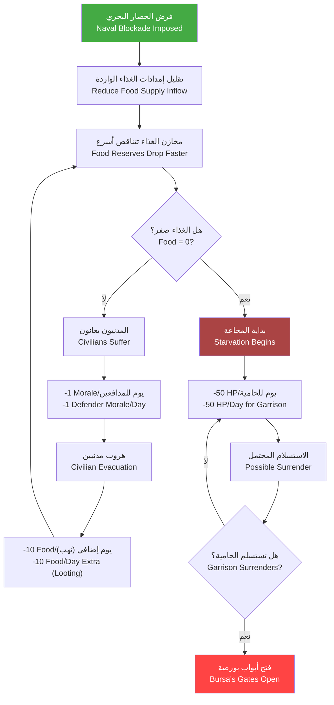
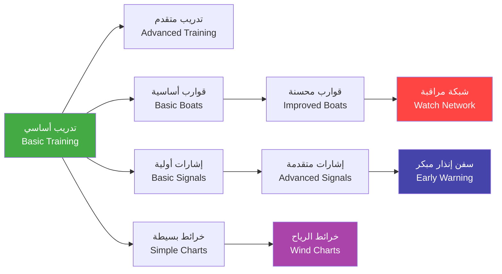

# الحصار البحري — Naval Blockade

> **النظام 19 — قطع خطوط الإمداد البحرية عن بورصة وتجويع المدينة حتى الاستسلام**

---

## 1. نظرة عامة — Overview

الحصار البحري هو أحد الأسلحة الاستراتيجية الأكثر فعالية في حصار بورصة. بينما يركز الحصار البري على تطويق المدينة من البر، يقوم الحصار البحري بقطع شريان الإمداد الحيوي الذي يربط بورصة بالقسطنطينية وباقي العالم البيزنطي.

نظراً لأن بورصة تتلقى 60% من إمداداتها عبر البحر (عبر ميناء مودانيا)، فإن فرض حصار بحري فعال يمكن أن يقلص مدة الحصار من 22 جولة إلى 12-14 جولة فقط — أي توفير 2-3 أشهر من الوقت الثمين.

---

## 2. آلية الحصار البحري — Blockade Mechanics

### 2.1 كيفية عمل الحصار — How Blockade Works

عند تعيين سفن لدوريات الحصار (Blockade Patrol)، تقوم هذه السفن بالإبحار في قطاع محدد من الساحل لمنع وصول سفن الإمداد البيزنطية.

**المتطلبات الأساسية لفرض الحصار:**
- السيطرة على المياه المقابلة لميناء مودانيا (قطاع البحر ضمن مدى 5 كم من الساحل)
- توفر 4+ قوارب Kayık على الأقل للدورية (أقل من ذلك غير فعال)
- قاعدة إمداد قريبة (أو سفينة تموين) لإعادة تزويد الوقود والطعام
- طقس يسمح بالإبحار (العواصف توقف الحصار مؤقتاً)

### 2.2 فعالية الحصار — Blockade Effectiveness

**صيغة فعالية الحصار:**
```
Blockade% = (Number_of_Ships × Ship_Efficiency × Crew_Experience) / (Coast_Length_Factor × Weather_Factor)

Where:
- Ship_Efficiency: Kayık = 0.5, War Galley = 2.0, Transport = 1.0
- Crew_Experience: مبتدئ = 0.7, متمرس = 1.0, محترف = 1.3
- Coast_Length_Factor: مودانيا وحدها = 2, ساحل بورصة كاملاً = 5
- Weather_Factor: هادئ = 1.0, رياح معتدلة = 0.9, بحر هائج = 0.6, ضباب = 0.5, عاصفة = 0.0
```

**مثال عددي:**
- 8 Kayık (Efficiency 0.5 لكل منها)
- طاقم متمرس (Experience × 1.0)
- حصار مودانيا فقط (Coast Length Factor = 2)
- طقس هادئ (Weather × 1.0)

```
Blockade% = (8 × 0.5 × 1.0) / (2 × 1.0) = 4 / 2 = 200% → يخفض إلى 95% (الحد الأقصى)
```

**مثال آخر — حصار ضعيف:**
- 4 Kayık (Efficiency 0.5)
- طاقم مبتدئ (Experience × 0.7)
- ساحل بورصة كاملاً (Coast Length Factor = 5)
- بحر هائج (Weather × 0.6)

```
Blockade% = (4 × 0.5 × 0.7) / (5 × 0.6) = 1.4 / 3 = 46.6%
```

### 2.3 مستويات فعالية الحصار — Blockade Levels

| المستوى | Blockade% | التأثير على وصول الإمدادات | التأثير على المجاعة | الوصف |
|---------|----------|---------------------------|--------------------|-------|
| ضعيف | 1-25% | -10% وصول الإمدادات | لا تأثير يذكر | بعض السفن تنزلق عبر الحصار |
| متوسط | 26-50% | -30% وصول الإمدادات | بداية المجاعة (البطيئة) | الحصار يؤثر لكن غير محكم |
| قوي | 51-75% | -55% وصول الإمدادات | مجاعة متسارعة | معظم الإمدادات تُمنع |
| صارم | 76-90% | -75% وصول الإمدادات | مجاعة شديدة | قلة قليلة تخترق |
| كامل | 91-95% | -90% وصول الإمدادات | مجاعة حرجة | حصار شبه مطلق |

---

## 3. تأثيرات الحصار — Blockade Effects

### 3.1 تأثير الحصار على إمدادات بورصة



### 3.2 تأثير الحصار على المعنويات — Morale Impact

تتأثر معنويات الحامية البيزنطية سلباً مع استمرار الحصار البحري:

| مدة الحصار | خصم المعنويات اليومي | التعليق |
|-----------|---------------------|---------|
| 1-5 أيام | 0 | الحامية لا تزال واثقة |
| 6-10 أيام | -1/يوم | بداية القلق |
| 11-20 يوماً | -2/يوم | قلق متزايد |
| 21-30 يوماً | -3/يوم | يأس بين الجنود |
| 31+ يوماً | -5/يوم |接近 الانهيار |

**صيغة تأثير المعنويات:**
```
Daily_Morale_Loss = Blockade_Level × 0.5 + Starvation_Rate × 2.0

Where:
- Blockade_Level: ضعيف=1, متوسط=2, قوي=3, صارم=4, كامل=5
- Starvation_Rate: 0-1 (نسبة المدنيين الجائعين)
```

**مثال:** حصار قوي (3) مع 40% مجاعة (0.4):
```
3 × 0.5 + 0.4 × 2.0 = 1.5 + 0.8 = 2.3 خسارة معنويات يومياً
```

### 3.3 منع التعزيزات البحرية — Blocking Naval Reinforcements

يمنع الحصار البحري وصول التعزيزات البيزنطية عبر البحر:

| نوع التعزيزات | العدد الطبيعي شهرياً | مع حصار ضعيف | مع حصار قوي | مع حصار كامل |
|--------------|--------------------|-------------|-----------|-------------|
| جنود مشاة | 200-300 | 150-200 | 50-100 | 0-20 |
| فرسان | 50-100 | 30-70 | 10-30 | 0-5 |
| إمدادات غذاء | 2000 وحدة | 1500 وحدة | 500 وحدة | 100 وحدة |
| مواد حربية | 500 وحدة | 350 وحدة | 100 وحدة | 20 وحدة |

---

## 4. كاسرات الحصار — Blockade Runners

### 4.1 سفن الكسر — Runner Ships

يحاول البيزنطيون إرسال سفن سريعة لاختراق الحصار ليلاً أو في الضباب.

**أنواع كاسرات الحصار:**

| النوع | Type | Speed | HP | Evasion | Capacity | التكرار |
|-------|------|-------|----|---------|----------|---------|
| زورق سريع | Fast Cutter | 10 عقدة | 200 | 40% | 10 Food | كل 2-3 أيام |
| سفينة تجارية مسلحة | Armed Merchant | 6 عقدة | 500 | 20% | 50 Food + 20 Gold | كل 5-7 أيام |
| سفينة حربية خفيفة | Light Warship | 7 عقدة | 700 | 25% | 30 مواد حربية | كل 7-10 أيام |
| قارب صيد متخفي | Disguised Fisher | 5 عقدة | 150 | 60% | 5 Food | كل 1-2 يوم |

### 4.2 آلية الاعتراض — Interception Mechanics

عند محاولة كاسر الحصار الاختراق، يتم احتساب فرصة الاعتراض:

```
Interception_Chance% = Base_Detection% + Patrol_Coverage% - Runner_Evasion%

Where:
- Base_Detection%:
  - نهار: 70%
  - ليل: 30%
  - ضباب: 20%
  - عاصفة: 10%
  
- Patrol_Coverage%: (Number_of_Patrol_Ships × 10%) محدودة بـ 80%
  
- Runner_Evasion%:
  - زورق سريع: 40%
  - سفينة تجارية مسلحة: 20%
  - سفينة حربية خفيفة: 25%
  - قارب صيد متخفي: 60%
```

**مثال — ليلاً مع 5 سفن دورية ضد زورق سريع:**
```
30% (ليل) + 50% (5 سفن × 10%) - 40% (Evasion) = 40% فرصة اعتراض
```

### 4.3 عواقب الاعتراض — Interception Outcomes

| النتيجة | احتمال | التفاصيل |
|---------|-------|----------|
| اعتراض كامل | حسب Interception_Chance% | تدمير الكاسر، غرق الحمولة |
| اعتراض جزئي | 30% | تدمير الكاسر، إنقاذ 30% من الحمولة |
| هروب الكاسر | 20% | وصول الحمولة بالكامل |
| تفادي ونجاح | حسب المكمل | وصول الحمولة بالكامل |

**عواقب نجاح كسر الحصار:**
- وصول إمدادات لبورصة: +200-500 Food حسب نوع الكاسر
- ارتفاع معنويات الحامية: +5-10 Morale
- انخفاض معنويات القوات المحاصرة العثمانية: -3 Morale
- الحصار يفقد 5% من فعاليته لمدة يوم واحد

---

## 5. الدوريات الساحلية — Coastal Patrols

### 5.1 تعيين الدوريات — Assigning Patrols

يمكن للاعب تعيين السفن لثلاثة أنواع من الدوريات:

| نوع الدورية | Patrol Type | مدى الإبحار | مدة الدورية | معدل الكشف | استهلاك الوقود |
|------------|------------|------------|-------------|-----------|---------------|
| دورية ساحلية قريبة | Close Patrol | 2 كم من الساحل | 4 ساعات | 80% | منخفض |
| دورية بعيدة | Long Patrol | 5 كم من الساحل | 8 ساعات | 60% | متوسط |
| دورية تمشيط | Sweep Patrol | متحرك على طول الساحل | 6 ساعات | 90% (في مسارها) | متوسط |
| دورية ثابتة (مراقبة) | Stationary Watch | نقطة واحدة | غير محدود | 50% | منعدم |

### 5.2 نظام اللقاءات — Encounter System

عند قيام دورية بمسح قطاعها، هناك احتمال لمقابلة سفن معادية:

```
Encounter_Chance% = Enemy_Naval_Activity% × Patrol_Detection% × Weather_Modifier

Where:
- Enemy_Naval_Activity%: 10-60% (حسب المرحلة من اللعبة)
- Patrol_Detection%: حسب نوع الدورية (أعلاه)
- Weather_Modifier: هادئ = 1.0, ضباب = 0.4, عاصفة = 0.2
```

**أنواع اللقاءات:**
1. **سفينة تجارية معادية**: هجوم سريع — غنيمة محتملة (20-50 Gold)
2. **قارب استطلاع**: مناوشة قصيرة — إذا هرب، قد يعزز البيزنطيون دفاعاتهم
3. **أسطول حربي صغير**: معركة بحرية — 2-5 سفن حربية بيزنطية
4. **كاسر حصار**: محاولة اختراق — اعتراض كما في الفقرة 4
5. **سفينة صيد محايدة**: لا تشتبك — لكن قد تكون جاسوسة

---

## 6. التفاعل مع نظام المجاعة — Interaction with Starvation System

### 6.1 تسريع عداد المجاعة — Accelerating the Starvation Timer

يرتبط الحصار البحري مباشرة بنظام المجاعة في حصار بورصة (نظام 17 — Siege Warfare).

**المعادلة الأساسية لمخزون الغذاء في بورصة:**
```
Daily_Food_Change = Natural_Consumption + Land_Blockade_Effect + Naval_Blockade_Effect - Supply_Runner_Success

Where:
- Natural_Consumption: -100 Food/يوم (الاستهلاك الطبيعي للحامية والمدنيين)
- Land_Blockade_Effect: -50 Food/يوم إذا كان الحصار البري نشطاً
- Naval_Blockade_Effect: -Blockade_Level × 30 Food/يوم
- Supply_Runner_Success: +200-500 Food في حالة نجاح كاسر الحصار
```

**مثال: حصار بري + حصار بحري قوي (Level 3):**
```
-100 - 50 - (3 × 30) = -240 Food/يوم
بدون أي كاسر حصار ناجح، مخزون 12000 Food ينفد في 50 يوماً (بدلاً من 120 يوماً)
```

### 6.2 الجدول الزمني المقارن — Comparative Timeline

| السيناريو | مخزون الغذاء الابتدائي | الاستهلاك اليومي | الأيام حتى نفاد الغذاء |
|-----------|----------------------|-----------------|----------------------|
| لا حصار | 12000 | -100 | 120 يوماً |
| حصار بري فقط | 12000 | -150 | 80 يوماً |
| حصار بحري فقط (قوي) | 12000 | -190 | 63 يوماً |
| حصار بري + بحري (قوي) | 12000 | -240 | 50 يوماً |
| حصار بري + بحري (صارم) | 12000 | -270 | 44 يوماً |
| حصار بري + بحري (كامل) | 12000 | -300 | 40 يوماً |

---

## 7. تكاليف صيانة الحصار — Blockade Maintenance Costs

### 7.1 التكاليف اليومية — Daily Costs

| العنصر | التكلفة اليومية لكل سفينة | الموارد المطلوبة |
|-------|-------------------------|-----------------|
| طعام الطاقم | 2 Food | — |
| أجر البحارة | 1 Gold | — |
| صيانة القارب (خشب) | 0.5 Wood | — |
| سهام للدورية | 0.2 Wood | — |
| **مجموع 8 Kayık** | **16 Food + 8 Gold + 4 Wood** | يومياً |

### 7.2 التكاليف الشهرية — Monthly Costs

للحفاظ على حصار بحري فعال (8+ Kayık) لمدة شهر كامل:

| المورد | الكمية الشهرية | السعر التقريبي |
|--------|---------------|---------------|
| Food | 480 | 240 Gold (إذا اشتريت) |
| Gold | 240 | — |
| Wood | 120 | 60 Gold |
| **المجموع المالي** | **~540 Gold** | شهرياً |

### 7.3 فعالية التكلفة — Cost Effectiveness

مقارنة تكلفة الحصار البحري بمصادر أخرى لتسريع الحصار:

| الطريقة | التكلفة | تسريع الحصار | فعالية التكلفة |
|---------|---------|-------------|---------------|
| حصار بحري 30 يوماً | 540 Gold | -40 يوماً من الحصار | 13.5 Gold/يوم موفر |
| بناء 5 مجانيق إضافية | 1500 Gold | -15 يوماً | 100 Gold/يوم موفر |
| 500 جندي إضافي | 2000 Gold | -10 أيام | 200 Gold/يوم موفر |
| رشوة قائد الحامية | 1000 Gold | فوري (إذا نجحت) | — |

---

## 8. تقنيات تطوير الحصار — Blockade Upgrade Technologies

### 8.1 تقنيات متاحة — Available Upgrades

| التقنية | Technology | التكلفة | وقت البحث | التأثير | متطلب مسبق |
|---------|-----------|---------|----------|---------|-----------|
| تدريب بحارة متقدم | Advanced Crew Training | 300 Gold | 5 أيام | +20% Crew Experience | ميناء صغير |
| قوارب دورية محسنة | Improved Patrol Boats | 400 Wood + 200 Gold | 7 أيام | +10% Patrol Coverage | رصيف بحري |
| إشارات الدخان والضوء | Signal Systems | 150 Gold + 50 Cloth | 3 أيام | +15% Detection Rate | لا يوجد |
| شبكة مراقبة ساحلية | Coastal Watch Network | 500 Wood + 300 Stone | 10 أيام | +20% Interception Chance | 3 أبراج مراقبة |
| خرائط الرياح المتقدمة | Advanced Wind Charts | 200 Gold | 4 أيام | -15% Weather Penalty | لا يوجد |
| سفن إنذار مبكر | Early Warning Boats | 300 Wood + 150 Gold | 6 أيام | +30% Detection عند الضباب | برج مراقبة |

### 8.2 شجرة التقنيات — Technology Tree



---

## 9. تكوين قوة الحصار الموصى بها — Recommended Blockade Force

### 9.1 لبورصة (Season 6) — For Bursa

| مستوى الميزانية | عدد السفن | النوع | فعالية متوقعة | التكلفة الشهرية | ملاحظات |
|---------------|----------|-------|--------------|----------------|---------|
| اقتصادي (Economic) | 4-5 Kayık | قوارب صغيرة | 25-35% | 200 Gold | حصار ضعيف لكن أفضل من لا شيء |
| قياسي (Standard) | 8-10 Kayık | قوارب صغيرة | 50-65% | 400 Gold | الأكثر توازناً |
| قوي (Strong) | 12-15 Kayık + 2-3 من كراسي | مختلط | 70-85% | 600-800 Gold | يتطلب تحالفاً مع كراسي |
| أقصى (Maximum) | 20 Kayık + 5 سفن كراسي حربية | أسطول كامل | 90-95% | 1200+ Gold | فعال جداً لكن مكلف |

### 9.2 التوزيع الأمثل للدوريات — Optimal Patrol Distribution

نظام الحصار في 3 ورديات يومياً:

| الوردية | التوقيت (ساعة لعبة) | عدد السفن | المهمة |
|---------|-------------------|-----------|--------|
| صباحية | 06:00-14:00 | 3-4 | دورية قريبة + مراقبة |
| مسائية | 14:00-22:00 | 3-4 | دورية بعيدة + تمشيط |
| ليلية | 22:00-06:00 | 4-5 | دورية قريبة + مراقبة (أهم وردية) |
| احتياط | — | 2-3 | استجابة سريعة + صيانة |

---

## 10. المخاطر والتحديات — Risks and Challenges

### 10.1 المخاطر الرئيسية

1. **نفاد الإمدادات**: إذا بقيت السفن في البحر لأكثر من 5 أيام متواصلة، ينفد طعامها وتضطر للعودة
2. **عواصف الشتاء**: من ديسمبر إلى فبراير، تنخفض فعالية الحصار إلى 10-20%
3. **هجمات مضادة**: إذا ركزت كل سفنك في الحصار، قد يهاجم البيزنطيون قاعدتك الساحلية
4. **تعب الطاقم**: بعد 10 أيام متواصلة في البحر، يتعب الطاقم وتنخفض الفعالية بنسبة 20%
5. **خيانة كراسي**: إذا تدهورت العلاقة مع كراسي أثناء استئجار سفنهم، قد ينسحبون فجأة

### 10.2 استراتيجيات تقليل المخاطر

| المخاطرة | استراتيجية التخفيف |
|----------|-------------------|
| نفاد الإمدادات | بناء سفينة تموين (Supply Ship) تدعم الأسطول |
| عواصف الشتاء | التخطيط للعمليات البحرية في الربيع والصيف فقط |
| هجمات مضادة | ترك 2 سفينة احتياط + بناء برج ساحلي واحد على الأقل |
| تعب الطاقم | تدوير الطواقم كل 7 أيام (تحتاج طواقم احتياطية) |
| خيانة كراسي | عدم الاعتماد كلياً على سفن كراسي — بناء قوارب عثمانية موازية |

---

## 11. سيناريو مثال — Example Scenario: حصار مودانيا

**الإعدادات:**
- 10 Kayık عثمانية + 3 سفن حربية من كراسي (تحالف)
-沿海长度为 25 كم (مودانيا إلى غمليك)
- طقس صيفي معتدل
- خبرة الطاقم: متمرسة

**الأسبوع الأول:**
- فعالية الحصار: 75% (قوي)
- محاولات كسر: 3 (ليلاً)
- الاعتراضات الناجحة: 2 من 3
- الإمدادات التي وصلت: 200 Food (مرة واحدة فقط)

**الأسبوع الثاني:**
- مخزون بورصة ينخفض من 11000 Food إلى 8500 Food
- معنويات الحامية: -7 (بدأ القلق)
- محاولات كسر: 5 (محاولة الحامية اليائسة)
- الاعتراضات: 3 من 5

**الأسبوع الثالث:**
- مخزون الغذاء: 5000 Food
- بداية المجاعة بين المدنيين (تأثير تراكمي)
- الحامية تبدأ بالتفكير في الاستسلام
- محاولة كسر كبرى: أسطول بيزنطي من القسطنطينية (8 سفن)

**الأسبوع الرابع:**
- اندحار الأسطول البيزنطي في معركة بحرية (بمساعدة سفن كراسي)
- مخزون الغذاء: 2000 Food — المجاعة تبدأ بين الجنود
- الحامية ترسل مبعوثاً للتفاوض على الاستسلام

---

## 12. ملخص — Summary

الحصار البحري هو أداة استراتيجية قوية في حصار بورصة. باستثمار 400-600 Gold شهرياً في 8-10 قوارب Kayık، يمكن للاعب تقليل مدة الحصار بنسبة 40-50%. مع تحالف كراسي، يمكن رفع الفعالية إلى 85%+، مما يجبر بورصة على الاستسلام في 6-8 أسابيع بدلاً من 4-5 أشهر.

> **تذكر**: الحصار البحري ليس بديلاً عن الحصار البري — إنه مكمل له. أقوى تأثير يتحقق عندما يعمل الاثنان معاً.

---

> **تاريخ آخر تحديث**: 2026-06-20
