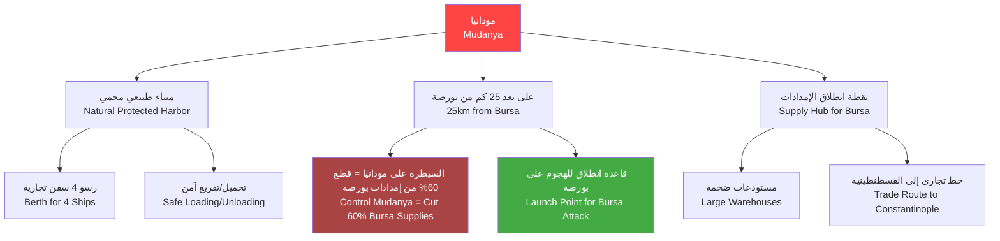
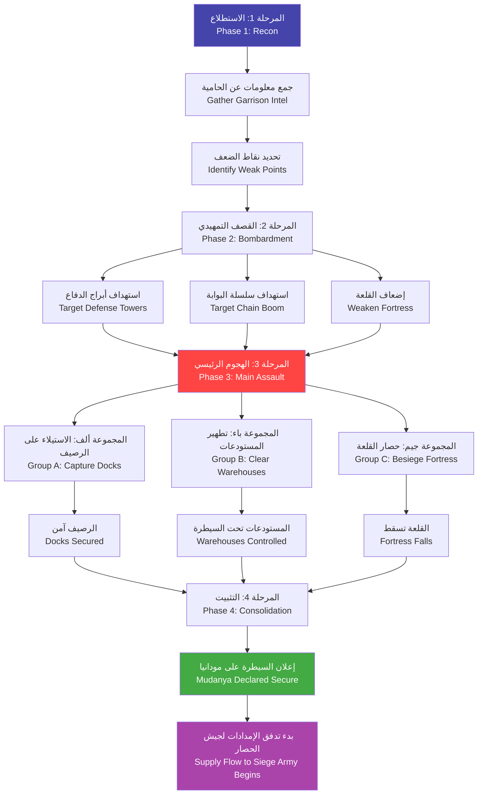

# الاستيلاء على الموانئ — Harbor Capture

> **النظام 19 — الاستيلاء على ميناء مودانيا وتأمين القاعدة البحرية العثمانية لحصار بورصة**

---

## 1. نظرة عامة — Overview

يمثل الاستيلاء على ميناء مودانيا (Mudanya) الهدف الاستراتيجي الأهم للعمليات البحرية في Season 6. مودانيا هي بوابة بورصة البحرية — بدونها، لا يمكن للبيزنطيين إمداد المدينة، وبالسيطرة عليها، يمتلك العثمانيون قاعدة بحرية استراتيجية للمستقبل.

يجمع هذا النظام بين:
- **القتال البري في بيئة ميناء** (شوارع، أرصفة، مستودعات)
- **الدعم البحري** (سفن تقصف مواقع العدو من البحر)
- **إدارة المباني** (الاستيلاء على docks، warehouses، shipyard)
- **الدفاع عن الميناء** بعد الاستيلاء عليه من الهجمات المضادة

---

## 2. ميناء مودانيا — Mudanya Port

### 2.1 الأهمية الاستراتيجية — Strategic Importance

### 2.2 تخطيط الميناء — Harbor Layout

| القطاع | Sector | المباني الرئيسية | الحامية (جنود) | الدفاعات |
|--------|--------|-----------------|---------------|---------|
| الرصيف الرئيسي | Main Dock | 4 أرصفة، رصيف حجري | 30 بيزنطي | برج نبالة صغير × 1 |
| منطقة المستودعات | Warehouse District | 3 مستودعات كبيرة، ساحة | 50 بيزنطي | سور خشبي بارتفاع 3م |
| حوض بناء السفن | Shipyard | ورشة بناء + حوض جاف | 20 بيزنطي + 10 عمال | لا يوجد |
| البلدة السكنية | Residential Area | 30 منزلاً + مسجد صغير + سوق | 40 بيزنطي + 200 مدني | لا يوجد |
| القلعة الدفاعية | Fortress | قلعة صغيرة + ثكنة عسكرية | 100 بيزنطي (النخبة) | 2 برج نبالة + سور حجري |
| سلسلة البوابة | Chain Boom Point | برج السلسلة + ونش | 10 بيزنطي | آلية رفع السلسلة |

### 2.3 حامية مودانيا — Mudanya Garrison

| الوحدة | العدد | النوع | الخبرة | المعدات |
|-------|-------|-------|-------|---------|
| حرس الميناء | 50 | مشاة خفيفة | متمرسة | رماح + دروع جلدية |
| رماة الأبراج | 30 | رماة | محترفة | أقواس مركبة + سهام نارية |
| حرس القلعة | 40 | مشاة ثقيلة | النخبة | سيوف + دروع حديدية + دروع صدرية |
| فرسان دورية | 20 | فرسان خفيفة | متمرسة | رماح خفيفة + سيوف |
| بحارة مسلحون | 40 | مشاة بحرية | مبتدئة | سيوف قصيرة + رماح |
| **المجموع** | **180** | — | — | — |

**مستوى التهديد: متوسط-عالٍ** — مودانيا محمية بشكل جيد لكنها ليعة منيعة

---

## 3. الاستعداد للهجوم — Preparing the Assault

### 3.1 خيارات الاقتراب — Approach Options

| الطريق | المسافة من نقطة التجمع | الغطاء | وقت الوصول | المفاجأة |
|-------|----------------------|--------|-----------|---------|
| من الشاطئ الشرقي | 1 كم | منخفض (شاطئ مكشوف) | 10 دقائق | منخفضة |
| من الغابة الشمالية | 3 كم | عالٍ (أشجار + تلال) | 30 دقيقة | عالية |
| من الطريق الرئيسي من بورصة | 5 كم | متوسط | 45 دقيقة | معدومة |
| من البحر مباشرة | 0 كم (إنزال على الرصيف) | لا يوجد | 2 دقيقة | عالية جداً (إذا نجح التسلل) |

### 3.2 الاستطلاع — Reconnaissance

قبل الهجوم، يمكن للاعب إرسال كشافين لجمع المعلومات:

| نوع الاستطلاع | الوقت | التكلفة | المعلومات المكتسبة |
|--------------|-------|---------|-------------------|
| كشاف على الشاطئ | ساعتان | 10 Gold | عدد الحراس على الرصيف |
| جاسوس في البلدة | 6 ساعات | 50 Gold | خريطة تفصيلية للمباني |
| مراقبة بحرية | 3 ساعات | 20 Gold | حالة السلسلة + حركة السفن |
| رشوة جندي بيزنطي | 12 ساعة | 150 Gold | جدول الحراس + نقاط الضعف |

### 3.3 القصف التمهيدي — Preparatory Bombardment

إذا توفرت سفن حربية (من كراسي أو سفن بيزنطية مأسورة)، يمكن قصف الميناء قبل الهجوم:

| الهدف | الطلقات المطلوبة | التأثير | مدة التحصين |
|-------|-----------------|---------|-----------|
| برج نبالة (رصيف) | 3-4 طلقات | تدمير أو إعاقة | دائم (حتى الإصلاح) |
| قلعة مودانيا | 8-10 طلقات | أضرار هيكلية (HP -30%) | مؤقت (2-3 أيام للإصلاح) |
| سور المستودعات | 4-6 طلقات | فتح ثغرة | يوم واحد |
| سلسلة البوابة | طلقتان (دقيقة) | تعطيل رفع السلسلة | 4 ساعات (حتى الإصلاح) |

---

## 4. مباني الميناء — Harbor Structures

### 4.1 الأرصفة — Docks

**المواصفات:**
| الخاصية | Property | القيمة |
|---------|----------|--------|
| العدد | 4 أرصفة |
| Capacity للسفن | 4 (واحدة لكل رصيف) |
| سرعة التحميل/التفريغ | ×2 مقارنة بالشاطئ (2 ثانية/جندي) |
| مكافأة إصلاح السفن | +50% سرعة إصلاح |
| HP لكل رصيف | 500 |
| درع | 30 (حجري) |
| تحصينات | جدار حجري بارتفاع 1.5م (Cover +30) |

**الاستيلاء:**
- استلام سلم: يحتاج 10 جنود يقاتلون لمدة 10 ثوانٍ
- بعد الاستيلاء: يمكن استخدام الرصيف فوراً
- إذا دُمّر: يتطلب 200 Wood + 100 Stone لإعادة البناء

### 4.2 المستودعات — Warehouses

**عدد المستودعات: 3 (كبير)، 2 (صغير)**

| المستودع | السعة (Food) | السعة (موارد أخرى) | HP | محتوى عند الاستيلاء (المتوسط) |
|----------|-------------|-------------------|-----|------------------------------|
| المستودع الشمالي (كبير) | 2000 | 500 Wood + 200 Stone | 600 | 800 Food + 200 Wood |
| المستودع الجنوبي (كبير) | 2000 | 500 مواد حربية | 600 | 600 Food + 100 مواد حربية |
| المستودع الغربي (كبير) | 2000 | 300 Gold | 600 | 400 Food + 150 Gold |
| المستودع الشرقي (صغير) | 500 | 100 مواد متنوعة | 300 | 200 Food + 50 Gold |
| مستودع الصيانة (صغير) | 100 | 300 Wood | 300 | 150 Wood |

**فوائد الاستيلاء:**
- غنيمة فورية: الغذاء والموارد تنتقل لجيش الحصار
- تخزين إمدادات الحصار العثمانية
- تقليل وصول الإمدادات لبورصة (إذا كانت المستودعات تحت السيطرة العثمانية، ينخفض تموين بورصة بنسبة إضافية 15%)

### 4.3 حوض بناء السفن — Shipyard

| الخاصية | Property | القيمة |
|---------|----------|--------|
| الوظيفة الأساسية | بناء وإصلاح السفن |
| Speed البناء | ×1.5 مقارنة بالبناء العادي |
| Speed الإصلاح | ×2 مقارنة بالإصلاح العادي |
| أنواع السفن التي يمكن بناؤها | Kayık فقط (في Season 6) → Galleys (Season 7+) |
| HP | 1000 |
| طاقم التشغيل | 20 عامل ماهر (يمكن تدريبهم من الصيادين المحليين) |

**المزايا بعد الاستيلاء:**
- يمكن بناء 2 Kayık في وقت واحد (بدلاً من 1)
- إصلاح جميع سفن الأسطول في 4 ساعات (بدلاً من 24 ساعة على الشاطئ)
- تدريب البحارة: +10% خبرة للطواقم الجديدة

### 4.4 سلسلة البوابة — Chain Boom

آلية دفاعية تمنع دخول السفن إلى الميناء.

| الخاصية | Property | القيمة |
|---------|----------|--------|
| HP للسلسلة | 1000 (معدنية، صعبة الكسر) |
| طول السلسلة | 150م (عرض الميناء) |
| حمولة السلسلة | تمنع عبور السفن المتوسطة والكبيرة |
| رفع السلسلة | 30 ثانية (يدوياً — ونش) |
| خفض السلسلة | 15 ثانية |
| برج التحكم | HP 400 + حامية 10 جنود |

**آليات التعامل مع السلسلة:**
| الطريقة | الوصف | الوقت | النجاح |
|---------|-------|-------|--------|
| تدمير برج التحكم | اقتحام برج السلسلة وقتل الحامية | 30 ثانية قتال | مضمون |
| قطع السلسلة (منحرفين) | إرسال سباحين ليليين بمناشير | 60 ثانية | 60% (احتمال اكتشاف) |
| كسر السلسلة بسفينة كبيرة | الاصطدام بالسلسلة بسرعة عالية | لحظي | 40% (ضرر كبير للسفينة) |
| رشوة حارس السلسلة | دفع 100-200 Gold | 10 ثوانٍ | 50% (حسب علاقة الفساد) |

### 4.5 القلعة الدفاعية — Fortress

آخر معقل للدفاع البيزنطي بعد اختراق الميناء.

| الخاصية | Property | القيمة |
|---------|----------|--------|
| HP | 3000 |
| الحامية | 100 جندي نخبة |
| الأبراج | 2 برج نبالة (HP 500 لكل برج) |
| السور | حجري، ارتفاع 8م |
| البوابة | خشبية معززة بالحديد، HP 800 |

**الاستيلاء على القلعة:**
1. تطويق القلعة (منع الهروب)
2. تحييد الأبراج (برجاً برجاً)
3. كسر البوابة أو تسلق السور
4. قتال داخل القلعة حتى آخر جندي بيزنطي

---

## 5. آليات القتال في الميناء — Harbor Combat Mechanics

### 5.1 القتال المختلط براً وبحراً — Mixed Land/Naval Combat

يمكن للسفن المشاركة في القتال داخل الميناء:

| دور السفينة | الهدف | Damage | المدى | الفعالية |
|------------|-------|--------|-------|---------|
| قصف الأبراج | أبراج الدفاع | 40/طلقة (منجنيق سفينة حربية) | 100م | عالية ضد الأهداف الثابتة |
| دعم المشاة | تجمعات العدو | 20/طلقة (سهام كثيفة) | 60م | متوسطة |
| منع التعزيزات | الطريق المؤدي للميناء | 10/ثانية (سهام) | 50م | عالية (منطقة مفتوحة) |
| إنزال سريع | الرصيف | — | مباشر | إنزال فوري على الرصيف |

### 5.2 القتال في شوارع الميناء — Street Fighting

| المبنى | Bonus دفاعي | Cover٪ | ضرر الرماة+ | صعوبة الاقتحام |
|--------|-----------|-------|------------|---------------|
| الرصيف | +10 | 30% | +0% | منخفضة |
| المستودعات | +30 | 70% | +20% | متوسطة |
| المنازل | +20 | 50% | +15% | متوسطة |
| القلعة | +50 | 80% | +30% | عالية |

### 5.3 الاستيلاء على الأرصفة — Capturing Docks

عند الاستيلاء على رصيف، يتحول تلقائياً إلى جانب العثمانيين:

- يمكن إنزال القوات مباشرة على الرصيف (فوري)
- يمكن إصلاح السفن المتضررة (×2 سرعة)
- يمنح +10 Morale للقوات العثمانية
- **الأهم:** يفتح خط إمداد بحري لجيش الحصار

---

## 6. السيطرة على الميناء — Controlling the Harbor

### 6.1 مدى الإمداد — Supply Range

بعد السيطرة على مودانيا، يمكن إرسال الإمدادات إلى جيش الحصار في بورصة:

| الوسيلة | مدى الإمداد (كم) | الكمية/اليوم | سرعة الوصول | خسائر النقل |
|--------|-----------------|-------------|-----------|------------|
| قوافل بغال (من الميناء) | 25 كم (مودانيا → بورصة) | 200 Food | 6 ساعات | 5% |
| عربات ثيران | 25 كم | 400 Food | 10 ساعات | 2% |
| نقل بحري + قوافل | 25 كم × 2 مرحلة | 500 Food | 8 ساعات | 3% |

### 6.2 معدل التعزيزات — Reinforcement Rate

مع مودانيا تحت السيطرة العثمانية:

| الوحدة | معدل الوصول الطبيعي | عبر مودانيا (مضاعف) |
|-------|--------------------|--------------------|
| مشاة | 100/أسبوع | 200/أسبوع |
| فرسان | 30/أسبوع | 50/أسبوع |
| رماة | 50/أسبوع | 100/أسبوع |
| مواد حربية | 200/أسبوع | 500/أسبوع |

### 6.3 الدخل التجاري — Trade Income

بعد الاستيلاء على مودانيا، يبدأ الميناء بتوليد الدخل:

| المصدر | الدخل اليومي | ملاحظات |
|-------|-------------|---------|
| رسوم الميناء | 5 Gold | من السفن التجارية التي ترسو |
| سوق السمك | 3 Gold | الصيادون المحليون يدفعون الضرائب |
| ضرائب التجار | 8 Gold | التجار الذين يستخدمون الميناء |
| بيع الغنائم | 10-50 Gold (مرة واحدة) | بيع البضائع المصادرة من المستودعات |
| **المجموع اليومي** | **~16 Gold** | بعد الاستقرار (ينخفض في الأسبوع الأول إلى 8 Gold) |

---

## 7. ترقية الميناء — Harbor Upgrades

### 7.1 مستويات الميناء — Port Levels

| المستوى | الاسم | التكلفة | الوقت | الفوائد |
|---------|------|---------|-------|---------|
| 1 | قرية صيد (Fishing Village) | — | — | أساسي: 2 رصيف خشبي، بناء Kayık فقط |
| 2 | مركز تجاري (Trading Post) | 800 Wood + 400 Stone + 300 Gold | 10 أيام | +2 رصيف، فتح التجارة +15 Gold/يوم |
| 3 | ميناء رئيسي (Major Port) | 2000 Wood + 1000 Stone + 800 Gold | 20 يوماً | +2 رصيف حجري، بناء سفن نقل، حوض جاف |
| 4 | قاعدة بحرية (Naval Base) | 4000 Wood + 2000 Stone + 2000 Gold | 30 يوماً | +4 أرصفة، بناء سفن حربية، منشآت عسكرية |

### 7.2 الترقيات الخاصة — Special Upgrades

| الترقية | Special Upgrade | التكلفة | الوقت | المتطلب | الفائدة |
|---------|----------------|---------|-------|--------|---------|
| أرصفة حجرية | Stone Docks | 500 Stone | 5 أيام | Port Level 2 | +50% سرعة تحميل، +100 HP |
| مستودعات كبيرة | Large Warehouses | 1000 Wood + 500 Stone | 7 أيام | Port Level 2 | تخزين 3000 Food إضافية |
| سوق الميناء | Harbor Market | 300 Gold | 3 أيام | Port Level 2 | +10 Gold/يوم دخل تجاري |
| ثكنة بحرية | Naval Barracks | 600 Wood + 400 Stone + 200 Gold | 8 أيام | Port Level 3 | تدريب 50 بحاراً في وقت واحد |
| جدار الميناء | Harbor Wall | 1500 Stone | 12 يوماً | Port Level 3 | جدار دفاعي حول الميناء (HP 5000) |
| منارة | Lighthouse | 400 Stone + 200 Gold | 6 أيام | Port Level 2 | +20% سرعة إبحار للسفن الصديقة ليلاً |

---

## 8. الدفاع عن الميناء — Holding the Harbor

### 8.1 الهجمات المضادة — Counter-Attacks

بعد الاستيلاء على مودانيا، سيحاول البيزنطيون استعادتها:

| نوع الهجوم المضاد | القوة | التكرار | الإشعار المسبق |
|------------------|-------|--------|---------------|
| غارة بحرية صغيرة | 2-3 سفن + 50 جندي | كل 3-5 أيام | مُبلغ (الكشافة يرون الأسطول) |
| هجوم بري من بورصة | 200-300 جندي | كل 7-10 أيام | مُبلغ (حراس الطريق) |
| هجوم مشترك (بري + بحري) | 500 جندي + 5 سفن | مرة واحدة (حدث رئيسي) | قبل 24 ساعة لعبة |
| محاولة تسلل ليلي | 30-50 جندي (قوارب صغيرة) | كل 4-6 أيام | قد لا يُكتشف (60% اكتشاف) |

### 8.2 تحضيرات الدفاع — Defense Preparations

لحماية الميناء المستولى عليه، يمكن للاعب:

| الإجراء | التكلفة | الوقت | التأثير |
|---------|---------|-------|--------|
| بناء ثكنة (Garrison) | 400 Wood + 200 Stone | 5 أيام | +50 حامية عثمانية دائمة |
| بناء برج مراقبة | 100 Wood + 50 Stone | يومان | كشف السفن على بعد 200م |
| نشر أطواف دفاعية | 50 Wood لكل طوف | 1 يوم | منع إنزال القوارب الصغيرة |
| تجنيد ميليشيا محلية | 100 Gold | 3 أيام | +30 مقاتل محلي (خبرة منخفضة) |
| بناء حاجز رملي على الشاطئ | 200 Wood + 50 Sandbags (100 Wood) | يوم واحد | -30% ضرر للقوات المدافعة |

### 8.3 الحد الأدنى للحامية الموصى بها — Minimum Recommended Garrison

للحفاظ على مودانيا بأمان، يحتاج اللاعب إلى:

| القطاع | الحد الأدنى | المستوى الآمن | المستوى الموصى به |
|--------|------------|--------------|------------------|
| الرصيف | 20 جندي | 40 جندي | 60 جندي + 10 رماة |
| المستودعات | 10 جنود | 20 جندي | 30 جندي |
| القلعة | 30 جندي | 50 جندي | 80 جندي (النخبة) |
| البلدة | 10 جنود | 20 جندي | 30 جندي (دوريات) |
| **المجموع** | **70** | **130** | **200** |

---

## 9. تخطيط الاستيلاء على مودانيا — Mudanya Capture Plan

---

## 10. سيناريو مثال — Example Scenario: الاستيلاء على مودانيا

**الإعدادات الابتدائية:**
- القوات العثمانية المتاحة: 500 جندي (300 مشاة + 150 رماة + 50 مشاة نخبة)
- الأسطول: 12 Kayık + 3 سفن حربية من كراسي (تحالف)
- القائد: القائد أورهان بك (Orhan Bey) + قائد بحري من كراسي
- الوقت: صيف 1326 (طقس مثالي للعمليات البرمائية)

**التسلسل الزمني للهجوم:**

**اليوم 1 — الاستطلاع:**
- كشافون يتسللون إلى مودانيا ليلاً ويعودون بمعلومات عن الحامية
- جاسوس يرشدك إلى نقطة ضعف في السور الشرقي (إنشائي سيء، يمكن هدمه بـ 3 طلقات منجنيق)
- سلسلة البوابة تُدار من برج وحيد على الرصيف الشمالي

**اليوم 2 — القصف التمهيدي:**
- 3 سفن حربية من كراسي تقصف برج السلسلة (4 طلقات — تدمير البرج)
- السلسلة تسقط في الماء — الميناء مفتوح
- طلقتان إضافيتان على برج النبالة الشرقي (HP -60%)

**اليوم 3 — الهجوم الرئيسي (فجراً):**
- **الموجة الأولى**: 4 Kayık تنزل 40 جندياً من المشاة النخبة على الرصيف
- السيطرة على الرصيف في 30 ثانية (مفاجأة كاملة)
- **الموجة الثانية**: 6 Kayık تنزل 60 جندياً يتجهون للمستودعات
- مقاومة في المستودع الشمالي (20 بيزنطياً) — تطهير في دقيقتين
- **الموجة الثالثة**: القوات المتبقية (400 جندي) تنزل على الرصيف الآن الآمن
- تطويق القلعة من جميع الجهات

**بعد الظهر: حصار القلعة:**
- 100 جندي بيزنطي نخبة في القلعة — يرفضون الاستسلام
- 3 ساعات من القتال المتواصل
- في النهاية، اقتحام البوابة بعد تدميرها بمنجنيق صغير
- تطهير القلعة غرفةً غرفة — آخر 20 جندياً بيزنطياً يستسلمون

**المساء — السيطرة الكاملة:**
- مودانيا تحت السيطرة العثمانية
- الخسائر العثمانية: 45 قتيلاً + 80 جريحاً
- الخسائر البيزنطية: 120 قتيلاً + 60 أسيراً
- الغنائم: 1200 Food + 300 Wood + 250 Gold + 100 مواد حربية

**الأيام التالية:**
- 4 أيام لإصلاح الأضرار في الميناء
- 700 جندي إضافي يصلون بحراً من مناطق العثمانيين الأخرى
- الإمدادات تبدأ بالتدفق إلى جيش الحصار في بورصة (+200 Food/يوم)
- المعنويات العثمانية: +15 — المعنويات البيزنطية في بورصة: -20

---

## 11. تأثير الاستيلاء على حصار بورصة — Impact on Bursa Siege

| المؤشر | قبل الاستيلاء | بعد الاستيلاء (فوراً) | بعد أسبوع |
|--------|-------------|--------------------|----------|
| إمدادات بورصة اليومية | -50 (بري فقط) | -150 (بري + قطع الإمداد البحري) | -200 + تأثير المستودعات |
| معنويات الحامية | 70 | 50 | 35 |
| سرعة المجاعة | بطيئة | متوسطة | سريعة |
| فرصة الاستسلام | 5% | 15% | 35% |
| الوقت المتبقي المقدر للحصار | 14-18 جولة | 10-14 جولة | 6-10 جولات |

---

## 12. ملخص — Summary

الاستيلاء على ميناء مودانيا هو **نقطة التحول الحاسمة** في حصار بورصة. إنه يحول الحصار من حصار بري محدود إلى تطويق كامل، ويفتح خط إمداد بحري للعثمانيين مع قطع آخر خط إمداد للبيزنطيين.

**الأهداف الرئيسية التي يخدمها الاستيلاء:**
1. ✅ قطع 60% من إمدادات بورصة
2. ✅ منع التعزيزات البيزنطية
3. ✅ فتح خط إمداد بحري للعثمانيين
4. ✅ الحصول على قاعدة بحرية للمستقبل
5. ✅ إضعاف معنويات بورصة بشكل حاد
6. ✅ تسريع الاستسلام بنسبة 40-50%

> **نصيحة استراتيجية**: لا تتعجل في الهجوم على مودانيا. انتظر حتى تحصل على معلومات استخباراتية كافية، وتأكد من توفر 400+ جندي للهجوم، والأهم — تأكد من تحييد سلسلة البوابة قبل إرسال السفن إلى الميناء.

---

> **تاريخ آخر تحديث**: 2026-06-20
