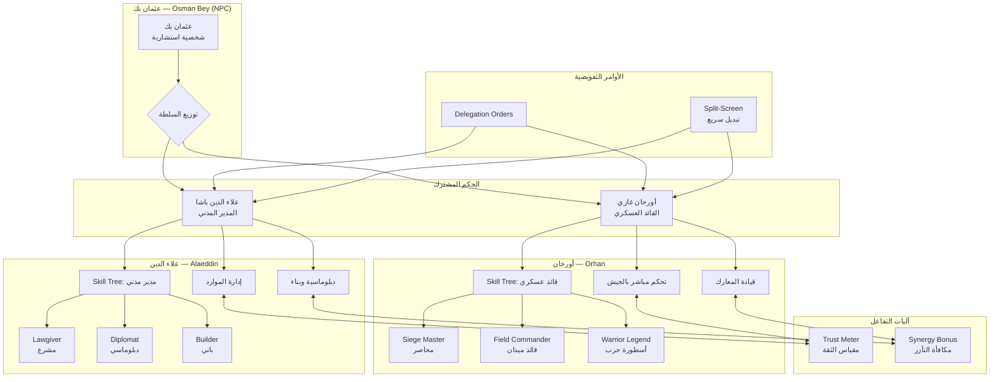

# نظام الحكم المشترك — Heir Co-Rule System (System 20)

> **الموسم السادس — حصار بورصة (1326)**

---

## 1. نظرة عامة — Overview

نظام الحكم المشترك (Heir Co-Rule System) هو الآلية الأساسية التي تميز الموسم السادس من اللعبة. لأول مرة في مسيرة "قيامة الدولة العثمانية"، لا يتحكم اللاعب بقائد واحد، بل بأخوين: **أورخان غازي** (القائد العسكري) و**علاء الدين باشا** (المدير المدني). هذا النظام يعكس التحول التاريخي من حكم الفرد المطلق (عثمان بك) إلى نموذج القيادة المشتركة الذي وضع أسس الدولة العثمانية المبكرة.

```
╔══════════════════════════════════════════════════════════════╗
║                                                            ║
║                    ن       ظ       ا       م                ║
║              الحكم المشترك — Heir Co-Rule                  ║
║                                                            ║
║    عثمان بك (محتضر)                                       ║
║         │                                                   ║
║         ├── أورخان غازي — القيادة العسكرية                  ║
║         │      Military Commander                           ║
║         │                                                   ║
║         └── علاء الدين باشا — الإدارة المدنية               ║
║                Civil Administrator                          ║
║                                                            ║
╚══════════════════════════════════════════════════════════════╝
```

---

## 2. السياق التاريخي — Historical Context

يبدأ الموسم السادس في عام 1326، مع اقتراب حصار بورصة. عثمان بك، مؤسس الدولة، أصبح طاعنًا في السن ومريضًا، ويوشك على تسليم زمام الأمور لأبنائه. في التاريخ الحقيقي، كان أورخان غازي هو القائد العسكري البارز بينما تولى علاء الدين باشا الشؤون المدنية والتشريعية. هذا التقسيم الطبيعي للسلطة هو ما يصوره هذا النظام.

| الشخصية | الدور التاريخي | دوره في اللعبة | فترة النشاط |
|---------|---------------|----------------|-------------|
| **عثمان بك** | المؤسس والشيخ | شخصية استشارية (غير قابلة للعب) | نهاية العمر |
| **أورخان غازي** | القائد العسكري | شخصية رئيسية — Combat & Army | 1326-1362 |
| **علاء الدين باشا** | الصدر الأعظم الأول | شخصية رئيسية — Administration & Diplomacy | 1326-1333 |

> **ملاحظة تاريخية**: في المصادر العثمانية المبكرة، كان علاء الدين باشا هو الأخ الأكبر لأورخان، لكنه تنازل عن العرش طواعية ليتولى منصب الصدر الأعظم (رئيس الوزراء) — أول من شغل هذا المنصب في التاريخ العثماني.

---

## 3. آلية القيادة المنقسمة — Split-Screen Command

يقوم النظام على فكرة أن اللاعب يتحكم بشخصية واحدة في كل لحظة، بينما يدير الذكاء الاصطناعي الأخرى. يمكن للاعب التبديل بينهما بحرية.

### 3.1 طرق التبديل

| الطريقة | المفتاح/الإجراء | الوصف |
|---------|----------------|-------|
| **التبديل السريع** | `Tab` | التبديل الفوري بين الأخوين |
| **النقر على الصورة** | Click Portrait | النقر على صورة الشخصية في واجهة التحكم |
| **النقر على الخريطة** | Click on Map | النقر على موقع الأخ على الخريطة المصغرة |
| **الأمر الصوتي** | `Tab + Click` | الضغط مع النقر لتعيين أمر مباشر |

### 3.2 ميزة الصورة داخل الصورة (Picture-in-Picture)

عند التحكم بأحد الأخوين، تظهر نافذة صغيرة (320×180 بكسل) في الزاوية اليمنى السفلى من الشاشة تُظهر ما يفعله الأخ الآخر. تحتوي هذه النافذة على:

- **كاميرا حية** لما يراه الأخ الآخر
- **شريط حالة** (HP / Stamina / Morale)
- **رمز المهمة الحالية** (Attack, Defend, Build, Patrol, Hold)
- **مؤشر الثقة** (Trust Meter) — نسبة مئوية صغيرة
- **زر التبديل السريع** للرجوع الفوري

يمكن للاعب تكبير نافذة PiP إلى وضع ملء الشاشة بنقرة مزدوجة.

### 3.3 الكاميرا المستقلة

يحتفظ كل أخ بكاميرته المستقلة تمامًا. عند التبديل من أورخان إلى علاء الدين، تنتقل الكاميرا فورًا إلى موقع علاء الدين دون التأثير على كاميرا أورخان. هذا يسمح بـ:

- **تخطيط هجومي**: يخطط اللplayer لمسيرة أورخان نحو سور المدينة بينما يبني علاء الدين أبراج الحصار
- **رد فعل سريع**: إذا تعرض أحد الأخوين لهجوم مفاجئ، يمكن التبديل الفوري للدفاع
- **مراقبة الجبهتين**: متابعة تقدم كلا العمليتين في وقت واحد

---

## 4. نظام التفويض — Delegation Mechanics

عندما لا يتحكم اللاعب بأحد الأخوين مباشرة، يديره الذكاء الاصطناعي. يمكن للاعب إعطاء أوامر تفويضية للشخصية غير المسيطر عليها.

### 4.1 أنواع الأوامر

| الأمر | الوصف | سلوك AI | شروط النجاح |
|-------|-------|---------|-------------|
| **Attack** (هجوم) | مهاجمة هدف محدد | يتقدم بقواته نحو الهدف، يستخدم المهارات الهجومية | مستوى المهارة العسكرية |
| **Defend** (دفاع) | الدفاع عن موقع | يثبت القوات، يبني تحصينات مؤقتة | مستوى المهارة العسكرية |
| **Build** (بناء) | إنشاء المباني والتحصينات | يوجه العمال، يخصص الموارد | مستوى مهارة البناء |
| **Patrol** (دورية) | تمشيط المنطقة | يتحرك في مسار دائري، يكتشف الكمائن | مستوى الإدراك (مشتق) |
| **Hold Position** (تثبيت) | البقاء في الموقع | لا يتحرك، يدافع عند الهجوم | لا يعتمد على مهارة |
| **Retreat** (انسحاب) | الانسحاب الآمن | ينسحب بطريقة منظمة، يغطي الانسحاب | مستوى المهارة العسكرية |

### 4.2 كفاءة الذكاء الاصطناعي — AI Competence

تعتمد جودة تنفيذ الأوامر على:

1. **مستوى Skill Tree** للأخ المُفوَّض
2. **مستوى الثقة** (Trust Meter)
3. **نوع الأمر** (بعض الأوامر تتطلب مهارات محددة)

| مستوى الثقة | كفاءة AI | وقت الاستجابة | جودة التنفيذ |
|-------------|----------|---------------|-------------|
| 0-20 (Rivalry) | 30-50% | 10-15 ثانية | ضعيف |
| 21-40 (Tension) | 50-65% | 6-10 ثوانٍ | متوسط |
| 41-60 (Neutral) | 65-80% | 3-6 ثوانٍ | جيد |
| 61-80 (Cooperation) | 80-90% | 2-4 ثوانٍ | ممتاز |
| 81-100 (Brotherhood) | 90-100% | 1-2 ثانية | استثنائي |

---

## 5. مقياس الثقة — Trust Meter

مقياس الثقة هو مؤشر رقمي (0-100) يعكس العلاقة بين الأخوين. هذا المقياس يؤثر على كل جانب من جوانب نظام الحكم المشترك.

### 5.1 العوامل المؤثرة على الثقة

**تزيد الثقة (+):**
| الإجراء | مقدار التغيير | ملاحظات |
|---------|---------------|---------|
| مشاركة القيادة (التبديل بينهما بانتظام) | +1 لكل 5 دقائق |  |
| تنفيذ أوامر الأخ الآخر بنجاح | +5 لكل أمر ناجح |  |
| دعم قرارات علاء الدين | +10 لكل قرار مدعوم |  |
| الانتصارات العسكرية المشتركة | +15 لكل معركة كبرى | بوجود كلا الأخوين |
| إكمال المهام المقسّمة | +10 لكل مهمة |  |
| أحداث الحوار الإيجابية | +5 إلى +25 | حسب اختيار الحوار |

**تقل الثقة (-):**
| الإجراء | مقدار التغيير | ملاحظات |
|---------|---------------|---------|
| تجاهل تعليمات الأخ الآخر | -5 لكل مرة |  |
| عدم التبديل لفترة طويلة (>10 دقائق) | -2 لكل 10 دقائق |  |
| الخسائر العسكرية الفادحة | -10 إلى -20 | حسب حجم الخسارة |
| تفضيل أحد الأخوين باستمرار | -3 لكل مهمة متكررة |  |
| أحداث الحوار السلبية | -5 إلى -25 | حسب اختيار الحوار |
| إلغاء أوامر التفويض | -2 لكل إلغاء |  |

### 5.2 تأثيرات مستويات الثقة

| المستوى | النطاق | التأثيرات |
|---------|--------|-----------|
| **Rivalry** (تنافس) | 0-20 | • كلا الأخوين يتصرفان باستقلالية<br>• رفض الأوامر التفويضية (30% فرصة)<br>• Synergy معطل تمامًا<br>• تخفيض Damage بنسبة 15%<br>• أحداث صراع سلبية إضافية |
| **Tension** (توتر) | 21-40 | • استجابة AI بطيئة (6-10 ثوانٍ)<br>• Synergy بنسبة 50% فقط<br>• فرصة 15% لسوء تفسير الأوامر<br>• تخفيض Morale تدريجي |
| **Neutral** (حيادي) | 41-60 | • أداء طبيعي<br>• Synergy بنسبة 100%<br>• لا مؤثرات إضافية |
| **Cooperation** (تعاون) | 61-80 | • استجابة AI سريعة (2-4 ثوانٍ)<br>• Synergy +20%<br>• فتح قدرات مشتركة أساسية<br>• مكافآت بناء إضافية |
| **Brotherhood** (أخوة) | 81-100 | • استجابة AI فورية (1-2 ثانية)<br>• Synergy +50%<br>• فتح جميع القدرات المشتركة<br>• أحداث حوارية إيجابية إضافية<br>• فتح Ultimate совместный |

---

## 6. هيكل الحكم المشترك — Co-Rule Structure



---

## 7. كيفية تدفق القيادة — Command Flow

```mermaid
sequenceDiagram
    participant P as Player
    participant UI as HUD
    participant O as Orhan (Active)
    participant A as Alaeddin (AI)
    participant E as Enemy

    Note over P: بداية المهمة — حصار بورصة
    P->>UI: Tab — اختيار أورخان
    UI->>O: تنشيط أورخان
    P->>O: توجيه الجيش نحو السور الرئيسي
    O->>E: بدء الهجوم
    Note over O: أورخان يقود هجومًا مباشرًا
    
    P->>UI: Tab — التبديل لعلاء الدين
    UI->>A: تنشيط علاء الدين
    P->>A: أمر "Build" — بناء أبراج الحصار
    A->>A: تنفيذ الأمر (AI)
    
    P->>UI: Tab — العودة لأورخان
    Note over P, A: التبديل السريع بين الجبهتين
    
    P->>O: أمر "Attack" على بوابة المدينة
    O->>E: هجوم مكثف على البوابة
    
    P->>UI: أمر تفويضي "Build Siege Tower" لعلاء الدين
    UI->>A: استقبال الأمر التفويضي
    A-->>A: بناء برج الحصار
    
    Note over P: التنسيق بين الجبهتين
    P->>O: تفعيل قدرة "الأخوة"
    O->>A: تعزيز متبادل (+20% Damage)
    A->>O: تعزيز متبادل (+20% Construction)
    
    Note over O,A,E: الهجوم النهائي المشترك
    P->>O: هجوم شامل
    P->>A: هجوم شامل
    O->>E: Damage كبير
    A->>E: دعم بالسلالم والمقاليع
```

---

## 8. مقارنة: الحكم الفردي vs الحكم المشترك

| الجانب | Solo Rule (مواسم 1-5) | Co-Rule (الموسم السادس) |
|--------|----------------------|------------------------|
| **الشخصيات** | عثمان بك — شخصية واحدة | أورخان + علاء الدين — شخصيتان |
| **التحكم** | تحكم مباشر بشخصية واحدة | تحكم بمنقسم (واحدة مباشرة، الأخرى AI) |
| **Skill Trees** | شجرة واحدة (قاتل) | شجرتان مستقلتان (عسكري + مدني) |
| **الموارد** | إدارة مركزية | إدارة منفصلة (جيش / موارد مدنية) |
| **المعارك** | قتال مباشر فقط | تنسيق هجومي + دعم لوجستي |
| **الدبلوماسية** | أساسية (عثمان) | متقدمة (علاء الدين) |
| **البناء** | بسيط | متطور (هندسة حصار) |
| **الثقة** | غير موجود | Trust Meter (0-100) |
| **Synergy** | غير موجود | مكافآت التآزر بين الأخوين |
| **الانتصار** | قوة عسكرية فردية | تنسيق وتخطيط استراتيجي |
| **التعقيد** | منخفض-متوسط | عالي |
| **القصة** | مسيرة بطل واحد | دراما أخوية وصراع على السلطة |

---

## 9. المهام في نظام الحكم المشترك — Mission Types

يسمح نظام الحكم المشترك بتصميم مهام أكثر تعقيدًا مما كان ممكنًا في المواسم السابقة:

### 9.1 مهمة نموذجية: حصار بورصة
```
┌─────────────────────────────────────────────────┐
│                                                 │
│  الهدف الأساسي: الاستيلاء على مدينة بورصة       │
│                                                 │
│  ┌─────────────┐         ┌─────────────┐        │
│  │  أورخان     │         │  علاء الدين │        │
│  │             │         │             │        │
│  │  الهدف:     │         │  الهدف:     │        │
│  │  • هدم السور │         │  • بناء 3   │        │
│  │  • فتح الثغرة│         │    أبراج    │        │
│  │  • قيادة    │         │    حصار     │        │
│  │    الهجوم   │         │  • إدارة    │        │
│  │    الرئيسي  │         │    الإمدادات│        │
│  │             │         │  • حماية    │        │
│  │             │         │    معسكر    │        │
│  │             │         │    الحصار   │        │
│  └──────┬──────┘         └──────┬──────┘        │
│         │                       │               │
│         └───────┬───────────────┘               │
│                 │                               │
│         ┌───────┴───────┐                       │
│         │  نجاح مشترك   │                       │
│         │  +15 Trust     │                       │
│         └───────────────┘                       │
│                                                 │
└─────────────────────────────────────────────────┘
```

### 9.2 أنواع المهام في الموسم السادس

| نوع المهمة | أورخان | علاء الدين | مكافأة مشتركة |
|-----------|--------|-------------|--------------|
| **حصار رئيسي** | يقود الهجوم على السور | يبني معدات الحصار | +15 Trust, +EXP |
| **معركة ميدانية** | يقاتل الجيش الرئيسي | يعزز المورال ويقدم الدعم | +10 Trust |
| **غارة ليلية** | يتسلق السور سرًا | يصنع إلهاءً (هجوم وهمي) | +20 Trust |
| **تفاوض واستسلام** | يحاصر المدينة | يتفاوض مع القادة | +25 Trust |
| **دفاع المعسكر** | يصد الهجمات المرتدة | يحافظ على خط الإمداد | +10 Trust |
| **تطويق مزدوج** | يقود الهجوم من الشمال | يقود الهجوم من الجنوب | +20 Trust |

---

## 10. النقاط الرئيسية — Key Takeaways

1. **التوازن هو المفتاح**: النجاح في الموسم السادس يعتمد على قدرة اللاعب على الموازنة بين شخصيتين باحتياجات وأدوار مختلفة تمامًا.

2. **الثقة تؤثر على كل شيء**: من استجابة AI إلى القدرات المشتركة، مستوى الثقة هو العمود الفقري للنظام.

3. **التخصص ضروري**: يجب على اللاعب توزيع نقاط Skill Tree بحكمة بين الأخوين لتغطية جميع الاحتياجات.

4. **التبديل الذكي**: التبديل المنتظم بين الأخوين يحافظ على مستوى ثقة مرتفع ويمنع التدهور.

5. **التنسيق يحقق المستحيل**: القدرات المشتركة (Synergy) والتآزر بين الأخوين يمكن أن يقلب موازين المعارك الصعبة.

---

> **تاريخ آخر تحديث**: 2026-06-20
