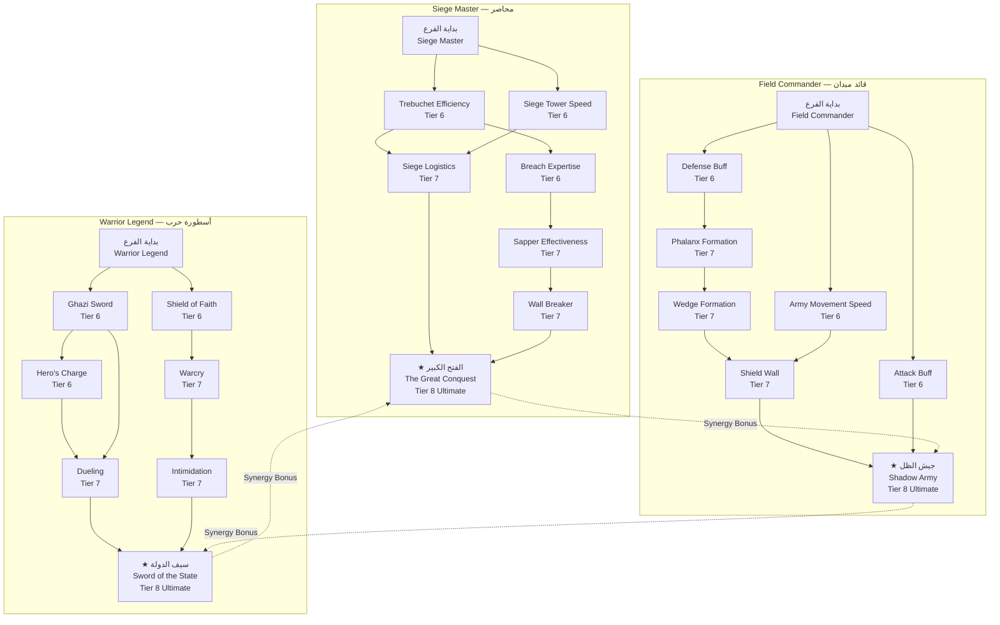

# نظام الحكم المشترك — Orhan Gazi: Commander Skill Tree (شجرة مهارات القائد)

> **التخصص**: القيادة العسكرية — Military Commander
> **مستوى المهارات**: Tier 6–8 (Ruler Tier)
> **نقاط المهارة**: 1 نقطة لكل مستوى، 3 نقاط لكل Tier

---

## 1. نظرة عامة — Overview

شجرة مهارات أورخان غازي تمثل الجانب العسكري من الحكم المشترك. بينما يركز علاء الدين على الإدارة والدبلوماسية، فإن أورخان هو القائد الميداني الذي يقود الجيوش ويخوض المعارك. هذه الشجرة تحتوي على ثلاث فروع رئيسية، كل منها يمثل أسلوبًا مختلفًا في القيادة العسكرية.

```
                    ┌─────────────────────────────┐
                    │     أورخان غازي             │
                    │     Orhan Gazi              │
                    │     Tier 6-8 Commander      │
                    └─────────────┬───────────────┘
                                  │
            ┌─────────────────────┼─────────────────────┐
            │                     │                     │
            ▼                     ▼                     ▼
    ┌───────────────┐   ┌───────────────┐   ┌───────────────┐
    │  Siege Master │   │Field Commander│   │Warrior Legend │
    │   محاصر       │   │  قائد ميدان   │   │  أسطورة حرب   │
    │               │   │               │   │               │
    │  • Trebuchet  │   │  • Unit Buffs │   │  • Personal   │
    │  • Breach     │   │  • Formations │   │    Combat     │
    │  • Siege Tower│   │  • Army Speed │   │  • Dueling    │
    │  • Sapper     │   │  • Tactics    │   │  • Warcry     │
    └───────┬───────┘   └───────┬───────┘   └───────┬───────┘
            │                     │                     │
            └─────────────────────┼─────────────────────┘
                                  │
                        ┌─────────┴─────────┐
                        │  Tier 8 Ultimate  │
                        │  قدرة نهائية      │
                        └───────────────────┘
```

---

## 2. هيكل الشجرة — Tree Structure

| Tier | النقاط المتاحة | إجمالي النقاط المتراكمة | فتح المتطلبات |
|------|---------------|------------------------|--------------|
| 6 | 3 | 3 | مستوى 20+ (أورخان) |
| 7 | 3 | 6 | مستوى 25+ (أورخان) |
| 8 | 3 | 9 | مستوى 30+ (أورخان) + إكمال مهمة "عهد الأبناء" |

---

## 3. الفرع الأول: Siege Master (محاصر)

هذا الفرع يركز على قدرة أورخان في قيادة عمليات الحصار — هدم الأسوار، بناء أسلحة الحصار، واقتحام المدن المحصنة.

### Tier 6 — قدرات الحصار الأساسية

#### 1. كفاءة المنجنيق — Trebuchet Efficiency

| الخاصية | القيمة |
|---------|--------|
| **نوع القدرة** | Passive (سلبية) |
| **تكلفة النقاط** | 1 |
| **متطلبات مسبقة** | لا يوجد |

| المستوى | Damage ضد الأسوار | سرعة إعادة التحميل | دقة الإصابة |
|---------|------------------|-------------------|------------|
| 1 | +15% | -10% | +5% |
| 2 | +25% | -20% | +10% |
| 3 | +40% | -30% | +15% |

---

#### 2. خبرة الاختراق — Breach Expertise

| الخاصية | القيمة |
|---------|--------|
| **نوع القدرة** | Active (نشطة) — تفعيل يدوي |
| **مدة التفعيل** | 20 ثانية |
| **Cooldown** | 60 ثانية |
| **تكلفة النقاط** | 1 |
| **متطلبات مسبقة** | Trebuchet Efficiency (مستوى 1+) |

| المستوى | زيادة Damage ضد الاختراق | فرصة الاختراق الفوري | نصف قطر التأثير |
|---------|-------------------------|---------------------|----------------|
| 1 | +30% | 10% | 5 متر |
| 2 | +50% | 20% | 8 متر |
| 3 | +75% | 35% | 12 متر |

**الوصف**: يوجه أورخان رماة المنجنيق لتركيز النيران على نقطة واحدة في السور، مما يزيد فرصة حدوث ثغرة.

---

#### 3. سرعة برج الحصار — Siege Tower Speed

| الخاصية | القيمة |
|---------|--------|
| **نوع القدرة** | Passive (سلبية) |
| **تكلفة النقاط** | 1 |
| **متطلبات مسبقة** | لا يوجد |

| المستوى | سرعة حركة برج الحصار | HP برج الحصار | سعة الجنود |
|---------|---------------------|---------------|-----------|
| 1 | +20% | +15% | +5 |
| 2 | +35% | +25% | +10 |
| 3 | +50% | +40% | +15 |

---

### Tier 7 — قدرات الحصار المتقدمة

#### 4. فعالية النّقّاب — Sapper Effectiveness

| الخاصية | القيمة |
|---------|--------|
| **نوع القدرة** | Active (نشطة) |
| **مدة التفعيل** | 30 ثانية |
| **Cooldown** | 90 ثانية |
| **تكلفة النقاط** | 1 |
| **متطلبات مسبقة** | Trebuchet Efficiency (مستوى 3) |

| المستوى | سرعة حفر الأنفاق | Damage ضد أساس السور | فرصة انهيار السور |
|---------|-----------------|---------------------|-------------------|
| 1 | +25% | +20% | 15% |
| 2 | +40% | +35% | 25% |
| 3 | +60% | +50% | 40% |

**الوصف**: يرسل أورخان النّقّابين (Sappers) لحفر أنفاق تحت أسوار المدينة، مما يضعف الأساسات ويزيد فرصة انهيار السور.

---

#### 5. لوجستيات الحصار — Siege Logistics

| الخاصية | القيمة |
|---------|--------|
| **نوع القدرة** | Passive (سلبية) |
| **تكلفة النقاط** | 1 |
| **متطلبات مسبقة** | Trebuchet Efficiency (مستوى 2) + Siege Tower Speed (مستوى 2) |

| المستوى | تكلفة بناء آلات الحصار | وقت بناء آلات الحصار | صيانة آلات الحصار |
|---------|----------------------|---------------------|------------------|
| 1 | -15% | -15% | -10% |
| 2 | -25% | -25% | -20% |
| 3 | -40% | -40% | -30% |

---

#### 6. هدم الأسوار — Wall Breaker (قدرة Tier 7 إضافية)

| الخاصية | القيمة |
|---------|--------|
| **نوع القدرة** | Active (نشطة) |
| **مدة التفعيل** | 10 ثوانٍ |
| **Cooldown** | 120 ثانية |
| **تكلفة النقاط** | 2 |
| **متطلبات مسبقة** | Breach Expertise (مستوى 3) + Sapper Effectiveness (مستوى 2) |

| المستوى | Damage الفوري ضد السور | صاعقة للجنود المدافعين | مدة الذهول |
|---------|----------------------|-----------------------|-----------|
| 1 | 500 | +15% | 3 ثوانٍ |
| 2 | 800 | +25% | 5 ثوانٍ |
| 3 | 1200 | +40% | 8 ثوانٍ |

**الوصف**: هجوم مركز بقوة هائلة على نقطة ضعف في السور، مما يسبب أضرارًا جسيمة ويصعق الجنود المدافعين على السور.

---

### Tier 8 — قدرة Siege Master النهائية

#### 7. ★ الفتح الكبير — The Great Conquest

| الخاصية | القيمة |
|---------|--------|
| **نوع القدرة** | Active (نهائية) — Ultimate |
| **مدة التفعيل** | 45 ثانية |
| **Cooldown** | 300 ثانية (5 دقائق) |
| **تكلفة النقاط** | 3 |
| **متطلبات مسبقة** | جميع قدرات Siege Master Tier 6-7 |

| التأثير | القيمة |
|---------|--------|
| Damage ضد الأسوار | +200% |
| Damage ضد الأبراج | +150% |
| سرعة آلات الحصار | +100% |
| فرصة الاختراق الفوري | 60% |
| Morale جنود الحصار | +30 نقطة |
| Duration | 45 ثانية |

**الوصف التاريخي**: "الفتح الكبير" هو تجسيد لقدرة أورخان الاستثنائية في حصار المدن. عند التفعيل، تتحول قوات الحصار بأكملها إلى آلة حرب لا توقف. تزداد قوة المنجنيق ثلاثة أضعاف، وتتحرك أبراج الحصار بسرعة مضاعفة، وتضرب الكباش البوابات بقوة هائلة. هذه القدرة تحول أي حصار إلى هجوم ساحق.

**الوصف الميكانيكي**: يتم تفعيل القدرة تلقائيًا عندما يكون أورخان ضمن 30 مترًا من سور العدو وتكون قوات الحصار جاهزة. تظهر حول السور تأثيرات بصرية (زلزال، دخان، نيران).

---

## 4. الفرع الثاني: Field Commander (قائد ميدان)

هذا الفرع يركز على قدرة أورخان في قيادة الجيوش في المعارك المفتوحة — تعزيز الوحدات، استخدام التشكيلات، وتنسيق التحركات.

### Tier 6 — قدرات القيادة الأساسية

#### 1. تعزيز الهجوم — Attack Buff

| الخاصية | القيمة |
|---------|--------|
| **نوع القدرة** | Aura (هالة) — تأثير مستمر حول أورخان |
| **نصف قطر الهالة** | 20 متر |
| **تكلفة النقاط** | 1 |
| **متطلبات مسبقة** | لا يوجد |

| المستوى | Damage+ | Armor Penetration+ | Critical Hit Chance+ |
|---------|--------|--------------------|--------------------|
| 1 | +8% | +5% | +3% |
| 2 | +15% | +10% | +5% |
| 3 | +25% | +15% | +8% |

---

#### 2. تعزيز الدفاع — Defense Buff

| الخاصية | القيمة |
|---------|--------|
| **نوع القدرة** | Aura (هالة) |
| **نصف قطر الهالة** | 20 متر |
| **تكلفة النقاط** | 1 |
| **متطلبات مسبقة** | لا يوجد |

| المستوى | Armor+ | HP+ | Damage Reduction+ |
|---------|--------|-----|------------------|
| 1 | +10% | +5% | +5% |
| 2 | +18% | +10% | +8% |
| 3 | +30% | +15% | +12% |

---

#### 3. سرعة الجيش — Army Movement Speed

| الخاصية | القيمة |
|---------|--------|
| **نوع القدرة** | Passive (سلبية) |
| **تكلفة النقاط** | 1 |
| **متطلبات مسبقة** | لا يوجد |

| المستوى | سرعة الحركة | سرعة الركض (Charge) | سرعة الانسحاب |
|---------|------------|--------------------|--------------|
| 1 | +10% | +15% | +10% |
| 2 | +18% | +25% | +20% |
| 3 | +25% | +40% | +30% |

---

### Tier 7 — قدرات القيادة المتقدمة

#### 4. تشكيل الكتائب — Phalanx Formation

| الخاصية | القيمة |
|---------|--------|
| **نوع القدرة** | Active (تشكيل) |
| **مدة التفعيل** | مستمر (حتى إلغاء التشكيل) |
| **Cooldown** | 15 ثانية (للتبديل) |
| **تكلفة النقاط** | 1 |
| **متطلبات مسبقة** | Defense Buff (مستوى 2) |

| المستوى | Defense (تشكيل) | Damage (تشكيل) | سرعة الحركة (تشكيل) | مقاومة الصدمات |
|---------|----------------|----------------|--------------------|--------------|
| 1 | +25% | -10% | -20% | +20% |
| 2 | +40% | -10% | -20% | +35% |
| 3 | +60% | -5% | -15% | +50% |

**الوصف**: يشكل أورخان المشاة في كتيبة دفاعية منيعة. تتراص الرماح في الجبهة بينما تحمي الدروع الجنود من السهام. التشكيل ممتاز ضد هجمات الفرسان ولكنه يقلل من سرعة الحركة.

---

#### 5. تشكيل الإسفين — Wedge Formation

| الخاصية | القيمة |
|---------|--------|
| **نوع القدرة** | Active (تشكيل) |
| **مدة التفعيل** | مستمر (حتى إلغاء التشكيل) |
| **Cooldown** | 15 ثانية (للتبديل) |
| **تكلفة النقاط** | 1 |
| **متطلبات مسبقة** | Phalanx Formation (مستوى 1) |

| المستوى | Damage (تشكيل) | Armor Penetration | سرعة الحركة | اختراق التشكيلات |
|---------|----------------|--------------------|--------------|-----------------|
| 1 | +30% | +20% | +10% | +25% |
| 2 | +45% | +30% | +15% | +40% |
| 3 | +65% | +45% | +25% | +60% |

**الوصف**: يشكل أورخان قوات الضربات السريعة (الفرسان والمشاة الخفيفون) في إسفين هجومي. ممتاز لاختراق خطوط العدو ومهاجمة الأجنحة.

---

#### 6. جدار الدروع — Shield Wall

| الخاصية | القيمة |
|---------|--------|
| **نوع القدرة** | Active (تشكيل) |
| **مدة التفعيل** | 30 ثانية |
| **Cooldown** | 90 ثانية |
| **تكلفة النقاط** | 1 |
| **متطلبات مسبقة** | Phalanx Formation (مستوى 2) + Army Speed (مستوى 2) |

| المستوى | Damage Reduction | مقاومة السهام | ثبات التشكيل | Morale |
|---------|-----------------|--------------|-------------|-------|
| 1 | 40% | 30% | +25% | +10 |
| 2 | 55% | 45% | +40% | +15 |
| 3 | 70% | 60% | +60% | +25 |

**الوصف**: تصطف الدروع في جدار منيع. هذا التشكيل يقلل بشكل كبير من أضرار السهام والهجمات المباشرة. يستخدم بشكل مثالي عند التقدم نحو الأسوار أو صد هجمات مرتدة.

---

### Tier 8 — قدرة Field Commander النهائية

#### 7. ★ جيش الظل — Shadow Army

| الخاصية | القيمة |
|---------|--------|
| **نوع القدرة** | Active (نهائية) — Ultimate |
| **مدة التفعيل** | 60 ثانية |
| **Cooldown** | 360 ثانية (6 دقائق) |
| **تكلفة النقاط** | 3 |
| **متطلبات مسبقة** | جميع قدرات Field Commander Tier 6-7 |

| التأثير | القيمة |
|---------|--------|
| عدد نسخ الوحدات | 80% من قوة الجيش الحالي |
| HP النسخ | 50% من HP الأصلي |
| Damage النسخ | 60% من Damage الأصلي |
| مدة البقاء | 60 ثانية |
| مدى الظهور | 15-40 مترًا من الجيش الأصلي |
| Morale المؤقت | +40 نقطة للجيش الأصلي |

**الوصف التاريخي**: "جيش الظل" يعكس قدرة أورخان التكتيكية في تضليل الأعداء. يتم إنشاء نسخ وهمية من الجيش تظهر من اتجاه غير متوقع، مما يربك العدو ويشتت قواته. العدو يرى جيشًا كاملاً يهاجم من الخلف أو الجانب، فيضطر لتقسيم قواته.

**الوصف الميكانيكي**: تظهر نسخ شبحية من الوحدات الحالية في موقع محدد (يختاره اللاعب ضمن نطاق). هذه النسخ تهاجم العدو وتستقبل الضربات لكنها تختفي بعد 60 ثانية أو عند تعرض كل نسخة لـ Damage كافٍ. قدرة ممتازة لكسر الحصارات أو تخفيف الضغط عن جبهة أخرى.

**ملاحظة تآزرية**: إذا كان علاء الدين قريبًا (ضمن 30 مترًا)، تزداد قوة النسخ بنسبة 20% إضافية وتعيش لمدة 15 ثانية إضافية.

---

## 5. الفرع الثالث: Warrior Legend (أسطورة حرب)

هذا الفرع يركز على قدرات أورخان القتالية الشخصية — القتال المباشر، المبارزة، والقدرات البطولية.

### Tier 6 — قدرات القتال الأساسية

#### 1. سيف الغازي — Ghazi Sword

| الخاصية | القيمة |
|---------|--------|
| **نوع القدرة** | Passive (سلبية) |
| **تكلفة النقاط** | 1 |
| **متطلبات مسبقة** | لا يوجد |

| المستوى | Damage شخصي | سرعة الهجوم | فرصة الضربة الحرجة |
|---------|-----------|------------|--------------------|
| 1 | +12% | +8% | +5% |
| 2 | +20% | +15% | +8% |
| 3 | +35% | +25% | +12% |

---

#### 2. درع الإيمان — Shield of Faith

| الخاصية | القيمة |
|---------|--------|
| **نوع القدرة** | Passive (سلبية) |
| **تكلفة النقاط** | 1 |
| **متطلبات مسبقة** | لا يوجد |

| المستوى | Armor (درع) | مقاومة السهام | مقاومة النار |
|---------|------------|--------------|-------------|
| 1 | +15 | +10% | +10% |
| 2 | +25 | +18% | +15% |
| 3 | +40 | +25% | +20% |

---

#### 3. اندفاع البطل — Hero's Charge

| الخاصية | القيمة |
|---------|--------|
| **نوع القدرة** | Active (نشطة) |
| **مدة التفعيل** | لحظي (اندفاع سريع) |
| **Cooldown** | 25 ثانية |
| **تكلفة النقاط** | 1 |
| **متطلبات مسبقة** | Ghazi Sword (مستوى 1) |

| المستوى | مسافة الاندفاع | Damage عند الاصطدام | صاعقة (Stun) |
|---------|--------------|--------------------|-------------|
| 1 | 12 متر | 100 | 1.5 ثانية |
| 2 | 18 متر | 180 | 2 ثانية |
| 3 | 25 متر | 300 | 3 ثانية |

**الوصف**: يندفع أورخان بسرعة البرق نحو هدف واحد. يصطدم بالهدف ويصدمه أرضًا، مسببًا Damage وصاعقة قصيرة. يمكن استخدامه للدخول في المعركة أو للهروب منها.

---

### Tier 7 — قدرات القتال المتقدمة

#### 4. المبارزة — Dueling

| الخاصية | القيمة |
|---------|--------|
| **نوع القدرة** | Active (مبارزة) |
| **مدة التفعيل** | حتى نهاية المبارزة أو 30 ثانية كحد أقصى |
| **Cooldown** | 120 ثانية |
| **تكلفة النقاط** | 1 |
| **متطلبات مسبقة** | Ghazi Sword (مستوى 2) + Hero's Charge (مستوى 2) |

| المستوى | Damage في المبارزة | درع في المبارزة | فرصة نزع سلاح الخصم | مكافأة الفوز |
|---------|-------------------|----------------|--------------------|-------------|
| 1 | +20% | +20% | 10% | +15 Morale |
| 2 | +35% | +30% | 20% | +25 Morale |
| 3 | +50% | +40% | 35% | +40 Morale + EXP |

**الوصف**: يتحدى أورخان قائد العدو في مبارزة فردية. خلال المبارزة، يتم عزل البطلين في حلبة قتال صغيرة. لا تستطيع الوحدات الأخرى التدخل. الفوز في المبارزة يرفع Morale الجيش بشكل كبير ويقلل Morale العدو. إذا قُتل قائد العدو، تنهار معنويات جيش العدو.

**آلية المبارزة**:
1. يختار اللاعب هدفًا (قائد عدو)
2. يبدأ حدث Quick Time (نقر متتالٍ)
3. يتفادى أورخان الهجمات ويوجه ضربات
4. يمكن استخدام قدرات خاصة أثناء المبارزة
5. الفوز = مكافآت كبرى، الخسارة = أورخان يفقد 40% HP

---

#### 5. صيحة الحرب — Warcry

| الخاصية | القيمة |
|---------|--------|
| **نوع القدرة** | Active (نشطة) |
| **مدة التفعيل** | 8 ثوانٍ |
| **Cooldown** | 45 ثانية |
| **نصف قطر التأثير** | 25 مترًا |
| **تكلفة النقاط** | 1 |
| **متطلبات مسبقة** | Shield of Faith (مستوى 2) |

| المستوى | Morale للجيش الصديق | Morale للجيش العدو | Damage صاعقة للعدو | مدة الخوف (Fear) |
|---------|-------------------|-------------------|-------------------|-----------------|
| 1 | +15 | -10 | 50 | 3 ثوانٍ |
| 2 | +25 | -18 | 100 | 5 ثوانٍ |
| 3 | +40 | -30 | 200 | 8 ثوانٍ |

**الوصف**: يطلق أورخان صيحة حرب عظيمة تهز ساحة المعركة. الصيحة ترفع معنويات جنوده وتخيف الأعداء. بعض الأعداء الضعفاء قد يفرون من ساحة المعركة.

---

#### 6. إرهاب العدو — Intimidation

| الخاصية | القيمة |
|---------|--------|
| **نوع القدرة** | Passive (سلبية) + Aura |
| **نصف قطر الهالة** | 15 مترًا |
| **تكلفة النقاط** | 1 |
| **متطلبات مسبقة** | Warcry (مستوى 1) |

| المستوى | تخفيض Damage العدو | تخفيض سرعة العدو | فرصة فرار العدو | Morale العدو— |
|---------|-------------------|-----------------|-----------------|---------------|
| 1 | -8% | -5% | 5% | -2/ثانية |
| 2 | -12% | -10% | 10% | -4/ثانية |
| 3 | -18% | -15% | 15% | -6/ثانية |

**الوصف**: سمعة أورخان كغازي لا يُقهَر تسبقه إلى ساحة المعركة. وجوده يرهب الأعداء القريبين، مما يقلل من فعاليتهم القتالية ويزيد من احتمالية فرارهم.

---

### Tier 8 — قدرة Warrior Legend النهائية

#### 7. ★ سيف الدولة — Sword of the State

| الخاصية | القيمة |
|---------|--------|
| **نوع القدرة** | Active (نهائية) — Ultimate |
| **مدة التفعيل** | 20 ثانية |
| **Cooldown** | 360 ثانية (6 دقائق) |
| **تكلفة النقاط** | 3 |
| **متطلبات مسبقة** | جميع قدرات Warrior Legend Tier 6-7 |

| التأثير | القيمة |
|---------|--------|
| **Damage** | +300% |
| **سرعة الهجوم** | +100% |
| **المناعة** | لا يمكن إصابته بأذى (Invincible) |
| **شفاء HP** | شفاء كامل + 50 HP/ثانية |
| **مقاومة السيطرة** | مناعة تامة (Stun, Fear, Knockdown) |
| **نصف قطر الخوف** | 30 مترًا — كل الأعداء يفرون أو يتجمدون |
| **مدة التفعيل** | 20 ثانية |

**الوصف التاريخي**: "سيف الدولة" هو تجسيد لمكانة أورخان كحامي الدولة العثمانية. عند التفعيل، يصبح أورخان تجسيدًا للقوة الإلهية — لا يُقهر، لا يُوقف، كل ضربة سيفه تمثل حكمًا بالإعدام على أعدائه. يخترق صفوف الأعداء كالسيف في الزبدة.

**الوصف الميكانيكي**: لأول 20 ثانية، أورخان لا يمكنه الموت. كل ضربة يوجهها تكاد تكون قاتلة. هذه القدرة مخصصة للحظات اليأس — عندما يكون الجيش على وشك الانهيار، يمكن لأورخان وحده قلب الموازين. لكن يجب استخدامها في التوقيت المناسب، حيث أن الـ Cooldown طويل جدًا (6 دقائق).

**ملاحظة تآزرية**: إذا كان علاء الدين قد استثمر في Builder → Siege Engineering، فإن مدة "سيف الدولة" تزيد بمقدار 5 ثوانٍ إضافية.

---

## 6. شجرة المهارات الكاملة — Full Skill Tree Flowchart



---

## 7. ملاحظات التآزر بين الفروع — Synergy Notes

| الفروع المتآزرة | نوع التآزر | المكافأة |
|----------------|-----------|---------|
| Siege Master + Field Commander | "تكتيكات الحصار الشامل" | +15% Damage لكل من يعمل ضمن 30 مترًا من آلات الحصار |
| Field Commander + Warrior Legend | "قائد المعركة" | AoE Buff يتضاعف تأثيره على أورخان نفسه |
| Warrior Legend + Siege Master | "غازي الأسوار" | +25% Damage شخصي ضد الأعداء على الأسوار |
| جميع الفروع الثلاثة | "القائد الكامل" | فتح قدرة سلبية مخفية: +10% لكل الخاصيات |

---

## 8. مقارنة مع شجرة علاء الدين — Comparison

| الجانب | أورخان (Commander) | علاء الدين (Statesman) |
|--------|-------------------|----------------------|
| **Tier** | 6-8 (Ruler) | 5-7 (Advisor) |
| **التركيز** | القوة المباشرة | القوة غير المباشرة |
| **القتال** | شخصي + قيادة جيش | دعم لوجستي + إداري |
| **المهارات** | Damage, Buffs, Formations | Edicts, Diplomacy, Construction |
| **التبعية** | مستقل (يمكن الفوز بالمعارك وحده) | يعتمد على الجيش (ليس مقاتلاً) |
| **Ultimate** | قتالية: هجوم / استنساخ / خلود | استراتيجية: قوانين / تحالفات / بناء |

---

> **تاريخ آخر تحديث**: 2026-06-20
