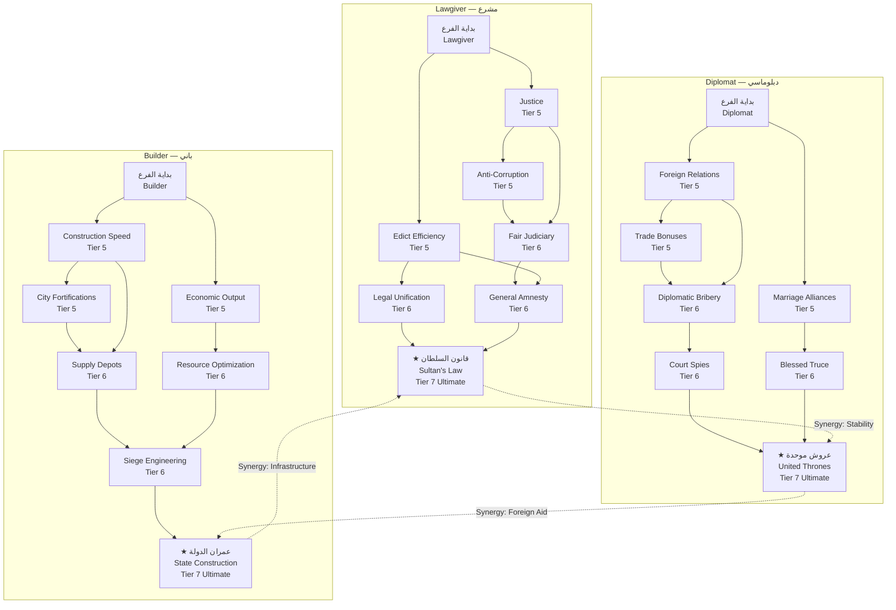

# نظام الحكم المشترك — Alaeddin Pasha: Statesman Skill Tree (شجرة مهارات رجل الدولة)

> **التخصص**: الإدارة المدنية والدبلوماسية — Civil Administrator & Diplomat
> **مستوى المهارات**: Tier 5–7 (Advisor Tier)
> **نقاط المهارة**: 1 نقطة لكل مستوى، 3 نقاط لكل Tier

---

## 1. نظرة عامة — Overview

شجرة مهارات علاء الدين باشا تمثل الجانب المدني من الحكم المشترك. بينما يقود أورخان الجيوش في ساحات المعارك، فإن علاء الدين هو الذي يبني الدولة من الداخل — يسن القوانين، يعقد التحالفات، ويشيد المباني التي تدعم التوسع العسكري. هذه الشجرة تحتوي على ثلاثة فروع رئيسية، كل منها يعكس وجهًا من وجوه الإدارة المدنية.

```
                    ┌─────────────────────────────────────┐
                    │     علاء الدين باشا                │
                    │     Alaeddin Pasha                  │
                    │     Tier 5-7 Statesman              │
                    └─────────────┬───────────────────────┘
                                  │
            ┌─────────────────────┼─────────────────────┐
            │                     │                     │
            ▼                     ▼                     ▼
    ┌───────────────┐   ┌───────────────┐   ┌───────────────┐
    │   Lawgiver    │   │   Diplomat    │   │   Builder      │
    │   مشرع        │   │  دبلوماسي     │   │   باني        │
    │               │   │               │   │               │
    │  • Edicts     │   │  • Foreign    │   │  • Construction│
    │  • Justice    │   │    Relations  │   │    Speed       │
    │  • Unrest     │   │  • Marriage   │   │  • Economy     │
    │  • Corruption │   │    Alliances  │   │  • Resource    │
    │               │   │  • Trade      │   │    Production  │
    │               │   │  • Bribes     │   │  • Siege       │
    │               │   │               │   │    Engineering │
    └───────┬───────┘   └───────┬───────┘   └───────┬───────┘
            │                     │                     │
            └─────────────────────┼─────────────────────┘
                                  │
                        ┌─────────┴─────────┐
                        │  Tier 7 Ultimate  │
                        │  قدرة نهائية      │
                        └───────────────────┘
```

---

## 2. هيكل الشجرة — Tree Structure

| Tier | النقاط المتاحة | إجمالي النقاط المتراكمة | فتح المتطلبات |
|------|---------------|------------------------|--------------|
| 5 | 3 | 3 | مستوى 15+ (علاء الدين) |
| 6 | 3 | 6 | مستوى 20+ (علاء الدين) |
| 7 | 3 | 9 | مستوى 25+ (علاء الدين) + إكمال مهمة "مجلس الدولة" |

---

## 3. الفرع الأول: Lawgiver (مشرع)

هذا الفرع يركز على قدرة علاء الدين في سن القوانين وإقامة العدل — تقليل الاضطرابات، مكافحة الفساد، وزيادة ولاء الشعب.

### Tier 5 — قدرات التشريع الأساسية

#### 1. كفاءة المراسيم — Edict Efficiency

| الخاصية | القيمة |
|---------|--------|
| **نوع القدرة** | Passive (سلبية) |
| **تكلفة النقاط** | 1 |
| **متطلبات مسبقة** | لا يوجد |

| المستوى | تخفيض تكلفة المراسيم | تخفيض مدة المراسيم | زيادة فعالية المرسوم |
|---------|---------------------|-------------------|---------------------|
| 1 | -15% | -15% | +10% |
| 2 | -25% | -25% | +18% |
| 3 | -40% | -35% | +25% |

**الوصف**: المراسيم (Edicts) هي قرارات حكومية يمكن إصدارها في أي منطقة: زيادة الضرائب، تخفيض الضرائب، التجنيد الإجباري، حظر التجول، إلخ. هذه القدرة تجعل إصدار المراسيم أرخص وأسرع وأكثر فعالية.

**أنواع المراسيم المتأثرة**:
| المرسوم | التأثير الأساسي | التكلفة الأساسية | المدة الأساسية |
|---------|----------------|-----------------|---------------|
| زيادة الضرائب | +30% دخل المنطقة | 500 Gold | 60 يومًا |
| تخفيض الضرائب | +20 ولاء، -15% دخل | 300 Gold | 60 يومًا |
| التجنيد | +3 وحدات/شهر | 400 Gold | 90 يومًا |
| حظر التجول | -50% اضطرابات ليلاً | 200 Gold | 30 يومًا |
| التعبئة العامة | +50% سرعة بناء، +20% تكاليف | 600 Gold | 45 يومًا |

---

#### 2. العدالة — Justice

| الخاصية | القيمة |
|---------|--------|
| **نوع القدرة** | Passive (سلبية) |
| **تكلفة النقاط** | 1 |
| **متطلبات مسبقة** | لا يوجد |

| المستوى | تخفيض الاضطرابات | زيادة الولاء | سرعة استقرار المناطق المحتلة |
|---------|-----------------|-------------|---------------------------|
| 1 | -15% | +2/شهر | +15% |
| 2 | -25% | +4/شهر | +25% |
| 3 | -40% | +8/شهر | +40% |

**الوصف**: نظام عدالة قوي يقلل من الاضطرابات ويزيد من ولاء الرعية. بعد احتلال منطقة جديدة، يسرع هذا النظام من استقرارها وعودتها إلى الإنتاج الكامل.

---

#### 3. مكافحة الفساد — Anti-Corruption

| الخاصية | القيمة |
|---------|--------|
| **نوع القدرة** | Passive (سلبية) |
| **تكلفة النقاط** | 1 |
| **متطلبات مسبقة** | Justice (مستوى 1) |

| المستوى | تخفيض الفساد | استرداد الموارد المفقودة | زيادة الشفافية |
|---------|-------------|------------------------|---------------|
| 1 | -15% | +10% من الفساد المسترجع | +5% |
| 2 | -25% | +20% | +10% |
| 3 | -40% | +35% | +15% |

**الوصف**: الفساد يقلص خزينة الدولة بنسبة مئوية كل شهر. هذه القدرة تقلل من الفساد وتسترجع بعض الموارد المفقودة. عند كشف الفساد، تظهر أحداث (Events) يمكن للاعب اختيار كيفية التعامل معها.

---

### Tier 6 — قدرات التشريع المتقدمة

#### 4. القضاء العادل — Fair Judiciary

| الخاصية | القيمة |
|---------|--------|
| **نوع القدرة** | Active (نشطة) |
| **مدة التفعيل** | 60 ثانية (للمحاكمة) |
| **Cooldown** | 180 ثانية (3 دقائق) |
| **تكلفة النقاط** | 1 |
| **متطلبات مسبقة** | Justice (مستوى 2) + Anti-Corruption (مستوى 1) |

| المستوى | تأثير المحاكمة العادلة | مدة التأثير | نصف قطر التأثير |
|---------|----------------------|------------|----------------|
| 1 | +10 ولاء، -10 اضطرابات | 120 يومًا | منطقتان |
| 2 | +18 ولاء، -18 اضطرابات | 180 يومًا | 3 مناطق |
| 3 | +30 ولاء، -30 اضطرابات | 300 يومًا | 5 مناطق |

**الوصف**: يقيم علاء الدين محكمة متنقلة في المنطقة المحددة. يحاكم المظالم ويحل النزاعات، مما يرفع الولاء ويقلل الاضطرابات بشكل كبير.

---

#### 5. التوحيد القانوني — Legal Unification

| الخاصية | القيمة |
|---------|--------|
| **نوع القدرة** | Passive (سلبية) |
| **تكلفة النقاط** | 1 |
| **متطلبات مسبقة** | Edict Efficiency (مستوى 3) |

| المستوى | تأثير القوانين الموحدة | ولاء جميع المناطق | سهولة الإدارة |
|---------|----------------------|------------------|-------------|
| 1 | +5% لجميع المراسيم | +1/شهر | -10% تكاليف إدارية |
| 2 | +8% | +3/شهر | -18% |
| 3 | +12% | +5/شهر | -25% |

**الوصف**: يوحد علاء الدين القوانين عبر جميع مناطق الدولة. هذا يقلل من التعقيد الإداري ويزيد من كفاءة الحكم، لكنه يتطلب جهدًا كبيرًا في البداية.

---

#### 6. العفو العام — General Amnesty (قدرة Tier 6 إضافية)

| الخاصية | القيمة |
|---------|--------|
| **نوع القدرة** | Active (نشطة) |
| **مدة التفعيل** | فوري |
| **Cooldown** | 600 ثانية (10 دقائق) — مرة واحدة فقط لكل معركة كبرى |
| **تكلفة النقاط** | 2 |
| **متطلبات مسبقة** | Edict Efficiency (مستوى 2) + Fair Judiciary (مستوى 2) |

| المستوى | تأثير العفو | فرصة تحويل الأعداء | مدة الهدنة |
|---------|------------|-------------------|-----------|
| 1 | +15 ولاء، -20 اضطرابات | 10% | 30 يومًا |
| 2 | +25 ولاء، -30 اضطرابات | 20% | 45 يومًا |
| 3 | +40 ولاء، -45 اضطرابات | 35% | 60 يومًا |

**الوصف**: يصدر علاء الدين عفوًا عامًا عن المتمردين والمنشقين. هذا ينهي التمردات فورًا ويحول بعض المتمردين السابقين إلى موالين للدولة.

---

### Tier 7 — قدرة Lawgiver النهائية

#### 7. ★ قانون السلطان — Sultan's Law

| الخاصية | القيمة |
|---------|--------|
| **نوع القدرة** | Active (نهائية) — Ultimate |
| **مدة التفعيل** | فوري |
| **Cooldown** | مرة واحدة لكل لعبة (One-time use per campaign) |
| **تكلفة النقاط** | 3 |
| **متطلبات مسبقة** | جميع قدرات Lawgiver Tier 5-6 |

| التأثير | القيمة |
|---------|--------|
| **المراسيم الحالية** | تصبح دائمة (لا تنتهي أبدًا) |
| **الولاء** | +50 نقطة لجميع المناطق |
| **الاضطرابات** | -80 نقطة لجميع المناطق |
| **الفساد** | 0% لبقية اللعبة |
| **الإدارة** | -50% تكاليف إدارية دائمة |

**الوصف التاريخي**: "قانون السلطان" هو تتويج لعمل علاء الدين التشريعي. يتم تدوين جميع القوانين والأعراف في دستور رسمي للدولة — "قانون نامه" — يصبح المرجع الأساسي للحكم في الدولة العثمانية. جميع المراسيم التي كانت سارية المفعول عند إصدار هذا القانون تصبح دائمة ولا يمكن إلغاؤها، مما يمنح استقرارًا قانونيًا هائلًا.

**الوصف الميكانيكي**: قبل استخدام هذه القدرة، يجب على اللاعب التأكد من أن جميع المراسيم النشطة هي ما يريد أن يصبح دائمًا. بمجرد التفعيل، لا رجعة فيه. الاستخدام الأمثل هو بعد إصدار جميع المراسيم المطلوبة (تخفيض الضرائب، زيادة الإنتاج، إلخ).

---

## 4. الفرع الثاني: Diplomat (دبلوماسي)

هذا الفرع يركز على قدرة علاء الدين في إدارة العلاقات الخارجية — عقد التحالفات، ترتيب الزيجات السياسية، وتعزيز التجارة.

### Tier 5 — قدرات الدبلوماسية الأساسية

#### 1. العلاقات الخارجية — Foreign Relations

| الخاصية | القيمة |
|---------|--------|
| **نوع القدرة** | Passive (سلبية) |
| **تكلفة النقاط** | 1 |
| **متطلبات مسبقة** | لا يوجد |

| المستوى | تحسين العلاقات مع كل الخصوم/الحلفاء | سرعة تحسن العلاقات | خيارات الحوار الدبلوماسي |
|---------|------------------------------------|-------------------|------------------------|
| 1 | +10 نقطة علاقات أساسية | +15% | خيارات أساسية |
| 2 | +20 نقطة | +25% | خيارات متوسطة |
| 3 | +35 نقطة | +40% | خيارات متقدمة |

**الوصف**: علاء الدين معروف بحكمته ولباقته الدبلوماسية. هذه القدرة تفتح خيارات حوار إضافية مع الشخصيات الأخرى (البكوات البيزنطيين، الإمارات التركمانية، إلخ).

---

#### 2. التحالفات الزوجية — Marriage Alliances

| الخاصية | القيمة |
|---------|--------|
| **نوع القدرة** | Active (نشطة) |
| **مدة التفعيل** | فوري (ترتيب الزواج) |
| **Cooldown** | 360 يومًا (سنة لعبة واحدة) |
| **تكلفة النقاط** | 1 |
| **متطلبات مسبقة** | لا يوجد |

| المستوى | زيادة العلاقات من زواج | مدة التحالف | مهر الزواج | فرصة القبول |
|---------|----------------------|------------|----------|-----------|
| 1 | +30 نقطة | 3 سنوات | 1000 Gold | 40% |
| 2 | +45 نقطة | 5 سنوات | 750 Gold | 55% |
| 3 | +60 نقطة | دائم | 500 Gold | 70% |

**الوصف**: يرتب علاء الدين زيجات سياسية بين العائلة العثمانية وعائلات النبلاء في الإمارات المجاورة. كل زواج يخلق تحالفًا قويًا قد يستمر لسنوات أو يصبح دائمًا.

**الزيجات المتاحة في الموسم السادس**:
| الطرف المقترح | الإمارة/الدولة | المكافأة | الصعوبة |
|--------------|---------------|---------|---------|
| ابنة حاكم بيجا | إمارة بيجا | تحالف عسكري | سهل |
| ابنة أمير قرسي | إمارة قرسي | أسطول بحري | متوسط |
| ابنة حاكم إسكي شهر | إمارة إسكي شهر | +500 جندي | متوسط |
| أميرة بيزنطية | الإمبراطورية البيزنطية | هدنة لمدة 5 سنوات | صعب |

---

#### 3. المكافآت التجارية — Trade Bonuses

| الخاصية | القيمة |
|---------|--------|
| **نوع القدرة** | Passive (سلبية) |
| **تكلفة النقاط** | 1 |
| **متطلبات مسبقة** | Foreign Relations (مستوى 1) |

| المستوى | دخل طرق التجارة | عدد طرق التجارة | جودة البضائع المتداولة |
|---------|----------------|----------------|---------------------|
| 1 | +20% | +1 | +10% |
| 2 | +35% | +2 | +18% |
| 3 | +50% | +3 | +30% |

**الوصف**: يفتح علاء الدين طرقًا تجارية جديدة ويحسن شروط التجارة مع الدول المجاورة. طرق التجارة توفر دخلاً ثابتًا (Gold/شهر) ويمكن أن توفر موارد نادرة.

---

### Tier 6 — قدرات الدبلوماسية المتقدمة

#### 4. الرشوة الدبلوماسية — Diplomatic Bribery

| الخاصية | القيمة |
|---------|--------|
| **نوع القدرة** | Active (نشطة) |
| **مدة التفعيل** | فوري |
| **Cooldown** | 120 ثانية |
| **تكلفة النقاط** | 1 |
| **متطلبات مسبقة** | Foreign Relations (مستوى 2) + Trade Bonuses (مستوى 2) |

| المستوى | كفاءة الرشوة | تأثير الرشوة | مدة التأثير | تكلفة الرشوة |
|---------|-------------|------------|------------|------------|
| 1 | 50% | +20 علاقات | 90 يومًا | 500 Gold |
| 2 | 65% | +35 علاقات | 180 يومًا | 400 Gold |
| 3 | 80% | +50 علاقات | 360 يومًا | 300 Gold |

**الوصف**: يستخدم علاء الدين الذهب لتليين مواقف الحكام المعادين. رشوة مسؤول كبير قد تفتح أبوابًا كانت مغلقة — من السماح بمرور الجيش عبر أراضيه إلى كشف معلومات عن تحركات العدو.

---

#### 5. جواسيس البلاط — Court Spies

| الخاصية | القيمة |
|---------|--------|
| **نوع القدرة** | Passive (سلبية) |
| **تكلفة النقاط** | 1 |
| **متطلبات مسبقة** | Foreign Relations (مستوى 3) + Diplomatic Bribery (مستوى 1) |

| المستوى | كشف المعلومات | تحذير مسبق من الهجمات | معرفة نقاط ضعف العدو |
|---------|--------------|---------------------|--------------------|
| 1 | خطط العدو الأساسية | 60 دقيقة قبل الهجوم | -10% Armor للعدو |
| 2 | خطط العدو المتوسطة | 120 دقيقة | -18% Armor |
| 3 | خطط العدو كاملة | 180 دقيقة | -30% Armor |

**الوصف**: ينشر علاء الدين شبكة من الجواسيس في بلاطات الحكام المجاورين. هذه الجواسيس ترسل تقارير منتظمة عن نوايا الأعداء، نقاط ضعفهم، وأسرارهم العسكرية.

---

#### 6. الهدنة المباركة — Blessed Truce (قدرة Tier 6 إضافية)

| الخاصية | القيمة |
|---------|--------|
| **نوع القدرة** | Active (نشطة) |
| **مدة التفعيل** | فوري |
| **Cooldown** | 600 ثانية (10 دقائق) |
| **تكلفة النقاط** | 2 |
| **متطلبات مسبقة** | Marriage Alliances (مستوى 3) |

| المستوى | مدة الهدنة | شفاء HP (خارج المعركة) | إعادة تنظيم الجيش | تكلفة الهدنة |
|---------|-----------|----------------------|-----------------|-------------|
| 1 | 30 يومًا | +10% من HP/يوم | +10% | 800 Gold |
| 2 | 45 يومًا | +20% من HP/يوم | +20% | 600 Gold |
| 3 | 60 يومًا | +35% من HP/يوم | +35% | 400 Gold |

**الوصف**: يرسل علاء الدين رسل سلام إلى العدو، عارضًا هدنة مؤقتة. خلال الهدنة، يتوقف القتال ويستعيد الجيش قوته ويعاد تنظيمه. قد يرفض العدو إذا كان متفوقًا بشكل كبير.

---

### Tier 7 — قدرة Diplomat النهائية

#### 7. ★ عروش موحدة — United Thrones

| الخاصية | القيمة |
|---------|--------|
| **نوع القدرة** | Active (نهائية) — Ultimate |
| **مدة التفعيل** | فوري |
| **Cooldown** | مرة واحدة لكل لعبة (One-time use per campaign) |
| **تكلفة النقاط** | 3 |
| **متطلبات مسبقة** | جميع قدرات Diplomat Tier 5-6 |

| التأثير | القيمة |
|---------|--------|
| **الإمارات المحايدة** | تصبح حليفة تلقائيًا |
| **العلاقات** | +100 نقطة مع جميع الدول |
| **طرق التجارة** | جميع الإمارات المحايدة تفتح طرقًا تجارية |
| **التحالفات الزوجية** | تتوفر زيجات جديدة مع كل إمارة |
| **الجيش الموحد** | +20% من قوات الحلفاء تصبح تحت سيطرة اللاعب |
| **الدخل** | +50% دخل من التجارة مع الحلفاء الجدد |

**الوصف التاريخي**: "عروش موحدة" يعكس حلم علاء الدين بتوحيد الإمارات التركمانية تحت راية واحدة. من خلال الدبلوماسية الذكية، الزيجات المباركة، والوعود بالمشاركة في الغنائم، يتمكن من إقناع جميع الإمارات المحايدة بالانضمام إلى التحالف العثماني — ليس كأتباع، بل كحلفاء متساوين.

**الوصف الميكانيكي**: عند التفعيل، كل إمارة كانت على الحياد أو لديها علاقة +30 نقطة أو أكثر ستنضم تلقائيًا إلى تحالف مع الدولة العثمانية. هذا يمكن أن يغير ميزان القوى في المنطقة بين ليلة وضحاها.

---

## 5. الفرع الثالث: Builder (باني)

هذا الفرع يركز على قدرة علاء الدين في تشييد المباني، تطوير الاقتصاد، ودعم العمليات العسكرية بالهندسة.

### Tier 5 — قدرات البناء الأساسية

#### 1. سرعة البناء — Construction Speed

| الخاصية | القيمة |
|---------|--------|
| **نوع القدرة** | Passive (سلبية) |
| **تكلفة النقاط** | 1 |
| **متطلبات مسبقة** | لا يوجد |

| المستوى | سرعة البناء | تكلفة البناء | جودة البناء (HP) |
|---------|------------|-------------|-----------------|
| 1 | +20% | -10% | +10% |
| 2 | +35% | -18% | +18% |
| 3 | +50% | -25% | +30% |

**الوصف**: علاء الدين يشرف شخصيًا على مشاريع البناء، مما يسرع وتيرة التشييد ويقلل التكاليف.

---

#### 2. الإنتاج الاقتصادي — Economic Output

| الخاصية | القيمة |
|---------|--------|
| **نوع القدرة** | Passive (سلبية) |
| **تكلفة النقاط** | 1 |
| **متطلبات مسبقة** | لا يوجد |

| المستوى | إنتاج الموارد (Gold) | إنتاج الخشب | إنتاج الغذاء | إنتاج الحجر |
|---------|--------------------|-----------|-----------|-----------|
| 1 | +15% | +15% | +10% | +10% |
| 2 | +25% | +25% | +18% | +18% |
| 3 | +40% | +40% | +30% | +30% |

**الوصف**: تطوير البنية التحتية الاقتصادية — الطواحين، المخابز، المناجم، وورش العمل — يزيد من إنتاج الموارد الأساسية.

---

#### 3. تحصينات المدن — City Fortifications

| الخاصية | القيمة |
|---------|--------|
| **نوع القدرة** | Passive (سلبية) |
| **تكلفة النقاط** | 1 |
| **متطلبات مسبقة** | Construction Speed (مستوى 1) |

| المستوى | HP أسوار المدن | HP أبراج الدفاع | Damage أبراج الدفاع | سرعة إصلاح الأسوار |
|---------|--------------|----------------|-------------------|------------------|
| 1 | +15% | +15% | +10% | +15% |
| 2 | +25% | +25% | +18% | +25% |
| 3 | +40% | +40% | +30% | +40% |

**الوصف**: يشيد علاء الدين تحصينات متطورة في المدن العثمانية. الأسوار تصبح أسمك، الأبراج تصبح أعلى، والمدافع تراقب الأفق.

---

### Tier 6 — قدرات البناء المتقدمة

#### 4. مراكز الإمداد — Supply Depots

| الخاصية | القيمة |
|---------|--------|
| **نوع القدرة** | Active (نشطة) |
| **مدة التفعيل** | فوري (بناء مستودع) |
| **Cooldown** | 300 ثانية (5 دقائق) |
| **تكلفة النقاط** | 1 |
| **متطلبات مسبقة** | Construction Speed (مستوى 2) + Economic Output (مستوى 2) |

| المستوى | أثر مستودع الإمداد | نصف قطر التأثير | مدة البقاء | تكلفة البناء |
|---------|------------------|---------------|-----------|------------|
| 1 | +15% HP/ثانية للقوات القريبة | 30 مترًا | 300 ثانية | 300 Gold |
| 2 | +25% HP/ثانية | 45 مترًا | 450 ثانية | 250 Gold |
| 3 | +40% HP/ثانية + إعادة ذخيرة | 60 مترًا | 600 ثانية | 200 Gold |

**الوصف**: يبني علاء الدين مستودعات إمداد متقدمة في ساحة المعركة. هذه المستودعات تزود القوات القريبة بالطعام والذخيرة والدعم الطبي، مما يعزز قدرتهم على البقاء والقتال.

---

#### 5. تحسين الموارد — Resource Optimization

| الخاصية | القيمة |
|---------|--------|
| **نوع القدرة** | Passive (سلبية) |
| **تكلفة النقاط** | 1 |
| **متطلبات مسبقة** | Economic Output (مستوى 3) |

| المستوى | تقليل هدر الموارد | تخزين الموارد (سعة) | تحويل الموارد (كفاءة) |
|---------|------------------|-------------------|--------------------|
| 1 | -15% | +20% | 50% |
| 2 | -25% | +35% | 65% |
| 3 | -40% | +50% | 80% |

**الوصف**: يحسن علاء الدين إدارة الموارد بحيث يقل الهدر وتزيد سعة التخزين. يمكن تحويل الموارد الزائدة (مثلاً: تحويل الخشب الزائد إلى Gold).

---

#### 6. هندسة الحصار — Siege Engineering

| الخاصية | القيمة |
|---------|--------|
| **نوع القدرة** | Active (نشطة) |
| **مدة التفعيل** | أثناء الحصار |
| **Cooldown** | لا يوجد (قدرة استمرارية) |
| **تكلفة النقاط** | 2 |
| **متطلبات مسبقة** | Construction Speed (مستوى 2) + City Fortifications (مستوى 2) |

| المستوى | تخفيض تكلفة آلات الحصار | زيادة Damage آلات الحصار | تأثير القدرة الخاصة | التآزر مع أورخان |
|---------|----------------------|------------------------|-------------------|----------------|
| 1 | -20% | +15% | مخططات الحصار: +5% سرعة | +10% Siege Bonus |
| 2 | -35% | +25% | مخططات الحصار: +10% سرعة | +18% |
| 3 | -50% | +40% | مخططات الحصار: +15% سرعة | +30% |

**الوصف**: علاء الدين ليس مجرد باني مدن، بل هو مهندس حصار ماهر. يشرف على تصميم وبناء آلات الحصار — المقاليع، أبراج الحصار، الكباش — ويضمن أنها تعمل بكفاءة قصوى.

**التآزر مع أورخان**: إذا كان أورخان قد استثمر في Siege Master branch، فإن تأثير "هندسة الحصار" يتضاعف بنسبة 50%. تصبح آلات الحصار التي بناها علاء الدين أقوى بشكل استثنائي عندما يستخدمها أورخان.

---

### Tier 7 — قدرة Builder النهائية

#### 7. ★ عمران الدولة — State Construction

| الخاصية | القيمة |
|---------|--------|
| **نوع القدرة** | Active (نهائية) — Ultimate |
| **مدة التفعيل** | فوري |
| **Cooldown** | مرة واحدة لكل لعبة (One-time use per campaign) |
| **تكلفة النقاط** | 3 |
| **متطلبات مسبقة** | جميع قدرات Builder Tier 5-6 |

| التأثير | القيمة |
|---------|--------|
| **جميع المباني الجارية** | تكتمل فورًا |
| **جميع المباني المخطط لها** | تُبنى في 10% من الوقت الأصلي |
| **جميع المباني القائمة** | تترقى إلى المستوى التالي مجانًا |
| **إصلاح الأسوار** | إصلاح كامل لجميع أسوار الدولة |
| **موارد إضافية** | +500 من كل مورد |
| **تأثير دائم** | +30% سرعة بناء لبقية اللعبة |

**الوصف التاريخي**: "عمران الدولة" هو تجسيد لرؤية علاء الدين العمرانية. في لحظة إلهام إداري، يصدر أوامره ببدء جميع مشاريع البناء المعلقة دفعة واحدة — الطرق، الجسور، المساجد، الحمامات، الأسواق، المستودعات، التحصينات. تتحول الدولة بين عشية وضحاها إلى ورشة بناء عملاقة.

**الوصف الميكانيكي**: هذه القدرة مناسبة للاستخدام بعد جمع الموارد الكافية وتخطيط جميع المباني المطلوبة. التوقيت الأمثل هو قبل حصار كبير (لتعزيز التحصينات) أو بعده مباشرة (لإعادة البناء بسرعة). يجب على اللاعب التأكد من أن جميع المباني المخطط لها لا تزال مفيدة قبل التفعيل.

---

## 6. شجرة المهارات الكاملة — Full Skill Tree Flowchart



---

## 7. ملاحظات التآزر بين الفروع — Synergy Notes

| الفروع المتآزرة | نوع التآزر | المكافأة |
|----------------|-----------|---------|
| Lawgiver + Diplomat | "السلطة الناعمة" | كل إمارة تتحالف دبلوماسيًا تكسب +10 ولاء إضافي |
| Diplomat + Builder | "ازدهار التجارة" | +25% دخل إضافي من طرق التجارة بناءً على عدد المباني التجارية |
| Builder + Lawgiver | "مدن النظام" | -20% وقت بناء بسبب القوانين المنظمة |
| جميع الفروع الثلاثة | "رجل الدولة الكامل" | فتح قدرة سلبية مخفية: +100% فعالية لكل المراسيم والتحالفات والمباني |

---

## 8. مقارنة بين شجرتي أورخان وعلاء الدين

| الجانب | أورخان (قوة مباشرة) | علاء الدين (قوة غير مباشرة) |
|--------|-------------------|---------------------------|
| **التأثير** | فوري — Damage, Buffs | تدريجي — قوانين، بناء، تحالفات |
| **القتال** | مباشر (سيف، اندفاع، مبارزة) | غير مباشر (هندسة حصار، جواسيس) |
| **المدة** | لحظي (ثوانٍ إلى دقائق) | طويل (أيام إلى سنوات لعبة) |
| **الموارد** | يستهلك موارد (ذخيرة، طعام) | ينتج موارد (Gold، خشب، حجر) |
| **الاعتمادية** | مستقل — يمكنه الفوز بالمعارك وحده | يعتمد على الجيش — لا يقاتل بنفسه |
| **العدو** | جيوش الأعداء | عدم الاستقرار، الفساد، العزلة |
| **المكافأة** | انتصارات عسكرية | استقرار الدولة وازدهارها |
| **Ultimate** | "الفتح الكبير"، "جيش الظل"، "سيف الدولة" | "قانون السلطان"، "عروش موحدة"، "عمران الدولة" |

---

> **تاريخ آخر تحديث**: 2026-06-20
