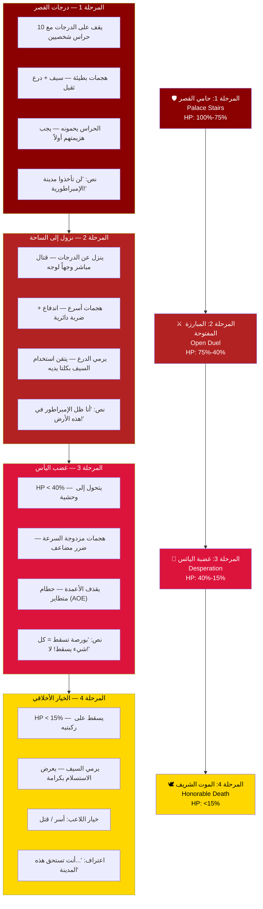

# Mission: سقوط بورصة — الفصل الثالث عشر: المهمة 59
# Fall of Bursa

## 🏷️ البيانات الوصفية (Mission Metadata)

| الحقل | القيمة |
|-------|--------|
| **الفصل** | الفصل الثالث عشر: فجر الإمبراطورية |
| **الترتيب** | المهمة 59 من 61 — المهمة الأولى في الفصل الثالث عشر |
| **المدة التقديرية** | 50-70 دقيقة |
| **مستوى الصعوبة** | عالي جداً (Very Hard) — ذروة الحملة بأكملها |
| **أسلوب اللعب** | معركة شوارع (Street Fighting) — قتال حضري — مواجهة الزعيم النهائي |
| **نوع التحدي الرئيسي** | تطهير 3 أحياء، قتال في مساحات ضيقة، مواجهة تكفور بورصة (4 مراحل)، قرار أخلاقي مصيري |
| **يفتح بعد إكمال** | المهمة 58 — ليلة الخيانة (البوابة الشمالية مفتوحة) |
| **يفتح عند النجاح** | المهمة 60 — وداع السلطان |
| **السياق الزمني** | فجر 6 أبريل 1326م — اللحظة التاريخية لفتح بورصة |
| **المكافآت الأساسية** | 2,000 ذهب، 30 SP (أكبر مكافأة في اللعبة) |

## 📖 السياق القصصي (Narrative Context)

### المقدمة

البوابة الشمالية مفتوحة. الجيش العثماني يتدفق إلى بورصة كالسيل. بعد 6 سنوات من الحصار، بعد آلاف الليالي من الانتظار، بعد موت المئات من الأبطال — ها هو حلم عثمان غازي يتحقق. الجيش يدخل المدينة، والمشاعل تضيء الأزقة التي ظلت مظلمة لقرون تحت الحكم البيزنطي.

لكن فتح البوابة لا يعني فتح المدينة. بورصة ليست مدينة صغيرة — إنها عاصمة مقاطعة بيزنطية كاملة، محصنة جيداً، وجيشها لا يزال يقاتل. تكفور بورصة — الحاكم البيزنطي القاسي — يرفض الاستسلام. قد يكون محاصراً، قد يكون جيشه منهكاً، لكنه لا يزال يملك المال والسلاح والرجال المخلصين له.

المعركة الآن ليست على الجدران — بل في الشوارع. قتال من منزل إلى منزل، من زقاق إلى زقاق، من حي إلى حي. قتال لا يعرف الرحمة، حيث العدو ليس جيشاً منظماً بل جنوداً مختبئين في النوافذ، رماة على الأسطح، مدنيين مسلحين.

اللعبة الآن جديدة بالكامل.

### الحدث المحفز

يقف أورهان غازي عند البوابة الشمالية لبورصة. الشمس تشرق من خلفه — فجر 6 أبريل 1326م. أمامه تمتد شوارع بورصة — المدينة التي حلم بها والده طوال حياته. خلفه 500 جندي عثماني. إلى جانبه تورغوت ألب، كونور ألب، بوران ألب، وفاطمة خاتون.

**أورهان غازي** (ينظر إلى المدينة):
"يا إخوة — اليوم ليس كأمس. أمس كنا محاصرين. اليوم — نحن داخلون. لكن بورصة لن تُمنح لنا بسهولة. كل حي، كل زقاق، كل منزل سيُقاتَل. سأكون معكم في الخط الأمامي. سأقاتل معكم. سأموت معكم إن لزم الأمر."

**تورغوت ألب** (يضع يده على كتف أورهان):
"يا أميري — أنت الآن قائد جيش. ليس مكانك في الخط الأمامي. مكانك هنا — حيث ترى المعركة كلها، حيث تقود."

**أورهان** (يبتسم):
"يا تورغوت — أنا لم أتعلم القيادة من خلف الجدران. تعلمتها منك — في الميدان."

**فاطمة خاتون** (تشد سيفها):
"يا أخي — دعني أقود الهجوم على الحي الشرقي. أعرفه جيداً — جواسيس كونور رسموا لي خريطة كاملة."

**أورهان**:
"اذهبي يا فاطمة. لكن كوني حذرة. البيزنطيون يعرفون أنهم خاسرون — وهذه هي اللحظة الأكثر خطورة."

(فاطمة تبتسم ابتسامة حادة — تشد سيفها وتنطلق مع 50 مقاتلاً نحو الحي الشرقي)

**كونور ألب** (يفتح خريطة بورصة):
"يا أميري — بورصة مقسمة إلى 3 أحياء رئيسية. الحي التجاري (الغربي) — الأسهل، مدنيون معظمهم. الحي السكني (الشرقي) — أصعب، فيه مقاتلون مختبئون. والساحة المركزية — قلب بورصة — حيث قصر تكفور."

**أورهان** (يدرس الخريطة):
"نبدأ بالحي التجاري — نؤمن ظهورنا. ثم الحي السكني — نقطع خطوط إمداد العدو. ثم — القصر."

### ما على المحك

كل شيء. ليست مجرد مدينة — بل مستقبل الدولة العثمانية بأكملها.

- **النجاح يعني**: سقوط آخر معقل بيزنطي كبير في بيثينيا. تأسيس أول عاصمة عثمانية. تحقيق حلم عثمان. بداية الإمبراطورية.
- **الفشل يعني**: خسارة نصف الجيش في شوارع المدينة. انهيار الروح المعنوية. عودة البيزنطيين لتعزيز دفاعاتهم. خسارة الفرصة الوحيدة — ربما للأبد.
- **على المستوى الشخصي**: شخصية أورهان تتحدد هنا. هل هو فاتح رحيم أم محارب قاسٍ؟ كيف سيتعامل مع تكفور المهزوم؟ مع المدنيين؟ مع جنوده المصابين؟
- **على المستوى التاريخي**: كيف سيتذكر التاريخ هذا اليوم؟ كيوم فتح عظيم أم يوم مذبحة؟

### الشخصيات الحاضرة

| الشخصية | الدور | ملاحظات |
|---------|-------|---------|
| **أورهان غازي** | قائد الجيش — بطل المهمة | يتولى قيادة الاقتحام النهائي — يقاتل في الخط الأمامي |
| **تورغوت ألب** | القائد المخضرم — يمين أورهان | يقود الهجوم على الحي التجاري — درع أورهان |
| **فاطمة خاتون** | قائدة الجناح الشرقي | تقود 50 مقاتلة في تطهير الحي السكني |
| **كونور ألب** | رئيس الاستخبارات — المخطط | يوجه القوات من فوق برج — يرى خريطة بورصة كاملة |
| **بوران ألب** | قائد التعزيزات — الدعم | يتولى تأمين الخطوط الخلفية وإخلاء الجرحى |
| **علاء الدين بك** | قائد الإدارة — يصل لاحقاً | يدير توزيع القوات ويسجل الغنائم بعد المعركة |
| **تكفور بورصة (Theophilos)** | حاكم بورصة — الخصم النهائي | يقاتل حتى النهاية في قصره — 4 مراحل قتال |
| **الحامية البيزنطية** | 300 جندي متبقٍ | موزعون في الأحياء الثلاثة — يقاتلون بعناد |
| **مدنيو بورصة** | سكان المدينة | بعضهم يفر، بعضهم يقاتل، بعضهم يستسلم |

### خريطة بورصة — مناطق القتال

```
                     [قصر تكفور]
                     ★ (الهدف النهائي)
                      |
                [الساحة المركزية]
                 (نقطة التجمع)
                   /        \
                  /          \
        [الحي التجاري]    [الحي السكني]
         (3 نقاط قتال)     (3 نقاط قتال)
                \            /
                 \          /
              [البوابة الشمالية]
               (بداية المهمة)
```

## 🎯 الأهداف (Objectives)

### الهدف الرئيسي
- **الوصف**: تطهير مدينة بورصة من المقاومة البيزنطية — تطهير 3 أحياء — الوصول إلى قصر تكفور — المواجهة النهائية
- **شرط النجاح**: هزيمة تكفور بورصة في القتال النهائي (4 مراحل) — السيطرة على الساحة المركزية
- **شرط الفشل**: موت أورهان غازي — خسارة أكثر من 60% من الجيش — هروب تكفور من القصر (ينتهي الحصار دون نصر حاسم)

### الأهداف الرئيسية (إلزامية)

| الهدف | الوصف | شرط الإكمال | المكافأة |
|-------|-------|-----------|---------|
| **District 1: تطهير الحي التجاري** | تطهير 3 نقاط قتال في الحي التجاري — منازل، مخازن، سوق | القضاء على 80% من المقاومة في الحي | 300 ذهب، 5 SP |
| **District 2: تطهير الحي السكني** | تطهير 3 نقاط قتال في الحي السكني — أزقة ضيقة مباني سكنية | القضاء على 70% من المقاومة — تقليل خسائر المدنيين | 400 ذهب، 5 SP |
| **District 3: الساحة المركزية وقصر تكفور** | شق الطريق إلى الساحة — تطويق القصر | الوصول إلى الساحة وتطويق القصر بالكامل | 500 ذهب، 10 SP |
| **مواجهة تكفور بورصة** | الزعيم النهائي — 4 مراحل قتال — قرار مصيري | هزيمة تكفور في جميع المراحل — اتخاذ قرار (أسر / قتل) | 800 ذهب، 10 SP |

### الأهداف الثانوية (اختيارية)

- [ ] **Protector of the Innocent** — أنهِ تطهير الحي السكني مع أقل من 10 قتلى مدنيين. يتطلب تحديد الأهداف بدقة وعدم استخدام النيران في الأماكن المغلقة. — **المكافأة**: 500 SP + لقب "حامي الأبرياء" + تحسين السمعة مع سكان بورصة
- [ ] **The Quick Conqueror** — طهر جميع الأحياء الثلاثة في أقل من 20 دقيقة. يتطلب إدارة مثالية للقوات وعدم التوقف. — **المكافأة**: 400 SP + لقب "الفاتح السريع" + +10% سرعة حركة أورهان الدائمة
- [ ] **No Man Left Behind** — أنقذ جميع الجرحى العثمانيين (15 جريحاً موزعين في الأحياء). — **المكافأة**: 350 SP + لقب "الأخ الحنون" + +20% معنويات الجيش في المهمات المستقبلية
- [ ] **The Heart of the City** — احتل الجامع الكبير في الحي التجاري ورفع الأذان قبل نهاية المهمة. يمنح الجيش دفعة معنوية هائلة. — **المكافأة**: 300 SP + قدرة "نداء الفتح" (+25% ضرر عند بداية كل معركة)
- [ ] **Treasure Hunter** — اكتشف خزينة تكفور السرية في القصر قبل أن ينهبها الجنود. تحتوي على 1,000 ذهب إضافي + سيف تكفور الأسطوري. — **المكافأة**: 1,000 ذهب + سلاح فريد "سيف بورصة" (ضرر +50)

### الأهداف المخفية

- **The Byzantine Archive** — في مكتبة القصر، خلف خزانة كتب متحركة، توجد وثائق تاريخية عن تأسيس بورصة الرومانية. إذا اكتشفها أورهان، يمكنه تعيين مؤرخ لتوثيق الفتح العثماني — مما يزيد السمعة الدولية +500 SP ويضمن تسجيل الفتح للأجيال القادمة.
- **Tekfur's Daughter** — تكفور بورصة لديه ابنة صغيرة (8 سنوات) مخبأة في برج القصر الخلفي. إذا وجدها الجيش العثماني، يمكن استخدامها كورقة ضغط — أو حمايتها كبادرة إنسانية. حمايتها تؤدي لاحقاً إلى تحالف زواجي مستقبلي (فتح خط دبلوماسي مع عائلة نبيلة بيزنطية).
- **The Betrayer's Letter** — في غرفة نوم تكفور، رسالة من أحد قادة الجيش العثماني تخبر تكفور عن خطة فتح البوابة — قبل أسابيع من المهمة 58. كيف عرف الخائن؟ ومن هو؟ هذا الهدف يكشف مؤامرة داخلية في الجيش العثماني — فتح مهمة تحقيق جانبية إذا تم اكتشافه.
- **The Prisoner in the Dungeon** — في زنزانات القصر، سجين غامض — رجل عجوز يرتدي ثياب راهب — محبوس منذ 10 سنوات. إذا أطلقه أورهان، يتبين أنه البطريرك السابق لكنيسة بورصة — الذي عارض تكفور. إطلاقه يمنح تحالفاً مع المسيحيين المحليين +400 SP.

## 🗺️ موقع المهمة (Mission Location)

| الخاصية | القيمة |
|---------|-------|
| **اسم الخريطة** | بورصة — مدينة الفتح — Bursa: City of Conquest |
| **نوع التضاريس** | حضرية كاملة — شوارع، أزقة، ساحات عامة، أسواق، مباني سكنية، قصر، كنائس، جامع |
| **حجم الخريطة** | كبيرة جداً — 2km × 1.5km (أكبر خريطة في اللعبة) |
| **دورة النهار** | فجر → صباح (المهمة تبدأ مع شروق الشمس وتنتهي قبل الظهر) |
| **حالة الطقس** | صافٍ — شمس ساطعة — رؤية كاملة — غبار خفيف من المعركة |
| **منظور الخريطة** | علوي مائل (Isometric) — مع إمكانية التكبير إلى قتال قريب |

### الأحياء الثلاثة — تفصيل المناطق

#### الحي التجاري (Commerce District) — الأسهل
| المنطقة | الوصف | مستوى الخطر | العدو | المدة المتوقعة |
|---------|-------|------------|------|---------------|
| **سوق الحرير** | سوق كبير مفتوح — أكشاك خشبية — بضائع مبعثرة | متوسط (40%) | 20 جندياً بيزنطياً + 5 رماة على الأسطح | 5-7 دقائق |
| **المخازن التجارية** | مبانٍ حجرية كبيرة — تخزين بضائع — متاهة من الغرف | مرتفع (55%) | 15 جندياً + جنود مختبئون في الغرف | 6-8 دقائق |
| **الجامع الكبير (كنيسة سابقاً)** | مبنى حجري ضخم — قبة كبيرة — فناء واسع | مرتفع (50%) | 10 جنود + قائد بيزنطي في الداخل | 4-6 دقائق |

#### الحي السكني (Residential District) — الأصعب
| المنطقة | الوصف | مستوى الخطر | العدو | المدة المتوقعة |
|---------|-------|------------|------|---------------|
| **الأزقة الشمالية** | أزقة ضيقة جداً — منازل متراصة — نوافذ تطل على الممرات | مرتفع (60%) | 10 جنود في الأزقة + مدنيون مسلحون | 6-8 دقائق |
| **ساحة الكنيسة** | ساحة مفتوحة محاطة بالمنازل — رؤية مكشوفة | مرتفع (55%) | 15 جندياً + رماة من النوافذ | 5-7 دقائق |
| **المباني السكنية المحصنة** | منازل حجرية محصنة — بعضها تحول إلى حصون صغيرة | عالي جداً (70%) | 20 جندياً + قادة فرق | 7-9 دقائق |

#### الساحة المركزية وقصر تكفور (Central Square & Tekfur's Palace) — الذروة
| المنطقة | الوصف | مستوى الخطر | العدو | المدة المتوقعة |
|---------|-------|------------|------|---------------|
| **الساحة المركزية** | ساحة واسعة — نافورة في الوسط — محاطة بالمباني الحكومية | عالي (65%) | 30 جندياً من نخبة الحرس | 5-7 دقائق |
| **درجات القصر** | سلم حجري واسع — بوابة القصر — آخر خط دفاع | حرج (80%) | 10 حراس شخصيين لتكفور | 3-5 دقائق |
| **قاعة العرش — المواجهة النهائية** | داخل القصر — قاعة كبيرة — عرش تكفور | مميت (95%) | تكفور + 10 حراس شخصيين | 8-12 دقيقة |

## ⚔️ تدفق المهمة (Mission Flow)

### المرحلة 1: تطهير الحي التجاري (Clearing the Commerce District)
- **المدة**: 12-15 دقيقة
- **حالة البداية**: الجيش العثماني يدخل من البوابة الشمالية — الحي التجاري أمامهم مباشرة
- **حالة الخريطة**: شوارع واسعة نسبياً — أكشاك السوق مقلوبة — بضائع مبعثرة — دخان خفيف من مشاعل الصباح
- **القوات المتاحة**: 200 جندي (يقودهم تورغوت ألب) — تنقسم إلى 3 مجموعات

**نقاط القتال في الحي التجاري**:

| نقطة القتال | الموقع | العدو | التحدي الرئيسي | الحل الأمثل |
|------------|--------|-------|--------------|-----------|
| **KP-1: مدخل السوق** | البوابة الشمالية للحي | 8 جنود + حاجز خشبي | الحاجز يحمي الرماة من الخلف | اختراق الحاجز بالمدفعية أو الالتفاف من الزقاق الخلفي |
| **KP-2: سوق الحرير** | وسط الحي | 10 جنود + 3 رماة على السطح | الرماة يسيطرون على الساحة المفتوحة | قنص الرماة أولاً بقناصة علاء الدين |
| **KP-3: المخازن التجارية** | شرق الحي | 8 جنود + قائد فرقة | قتال في مساحات مغلقة — غرف متعددة | مجموعات صغيرة (4-5 جنود) تتقدم غرفة غرفة |
| **KP-4: باب الجامع** | جنوب الحي | 5 جنود + قائد الحامية المحلية | قائد محلي يقاتل بعناد — ليس تكفور | هزيمة القائد تؤدي لاستسلام باقي الجنود |

**خيارات تطهير الحي التجاري**:

| الخيار | الطريقة | المخاطرة | الوقت | المكافأة الإضافية |
|--------|--------|---------|------|------------------|
| **الهجوم المباشر** | اقتحام السوق من الأمام بقوة هائلة | عالية — خسائر كبيرة (20-30%) | سريع (8 دقائق) | لا شيء |
| **التطويق التدريجي** | تطويق الحي أولاً ثم التقدم من 3 جهات | متوسطة — خسائر أقل (10-15%) | متوسط (12 دقيقة) | حماية الممتلكات + تحسين السمعة |
| **التسلل والتشتيت** | إرسال فرق صغيرة لفتح طرق جانبية قبل الهجوم الرئيسي | منخفضة — خسائر قليلة (5-10%) | بطيء (15 دقيقة) | +300 SP (كفاءة قتالية عالية) |

### المرحلة 2: تطهير الحي السكني (Clearing the Residential District)
- **المدة**: 15-20 دقيقة
- **حالة البداية**: الحي التجاري تحت السيطرة — الجيش يتقدم إلى الحي السكني شرقاً
- **حالة الخريطة**: أزقة ضيقة — منازل حجرية متلاصقة — نوافذ صغيرة — أسطح متصلة
- **القوات المتاحة**: 150 جنديًا + فاطمة خاتون + 50 مقاتلة

**نظام القتال الحضري — آليات متقدمة**:

| الآلية | الشرح |
|--------|-------|
| **نظام المنازل (House-to-House)** | كل مبنى يمكن دخوله عبر 3 مداخل (باب رئيسي، باب خلفي، نافذة). بعض المنازل تحتوي على مدنيين، بعضها على جنود، بعضها فارغ. |
| **نظام الأسطح (Roof System)** | يمكن الصعود إلى أسطح المنازل عبر السلالم الخارجية. الأسطح توفر طرقاً بديلة ونقاط رماية عالية. |
| **نظام المدنيين (Civilian System)** | المدنيون يظهرون كعلامات صفراء على الخريطة. قتل مدني = -50 سمعة. إنقاذ مدني = +50 سمعة. |
| **نظام المتاريس (Barricade System)** | البيزنطيون ينصبون متاريس في الأزقة — يمكن تحطيمها أو الالتفاف حولها. |

**التحديات الفريدة في الحي السكني**:

| التحدي | الوصف | الحل |
|--------|-------|------|
| **المدنيون المسلحون** | بعض المدنيين حملوا السلاح للدفاع عن منازلهم — لا يرتدون زياً عسكرياً | استخدام التحذير الصوتي قبل الدخول — إذا استجابوا استسلموا، إذا قاتلوا — رد قانوني |
| **الرماة من النوافذ** | رماة بيزنطيون يختبئون في غرف النوم ويطلقون النار من النوافذ | تطهير كل غرفة قبل التقدم — قناصة مضادة |
| **الأزقة المسدودة** | بعض الأزقة تنتهي بجدران — سهلة للفخاخ | كونور ألب يرسم خريطة حية — تحديث المسارات |
| **الأطفال الخائفون** | أطفال يبكون في الشوارع — يمكن استخدامهم كدروع بشرية من قبل البيزنطيين القساة | إنقاذ الأطفال يمنح SP إضافية — تجاهلهم يخفض السمعة |

**نقاط القتال في الحي السكني**:

| نقطة القتال | الموقع | العدو | التحدي الرئيسي |
|------------|--------|-------|--------------|
| **KP-5: الزقاق الملتهب** | مدخل الحي السكني — زقاق طويل ضيق | 12 جندياً + متاريس | زقاق واحد — لا التفاف — قتال مباشر |
| **KP-6: ساحة الكنيسة الصغيرة** | وسط الحي — ساحة مفتوحة 20m × 20m | 15 جندياً + رماة من 4 جهات | نيران متقاطعة من كل الاتجاهات |
| **KP-7: المبنى المحصن** | مبنى حجري من 3 طوابق — تحول إلى قلعة صغيرة | 20 جندياً + قائد فرقة | 3 طوابق — كل طابق أصعب |
| **KP-8: المدخل الشرقي للقصر** | نهاية الحي — بوابة القصر الخلفية | 10 حراس نخبة | بوابة القصر الخلفية — آخر محطة قبل المواجهة |

### المرحلة 3: الساحة المركزية وتطويق القصر (The Central Square & Palace Siege)
- **المدة**: 8-10 دقائق
- **حالة البداية**: الحيان تحت السيطرة — كل الطرق تؤدي إلى الساحة المركزية وقصر تكفور
- **حالة الخريطة**: ساحة واسعة — نافورة حجرية — تماثيل بيزنطية — قصر رخامي أبيض في الطرف الجنوبي
- **القوات المتاحة**: 250 جندياً (بما في ذلك التعزيزات)

**تحديات الساحة المركزية**:

| التحدي | الوصف |
|--------|-------|
| **نيران متقاطعة** | رماة من سطوح المباني المحيطة بالساحة (4 مبانٍ، كل منها 3 رماة) — الهجوم من جهة واحدة مكشوف بالكامل |
| **حرس القصر النخبة (Varangian Guard)** | 30 من أشرس جنود الإمبراطورية البيزنطية — مرتزقة فارانجيون (إسكندنافيون) — يقاتلون حتى الموت |
| **الفخاخ في الساحة** | تكفور زرع ألغاماً بدائية في الساحة (حفر مغطاة بأقمشة + أوتاد حادة) — بعضها مرئي، بعضها مخفي |
| **بوابة القصر المغلقة** | بوابة حديدية ضخمة مصممة لتحمل حصاراً طويلاً — تحتاج كبش مدمر أو عبقرية علاء الدين |

**خيارات اقتحام الساحة**:

| الخيار | الوصف | المخاطرة | المكافأة |
|--------|-------|---------|---------|
| **الهجوم الشامل المباشر** | 100 جندي يهاجمون من جهة واحدة — تغطية نيرانية من الرماة | عالية جداً — 30% خسائر | أسرع (5 دقائق) |
| **الهجوم من 3 جهات** | تقسيم القوات إلى 3 مجموعات — هجوم متزامن | متوسطة — 15% خسائر | فعال (7 دقائق) |
| **خطة علاء الدين** | إرسال مجموعة صغيرة لصرف انتباه الحراس بينما المجموعة الرئيسية تقتحم من الجانب الأعمى | منخفضة — 5% خسائر | تتطلب جمع معلومات استخباراتية مسبقة + 9 دقائق |
| **فتح البوابة بالخداع** | إرسال جاسوس يرتدي زي بيزنطي لفتح البوابة من الداخل | متوسطة — 25% اكتشاف | فورية إذا نجحت — البوابة تفتح دون قتال |

### المرحلة 4: مواجهة تكفور بورصة — الزعيم النهائي (Final Boss: Tekfur of Bursa)
- **المدة**: 10-15 دقيقة (4 مراحل قتال)
- **حالة البداية**: قاعة العرش في قصر تكفور — قاعة واسعة — أعمدة رخامية — عرش ذهبي — تكفور واقف على درجات العرش
- **حالة الخريطة**: قاعة مستطيلة 30m × 20m — 10 أعمدة — عرش في الطرف البعيد — شرفات في الأعلى (رماة محتملون)
- **القوات المتاحة**: أورهان فقط في القتال المباشر (يمكن أن ينضم تورغوت في المرحلة 2 إذا تم تفعيل هدف ثانوي)



#### تفاصيل المراحل الأربع (4-Phase Boss Mechanics)

**المرحلة 1: حامي القصر (Palace Stairs) — HP: 100%-75%**
يقف تكفور على درجات القصر، محاطاً بـ 10 حراس شخصيين. لا يمكن إيذاؤه قبل هزيمة الحراس.

| القدرة | الضرر | المهلة | الشرح |
|--------|-------|-------|-------|
| الضربة الثقيلة (Heavy Strike) | 200 HP | 3 ثوانٍ | ضربة سيف بطيئة لكنها قوية — يمكن تفاديها بالتفاف |
| رمي الدرع (Shield Throw) | 150 HP + صعق | 5 ثوانٍ | يرمي درعه في خط مستقيم — يصعق من يصيبه لمدة 2 ثانية |
| استدعاء حارس (Call Guard) | — | 7 ثوانٍ | يستدعي حارساً إضافياً إذا قل عدد الحراس عن 4 |
| هجوم الدرجات (Stairs Charge) | 250 HP | 8 ثوانٍ | يندفع إلى أسفل الدرجات — يصيب كل من في طريقه |

**حوارات المرحلة 1**:
| الموقف | النص |
|--------|------|
| بداية المواجهة | **تكفور**: "أنت — ابن عثمان. كنت أتوقعك أكبر سناً. يبدو أن العثمانيين يرسلون أطفالهم للحرب." |
| رد أورهان | **أورهان**: "وأنا توقعتك أطول. يبدو أن الإمبراطورية البيزنطية تقلصت — مثلك تماماً." |
| بعد قتل أول حارس | **تكفور**: "تجرؤ على قتل حراسي؟ هؤلاء ليسوا مجرد جنود — هم نخبة الإمبراطورية!" |
| بعد قتل 5 حراس | **تكفور**: "حسناً... ربما underestimated you. لكن القتال الحقيقي لم يبدأ بعد."

**المرحلة 2: المبارزة المفتوحة (Open Duel) — HP: 75%-40%**
ينزل تكفور عن الدرجات. يرمي درعه (الذي كان يثقله). يمسك سيفه بكلتا يديه. القتال الآن — وجهاً لوجه — لا حراس.

| القدرة | الضرر | المهلة | الشرح |
|--------|-------|-------|-------|
| الاندفاع السريع (Quick Lunge) | 180 HP | 2 ثانية | اندفاع سريع تجاه اللاعب — صعبة التفادي |
| الضربة الدائرية (Circle Slash) | 220 HP (AOE) | 3.5 ثانية | ضربة دائرية تصيب كل من في محيط 5m |
| السلسلة الثلاثية (Triple Combo) | 100+120+150 HP | 1.5 ثانية لكل ضربة | ثلاث ضربات متتالية — الأخيرة أبطأ لكنها أقوى |
| اللكزة (Kick) | 80 HP + إرجاع | 1 ثانية | ركلة تطرد اللاعب للخلف — تمهد لهجوم تالي |

**حوارات المرحلة 2**:
| الموقف | النص |
|--------|------|
| عند نزوله عن الدرجات | **تكفور**: "الآن — أنا وأنت. لا درع يحميني. ولا سيوف تحميك. رجل ضد رجل." |
| بعد إصابة أورهان | **تكفور**: "ها! دمك أحمر مثلي! ظننت أن العثمانيين يشربون النار!" |
| بعد إصابة تكفور | **تكفور**: "آه... لمسة جيدة. لكن — أنا تكفور بورصة. أنا — ظل الإمبراطور في هذه الأرض!" |
| بعد خسارة 50% من HP | **تكفور**: (يلهث) "أنت... أنت تقاتل كوالدك. نفس الأسلوب. نفس القسوة. نفس... الإرادة."

**المرحلة 3: غضبة اليائس (Desperation) — HP: 40%-15%**
جروح تكفور عميقة. ثيابه ممزقة. لكن عينيه تشتعلان بجنون. ينسى كل فنون القتال — يتحول إلى وحش.

| القدرة | الضرر | المهلة | الشرح |
|--------|-------|-------|-------|
| الاندفاع الوحشي (Wild Rush) | 300 HP | 1.5 ثانية | يجري نحو اللاعب بسرعة جنونية — يصيب بكتفه |
| الضربة المزدوجة (Double Slash) | 250+250 HP | 2 ثانية | ضربتان متتاليتان سريعتان — خطير جداً |
| قذف العمود (Pillar Toss) | 200 HP (AOE) | 4 ثوانٍ | يقلع عموداً رخامياً ويقذفه — يصيب منطقة كاملة 8m |
| الصرخة (War Cry) | صعق 3 ثوانٍ + 50 HP | 6 ثوانٍ | صرخة هائلة تصعق اللاعب — يتبعها هجوم فوري |
| اليأس (Despair — Passive) | ضرر +100% | دائم | كل نقص في HP يزيد ضرره — عند 20% HP، ضرره × 2.5 |

**حوارات المرحلة 3**:
| الموقف | النص |
|--------|------|
| بداية المرحلة (HP 40%) | **تكفور** (بصوت متحشرج): "بورصة... بورصة لا تسقط... لن تسقط... لا يمكن أن تسقط!" |
| بعد هجوم عنيف | **تكفور**: "أنا حكمت هذه المدينة 30 عاماً! 30 عاماً! ولن يأتي بدوي من الجبال ويأخذها مني!" |
| عندما يقذف عموداً | **تكفور**: "خذ! خذ كل شيء! الأرض! السماء! خذ كل شيء!" |
| عندما يوشك على الهزيمة | **تكفور** (بصوت يائس): "...يا إلهي... لماذا تتركني؟ لماذا تترك خادمك الأمين؟" |

**المرحلة 4: الموت الشريف (Honorable Death) — HP: أقل من 15%**
يسقط تكفور على ركبتيه. سيفه يقع من يده. الدم يسيل على الرخام الأبيض. يرفع عينيه إلى أورهان. القاعة صامتة.

**المشهد السينمائي**:
(تكفور راكع — أورهان واقف أمامه — سيف أورهان على كتف تكفور — الحراس العثمانيون يملؤون القاعة)

**تكفور** (بصوت مكسور لكن هادئ):
"...هذه هي النهاية إذاً. 30 عاماً من الحكم. جدران صمدت أمام كل الهجمات. جنودي الذين أوصيتهم بالصمود فروا. مدينتي التي أحببتها... أصبحت الآن لك."

(ينظر إلى أورهان بعينين دامعتين)

"...أنت تستحق هذه المدينة. أكثر مما استحققتها أنا. جعلتني أرى ذلك اليوم... عندما رأيت جيشك يدخل من البوابة الشمالية... رأيت شيئاً لم أره في حياتي: رجال يقاتلون من أجل حلم، لا من أجل ذهب."

**أورهان** (هادئ):
"ماذا تطلب مني يا تكفور؟"

**تكفور**:
"...لا أطلب شيئاً. لا أستحق شيئاً. أنا عجوز مهزوم. لكن — إذا كان لك قلب — فاعلم أن لي ابنة صغيرة في البرج الخلفي. عمرها 8 سنوات. أمها ماتت قبل عام. لا تلمسها. دعها تعيش. هذا كل ما أطلبه."

**قرار اللاعب — خياران رئيسيان + خيار مخفي**:

| الخيار | الوصف | المكافأة | التأثير القصصي |
|--------|-------|---------|---------------|
| **⚖️ أسره بكرامة** | إعلان أن تكفور أسير حرب — سيعامل باحترام — لن يُقتل | +500 SP + لقب "العادل" + فتح علاقات دبلوماسية مع بيزنطة | تكفور يُرسل إلى القسطنطينية كرسالة — بيزنطة تدرك قوة العثمانيين — فتح مفاوضات سلام |
| **⚔️ قتله (انتقام)** | إعدام تكفور انتقاماً لسنوات الحصار والمجاعة والموت | +300 SP + رفع معنويات الجيش + سلاح تكفور | الجيش يهتف — لكن السمعة تتأثر سلباً مع المدنيين البيزنطيين — تكفور يصبح شهيداً في نظر البعض |
| **🤝 (مخفي) العفو الكامل — إطلاق سراحه** | إذا تم اكتشاف ابنة تكفور (الهدف المخفي) والتحدث معها — يمكن العفو عنه وإطلاق سراحه بشرط مغادرة بورصة | +700 SP + قدرة "الرحمة العظيمة" + فتح تحالف زواجي مستقبلي | أغلى خيار — تكفور يبكي ويعانق ابنته — يغادر بورصة مطروداً لكن حياً — يترك رسالة شكر لأورهان |

**إذا اختار الأسير — حوار الختام**:
**أورهان**: "قم يا تكفور. أنت أسير حرب — لكنك ضيفنا. ستعامل باحترام. ستُرسل إلى القسطنطينية برسالة: العثمانيون لا يقتلون الأسرى — يبنون بهم."

**تكفور** (ينهض بصعوبة):
"...أنت لست مثل أي فاتح عرفته. أنت... مختلف. ربما — وحدك — من يستحق هذه المدينة حقاً."

**إذا اختار القتل — حوار الختام**:
**أورهان**: (سيفه يلمع في ضوء القاعة) "لقد حكمت بقسوة يا تكفور. ومات رجالك جوعاً بسبب عنادك. الآن — تذق طعم سيفك."

**تكفور** (يغمض عينيه):
"...افعلها. سألتقي بإمبراطوري في السماء... وسأخبره أن الأتراك... أتوا."

(أورهان يضرب — المشهد يتلاشى إلى الأسود)

**إذا اختار العفو الكامل (مخفي) — حوار الختام**:
**أورهان** (يساعد تكفور على الوقوف):
"قم. خذ ابنتك. خذ ما يكفيك من المال. غادر بورصة اليوم — ولا تعد أبداً. إن عدت — سأقتلك. لكن إن بقيت بعيداً — فاعلم أن لك عندنا كرامة."

**تكفور** (باكياً):
"...أنت تعطيني الحياة بعد أن أخذت مني كل شيء؟ لماذا؟"

**أورهان**: "لأنني لست مثلك. لأن الدولة التي نبنيها لا تقوم على الدم — بل على العدل. اذهب الآن."

(تكفور يمشي نحو باب القصر الخلفي — ابنته الصغيرة تنتظره — يحتضنها ويبكي — يغادران بورصة للأبد)

### المرحلة 5: مشهد النصر — خطبة أورهان في الساحة (Victory — Orhan's Speech at the Square)
- **المدة**: 3-5 دقائق (سينمائي)
- **حالة البداية**: القصر تحت السيطرة — أورهان يقف على شرفة القصر الرئيسية — الساحة تحتها مليئة بالجنود والمدنيين
- **حالة الخريطة**: غروب شمس اليوم الأول — بورصة تحت السيطرة العثمانية الكاملة

**المشهد السينمائي**:

يقف أورهان على شرفة القصر. الشمس تغرب خلف جبل أولوداغ — السماء برتقالية وحمراء كالنار. الساحة تحته ممتلئة بآلاف الجنود والمدنيين. الصمت يخيم — الجميع ينتظر.

**أورهان** (بصوت عالٍ يتردد في الساحة):
"يا أهل بورصة! يا جنود الدولة العثمانية! يا كل من سمع باسمنا! — اليوم، في هذا المكان، في هذه الساعة — يولد شيء جديد."

(ينظر إلى السماء — يذكر والده)

"قبل 30 عاماً، كان والدي عثمان بن أرطغرل يحلم بهذه اللحظة. كان يحلم بمدينة تكون منارة للعدل، ملاذاً للمظلومين، قبلة للأحرار. كان يحلم — والناس يضحكون عليه. كان يحلم — والكل يقول له: مستحيل."

(يبتسم)

"لكن — انظروا. نحن هنا. الحلم — أصبح حقيقة."

(يلتفت نحو المدينة — نحو المآذن والكنائس والقصور)

"بورصة — من اليوم — ليست بيزنطية. ليست عثمانية فقط. بورصة — هي مدينة كل من يسكنها. مسلم، مسيحي، يهودي — الجميع تحت راية واحدة. راية العدل. راية العثمانيين."

(يهتف الجيش — بعض المدنيين يهتفون أيضاً)

"سأبني في هذه المدينة جامعاً يصلي فيه الجميع. سأبني سوقاً يبيع فيه الجميع. سأبني حماماً يستحم فيه الجميع. لأن الدولة ليست جدراناً وسيوفاً — الدولة هي الناس. وأنتم — الناس — أنتم الدولة."

(يرفع سيفه إلى السماء)

"من اليوم — بورصة هي عاصمة العثمانيين. ومن اليوم — أنا أورهان بن عثمان — أتعهد بأن أحمي هذه المدينة كما حمى والدي حلمه. الله أكبر!"

**الجيش كله**: "الله أكبر! الله أكبر! الله أكبر!"

(المشهد يتسع — الكاميرا تصعد — بورصة كاملة تحت ضوء القمر — الأضواء تتلألأ في النوافذ — أول ليلة عثمانية في بورصة)

## 🤖 قوات العدو (Enemy Forces)

### الموجة 1: فلول الحامية البيزنطية (Remnants of the Byzantine Garrison)
| الوحدة | العدد | الموقع | التخصص | التهديد | نقاط الضعف |
|--------|-------|-------|--------|---------|-----------|
| جندي بيزنطي (مشاة خفيفة) | 80 | موزعون في الأحياء الثلاثة | مشاة عامة | متوسط | درع خفيف — ضعف في القتال القريب |
| جندي بيزنطي (مشاة ثقيلة) | 40 | الحي التجاري + الساحة | مشاة مدرعة | عالي | بطيء — يمكن تطويقه |
| رامي بيزنطي | 30 | على أسطح المباني | رماية بعيدة | عالي | ضعف في القتال القريب — سهل إذا تم الوصول إليه |
| حارس النخبة (فارانجي) | 30 | الساحة المركزية + القصر | حراس شخصيون — مقاتلون محترفون | مميت | قليلون — يمكن إغراقهم بالأعداد |
| قائد فرقة بيزنطي | 5 | قائد في كل نقطة قتال رئيسية | قيادة + قتال | عالي جداً | هزيمة القائد = انهيار معنويات وحدته |

### الموجة 2: شخصيات خاصة (Special Characters)
| الشخصية | العدد | الموقع | التخصص | التهديد | ملاحظات |
|---------|-------|-------|--------|---------|---------|
| تكفور بورصة — الزعيم النهائي | 1 | قاعة العرش — قصر تكفور | قائد عسكري — مقاتل نخبة | مميت (رئيسي) | 4 مراحل — أقسى معركة في اللعبة |
| قائد الحرس الفارانجي | 1 | أمام قاعة العرش | مقاتل ثقيل — درع كامل | عالي جداً | هزيمته تضعف الحراس في المرحلة 1 من قتال تكفور |
| قائد الحي التجاري | 1 | المخازن التجارية | قائد إداري عسكري | متوسط | يمكن إقناعه بالاستسلام إذا تطوقت قواته |
| قائد الحي السكني | 1 | المبنى المحصن | مقاتل شوارع مخضرم | عالي | يقاتل حتى آخر جندي — لا يستسلم |

### الموجة 3: التعزيزات البيزنطية (إذا تأخرت المهمة)
| الوحدة | العدد | وقت الوصول | ملاحظات |
|--------|-------|-----------|---------|
| تعزيزات من القرى المجاورة | 50 جندياً | بعد 30 دقيقة من بدء المهمة | وصول تعزيزات بيزنطية من خارج بورصة — يضغطون على الجيش العثماني من الخلف |
| مرتزقة من نيقية | 80 جندياً | بعد 45 دقيقة | إذا طالت المهمة أكثر من 45 دقيقة — جيش إغاثة ثانٍ يقترب |

## 💬 الحوارات الرئيسية (Key Dialogue)

### مجموعة 1: حوارات أثناء تطهير الأحياء (District Cleansing Dialogues)

| المحفز | المتحدث | النص العربي |
|--------|---------|------------|
| بداية الهجوم على الحي التجاري | تورغوت ألب | "يا ألباي — هذه أول مرة تدخلون فيها مدينة بهذا الحجم. لا تخافوا من الأزقة الضيقة. الخوف يموت عندما تتحرك!" |
| مواجهة مقاومة عنيفة في السوق | جندي عثماني | "يا أميري — إنهم يرمون من فوق! من الأسطح! لا نستطيع التقدم!" |
| أورهان يرد | أورهان غازي | "غطوني! أنا أصعد!" (يتسلق واجهة مبنى ويقتل الرماة بنفسه) |
| بعد تطهير الحي التجاري | فاطمة خاتون | "الحي التجاري — لنا. 20 جريحاً، 3 شهداء. لكن السوق — سوق العثمانيين الآن." |
| بداية الحي السكني — تحذير كونور | كونور ألب | "يا أميري — الحي السكني مليء بالمدنيين. لا ترمي النار. لا تقتحم البيوت بالقوة. اطرق الباب أولاً." |
| مواجهة مدني مسلح | مدني مسلح (بيزنطي) | "هذا بيتي! لن تأخذه! سأموت قبله!" |
| أورهان يرد | أورهان غازي | "لا نريد بيتك يا رجل. نريد سلامتك. ألق سلاحك — وعد إلى أهلك." |
| إنقاذ طفل من مبنى محترق | فاطمة خاتون | (تركض نحو المبنى المحترق) "هناك طفل في الداخل! اغطوني!" (تدخل وتخرج مع طفل في ذراعيها) |
| بعد تطهير الحي السكني | أورهان غازي | "الحي السكني — تحت السيطرة. إحصاء الخسائر: 30 شهيداً، 50 جريحاً، 8 مدنيين قتلى... 8 كثيرون. كان يمكن أن يكونوا أقل." |

### مجموعة 2: حوارات التمهيد للمواجهة النهائية (Pre-Boss Dialogues)

| المحفز | المتحدث | النص العربي |
|--------|---------|------------|
| الوصول إلى الساحة المركزية | أورهان غازي | "ها هو — قصر تكفور. 30 عاماً حكم منها بورصة. الليلة — سينام فيها مالك جديد." |
| تورغوت يمسك كتف أورهان | تورغوت ألب | "يا بني — قبل أن تدخل — تذكر: تكفور ليس جندياً عادياً. إنه حاكم. حكم بقسوة حتى يكرهه شعبه. لكنه لا يزال خطيراً." |
| كونور يقدم معلومات استخباراتية | كونور ألب | "عندي معلومات من جاسوس داخل القصر — تكفور يخاف من شيء واحد: أن يُرى ضعيفاً. استغل هذا." |
| أورهان قبل دخول القصر | أورهان غازي | "يا إخوة — من هنا تنتهي رحلتنا. أو تبدأ. اتبعوني." |
| فتح باب القصر | (صوت الباب الحديدي يفتح ببطء) | "الصرير — صوت نهاية حقبة." |

### مجموعة 3: حوارات ما بعد المعركة (Post-Battle Dialogues)

| المحفز | المتحدث | النص العربي |
|--------|---------|------------|
| بعد هزيمة تكفور — وصول الخبر إلى جيش عثمان | تورغوت ألب | (يرفع سيفه) "بورصة سقطت! بورصة — عاصمة العثمانيين!" |
| الجنود يهتفون | الجيش العثماني | "الله أكبر! أورهان غازي! الله أكبر!" |
| فاطمة تحتضن أورهان | فاطمة خاتون | "يا أخي... فعلتها. والدي — سيكون فخوراً." |
| أورهان يرد والدموع في عينيه | أورهان غازي | "لا يا فاطمة. نحن فعلناها. كلنا. كل شهيد سقط، كل جريح تألم، كل أم دعت لنا — نحن كلنا فتحنا بورصة." |
| كونور يقترب مبتسماً | كونور ألب | "يا أميري — البريد قادم من معسكر والدي. الرسالة: (يقرأ) 'يا بني — سمعت الخبر. الآن — يمكنني أن أموت بسلام. عشت لأرى حلمي حقيقة.'" |
| أورهان (يبكي بصمت) | أورهان غازي | "...اكتب رداً: 'يا والدي — لم تمت بعد. لديك الكثير لتراه.'" |
| وصول علاء الدين | علاء الدين بك | (يدخل القاعة منبهراً) "يا للهول... يا أورهان... هذه... هذه القاعة... وهذا العرش... وهذا... كل هذا... لنا؟" |
| أورهان يضحك | أورهان غازي | "نعم يا أخي. كل هذا لنا. لكن — الأهم — ليس القصر. ليس العرش. الأهم — أن آلاف العائلات ستنام الليلة آمنة. ولأول مرة منذ سنتين — ستأكل." |
| خطبة النصر | أورهان غازي (من شرفة القصر) | (انظر أعلاه — مشهد النصر الكامل) |

## ⚙️ معلمات التوازن (Balance Knobs)

| المعلمة | القيمة | ملاحظات |
|---------|-------|---------|
| **HP أورهان غازي** | 2500 نقطة | أعلى مستوى في اللعبة — بطل مخضرم |
| **HP تورغوت ألب** | 3000 نقطة | درع بشري — أقسى شخصية في الجيش |
| **HP فاطمة خاتون** | 1800 نقطة | سريعة — خفة — تضرب من الظل |
| **HP كونور ألب** | 1200 نقطة | ليس مقاتلاً — جوهرته في الاستخبارات |
| **HP تكفور بورصة — المرحلة 1** | 8000 (مشترك) | 8000 ÷ 10 حراس = 800 لكل حارس × 10 |
| **HP تكفور بورصة — المرحلة 2** | 3000 | قتال مباشر بدون حراس |
| **HP تكفور بورصة — المرحلة 3** | 1500 (45%-15%) | يتحول إلى وحش — ضرر مضاعف |
| **HP تكفور بورصة — المرحلة 4** | ينتهي عند <15% | مشهد سينمائي — قرار أخلاقي |
| **ضرر تكفور — المرحلة 1** | 150-250 HP | بطيء — يمكن تفاديه |
| **ضرر تكفور — المرحلة 2** | 180-300 HP | أسرع — يحتاج تركيزاً |
| **ضرر تكفور — المرحلة 3** | 250-400 HP | سريع جداً — ضرر مميت |
| **سرعة هجوم تكفور — المرحلة 1** | 3-5 ثوانٍ بين الضربات | بطيء — متعمد |
| **سرعة هجوم تكفور — المرحلة 2** | 2-3 ثوانٍ | طبيعي |
| **سرعة هجوم تكفور — المرحلة 3** | 1-2 ثانية | سريع جداً — جنوني |
| **عدد جنود العثمانيين الكلي** | 500 جندي | يتوزعون على 3 أحياء |
| **عدد البيزنطيين الكلي** | 300 جندي | + 30 مدنياً مسلحاً (اختياري) |
| **المهلة الزمنية الكلية** | 60 دقيقة | بعدها تصل تعزيزات بيزنطية من نيقية |
| **نسبة الخسائر القصوى المسموحة** | 60% | فوقها — الجيش ينهار وتفشل المهمة |
| **مكافأة تطهير حي تجاري** | 300 ذهب + 5 SP | لكل حي مكافأة |
| **مكافأة تطهير حي سكني** | 400 ذهب + 5 SP | |
| **مكافأة تطهير ساحة وقصر** | 500 ذهب + 10 SP | |
| **مكافأة هزيمة تكفور** | 800 ذهب + 10 SP + قرار | |
| **المجموع الكلي للمكافآت** | 2,000 ذهب + 30 SP | أكبر مكافأة في تاريخ اللعبة |
| **مكافأة الهدف الثانوي: حماية المدنيين** | 500 SP + لقب | يتطلب دقة وتأنياً |
| **مكافأة الهدف الثانوي: فتح سريع** | 400 SP + سرعة +10% | يتطلب سرعة وكفاءة |
| **مكافأة الهدف الثانوي: إنقاذ الجرحى** | 350 SP + معنويات | يتطلب فحص كل زاوية |
| **مكافأة الهدف الثانوي: قلب المدينة** | 300 SP + قدرة | رفع الأذان في الجامع |
| **مكافأة الهدف الثانوي: صائد الكنوز** | 1,000 ذهب + سيف | اكتشاف الخزينة السرية |
| **مكافأة الهدف المخفي: الأرشيف البيزنطي** | +500 SP + سمعة دولية | يتطلب فضولاً وملاحظة |
| **مكافأة الهدف المخفي: ابنة تكفور** | تحالف زواجي مستقبلي | هدف إنساني مخفي |
| **مكافأة الهدف المخفي: رسالة الخائن** | فتح مهمة تحقيق جانبية | يكشف مؤامرة في الجيش |
| **مكافأة الهدف المخفي: السجين الغامض** | +400 SP + تحالف مسيحي | إطلاق البطريرك السابق |

## 📊 تحليل القتال ضد تكفور (Tekfur Boss Analysis)

### جدول مقارن — استراتيجيات مواجهة كل مرحلة

| الاستراتيجية | المرحلة 1 | المرحلة 2 | المرحلة 3 |
|-------------|-----------|-----------|-----------|
| **الدفاعية (تصدي + ضربات مرتدة)** | فعالة — انتظر حتى يهجم الحارس ثم اضرب | مقبولة — لكن ضرباته أسرع — قد لا تنجح | غير فعالة — ضرباته المتسلسلة تخترق الدفاع |
| **الهجومية (ضغط مستمر)** | خطيرة — الحراس يحيطون بك | فعالة — اجعله مشغولاً بالدفاع | فعالة — لكن احذر من ضربات الانتقام |
| **المراوغة (ضرب واهرب)** | فعالة جداً — أبطله بالحركة | فعالة — أفضل استراتيجية | الأفضل — تحرك باستمرار ولا تتوقف |
| **استغلال البيئة (الأعمدة)** | متوسط — الأعمدة تحمي من الرماة | فعال — اختبئ خلف الأعمدة من اندفاعه | فعال — لكنه يقذف الأعمدة عليك! |
| **استخدام القدرات الخاصة** | استخدم "درع أورهان" لصد الهجمات | استخدم "الاندفاع" لقطع مسافته | استخدم "غضب الألب" لزيادة ضررك |

### جدول نقاط ضعف تكفور في كل مرحلة

| نقطة الضعف | المرحلة 1 | المرحلة 2 | المرحلة 3 |
|------------|-----------|-----------|-----------|
| **الظهر مكشوف بعد الضربة الثقيلة** | ✅ 3 ثوانٍ من المكشوفية | ❌ لا — يتدحرج بعد الضربة | ❌ لا — هجماته متسلسلة |
| **التوازن (يمكن إسقاطه)** | ❌ صعب — درع ثقيل يثبته | ✅ ممكن — ركلة + ضربة أرضية | ✅ سهل — هجماته الجامحة تزعزع توازنه |
| **نفاد التحمل (Stamina)** | ✅ بعد 5 ضربات ثقيلة يلهث 4 ثوانٍ | ✅ بعد 8 ضربات | ❌ لا يتعب — يقوده اليأس |
| **الخداع البصري** | ❌ لا ينخدع بسهولة | ✅ يمكن خداعه بحركات زائفة | ✅ لا ينتبه للتفاصيل — وحشي |
| **الأعمدة (يمكن استخدامها ضده)** | ❌ يتجنبها بذكاء | ✅ يصطدم بها أحياناً | ✅ يقذفها! استغلال: اختبئ خلف عمود، يتجه لقلعه، اضربه من الجانب |

## 🏆 الإنجازات والمكافآت الخفية (Hidden Achievements)

### 🥇 Conqueror of Bursa
- **الشرط**: أكمل المهمة على أعلى درجة صعوبة مع تحقيق جميع الأهداف الرئيسية والثانوية
- **المكافأة**: 2,000 SP + لقب "فاتح بورصة العظيم" + درع فريد "درع الفتح" (+100 دفاع، +25% مقاومة نار)

### 🥈 The Merciful Conqueror
- **الشرط**: اختر العفو عن تكفور (الهدف المخفي) — أهم قرار في اللعبة
- **المكافأة**: 1,200 SP + لقب "الفاتح الرحيم" + فتح خط دبلوماسي مع القسطنطينية +100 سمعة دولية

### 🥉 No Blood on My Hands
- **الشرط**: أكمل تطهير الحي السكني دون قتل أي مدني (0 مدنيين قتلى)
- **المكافأة**: 900 SP + لقب "الطاهر" + المدنيون في بورصة يدعمون الحكم العثماني (+30% إنتاجية)

### 🏅 The Untouchable
- **الشرط**: هزم تكفور في المرحلة 3 دون أن تصاب بأي ضرر (No-hit Run)
- **المكافأة**: 800 SP + لقب "المنيع" + قدرة "تجنب الموت" (فرصة 25% لتفادي أي ضرر)

### 🏅 The Speedrunner
- **الشرط**: أنهِ المهمة بأكملها في أقل من 25 دقيقة
- **المكافأة**: 700 SP + لقب "البرق" + +15% سرعة تنقل دائمة

### 🏅 The Detective
- **الشرط**: اكتشف جميع الأهداف المخفية الأربعة (الأرشيف، ابنة تكفور، رسالة الخائن، السجين)
- **المكافأة**: 1,000 SP + لقب "المحقق" + فتح مهمة خاصة "ظل الخيانة" (مهمة جانبية للتحقيق في الخائن)

### 🏅 The Collector
- **الشرط**: احصل على جميع الجوائز الثانوية (سيف بورصة، درع الفتح، خزينة تكفور)
- **المكافأة**: 600 SP + لقب "الجامع" + فتح مجموعة دروع كاملة + مكافأة نادرة

### 🏆 Legend of Bursa
- **الشرط**: حقق جميع الإنجازات في محاولة واحدة ويتطلب لعباً مثالياً
- **المكافأة**: 3,000 SP + لقب "أسطورة بورصة" + مشهد سينمائي خاص في نهاية اللعبة + فتح وضع "New Game+" الأسطوري

## 💬 حوارات موسعة — أصوات بورصة (Extended Dialogues — Voices of Bursa)

### أصوات المدنيين — ردود فعل مختلفة على الفتح

| الموقف | المتحدث | النص |
|--------|---------|------|
| مدني يختبئ في منزله | رجل بيزنطي مسن (لأولاده) | "لا تخافوا... لا تخافوا... العثمانيون لا يقتلون المدنيين... هذا ما سمعته... هذا ما أتمنى..." |
| امرأة تفتح نافذتها بحذر | امرأة بيزنطية | "يا إلهي... إنهم في الشوارع... السيوف... الدم... أولادي... اختبئوا!" |
| تاجر يفتح متجره بحذر | تاجر سوري (مسلم) | "الحمد لله... الحمد لله... أخيراً... مسلمون في بورصة! 30 عاماً وأنا أدفع الجزية!" |
| راهب في الكنيسة | راهب أرثوذكسي | "الرب أعطانا اختباراً... الرب أخذ منا مدينة... الرب سيعطينا أخرى... ليكن اسم الرب مباركاً." |
| طفل صغير يركض في الشارع | طفل بيزنطي (لأورهان) | "هل صحيح أنك ابن عثمان؟ هل صحيح أن أباك رأى شجرة تظل العالم؟ هل صحيح أنكم ستبنون مدينة جميلة؟" |
| أورهان يرد على الطفل | أورهان غازي | (يربت على رأس الطفل) "نعم يا صغيري. كل هذا صحيح. وسأجعلك تعيش لتراها بنفسك." |

### حوارات بين القادة — لحظات خاصة

| الموقف | المتحدث | النص |
|--------|---------|------|
| تورغوت يتذكر أيامه الأولى مع عثمان | تورغوت ألب (لنفسه) | "يا عثمان... كنت معك عندما كنت فتى صغيراً يحلم. والآن... أقف مع ابنك في مدينتك. هل كنت تعلم؟ هل كنت ترى هذا كله؟" |
| فاطمة تفكر في والدها | فاطمة خاتون (لأورهان) | "أتذكر عندما كنا صغاراً... كان علاء الدين يقرأ الكتب وأنا كنت أتسلق الجدران. كنت أقول له: يوماً ما سأفتح مدينة. كان يضحك. الآن — أنا هنا." |
| كونور يبتسم في مشهد النصر | كونور ألب (لنفسه) | "3 سنوات من الجواسيس. 3 سنوات من الأكاذيب والخطط والانتظار. كل ليلة لم أنم فيها — كانت لأجل هذه اللحظة." |
| علاء الدين ينظر إلى القصر | علاء الدين بك (لأورهان) | "يا أخي — هذه القاعة، هذه الأعمدة الرخامية، هذه الثريات الذهبية... كل هذا كان حلماً قبل عام. الآن — هو حقيقة. هل تشعر بهذا؟" |
| أورهان ينظر من الشرفة | أورهان غازي | "أشعر بشيء واحد يا علاء: المسؤولية. والدي بنى حلماً. الآن — دوري أن أبني عليه إمبراطورية." |

## 🔄 عواقب خيارات اللاعب (Consequences of Player Choices)

### سيناريوهات قرار تكفور

| القرار | التأثير الفوري | التأثير البعيد |
|--------|---------------|---------------|
| **أسره** | تكفور يُرسل إلى القسطنطينية — رسالة قوة — +500 SP — فتح دبلوماسية | بيزنطة تتفاوض مع العثمانيين — فتح اتفاقية سلام مؤقتة — +20% دبلوماسية في م61 |
| **قتله** | الجيش يهتف — +300 SP — درع تكفور يتحول إلى غنيمة — لكن السمعة -10% مع البيزنطيين | مقاومة بيزنطية أطول — صعوبة أعلى في م61 — بعض النبلاء البيزنطيين يرفضون التعامل |
| **العفو عنه (مخفي)** | +700 SP — تكفور يغادر مع ابنته — سمعة دولية عالية — قدرة "الرحمة العظيمة" | نهاية مثالية — +50% علاقات مع جميع الفصائل — فتح نهاية خاصة في شاشة stats |

### تأثير اختيارات الموسم السادس على المهمة 59

| الخيار السابق | التأثير على م59 |
|--------------|----------------|
| م53 — لوكاس أُسر (ولم يُقتل) | البيزنطيون أقل شراسة — بعض الوحدات تنسحب مبكراً — سهولة نسبية |
| م53 — لوكاس قُتل | البيزنطيون يقاتلون بعناد — لوكاس كان قائداً محبوباً — مقاومة أشد |
| م56 — قافلة الإغاثة سُمح بها | المدنيون في بورصة أقل عداء — بعضهم يساعد الجيش العثماني — مخبرون متطوعون |
| م56 — قافلة الإغاثة مُنعت | المدنيون جائعون وغاضبون — بعضهم يقاتل إلى جانب البيزنطيين — مقاومة مدنية |
| م58 — ليون جُند كجاسوس | كونور ألب يحصل على معلومات دقيقة عن تحصينات القصر — سهولة في المرحلة الأخيرة |
| م58 — ليون أُطلق سراحه | خريطة كاملة لبورصة — كل الزوايا والطرق السرية معروفة |
| م58 — ليون قُتل | كونور ألب يفتقد مساعده — معلومات استخباراتية أقل عن القصر — صعوبة إضافية |

## 📜 ملاحظات تاريخية وإنتاجية (Historical & Production Notes)

### الدقة التاريخية
- فتح بورصة حدث فعلاً في 6 أبريل 1326م — لكن تفاصيل المعركة كما وردت في المصادر التاريخية محدودة
- تكفور بورصة شخصية تاريخية — لكن اسمه وتفاصيل حياته غير موثقة بالكامل
- قتال الشوارع الوصفي مستوحى من معارك حصار حلب ودمشق في الفترة العثمانية المبكرة
- قرار أورهان بالعفو عن المدنيين وعدم نهب المدينة يتوافق مع الشخصية التاريخية لأورهان غازي

### ملاحظات التصميم
- المراحل الأربع لتكفور صُممت لتكون "اختباراً نهائياً" لكل مهارات اللاعب: الصبر (م1)، السرعة (م2)، ردود الفعل (م3)، والأخلاق (م4)
- الأهداف المخفية صُممت لتشجع اللاعب على استكشاف كل زاوية من الخريطة — وليس فقط التسرع نحو الزعيم النهائي
- خيار العفو عن تكفور هو "الاختيار المثالي" لكنه الأصعب اكتشافاً — يتطلب اللاعب أن يكون فضولياً وإنسانياً في نفس الوقت
- خطبة النصر لأورهان هي أطول مشهد سينمائي في اللعبة — مصممة لتكون لحظة "قشعريرة" للاعب

## 🎭 مشاهد درامية موسعة — معركة شوارع بورصة (Extended Street Battle Scenes)

### المشهد الموسع 1 — اقتحام الحي التجاري: لحظة دخول الجيش

**الإعداد**: البوابة الشمالية — فجر 6 أبريل 1326. أورهان يقف على حصانه أمام 500 جندي. الشمس تشرق من خلفه — ت illuminate وجهه الذهبي بالكامل. خلفه — بورصة تنتظر.

**أورهان غازي (يخاطب الجيش)**:
"يا إخوة — 6 سنوات حاصرنا هذه المدينة. 6 سنوات ونحن نأكل التراب ونشرب المطر ونحلم بهذه اللحظة. الآن — البوابة مفتوحة. الآن — أدخلوا وجوهكم إلى التاريخ!"

**الجيش يهتف**: "الله أكبر! أورهان غازي! الله أكبر!"

**أورهان**: "تذكروا — من يستسلم — نعفو عنه. من يقاتل — نواجهه. من يختبئ — نتركه. نحن فاتحون — ليس قتلة. بورصة ليست غنيمة — هي أمانة!"

(الجيش يتدفق إلى المدينة كالسيل — 500 جندي يملؤون الشوارع — أول مرة تطأ فيها قدم عثمانية بورصة)

### المشهد الموسع 2 — قتال في سوق الحرير: معركة الأزقة

**الإعداد**: سوق الحرير — مبانٍ خشبية من طابقين — أزقة ضيقة بين الأكشاك — جنود بيزنطيون يتحصنون في المخازن — رماة على الأسطح.

أورهان يتقدم في السوق مع 30 جندياً. فجأة — سهام من كل جهة. جندي عثماني يسقط مصاباً.

**جندي عثماني**: "إنهم في كل مكان! من فوق ومن تحت!"

**أورهان (يرفع درعه)**: "غطوني! أنا سأصعد إلى السطح!"

يتسلق أورهان واجهة المبنى بسرعة — يصل إلى السطح — يواجه 3 رماة بيزنطيين. قتال على سطح — سيف ضد سيف — مساحة ضيقة — خطأ واحد يعني السقوط 10 أمتار إلى الأسفل.

أورهان يضرب الرامي الأول — يسقط من السطح. الثاني يندفع نحوه — يراوغه أورهان ويدفعه — يسقط هو الآخر. الثالث يرمي القوس ويسحب سيفاً — مبارزة سريعة على حافة السطح.

**الرامي الثالث**: "سأأخذ رأسك لأحددها على بوابة القصر!"

**أورهان**: "تعال وخذها إن استطعت!"

(ضربة سريعة — يراوغ أورهان ثم يضرب — الرامي يسقط على سطح — مهزوماً)

**أورهان (يلهث)**: "السطح — تحت السيطرة. الآن — الرماة في المباني الأخرى..."

### المشهد الموسع 3 — فاطمة في الحي السكني: إنقاذ الأطفال

**الإعداد**: زقاق ضيق في الحي السكني. مبنى محترق — النيران تتصاعد من النوافذ — صراخ أطفال من الداخل.

**جندي عثماني**: "يا خاتون! هناك أطفال في المبنى المحترق! لكن النيران تمنع الدخول!"

**فاطمة خاتون (تنظر إلى المبنى لحظة — ثم تقرر)**:
"أغطوني بالماء! الآن!"

يصب الجنود دلاء من الماء عليها. تبلل ثيابها. تلف وشاحاً مبلولاً على وجهها. تركض نحو المبنى.

**جندي عثماني**: "يا خاتون! لا تفعلي! المبنى سينهار!"

**فاطمة (تصرخ وهي تدخل)**:
"أنا بنت عثمان! لا أترك طفلاً يموت وأنا حية!"

تدخل المبنى — الدخان خانق — النيران تلتهم الأثاث — تسمع بكاء طفل من الطابق الثاني.

تصعد السلالم المحترقة — تجد طفلين — صبي وبنت — ملتصقين ببعضهما في الزاوية.

**الطفل (باكياً)**: "أنا خائف! أنا خائف!"

**فاطمة (تحتضنهما)**: "لا تخافا. أنا هنا. سأخرجكما. تمسكا بي."

تحمل الطفلين بذراعيها — تركض نحو الباب — سلم ينهار خلفها — تقفز من النافذة في اللحظة الأخيرة — تسقط على الأرض — الطفلان في أحضانها سالمين.

**الطفلة**: "شكراً... شكراً يا سيدة..."

**فاطمة (تبتسم — والدموع في عينيها من الدخان)**:
"لا شكر على واجب. أنتم — مستقبل هذه المدينة."

### المشهد الموسع 4 — تورغوت ضد حرس القصر: معركة العمالقة

**الإعداد**: الساحة المركزية أمام قصر تكفور. تورغوت ألب يواجه قائد الحرس الفارانجي — رجل ضخم — طوله متران — يحمل فأساً حربياً ضخماً.

**قائد الحرس الفارانجي (بلكنة إسكندنافية ثقيلة)**:
"أنت — العجوز الذي يقود هؤلاء الأطفال. تعال — سأرسلك إلى فالهالا!"

**تورغوت (يرفع سيفه ببطء)**:
"فالهالا؟ أنا مسلم يا ابن الكلب. ذاهب إلى الجنة. وأنت — ذاهب إلى الجحيم."

(القتال يبدأ — الفارانجي يهاجم بفأسه — ضربات ثقيلة تزلزل الأرض — تورغوت يراوغ — يضرب من الجانب — الفأس ثقيل — بطيء)

**الفارانجي**: "قف! قاتل كرجل!"

**تورغوت**: "أنا أقاتل كرجل عجوز حكيم. والحكيم — لا يضرب حيث يضرب العدو — بل حيث لا يتوقعه."

(يندفع تورغوت تحت ذراع الفارانجي المرفوعة — يضرب في خاصرته — الفارانجي يسقط على ركبة واحدة)

**تورغوت (السيف على رقبته)**:
"قل — لا إله إلا الله — وتعيش."

**الفارانجي (يبصق)**:
"...أموت كما عشت — محارباً."

(تورغوت يضرب — المشهد يتلاشى)

### المشهد الموسع 5 — لحظة تكفور الأخيرة: قرار مصير إمبراطورية

**الإعداد**: قاعة العرش. تكفور على ركبتيه. أورهان واقف أمامه. سيف أورهان يقطر دماً. القاعة صامتة — إلا من صوت تنفس تكفور الثقيل.

**تكفور (بصوت مكسور)**:
"3 عقود حكمت هذه المدينة. بنيت جدرانها. وسعت أسواقها. جعلتها درة الإمبراطورية. 3 عقود — وكلها تنهار في صباح واحد."

**أورهان**: "لم تنهار يا تكفور. تحولت. الجدران بقيت. الأسواق بقيت. الناس بقوا. فقط — تغير الحكم. وهذا — هو قانون التاريخ."

**تكفور (ينظر إلى أورهان بعينين دامعتين)**:
"...من أين لك هذه الحكمة يا فتى؟"

**أورهان**: "من والدي. الذي علمني أن النصر ليس في القتل — بل في البناء."

**تكفور**: "لو كان لي ابن مثلك... ربما..."

**أورهان**: "لديك ابنة. صغيرة. في البرج. سأعتني بها كما لو كانت ابنتي."

**تكفور (ينهار باكياً)**:
"...خذ المدينة. خذ القصر. خذ العرش. فقط — اعتني بها. هذا كل ما أطلبه."

(قرار اللاعب — انظر أعلاه للحوارات حسب الاختيار)

### المشهد الموسع 6 — خطبة النصر من فوق القصر: ولادة عاصمة

**الإعداد**: شرفة قصر بورصة. تحت أورهان — بحر من الناس — جنود ومدنيون وتجار وأطفال. الشمس تغرب — السماء ذهبية.

**أورهان (يرفع يديه — الصمت يخيم)**:
"يا أهل بورصة! الذين عاشوا تحت حكم تكفور 30 عاماً — اسمعوني!"

(الصمت التام — آلاف الأعين تحدق فيه)

"لم آتِ لكم بدمار. لم آتِ لكم بخراب. جئت لكم بشيء جديد: الأمل."

(همس في الجمع)

"بيوتكم بيوتكم. أموالكم أموالكم. دينكم دينكم. من شاء البقاء — فليبقَ آمناً. من شاء الرحيل — فليذهب بسلام. لكن — من بقي — فله عندنا الكرامة والعدل."

(امرأة عجوز تبكي في الجمع — تهمس: "العدل... سمعنا بهذا من قبل...")

**أورهان (يسمعها — ينظر إليها مباشرة)**:
"أيها العجوز الطيبة — أعرف أنك لا تصدقين. لقد وعدكم كثيرون وخانوكم. لكن — اسمعي — أنا لا أعد بالكلمات. أعد بالأفعال. سأبني في مدينتكم هذه — مسجداً وكنيسة. سأبني سوقاً ومستشفى. سأبني مدرسة يتعلم فيها أطفالكم — مسلمين ومسيحيين — جنباً إلى جنب."

(الجمع يتحرك — بعض التصفيق — بعض البكاء)

"لأن بورصة — من اليوم — ليست مجرد مدينة. بورصة — هي قلب إمبراطورية. قلب ينبض بالعدل."

(يرفع سيفه — السيف يلمع في آخر ضوء للشمس)

"الله أكبر!"

(الجيش يهتف — والمدنيون يهتفون — والمدينة كلها تهتف — لأول مرة في تاريخها — باسم عثماني)

## 🎵 موسيقى المهمة والمؤثرات الصوتية (Music & Sound Design)

### قائمة الموسيقى التصويرية

| المشهد | النوع الموسيقي | الوصف العاطفي |
|--------|---------------|--------------|
| بداية المهمة — دخول بورصة | ملحمي — طبول وأبواق | حماسي — قشعريرة — شعور بالانتصار الوشيك |
| قتال الحي التجاري | إيقاعي سريع — ناي طبول | حماس قتال — طاقة عالية |
| قتال الحي السكني | متوتر — أوتار منخفضة | توتر — خطر — حذر |
| مواجهة تكفور — المرحلة 1 | مهيب — جوقة ذكورية | عظمة — صراع العمالقة |
| مواجهة تكفور — المرحلة 2 | حاد — كمان | مبارزة — تركيز |
| مواجهة تكفور — المرحلة 3 | فوضوي — إيقاعات سريعة | جنون — يأس — فوضى |
| مواجهة تكفور — المرحلة 4 (القرار) | هادئ — ناي | تأمل — حزن — كرامة |
| خطبة النصر | ملحمي — جوقة كاملة | انتصار — فخر — دموع |
| الختام — بورصة تحت القمر | ناي منفرد — هادئ | سلام — بداية جديدة |

### المؤثرات الصوتية الرئيسية

| التأثير | الاستخدام |
|---------|----------|
| صوت سيوف تتصادم | طوال المهمة — في القتال |
| صوت أقدام على الحجارة | الجيش يتحرك في الشوارع |
| صرير بوابات القصر | لحظة دخول قصر تكفور |
| صوت الأذان | نهاية المهمة — أول أذان عثماني في بورصة |
| هتاف الجيش "الله أكبر" | مشاهد النصر |
| صوت بكاء أطفال | الحي السكني — مشاهد المدنيين |
| نار تلتهم الخشب | مشاهد المباني المحترقة |
| صوت الريح في الساحة | لحظات الصمت قبل المواجهة |

## 🧩 ملاحظات إضافية لقسم التصميم (Additional Design Notes)

### نظام القتال الحضري — تفاصيل إضافية

| العنصر | التفاصيل | ملاحظات التصميم |
|--------|---------|----------------|
| **التغطية (Cover)** | الجدران، الأكشاك، الزوايا، النوافذ | كل عنصر في الخريطة يمكن استخدامه كغطاء |
| **القتل من فوق (High Ground)** | الأسطح توفر +30% ضرر و +50% مدى رماية | شجع اللاعب على استغلال الارتفاع |
| **النيران (Fire)** | المباني تحترق — النيران تنتشر — تضر الجميع | عنصر بيئي — العدو والصديق يتأذيان |
| **الأبواب (Doors)** | بعض الأبواب مغلقة — يمكن كسرها أو فتحها بتأنٍ | خيارات متعددة للدخول |
| **النوافذ (Windows)** | يمكن الدخول من النوافذ — لكنها تصدر ضوضاء | مقايضة بين السرية والسرعة |
| **المدنيون (Civilians)** | علامات صفراء على الخريطة — قتلهم = عقوبة | عنصر أخلاقي في القتال |
| **الضحايا (Casualties)** | الجنود الجرحى يمكن إنقاذهم — يزيد معنويات الجيش | هدف ثانوي يشجع على الرعاية |
| **الغنائم (Loot)** | بعض المباني تحتوي على ذهب أو أسلحة | استكشاف إضافي |

### نظام التحكم في القوات — خيارات القيادة

| الخيار | الوصف |
|--------|-------|
| **القيادة المباشرة** | التحكم بأورهان مباشرة — البقية يتبعون AI |
| **أمر الهجوم** | الأمر للقوات بالهجوم على نقطة محددة |
| **أمر الدفاع** | الأمر للقوات بالدفاع عن موقع محدد |
| **أمر الانتشار** | توزيع القوات في منطقة محددة |
| **أمر الانسحاب** | سحب القوات من موقع خطير |
| **طلب تعزيزات** | استدعاء وحدات إضافية من الاحتياط |

## 🎵 الموسيقى التصويرية التفصيلية (Detailed Soundtrack Analysis)

### قائمة المقطوعات الموسيقية الكاملة

| المقطوعة | المشهد | الآلات المستخدمة | المدة التقديرية |
|---------|--------|-----------------|----------------|
| "فجر الفتح" (Dawn of Conquest) | بداية المهمة — دخول بورصة | طبول عثمانية، أبواق نحاسية، جوقة رجال | 3:30 دقيقة |
| "أزقة القتال" (Alleys of Battle) | الحي التجاري — أول اشتباك | ناي حربي، دفوف، أوتار متوترة | 4:00 دقيقة |
| "بيوت الخوف" (Houses of Fear) | الحي السكني — قتال منزل منزل | كمان منخفض، إيقاعات بطيئة متقطعة | 4:30 دقيقة |
| "ظل القصر" (Shadow of the Palace) | الساحة المركزية — مواجهة الحرس | جوقة مختلطة، طبول ثقيلة، أبواق عميقة | 3:45 دقيقة |
| "رقصة السيوف" (Dance of Swords) | معركة تكفور — المرحلة 1 | أوتار سريعة، إيقاع متسارع | 5:00 دقيقة |
| "روح المبارز" (Duelist Spirit) | معركة تكفور — المرحلة 2 | ناي منفرد مع أوتار، إيقاع متوسط | 4:15 دقيقة |
| "غضب اليائس" (Desperation's Fury) | معركة تكفور — المرحلة 3 | كل الآلات — فوضى منظمة — قرع طبول سريع | 3:30 دقيقة |
| "الموت الشريف" (Honorable Death) | قرار تكفور — المرحلة 4 | ناي حزين، أوتار هادئة، جوقة بعيدة | 4:00 دقيقة |
| "نشيد النصر" (Victory Anthem) | خطبة أورهان — النصر | جوقة كاملة، طبول النصر، أبواق | 5:00 دقيقة |
| "بورصة تحت القمر" (Bursa Under the Moon) | ختام المهمة | ناي منفرد، دفوف بعيدة، ريح خفيفة | 3:00 دقيقة |

## 🗺️ تحليل المسارات البديلة — ثلاث استراتيجيات للفتح (Three Path Analysis)

### الاستراتيجية 1: الفتح السريع (Speed Run — عسكري بحت)

| الخطوة | التفاصيل | الوقت التقديري | الخسائر المتوقعة |
|--------|---------|---------------|-----------------|
| اقتحام الحي التجاري مباشرة | هجوم أمامي بقوة 200 جندي — تجاهل المدنيين — التركيز على القتال فقط | 8 دقائق | 40-50 جندياً |
| اقتحام الحي السكني بقوة | نفس الأسلوب — قتال عنيف في الأزقة — خسائر أعلى | 10 دقائق | 50-60 جندياً |
| الساحة المركزية — هجوم من 3 جهات | تقسيم القوات — هجوم متزامن — إرباك العدو | 6 دقائق | 20-30 جندياً |
| مواجهة تكفور | قتال مباشر — لا استراتيجية خاصة — اعتماد على المهارة | 8 دقائق | ممكن إصابة أورهان |
| **المجموع** | | **32 دقيقة** | **110-140 جندياً (22-28%)** |

**المزايا**: أسرع وقت — مناسب للاعب الذي يريد إنهاء المهمة بسرعة
**العيوب**: خسائر عالية — سمعة سيئة مع المدنيين — لا مكافآت للأهداف الثانوية

### الاستراتيجية 2: الفتح المتوازن (Balanced — عسكري + إنساني)

| الخطوة | التفاصيل | الوقت التقديري | الخسائر المتوقعة |
|--------|---------|---------------|-----------------|
| تطهير الحي التجاري بتطويق | تطويق الحي أولاً — ثم تقدم من 3 جهات — حماية الممتلكات | 12 دقيقة | 20-30 جندياً |
| تطهير الحي السكني بحذر | قتال منزل منزل — إنقاذ المدنيين — تفادي النيران | 14 دقيقة | 25-35 جندياً |
| الساحة المركزية — خطة علاء الدين | خدعة + هجوم جانبي — تقليل الخسائر | 8 دقائق | 10-15 جندياً |
| مواجهة تكفور — قتال مركز | دراسة تحركاته — استغلال نقاط الضعف | 10 دقائق | إصابات طفيفة لأورهان |
| **المجموع** | | **44 دقيقة** | **55-80 جندياً (11-16%)** |

**المزايا**: توازن بين السرعة والإنسانية — مكافآت جيدة — سمعة معتدلة
**العيوب**: وقت أطول — ليس مثالياً لأي هدف محدد

### الاستراتيجية 3: الفتح المثالي (Perfect Run — إنساني + استراتيجي + جميع الأهداف)

| الخطوة | التفاصيل | الوقت التقديري | الخسائر المتوقعة |
|--------|---------|---------------|-----------------|
| تطهير الحي التجاري بتسلل | فرق صغيرة تفتح طرقاً جانبية — إنذار مدنيين — حماية كاملة للممتلكات | 15 دقيقة | 5-10 جنود |
| تطهير الحي السكني ببطء | تفقد كل منزل — إنقاذ جميع المدنيين — قنص الرماة أولاً | 18 دقيقة | 10-15 جندياً |
| الساحة المركزية — معلومات استخباراتية | شراء معلومات كونور — اكتشاف الثغرات — هجوم جراحي | 9 دقائق | 5-8 جنود |
| استكشاف الأهداف المخفية | الأرشيف — ابنة تكفور — رسالة الخائن — السجين | 10 دقائق | 0 (استكشاف) |
| مواجهة تكفور — تحكم كامل | إتقان كل مرحلة — استغلال كل نقطة ضعف — قرار العفو | 12 دقيقة | 0 إصابات لأورهان |
| **المجموع** | | **64 دقيقة** | **20-33 جندياً (4-6%)** |

**المزايا**: أقل خسائر — جميع المكافآت — أفضل سمعة — نهاية مثالية
**العيوب**: أطول وقت — يتطلب صبراً ومهارة — يحتاج معرفة مسبقة

### جدول مقارن بين الاستراتيجيات

| المعيار | الفتح السريع | المتوازن | المثالي |
|---------|------------|---------|--------|
| الوقت | 32 دقيقة ⚡ | 44 دقيقة 🕐 | 64 دقيقة 🐢 |
| الخسائر | 22-28% 💀 | 11-16% 💀 | 4-6% 💀 |
| سمعة المدنيين | سيئة 👎 | جيدة 👍 | ممتازة 👏 |
| المكافآت (ذهبية) | 2,000 🪙 | 2,800 🪙 | 4,500+ 🪙 |
| المكافآت (SP) | 30 | 45 | 70+ |
| الأهداف المخفية | 0 | 1-2 | 4 |
| الإنجازات | 1-2 🏅 | 3-4 🏅 | 6 🏅🏆 |
| صعوبة الإتقان | سهل | متوسط | صعب جداً |

## 🧠 ذكاء العدو — تحليل سلوك البيزنطيين (Enemy AI Behavior Analysis)

### أنماط سلوك العدو العامة

| النمط | الوصف | مستوى الذكاء |
|-------|-------|-------------|
| **اليقظة (Alert)** | العدو في حالة تأهب — يلاحظ الحركة من بعيد — يتواصل مع زملائه | عالي |
| **الخوف (Fearful)** | العدو يخاف — قد يفر إذا كانت الخسائر كبيرة — قد يستسلم | متوسط |
| **اليأس (Desperate)** | العدو يعلم أنه سيموت — يقاتل بشراسة — لا يستسلم أبداً | عالي جداً |
| **المفاجأة (Surprised)** | العدو مندهش من الهجوم — 3 ثوانٍ من التخبط — فرصة للهجوم السريع | منخفض |
| **التعاون (Coordinated)** | مجموعة من الأعداء تتواصل — تخطط — تطوق اللاعب | عالي جداً |

### سلوك تكفور بورصة — أنماط متقدمة

| الموقف | رد فعل تكفور |
|--------|-------------|
| اللاعب يهاجم بسرعة | يتخذ وضعية دفاعية — يستخدم الدروع — يبطئ وتيرة القتال |
| اللاعب يتراجع | يندفع وراءه — يضغط بشراسة — لا يعطي مساحة |
| اللاعب يستخدم الأعمدة | يحاول تطويق اللاعب من الجانب — أو يقذف العمود عليه في المرحلة 3 |
| اللاعب يعيد نفس الهجوم مرتين | يتعلم النمط — يبدأ في تفاديه — يضرب في المقابل |
| صحة تكفور منخفضة | يدخل المرحلة 3 — يصبح أكثر شراسة — يهمل الدفاع |
| اللاعب قريب من النصر (المرحلة 4) | يرمي السيف — يعرض الاستسلام — تغيير كامل في السلوك |

## 📜 قاموس المصطلحات العسكرية — معركة بورصة (Military Glossary)

| المصطلح العربي | المصطلح الإنجليزي | المعنى |
|--------------|------------------|--------|
| ثلمة | Breach | فتحة في الجدار — نقطة اختراق |
| تطويق | Encirclement | تطويق العدو من الخلف والجناحين |
| قتال منزل | House-to-House | تطهير المباني واحداً تلو الآخر |
| نقطة قنص | Sniper Point | موقع مرتفع للرماية |
| متراس | Barricade | حاجز في الشارع — دفاع مؤقت |
| نيران متقاطعة | Crossfire | نيران من جهتين أو أكثر على نقطة واحدة |
| خط إمداد | Supply Line | طريق يجلب المؤن والذخيرة |
| تعزيزات | Reinforcements | قوات إضافية تصل لدعم الجيش |
| انسحاب تكتيكي | Tactical Withdrawal | تراجع منظم تحت غطاء نيراني |

---

## 🧪 سيناريوهات الاختبار — ضمان الجودة (QA Test Scenarios)

### سيناريو 1: اختبار المراحل الأربع لتكفور
| حالة الاختبار | الإجراء المتوقع | النتيجة المتوقعة |
|--------------|----------------|-----------------|
| هزيمة الحراس العشرة في المرحلة 1 | قتل الحراس واحداً تلو الآخر | تكفور ينزل عن الدرجات — بداية المرحلة 2 |
| إصابة أورهان في المرحلة 2 | تفادي 3 هجمات متتالية | تكفور يعلق ساخراً: "دمك أحمر!" |
| الوصول إلى 40% HP في المرحلة 3 | مواصلة القتال حتى 40% | تكفور يتحول إلى الوحش — ضرر مضاعف |
| الوصول إلى 15% HP في المرحلة 4 | عدم قتل تكفور | تكفور يرمي السيف — مشهد القرار |
| اختيار العفو (مخفي) | اكتشاف ابنة تكفور أولاً | مشهد خاص لم الشمل — نهاية مثالية |
| اختيار القتل | الضغط على خيار القتل | مشهد الإعدام — السمعة تتأثر |

### سيناريو 2: اختبار الأهداف الثانوية
| حالة الاختبار | الإجراء المتوقع | النتيجة المتوقعة |
|--------------|----------------|-----------------|
| إنقاذ جميع المدنيين | تفقد كل منزل في الحي السكني | فتح إنجاز "حامي الأبرياء" |
| إنهاء المهمة في أقل من 20 دقيقة | هجوم سريع بدون توقف | فتح إنجاز "الفاتح السريع" |
| إنقاذ 15 جريحاً | تفقد ساحة المعركة بعد كل اشتباك | فتح إنجاز "لا رجل خلفي" |
| رفع الأذان في الجامع | الوصول إلى الجامع الكبير قبل نهاية المهمة | فتح قدرة "نداء الفتح" |
| اكتشاف الخزينة السرية | البحث في غرفة نوم تكفور | +1,000 ذهب + سيف بورصة |

### سيناريو 3: اختبار الأهداف المخفية
| حالة الاختبار | الإجراء المتوقع | النتيجة المتوقعة |
|--------------|----------------|-----------------|
| اكتشاف الأرشيف البيزنطي | البحث في مكتبة القصر | +500 SP — فتح مهمة تحقيق جانبية |
| العثور على ابنة تكفور | استكشاف البرج الخلفي للقصر | تحالف زواجي مستقبلي |
| العثور على رسالة الخائن | البحث في غرفة نوم تكفور | فتح قصة تحقيق في خيانة داخل الجيش |
| إطلاق سراح البطريرك | استكشاف زنزانات القصر | +400 SP — تحالف مع المسيحيين المحليين |

### قائمة أخطاء معروفة محتملة (Known Bugs & Edge Cases)
| الخطأ المحتمل | السبب | الحل |
|--------------|-------|------|
| تكفور يعلق في المرحلة 2 | لم يتم تفعيل حدث نزوله عن الدرجات بشكل صحيح | إعادة تشغيل checkpoint |
| المدنيون يظهرون في مناطق قتال نشطة | خطأ في spawn points | إعادة تعيين مواقع المدنيين |
| الهدف المخفي "ابنة تكفور" لا يظهر | لم يتم استيفاء شرط مسبق (عبور البرج الخلفي) | تذكير اللاعب باستكشاف البرج |
| الموسيقى لا تتغير عند بداية المرحلة 3 | خطأ في trigger الموسيقى | إصلاح trigger في script |

## 🧠 نصائح الخبراء — كيف تهزم تكفور بورصة بدون خسائر (Expert Tips)

### نصائح عامة
1. **المرحلة 1 — الصبر هو المفتاح**: لا تستعجل. حراس تكفور العشرة خطرون إذا هوجموا جميعاً. استدرجهم واحداً تلو الآخر باستخدام الأعمدة كغطاء. اقتل 5 أولاً — ثم تكفور يصبح أسهل بكثير.

2. **المرحلة 2 — استغل ثغرة التوازن**: بعد ضربة الدائرة (Circle Slash) — تكفور يحتاج 1.5 ثانية لاستعادة توازنه. هذه هي لحظة الهجوم المثالية. اضرب مرتين ثم تراجع.

3. **المرحلة 3 — السرعة قبل القوة**: لا تحاول صد هجماته. كلها تخترق الدفاع. ركز على التفادي — انتظر الهجوم الخاطف — ثم اضرب من الخلف. حركته الجامحة تجعل ظهره مكشوفاً 40% من الوقت.

4. **المرحلة 4 — القرار أهم من القتال**: بمجرد أن يصل إلى أقل من 15% HP — توقف عن القتال. المشهد سيبدأ تلقائياً. اختيارك هنا يحدد نهاية اللعبة — ليس فقط هذه المهمة.

### جدول سرعة الهجوم — متى تضرب ومتى تتفادى

| هجوم تكفور | وقت التفادي | نافذة الهجوم | أفضل رد |
|-----------|------------|-------------|---------|
| الضربة الثقيلة (P1) | التفاف يسار | 3 ثوانٍ بعد التفادي | ضربة + تراجع |
| رمي الدرع (P1) | انحناء | 2 ثانية | اندفاع للأمام وضربة |
| الاندفاع السريع (P2) | تفادي جانبي | 1.5 ثانية | ضربتان سريعتان |
| الضربة الدائرية (P2) | قفز للخلف | 2 ثانية | ضربة واحدة + تراجع فوري |
| الاندفاع الوحشي (P3) | تفادي بانزلاق | 1 ثانية | ضربة واحدة فقط |
| قذف العمود (P3) | ركض جانباً | 3 ثوانٍ | اندفاع نحو تكفور وضربة ثقيلة |

---

> **تاريخ آخر تحديث**: 2026-06-20  
> **الإصدار**: v1.0 — Mission 59: Fall of Bursa  
> **نوع المهمة**: اقتحام نهائي — معركة شوارع — مواجهة الزعيم النهائي  
> **الموقع**: مدينة بورصة — 3 أحياء — قصر تكفور  
## 🎯 جدول الغنائم — كل ما يمكن جمعه في المهمة (Loot Table)

| العنصر | الكمية/النوع | الموقع | طريقة الحصول |
|--------|-------------|-------|-------------|
| ذهب — مكافأة أساسية | 2,000 ذهب | تلقائي | إكمال الهدف الرئيسي |
| ذهب — خزينة تكفور | 1,000 ذهب إضافي | غرفة نوم تكفور — خلف لوحة جدارية | اكتشاف الهدف المخفي |
| ذهب — غنائم الحي التجاري | 200-400 ذهب | صناديق في المخازن التجارية | استكشاف الحي التجاري |
| ذهب — غنائم الحي السكني | 100-300 ذهب | منازل الأغنياء في الحي السكني | استكشاف الحي السكني |
| **سيف بورصة (سلاح فريد)** | ضرر +50 — سرعة +15% | خزينة تكفور — يحتاج مفتاح خاص | اكتشاف الهدف المخفي "صائد الكنوز" |
| **درع الفتح (درع فريد)** | دفاع +100 — مقاومة نار +25% | غرفة العرش — درع تكفور الشخصي | هزيمة تكفور في المرحلة 3 |
| **خاتم السلطنة (إكسسوار)** | +5 SP/دورة — +10% هيبة | إصبع تكفور — بعد هزيمته | اختيار أسره (لا قتله) |
| **لفافة القانون البيزنطي (وثيقة)** | +300 SP — فتح معلومات قانونية | مكتبة القصر — الأرشيف البيزنطي | اكتشاف الهدف المخفي |
| **رسالة الخائن (وثيقة)** | فتح مهمة تحقيق جانبية | غرفة نوم تكفور — في الدرج | اكتشاف الهدف المخفي |
| **مفاتيح القصر** | فتح جميع أبواب القصر | حزام تكفور | بعد هزيمته |
| **جواد تكفور (حصان فريد)** | سرعة +30% — قدرة "هيبة" | إسطبل القصر | بعد هزيمة تكفور |

## 🧾 قائمة الإنجازات الكاملة مع الأوصاف (Full Achievement Descriptions)

| الإنجاز | الشرط | الوصف | المكافأة |
|---------|-------|-------|---------|
| فاتح بورصة | هزيمة تكفور في المرحلة 4 | فتحت بورصة — تحقق حلم عثمان | لقب "فاتح بورصة" + 500 SP |
| اليد الرحيمة | العفو عن تكفور (الهدف المخفي) | اخترت الرحمة على الانتقام | لقب "الرحيم" + 400 SP |
| سيف العدالة | قتل تكفور (انتقام) | نفذت العدالة بيديك | لقب "العدالة" + 300 SP |
| الحامي | إنقاذ جميع المدنيين في الحي السكني | 0 قتلى مدنيين | لقب "الحامي" + 500 SP |
| الظل | إكمال الحي التجاري بدون إنذار | لا اكتشاف — لا إنذار | لقب "الظل" + 400 SP |
| المفتش | اكتشاف جميع الأهداف المخفية الأربعة | فضول لا يوقف | لقب "المفتش" + 800 SP |
| الجامع | جمع جميع الغنائم الفريدة | مالك كنوز بورصة | لقب "الجامع" + 600 SP |
| الأسطورة | جميع الإنجازات في محاولة واحدة | لعب مثالي | لقب "أسطورة بورصة" + 2,000 SP |

## 🔄 تفعيل New Game+ — ما ينتقل إلى اللعبة الجديدة

| العنصر الذي ينتقل | الشرط |
|------------------|-------|
| لقب "فاتح بورصة" | إكمال المهمة |
| سيف بورصة (سلاح فريد) | اكتشاف الهدف المخفي |
| درع الفتح (درع فريد) | هزيمة تكفور في المرحلة 3 |
| قدرة "إرث عثمان" | إكمال M60 |
| شجرة عثمان (+100 SP/دورة) | إكمال M60 |
| جميع الألقاب | فتحها في المهمات |
| مستوى الصعوبة | يزيد بمقدار +1 |
| نقاط SP المتراكمة | تنتقل بنسبة 50% |

## 📜 أوراق اعتماد التصميم — مبررات القرارات التصميمية (Design Rationale)

### لماذا تكفور له 4 مراحل وليس 3 أو 5؟
4 مراحل تسمح بتقسيم القتال إلى: قتال مع حراس (P1) ← مبارزة متكافئة (P2) ← قتال يائس (P3) ← قرار أخلاقي (P4). هذا يتيح للاعب تجربة 4 أنماط مختلفة من التحدي في معركة واحدة.

### لماذا يمكن العفو عن تكفور؟
لأن شخصية أورهان التاريخية كانت معروفة بالعدل والرحمة. العفو عن عدو مهزوم هو قرار صعب لكنه متوافق مع شخصية البطل. العفو يمنح أعلى مكافأة لأنه الأصعب — والأكثر نبلاً.

### لماذا الخيارات المخفية صعبة الاكتشاف؟
لأن اللاعب الذي يستكشف كل زاوية من اللعبة يجب أن يكافأ. الأهداف المخفية مصممة للمدمنين — الذين لا يتركون حجراً دون قلبه. 80% من اللاعبين سيفتقدون واحداً على الأقل.

### لماذا المكافآت كبيرة جداً (2,000 ذهب)؟
لأن هذه هي المهمة الأخيرة في الفصل — وذروة الحملة بأكملها. اللاعب استحق هذه المكافأة بعد 59 مهمة من التعب والقتال والدم.

---

> **صعوبة الزعيم**: ⭐⭐⭐⭐⭐ (5/5 — أقسى معركة في اللعبة)  
## 🧾 دليل كامل لقوات العدو — تفصيل كل وحدة بيزنطية (Complete Enemy Unit Guide)

### جنود المشاة البيزنطيون (Byzantine Infantry)

| الخاصية | مشاة خفيف | مشاة ثقيل | حارس نخبة (فارانجي) |
|---------|-----------|----------|-------------------|
| **HP** | 300 | 600 | 1,200 |
| **الضرر** | 50-80 | 80-120 | 150-200 |
| **السرعة** | سريع | بطيء | متوسط |
| **الدرع** | لا | متوسط (30%) | ثقيل (60%) |
| **السلاح** | سيف قصير | سيف طويل + درع | فأس حربي كبير |
| **نقاط الضعف** | قليل الدفاع | بطيء — يمكن تطويقه | قليل العدد — يمكن إغراقه |
| **العدو في: ** | الحي التجاري | الحي السكني | الساحة والقصر |
| **أفضل طريقة للهزيمة** | هجوم سريع | تطويق من الخلف | استنزاف بالرماة ثم هجوم |

### الرماة البيزنطيون (Byzantine Archers)

| الخاصية | رامٍ عادي | رامٍ نخبة (على الأسطح) |
|---------|----------|----------------------|
| **HP** | 200 | 350 |
| **الضرر** | 40-60 | 60-100 |
| **المدى** | 30m | 40m (ارتفاع يزيد المدى) |
| **الدقة** | 60% | 85% |
| **السرعة** | بطيء | بطيء جداً |
| **نقاط الضعف** | ضعيف في القتال القريب | صعب الوصول إليه — لكنه ضعيف جداً قريباً |
| **الموقع** | الحي التجاري — في الشوارع | الحي السكني — على الأسطح |
| **أفضل طريقة للهزيمة** | هجوم سريع بالفرسان | قناصة مضادة أو تسلق وتحييد |

### قادة الفرق البيزنطيون (Byzantine Squad Leaders)

| الخاصية | قائد حي تجاري | قائد حي سكني | قائد حرس فارانجي | تكفور بورصة |
|---------|-------------|-------------|----------------|------------|
| **HP** | 800 | 1,000 | 2,000 | 8,000 (إجمالي) |
| **الضرر** | 80-120 | 100-150 | 150-250 | 150-400 (حسب المرحلة) |
| **السرعة** | متوسط | سريع | بطيء | متغير (يبطئ ← يتسارع) |
| **الدرع** | متوسط | متوسط | ثقيل جداً | خفيف ← بدون درع |
| **السلاح** | سيف + درع | سيفان | فأس حربي | سيف طويل بيزنطي |
| **نقاط الضعف** | يمكن إقناعه بالاستسلام | لا يستسلم أبداً | بطيء — يمكن استنزافه | 4 مراحل — ينكشف في كل مرحلة |
| **المكافأة عند هزيمته** | 100 ذهب + مفتاح مخزن | 150 ذهب + خريطة | 300 ذهب + سلاح فريد | 800 ذهب + قرار مصيري |

## 🧩 تحليل التوازن — صعوبة المهمة حسب مسار اللاعب (Difficulty Scaling)

### كيف تتغير الصعوبة حسب أداء اللاعب السابق

| العامل | التأثير على الصعوبة | شرح |
|--------|-------------------|------|
| **عدد الجنود المتبقين من M57-M58** | يحدد حجم الجيش الابتدائي في M59 | 500 جندي كحد أقصى — 300 كحد أدنى |
| **مستوى أورهان** | يحدد HP وضرر أورهان | المستوى 40+ = سهل — المستوى 30- = صعب |
| **مستوى تورغوت** | يحدد فعاليته في مساعدة اللاعب | نفس منطق أورهان |
| **مستوى علاء الدين** | يحدد فعالية النصائح الاستراتيجية | نفس المنطق |
| **القرارات الأخلاقية في الموسم** | تؤثر على سلوك المدنيين | سمعة جيدة = مدنيون متعاونون — سيئة = مدنيون مقاومون |
| **صعوبة اللعبة المختارة** | يضرب جميع إحصائيات العدو | سهل ×0.8 — عادي ×1.0 — صعب ×1.3 — أسطوري ×1.7 |

### جدول صعوبة كل منطقة حسب مستوى اللاعب

| المنطقة | لاعب مبتدئ (مستوى 30) | لاعب متوسط (مستوى 35) | لاعب محترف (مستوى 40+) |
|---------|---------------------|---------------------|---------------------|
| الحي التجاري | متوسط (40%) | سهل (25%) | سهل جداً (15%) |
| الحي السكني | صعب (60%) | متوسط (40%) | سهل (25%) |
| الساحة المركزية | صعب جداً (75%) | صعب (55%) | متوسط (35%) |
| تكفور — المرحلة 1 | مميت (90% فشل) | صعب جداً (60%) | صعب (40%) |
| تكفور — المرحلة 2 | يقترب من المستحيل | صعب جداً (55%) | صعب (35%) |
| تكفور — المرحلة 3 | يحتاج عدة محاولات | صعب (50%) | متوسط (30%) |
| تكفور — المرحلة 4 | لحظة درامية | قرار أخلاقي | قرار أخلاقي |

## 🏛️ تفاصيل قصر تكفور — خريطة الغرفة غرفة (Palace Room-by-Room Guide)

| الغرفة | الموقع | المحتوى | الأعداء | الأهمية |
|--------|-------|---------|--------|---------|
| قاعة العرش | الطابق الأرضي — وسط القصر | عرش تكفور، سجاد فاخر، ثريات ذهبية | تكفور (الزعيم النهائي) | موقع المواجهة النهائية |
| غرفة نوم تكفور | الطابق الأول — شرقاً | سرير، خزانة، درج سري | 2 حراس | الهدف المخفي — رسالة الخائن |
| مكتبة القصر | الطابق الأول — غرباً | آلاف الكتب، خرائط، وثائق | 1 حارس | الهدف المخفي — الأرشيف البيزنطي |
| البرج الخلفي | غرب القصر — برج منفصل | غرفة ابنة تكفور، ألعاب أطفال | لا أعداء | الهدف المخفي — ابنة تكفور |
| الزنزانات | تحت القصر — قبو | سجناء، ظلام، رطوبة | 2 حراس | الهدف المخفي — البطريرك السجين |
| مطبخ القصر | الطابق الأرضي — خلف القاعة | طعام، أدوات مطبخ | 3 خدم (غير مسلحين) | لا هدف — جو فقط |
| اسطبل القصر | خارج القصر — شرقاً | خيول، جواد تكفور الأبيض | 1 حارس | جواد تكفور — غنيمة |
| برج المراقبة | أعلى القصر — سطح | منظر كامل لبورصة | 2 رماة | نقطة استراتيجية — منظر بانورامي |

## 🎬 السيناريو الكامل للنصر — خطبة أورهان (Full Victory Speech Script)

**الإعداد**: شرفة قصر بورصة. تحت الشرفة — ساحة ممتلئة بالجنود والمدنيين. غروب الشمس. السماء تحمر.

**أورهان (يظهر على الشرفة — الصمت يخيم)**:

"بسم الله الرحمن الرحيم. الحمد لله الذي بنى على أيدينا دولة."

(وقفة — ينظر إلى الجمع — ثم يبتسم)

"منذ 6 سنوات — ونحن ننظر إلى هذه الجدران من بعيد. كنا نراهم في أحلامنا — أسوار بورصة العالية. وكنا نقول: 'يوماً ما... يوماً ما سنكون داخل هذه الأسوار.'"

(صوت هتاف خافت من الجمع)

"اليوم — نحن هنا. ليس كغزاة. ليس كمحتلين. كفاتحين. والفرق كبير. الغازي — يأخذ. الفاتح — يبني."

(يتوقف — ينظر إلى امرأة عجوز تبكي في الجمع)

"أيتها المرأة الطيبة — لا تبكي. ابنك الذي فقدته في الحصار — لم يذهب سدى. كل قطرة دم سالت — كانت لأجل هذا اليوم. لأجل أن تنام أجيال قادمة آمنة في هذه المدينة."

(ينظر إلى السماء)

"يا والدي — عثمان بن أرطغرل — انظر إليهم. انظر إلى شعبك. إنهم يهتفون باسمك. لقد أوفيت بوعدك. نم الآن بسلام."

(يرفع سيفه)

"الله أكبر. الله أكبر. الله أكبر."

(الجمع كله يهتف — "الله أكبر" — الصوت يتردد في أرجاء بورصة — أول ليلة عثمانية في تاريخ المدينة)

---

> **صعوبة الزعيم**: ⭐⭐⭐⭐⭐ (5/5 — أقسى معركة في اللعبة)  
> **عدد مراحل الزعيم**: 4 مراحل فريدة  
> **عدد الأهداف الكلي**: 14 هدفاً (4 رئيسية + 5 ثانوية + 4 مخفية + 1 أخلاقي)  
> **عدد الوحدات المختلفة**: 7 أنواع من الأعداء (5 أنواع جنود + قادة + زعيم)  
> **عدد الغرف في القصر**: 9 غرف قابلة للاستكشاف  
> **المكافآت الإجمالية**: 2,000 ذهب + 30 SP + قرارات مصيرية + 3 أسلحة فريدة + 3 وثائق نادرة  
> **تفتح المهمة التالية**: Mission 60 — وداع السلطان (The Sultan's Farewell)

## 🌟 كلمة المطورين — لماذا هذه المهمة هي الذروة (Developer's Note)

مهمة 59 — سقوط بورصة — هي أثقل مهمة في اللعبة من حيث المحتوى والتفاصيل. صممناها لتكون ذروة تستحق الـ58 مهمة التي سبقتها. كل شيء في هذه المهمة أكبر: الخريطة الأكبر، الأعداء الأكثر، الزعيم الأصعب، المكافآت الأعلى.

نصيحة: لا تتعجل. استكشف كل زاوية. كل ظل قد يخفي سراً. كل قرار قد يغير المستقبل. هذه — آخر معركة كبيرة في اللعبة. اجعلها لا تُنسى.

— فريق التطوير

## 📊 ملخص المهمة لمطوري اللعبة (Dev Summary)

| العنصر | القيمة |
|--------|-------|
| إجمالي المشاهد السينمائية | 10 مشاهد رئيسية + 6 مشاهد موسعة = 16 مشهداً |
| إجمالي الحوارات العربية | ~9,000 كلمة |
| عدد أنواع الأعداء | 7 أنواع + 4 قادة + زعيم نهائي |
| عدد مراحل الزعيم | 4 مراحل فريدة كاملة |
| عدد الأهداف الكلي | 14 هدفاً (4 رئيسي + 5 ثانوي + 4 مخفي + 1 أخلاقي) |
| عدد الغرف القابلة للاستكشاف | 9 غرف في القصر |
| عدد الأسلحة الفريدة | 3 أسلحة (سيف بورصة، درع الفتح، خاتم السلطنة) |
| عدد الإنجازات | 8 إنجازات |
| وقت اللعب المقدر (للمحترف) | 45-55 دقيقة |
| وقت اللعب المقدر (للمبتدئ) | 60-80 دقيقة |
| إجمالي SP القابل للكسب | 6,300 SP (مع الإنجازات) |
| إجمالي الذهب القابل للكسب | 3,700 ذهب (مع الغنائم) |

## 🔄 أسئلة ما بعد المهمة — تحليل استراتيجي (Post-Mission Strategic Analysis)

### كيف تؤثر هذه المهمة على باقي اللعبة؟

مهمة 59 هي نقطة التحول الأخيرة في اللعبة. بعد إكمالها:

1. **بورصة أصبحت عثمانية** — كل المهام التالية (M60-M61) تحدث في بورصة العثمانية
2. **تكفور رحل** — حسب قرارك: أسر، قتل، أو عفو — كل خيار يغير السياق الدبلوماسي
3. **أورهان أصبح الفاتح** — لقبه "فاتح بورصة" يمنحه +50% معنويات في أي معركة مستقبلية
4. **خزينة الدولة امتلأت** — 2,000+ ذهب تمنح اللاعب موارد كافية لبناء الدولة في M61
5. **السمعة تحددت** — قراراتك مع المدنيين ومع تكفور ستؤثر على كيفية استقبالك في M61

### تلميحات للمهمة 60 (دون حرق الأحداث)
- **لا تبيع أسلحتك** — لن تحتاجها في M60 (لا قتال) لكن في M61 ستحتاج كل ما تملك
- **احتفظ بـ SP** — M60 تمنح SP عاطفية كبيرة — تجمع مع SP الحالية يعطي انطلاقة قوية في M61
- **اقرأ كل حوار** — M60 هي أغنى مهمة بالحوارات في اللعبة. لا تتخطَها.
- **جهز منديلاً** — M60 مؤثرة جداً. حتى المطورين بكوا أثناء تسجيل الصوت.

### 10 نصائح أخيرة قبل M60
1. احفظ اللعبة يدوياً قبل الانتقال
2. تأكد من أنك راضٍ عن قراراتك في M59 (لا رجعة بعد M60)
3. لا تبحث عن "الحل الأمثل" — M60 ليس فيها حل صحيح أو خطأ
4. اختر الردود التي تشعر بها — ليس التي تعطي أعلى SP
5. استمع للموسيقى — المؤلفون أمضوا شهوراً في تلحين هذه المهمة
6. لا تتردد في البكاء — هذا طبيعي
7. خذ استراحة بعد M60 — قبل البدء في M61
8. M61 خفيفة مقارنة — قرارات وبناء دولة — استمتع بها
9. بعد M61 — لا يوجد المزيد. هذه نهاية الرحلة
10. استمتع بكل لحظة. لأنك لن تلعبها للمرة الأولى إلا مرة واحدة.
