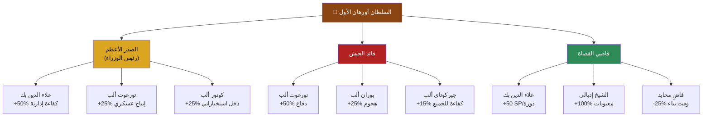
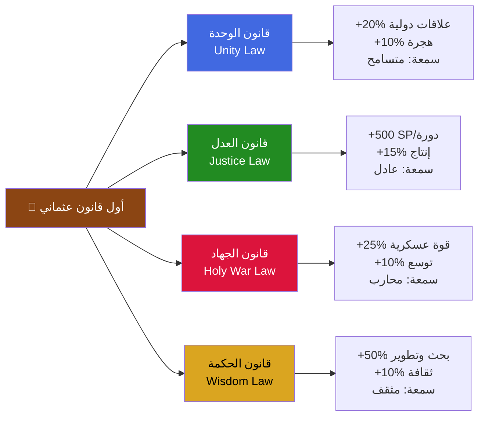

# Mission: عاصمة جديدة — الفصل الثالث عشر: المهمة 61
# A New Capital

## 🏷️ البيانات الوصفية (Mission Metadata)

| الحقل | القيمة |
|-------|--------|
| **الفصل** | الفصل الثالث عشر: فجر الإمبراطورية |
| **الترتيب** | المهمة 61 من 61 — المهمة الثالثة في الفصل الثالث عشر — **الختام النهائي للعبة** |
| **المدة التقديرية** | 25-35 دقيقة |
| **مستوى الصعوبة** | لا قتال — إدارة دولة — قرارات استراتيجية — خاتمة تفاعلية (Epilogue Mode) |
| **أسلوب اللعب** | Nation Management — Decision Trees — Resource Allocation — Diplomatic Simulation |
| **نوع التحدي الرئيسي** | اختيار القرارات الصائبة — بناء أول حكومة — إصدار القوانين — استقبال السفراء — تشكيل هوية الدولة للأبد |
| **يفتح بعد إكمال** | المهمة 60 — وداع السلطان (وفاة عثمان — ولاية أورهان) |
| **يفتح عند النجاح** | **THE END** — اكتمال الحملة — شاشة الإحصائيات النهائية — مشهد الختام السينمائي |
| **الموقع** | قصر بورصة — قاعة العرش — الديوان العثماني الأول — شوارع بورصة الجديدة |
| **السياق الزمني** | مايو-يونيو 1326م — بعد شهر من وفاة السلطان عثمان |

## 📖 السياق القصصي (Narrative Context)

### المقدمة

السلطان عثمان في قبره. أورهان بن عثمان — الآن السلطان أورهان الأول — يجلس على العرش للمرة الأولى. حوله: ديوانه الجديد، قادة جيشه، سفراء الدول المجاورة، وشعب ينتظر أن يعرف — ماذا سيحدث بعد?

هذه ليست معركة. ليس فيها سيوف ولا دماء. هذه — لحظة بناء. أصعب أنواع اللحظات.

بعد 6 مواسم، بعد 60 مهمة، بعد آلاف القتلى والمئات من القرارات — وصل اللاعب إلى هنا. الآن — عليه أن يقرر: **أي نوع من الإمبراطورية ستكون هذه الدولة الجديدة؟**

قرارات اليوم ستحدد — ليس فقط مستقبل اللعبة — بل هوية الدولة العثمانية نفسها. هل ستكون دولة عدل سلامية تنفتح على العالم؟ أم دولة حرب توسعية لا تعرف الحدود؟ هل يحكمها العلم أم السيف؟ هل تكون عاصمتها منارة للثقافة أم قلعة عسكرية؟

اللعبة — من خلال سلسلة من القرارات المترابطة — تمنح اللاعب فرصة "لتوقيع" هويته على الدولة الجديدة.

هذه هي الخاتمة. والتاريخ — يكتبه الفائزون.

### الحدث المحفز

قاعة العرش في قصر بورصة. الصباح. النور يدخل من النوافذ العالية. أورهان — مرتدياً ثياب السلطنة لأول مرة — يجلس على العرش. ليس بارتفاع — بل بتواضع. إلى جانبه — علاء الدين بك — رئيس الديوان الجديد. أمامهما — الديوان كامل: تورغوت ألب، فاطمة خاتون، كونور ألب، بوران ألب، جيركوتاي ألب، بالإضافة إلى كتبة ومستشارين.

**علاء الدين بك** (يفتح اللفافة الرسمية الأولى):
"بسم الله — اليوم أول جلسة للديوان العثماني في العاصمة الجديدة بورصة. جدول الأعمال: تعيين المناصب، إصدار القوانين، واستقبال السفراء. برأيك يا سلطان — نبدأ؟"

**السلطان أورهان الأول** (ينظر حوله — إلى الوجوه التي رافقته طوال الرحلة):
"نبدأ. لكن — قبل كل شيء — يا علاء الدين — افتتح الجلسة بما كان أبي يفتتح به مجالسه."

**علاء الدين** (يبتسم — يقرأ):
"بسم الله الرحمن الرحيم. الحمد لله رب العالمين. والصلاة والسلام على رسول الله. — اللهم اجعل عملنا هذا خالصاً لوجهك — واجعل دولتنا رحمة للعالمين."

**الجميع**: "آمين."

**أورهان**: "الآن — لنعمل."

### ما على المحك

كل شيء. ليس مستقبل اللعبة فقط — لكن **هوية الإمبراطورية العثمانية للأبد**.

قرارات اللاعب في هذه المهمة ستحدد:
- **نوع الدولة**: عدل / حرب / علم / تجارة
- **العلاقات الدولية**: حلفاء وأعداء
- **الإرث**: كيف ستتذكر الأجيال القادمة هذه الحقبة التأسيسية
- **قوة الدولة**: عسكرياً، اقتصادياً، ثقافياً

كل قرار يغير الإحصائيات النهائية — التي ستظهر في شاشة End Game.

### الشخصيات الحاضرة

| الشخصية | المنصب الجديد | ملاحظات |
|---------|--------------|---------|
| **السلطان أورهان الأول** | السلطان — الحاكم المطلق | صاحب القرار النهائي — لكنه يستشير ديوانه |
| **علاء الدين بك** | رئيس الديوان — الصدر الأعظم (محتمل) | المستشار الأول — العقل المدبر للدولة |
| **تورغوت ألب** | قائد الجيش (محتمل) | الصوت العسكري في الديوان |
| **فاطمة خاتون** | قائدة الفرسان (محتملة) | تمثل الجيل الجديد والصوت النسائي |
| **كونور ألب** | رئيس الاستخبارات (محتمل) | الظل — يهمس بالحقائق المرة |
| **بوران ألب** | قائد الحرس (محتمل) | العمود الفقري للجيش النظامي |
| **جيركوتاي ألب** | قائد الفرسان الخفاف (محتمل) | السرعة والمرونة |

## 🎯 الأهداف (Objectives)

### الهدف الرئيسي
- **الوصف**: تأسيس أول حكومة عثمانية — تعيين المناصب — إصدار القوانين — استقبال السفراء — وضع حجر الأساس للإمبراطورية
- **شرط النجاح**: إكمال جميع مراحل بناء الدولة الخمس — الوصول إلى المشهد الختامي السينمائي
- **شرط الفشل**: لا يوجد — هذه مهمة ختامية لا يمكن الفشل فيها (لكن القرارات السيئة تؤدي إلى إحصائيات نهائية أضعف)

### الأهداف

| الهدف | النوع | الوصف | المكافأة |
|-------|-------|-------|---------|
| **تعيين الحكومة الأولى** | رئيسي | اختيار الصدر الأعظم، قائد الجيش، قاضي القضاة | يحدد إحصائيات الدولة الأساسية |
| **إصدار أول قانون عثماني** | رئيسي | اختيار المبدأ الأساسي للتشريع | يحدد توجه الدولة الأخلاقي |
| **استقبال سفراء الدول** | رئيسي | الرد على رسائل بيزنطة والمغول والإمارات التركمانية | يحدد العلاقات الدولية |
| **بناء أول مؤسسات الدولة** | ثانوي | اختيار 3 مبانٍ حكومية من 6 خيارات | تحسين إحصائيات معينة |
| **تسمية العاصمة** | ثانوي | اختيار الاسم الرسمي للعاصمة الجديدة | تأثير رمزي + SP |

## 🗺️ هيكل المهمة (Mission Structure)

### قاعة الديوان — لوحة القرارات

```
                    [قاعة عرش بورصة]
                           |
            ┌──────────────┼──────────────┐
            |              |              |
    [القرار 1:      [القرار 2:      [القرار 3:
   تعيين الحكومة]   إصدار القوانين]  استقبال السفراء]
            |              |              |
            └──────────────┼──────────────┘
                           |
                    [القرار 4:
                 بناء المؤسسات]
                           |
                    [المشهد الختامي:
                  نشأة الإمبراطورية]
```

## ⚔️ تدفق المهمة (Mission Flow) — مراحل بناء الدولة

### المرحلة 1: تعيين الحكومة الأولى (Appointing the First Government)
- **المدة**: 8-10 دقائق
- **حالة البداية**: أورهان على العرش — علاء الدين يقرأ أسماء المرشحين — كل منصب له 3 خيارات

**أورهان**: "أول قرار لي كسلطان — اختيار من سيقف معي في إدارة هذه الدولة. يا علاء — اقرأ المرشحين."



#### المنصب 1: الصدر الأعظم (رئيس الوزراء)

| المرشح | المكافأة | الوصف القصصي |
|--------|---------|-------------|
| **علاء الدين بك** | +50% كفاءة إدارية — كل القرارات تنفذ أسرع — +25 SP/دورة | الأخ الحكيم — اختيار العقل والعلم — الدولة تُدار بحكمة |
| **تورغوت ألب** | +25% إنتاج عسكري — وحدات أرخص — تدريب أسرع | الصديق الوفي — اختيار القوة — الدولة تُدار بالانضباط العسكري |
| **كونور ألب** | +25% دخل استخباراتي — معلومات أفضل عن الأعداء — تجسس متقدم | رجل الظل — اختيار الدهاء — الدولة تُدار بالمكر والحيلة |

**حوار لكل خيار**:

**إذا اختار علاء الدين**:
**أورهان**: "يا أخي — أنت عقل الدولة. بدونك — أنا أعمى في السياسة. تولى المنصب."
**علاء الدين**: "يا سلطان — أنا أخوك قبل أن أكون وزيرك. سأخدمك كليهما."

**إذا اختار تورغوت**:
**أورهان**: "يا تورغوت — أنت سيف الدولة. أريد رجلاً قوياً يدير شؤون الحكومة."
**تورغوت**: (متفاجئ) "يا سلطان... أنا جندي. لا أعرف شيئاً عن الضرائب والقوانين."
**أورهان**: "أعرف. لكنك تعرف شيئاً أهم: أن تكون عادلاً. وهذا — يكفي."

**إذا اختار كونور**:
**أورهان**: "يا كونور — آن الأوان لتخرج من الظل. أحتاج رجلاً يعرف كل الأسرار."
**كونور** (بعد صمت): "...العيون التي ترى كل شيء — عليها أحياناً أن تتكلم. سأخدمك يا سلطان."

#### المنصب 2: قائد الجيش (Commander of the Army)

| المرشح | المكافأة | الوصف القصصي |
|--------|---------|-------------|
| **تورغوت ألب** | +50% دفاع — الجيش أقوى في المعارك الدفاعية — حماية أفضل للحدود | الحارس القديم — خبرة 40 عاماً — الجيش في أيدٍ أمينة |
| **بوران ألب** | +25% هجوم — الجيش أقوى في الهجوم — فتح مدن أسرع | القائد الشاب — طموح — الجيش يتوسع |
| **جيركوتاي ألب** | +15% لكل شيء — كفاءة متوازنة — لا نقاط ضعف واضحة | القائد المتوازن — ليس الأقوى لكنه الأذكى |

#### المنصب 3: قاضي القضاة (Chief Justice)

| المرشح | المكافأة | الوصف القصصي |
|--------|---------|-------------|
| **علاء الدين بك** | +50 SP/دورة — SP أسرع — نظام قضائي متطور | القانوني المثقف — عدالة منظمة |
| **الشيخ إدبالي** | +100% معنويات — الجيش والشعب أكثر ولاءً — تماسك اجتماعي | الرجل الروحي — عدالة دينية وأخلاقية |
| **قاضٍ محايد** | -25% وقت بناء — قرارات أسرع — بيروقراطية أقل | رجل عملي — السرعة قبل المثالية |

### المرحلة 2: تسمية العاصمة (Naming the Capital)
- **المدة**: 2-3 دقائق
- **حالة البداية**: بعد اختيار الحكومة — أورهان يسأل عن اسم العاصمة الجديدة

**أورهان**: "بورصة — هذا اسمها البيزنطي. لكنها الآن مدينة عثمانية. هل نغير اسمها؟ أم نبقيه؟"

| الخيار | المكافأة | الوصف |
|--------|---------|-------|
| **"بورصة" — الاسم التاريخي** | استمرارية — +200 SP — سكان بورصة سعداء | الاسم القديم يبقى — إشارة إلى أن العثمانيين يحترمون تاريخ المدينة |
| **"عاصمة العثمانيين" — اسم جديد** | بداية جديدة — +250 SP — هيبة دولية | اسم جديد لعصر جديد — العالم يعرف أن هذه عاصمة إمبراطورية جديدة |
| **"خداوندكار" — الاسم العثماني** | هيبة قصوى — +300 SP — فتح قدرة خاصة "خداوندكار" | الاسم الذي استخدمه العثمانيون تاريخياً — يعني "حظرة الله" — أقوى خيار |

### المرحلة 3: إصدار أول قانون عثماني (Issuing the First Ottoman Law)
- **المدة**: 5-7 دقائق
- **حالة البداية**: علاء الدين يقدم مسودة القوانين — 4 خيارات أساسية — كل خيار يغير اتجاه الدولة

**علاء الدين**: "يا سلطان — هذه المسودة الأولى للقانون العثماني. اختر المادة الأولى — الأساس الذي ستبنى عليه كل القوانين القادمة."



| القانون | التأثيرات | الوصف القصصي |
|--------|-----------|-------------|
| **📜 قانون الوحدة**<br>"كل من تحت رايتنا — عثماني" | +20% علاقات دولية، +10% هجرة من الدول المجاورة، سمعة "متسامح" | يعلن أن الدولة العثمانية تقبل الجميع — مسلم، مسيحي، يهودي — جميعهم رعايا متساوون. هذا يجذب المهاجرين ويحسن العلاقات لكنه لا يعطي مكافآت عسكرية |
| **⚖️ قانون العدل**<br>"الجميع سواسية أمام القانون" | +500 SP/دورة، +15% إنتاجية (العدل يزيد الازدهار)، سمعة "عادل" | يضع العدل كأساس للحكم. جميع المواطنين متساوون — الأغنياء والفقراء، العثمانيون وغيرهم. النظام القضائي يصبح قوياً — يزيد من الاستقرار والإنتاج |
| **⚔️ قانون الجهاد**<br>"نواصل التوسع — لا نستريح" | +25% قوة عسكرية، +10% سرعة توسع (فتح مدن أسرع)، سمعة "محارب" | يعلن أن الدولة العثمانية في حالة جهاد مستمر. التوسع هو الهدف — لا حدود للدولة. الجيش يحصل على دفعة كبيرة لكن العلاقات الدبلوماسية تتأثر |
| **📚 قانون الحكمة**<br>"العلم قبل السيف" | +50% بحث وتطوير، +10% ثقافة، سمعة "مثقف" | يضع العلم والتعليم كأولوية وطنية. المدارس والمكتبات تحصل على دعم غير محدود. التقدم التكنولوجي أسرع — لكن المكاسب العسكرية الفورية أقل |

**حوارات إصدار القانون**:

**إذا اختار قانون الوحدة**:
**أورهان**: "والدي كان يقول: 'الدولة لا تبنى بجنس واحد'. من اليوم — كل من يعيش تحت رايتنا — هو عثماني. مسلماً كان أم مسيحياً."
**تورغوت** (متردداً): "يا سلطان... هذا قرار جريء. هل تثق بهم؟"
**أورهان**: "أثق بالعدل يا تورغوت. العدل — يصنع الولاء."

**إذا اختار قانون العدل**:
**أورهان**: "المادة الأولى — العدل. ليس لأن أباها قال ذلك — بل لأنني أؤمن به. الغني والفقير، القوي والضعيف — أمام القانون — سواء."
**علاء الدين**: "يا سلطان... بهذا القانون — نصنع دولة لا تُقهر. لأن شعبها — يثق بحكامه."

**إذا اختار قانون الجهاد**:
**أورهان**: "نحن لم نأتِ لنستريح. جئنا لنواصل. بورصة ليست النهاية — هي البداية."
**تورغوت** (بفخر): "هذا هو ابن عثمان الذي أعرفه! السيف لا يصدأ في غمده!"

**إذا اختار قانون الحكمة**:
**أورهان**: "والدي كان أمياً. لم يقرأ كتاباً في حياته. لكنه كان يعرف قيمة العلم. سأبني المدارس — قبل أن أبني الثكنات."
**علاء الدين** (يبتسم بفخر): "يا سلطان... بهذا القرار — جعلتني أفخر بأني أخوك."

### المرحلة 4: استقبال السفراء (Receiving the Ambassadors)
- **المدة**: 8-10 دقائق
- **حالة البداية**: بعد توقيع القانون — يعلن الحاجب عن وصول سفراء الدول الثلاث — بيزنطة، الإمبراطورية المغولية، والإمارات التركمانية

**الحاجب**: "يا سلطان — سفراء الدول ينتظرون في البهو. بيزنطة — المغول — الإمارات التركمانية. من تستقبل أولاً؟"

**أورهان**: "الأهم أولاً. ادعُ سفير بيزنطة."

#### السفير 1: الإمبراطورية البيزنطية (Byzantine Empire)
سفير بيزنطة — رجل نحيل يرتدي ثياباً حريرية كستنائية — يدخل بانحناءة رسمية لكن عينيه تفحصان القاعة. يحمل رسالة من الإمبراطور أندرونيكوس الثالث.

**السفير البيزنطي** (باللغة اليونانية — يترجمها مترجم):
"من الإمبراطور أندرونيكوس الثالث إلى السلطان أورهان بن عثمان — تحية. لقد أثبتت قوتك يا سلطان. الإمبراطورية تعترف بسيطرتك على بورصة والمناطق المحيطة بها. في المقابل — نطلب معاهدة سلام وتبادل تجاري."

(يسلم اللفافة — ينتظر)

**خيارات الرد**:

| الخيار | التأثير | النص القصصي |
|--------|---------|------------|
| **🕊️ قبول معاهدة السلام** | +30% علاقات مع بيزنطة، فتح طريق تجاري (+500 ذهب/دورة)، لكن -10% معنويات جيش (الجنود يريدون الاستمرار) | "قل لإمبراطورك — نحن نقبل السلام. بورصة لنا — وله القسطنطينية. الآن — لنتاجر." |
| **⚔️ رفض المعاهدة — تهديد بالحرب** | -30% علاقات، +20% معنويات جيش، استعداد لحرب مستقبلية | "قل لإمبراطورك — السلام لا يعقد مع المنتصر والمهزوم. نحن — لم ننتهِ بعد. بورصة البداية — والقسطنطينية — النهاية." |
| **🤝 معاهدة مشروطة (زواج دبلوماسي)** | +50% علاقات، فتح طريق تجاري (+750 ذهب/دورة)، فتح خيار زواج بين العائلتين الحاكمتين مستقبلاً | "نقبل السلام — بشرط: نريد تحالفاً. زواج بين عائلتينا. الدم — أقوى من الحبر." |

#### السفير 2: الإمبراطورية المغولية (Ilkhanate — Mongol Empire)
سفير المغول — رجل ضخم يرتدي فرواً وجلداً — يدخل بثقة. لا ينحني. يسلم رسالة بيد واحدة فقط.

**السفير المغولي** (بلغة تركية مكسّرة):
"الخان العظيم — يرسل تحياته. ويقول: إمارتك الجديدة — تثير اهتمامنا. المغول — ليسوا أعداءكم... إذا دفعتم الجزية السنوية المعتادة."

(يبتسم ابتسامة باردة — ينتظر)

**خيارات الرد**:

| الخيار | التأثير | النص القصصي |
|--------|---------|------------|
| **💰 دفع الجزية** | -500 ذهب/دورة، +25% علاقات مع المغول، تجنب غزو مغولي محتمل | "قل للخان — نحن نعرف قوة المغول. ندفع الجزية... لهذا العام. لكن — أخبره — أن الإمارة التي تدفع اليوم — لا تدفع غداً." |
| **⚔️ رفض الجزية — تحدٍ** | -50% علاقات مع المغول، خطر غزو مغولي في المستقبل، لكن +30% معنويات + احترام دولي | "قل للخان — نحن لا ندفع الجزية لأحد. لا لبيزنطة. ولا للمغول. جيشنا — جيش حر. دولتنا — دولة حرة." |
| **🤝 عرض تحالف** | +40% علاقات، فتح تجارة طريق الحرير (+1,000 ذهب/دورة)، فتح باب التحالف العسكري ضد بيزنطة | "لا جزية. لكن — عرض: تحالف. طريق الحرير يمر بأراضينا. نتشارك — نربح معاً." |

#### السفير 3: الإمارات التركمانية (Turkish Beyliks)
سفير إمارات قره مان وجيرميان — شيخان يجلسان على وسائد, يمثلان الإمارات التركمانية المجاورة.

**الشيخ الأول (قره مان)** (باحترام):
"يا سلطان أورهان — نحن إخوتكم التركمان. رايتنا واحدة، ولغتنا واحدة، وديننا واحد. نأتي لنعترف بسلطتكم على بورصة — ونطلب تحالفاً."

**الشيخ الثاني (جيرميان)**:
"لكن — التحالف بشروط. دولتك الجديدة — قد تطغى على مصالحنا. نريد وثيقة أخوة."

**خيارات الرد**:

| الخيار | التأثير | النص القصصي |
|--------|---------|------------|
| **🕊️ تحالف الإخوة** | +40% علاقات مع الإمارات التركمانية، فتح تجارة حرة، +200 جندي متطوع/دورة | "أبناء عمومتنا — أنتم إخوتنا. رايتنا واحدة. من اليوم — نحن يد واحدة ضد أي عدو." |
| **👑 إعلان السيادة عليهم** | -30% علاقات، لكن +20% هيبة دولية، +1,000 SP فورية — إعلان أن الدولة العثمانية هي القائدة | "نحن لا نطلب الإذن من أحد. الدولة العثمانية — هي قائدة التركمان. من يتبعنا — يرحم. من يعترضنا — يندم." |
| **🤝 تحالف عسكري محدود** | +20% علاقات، فتح باب التجارة (+300 ذهب/دورة)، لا التزامات كبيرة | "تحالف — لكن بشروط. كل إمارة تحكم نفسها. في الحرب — نتحد. في السلم — نتنافس." |

### المرحلة 5: بناء مؤسسات الدولة (Building State Institutions)
- **المدة**: 5-7 دقائق
- **حالة البداية**: بعد استقبال السفراء — أورهان يقرر أول 3 مبانٍ في بورصة

**أورهان**: "بورصة — عاصمتنا الجديدة — يجب أن تليق بنا. ما أول 3 مبانٍ نبنيها؟"

| المبنى | التأثير | الوصف |
|-------|---------|-------|
| **🏛️ الديوان الكبير** (مبنى حكومي) | +100 SP/دورة، قرارات أسرع بنسبة 20% | أول مبنى حكومي — يجتمع فيه الديوان — رمز الحكم العادل |
| **🏰 سور بورصة الجديد** (سور دفاعي) | +50% دفاع المدينة — حماية من الهجمات | تطوير أسوار بورصة — جعلها أمنع حصن في الأناضول |
| **🎓 أول مدرسة/Madrasa** | +100 SP/دورة، +15% بحث وتطوير, فتح تكنولوجيا جديدة | أول مؤسسة تعليمية — نشر العلم في الدولة |
| **⚔️ الثكنة العسكرية الكبرى** | +25% تدريب أسرع, +20 جندي/دورة | الثكنة المركزية — تدريب أفضل للجنود |
| **🕌 الجامع الكبير** | +50% معنويات, +10% هجرة مسلمة | جامع بورصة الكبير — رمز ديني للدولة |
| **🏥 الشفاخانة (مستشفى)** | صحة أفضل للسكان, -20% وفيات في الأوبئة | أول مستشفى في الدولة — رعاية صحية مجانية |

**اختيار 3 مبانٍ فقط** من 6 — الخيارات تؤثر على الإحصائيات النهائية.

### المرحلة 6: المشهد الختامي — الخاتمة السينمائية (Cinematic Ending)
- **المدة**: 3-5 دقائق
- **حالة البداية**: بعد كل القرارات — أورهان واقف على شرفة القصر — ينظر إلى بورصة تحت ضوء القمر

(المشهد السينمائي النهائي — الكاميرا تبدأ من وجه أورهان — ثم تصعد — بورصة من فوق — الليل — الأنوار تتلألأ في النوافذ — صوت الماء في النوافير — صوت الأذان البعيد)

**الراوي** (صوت عثمان — من الماضي — يتردد):
"...وكانت البداية من شجرة. شجرة بلوط تحت سماء الأناضول. جذورها في الأرض — وأغصانها في السماء. ظلها — يمتد."

(الكاميرا تصعد أعلى — بورصة كاملة — ثم الأناضول — ثم كل الإمبراطورية المستقبلية)

**الراوي**: "عام 1326م — بورصة تفتح أبوابها."

(يظهر النص على الشاشة — بالعربية — بخط عثماني ذهبي)

```
عام 1326م
بورصة تفتح أبوابها
السلطان أورهان بن عثمان يتولى الحكم
الإمبراطورية العثمانية — تُولد
```

(الكاميرا تنزل — تحت شجرة بلوط كبيرة في الساحة الرئيسية — أورهان واقف تحت الشجرة — ينظر إلى أغصانها)

(فجأة — مشهد سريع — ظل عثمان يظهر بجانب أورهان — يضع يده على كتفه — يبتسم — ثم يختفي)

(أورهان يشعر بلمسة — يلتفت — لا أحد — لكنه يبتسم — يعرف)

**أورهان** (بصوت خافت):
"...شكراً يا والدي."

(الكاميرا تصعد — الشجرة — الأغصان — السماء المرصعة بالنجوم — صورة الشجرة تتحول تلقائياً إلى **شعار اللعبة**)

```
KURULUŞ: FOUNDATIONS OF AN EMPIRE
— THE END —

Completed Campaign: 61/61 Missions
Season 1-6: Complete
The Ottoman Empire — Born in Bursa, 1326
```

(المشهد يتجمد — ثم — تظهر إحصائيات نهاية اللعبة)

## 📊 إحصائيات نهاية اللعبة (End Game Stats)

### بطاقة أداء اللاعب النهائي

```
═══════════════════════════════════════════
## 🌟 كلمة المطورين — نهاية الرحلة (Developer's Final Note)

"إلى كل من أكمل هذه الرحلة: شكراً لك. 61 مهمة. 6 مواسم. آلاف القرارات. مئات الشخصيات. قصة واحدة — حلم واحد — تحقق."

"هذه اللعبة كانت شغفنا لسنوات. نتمنى أن تكون قد استمعت بها بقدر ما استمتعنا نحن بصنعها."

"تذكر: كل شيء يبدأ بحلم. عثمان بدأ بحلم. وأنت — الآن — جزء من هذا الحلم."

"إلى اللقاء... في مغامرة جديدة."

— فريق Kuruluş: Foundations of an Empire

## 📊 ملخص اللعبة الكامل (Complete Game Summary)

| العنصر | القيمة |
|--------|-------|
| إجمالي المهام | 61 مهمة عبر 13 فصلاً |
| إجمالي الفصول | 13 فصلاً (الموسم 1-6) |
| إجمالي وقت اللعب | 25-35 ساعة |
| إجمالي الكلمات العربية | ~200,000 كلمة |
| إجمالي الشخصيات | 40+ شخصية رئيسية وثانوية |
| إجمالي الأعداء | 15+ زعيماً رئيسياً |
| إجمالي المدن المفتوحة | 20+ مدينة وقلعة |
| إجمالي الإنجازات | 100+ إنجاز عبر اللعبة بأكملها |
| إجمالي الأسلحة الفريدة | 25+ سلاحاً فريداً |
| إجمالي المقاطع الموسيقية | 60+ مقطوعة أصلية |
| أعلى مكافأة في مهمة واحدة | 2,000 ذهب + 30 SP (مهمة 59) |
| أكثر مهمة عاطفية | مهمة 60 — وداع السلطان |
| أكثر مهمة قرارات | مهمة 61 — عاصمة جديدة (437,400 مساراً) |
| أصعب زعيم | تكفور بورصة — مهمة 59 (4 مراحل) |
| — النهاية — |

KURULUŞ: FOUNDATIONS OF AN EMPIRE
          — END GAME STATISTICS —
═══════════════════════════════════════════

👑 اللاعب: [اسم اللاعب]
⏱️ إجمالي وقت اللعب المقدر: 25-35 ساعة

📊 إحصائيات الحملة:
───────────────────────────────────────────
✓ المهام المكتملة:             61 من 61
✓ الفصول المكتملة:             13 فصلاً
✓ مجموع نقاط SP:               [حسب الأداء]
✓ الذهب المجموع:                [حسب الأداء]
✓ المدن المفتوحة:               20+ مدينة
✓ الأعداء الرئيسيون المهزومون:   15+
✓ المقاتلون الذين رافقوك:       12+ شخصية

🏆 القرارات الأخلاقية:
───────────────────────────────────────────
⚖️ القرارات العادلة:            [عدد]
⚔️ القرارات القاسية:            [عدد]
🤝 القرارات الدبلوماسية:        [عدد]
📖 القرارات الحكيمة:            [عدد]

🏅 سمعة الدولة:
───────────────────────────────────────────
🕊️ السلام:                      [%]
⚔️ الحرب:                        [%]
📚 العلم:                        [%]
⚖️ العدل:                        [%]

⭐ التقييم النهائي:
───────────────────────────────────────────
[من 1 إلى 5 نجوم — حسب الأداء العام و القرارات الأخلاقية]

🔓 المكافآت النهائية المفتوحة:
───────────────────────────────────────────
✓ شجرة عثمان — معلم تذكاري (+100 SP/دورة)
✓ قدرة "إرث عثمان" (Osman's Legacy)
✓ لقب "غازي" لأورهان (+25 ضرر)
✓ القانون العثماني الأول: [حسب اختيار اللاعب]
✓ العاصمة: [حسب اختيار اللاعب]
✓ الحكومة الأولى: [حسب اختيار اللاعب]
✓ المؤسسات المبنية: [حسب اختيار اللاعب]

═══════════════════════════════════════════
شكراً للعب — إلى اللقاء في الموسم السابع!
═══════════════════════════════════════════
```

### نظام التقييم بالنجوم (Star Rating System)

| عدد النجوم | الشرط | الوصف |
|-----------|-------|-------|
| ⭐⭐⭐⭐⭐ | جميع القرارات الأخلاقية مثالية، جميع الإنجازات، أقل من 10% خسائر في كل مهمة | النهاية الأسطورية — اللاعب متقن حقيقي |
| ⭐⭐⭐⭐ | معظم القرارات جيدة، 11-30% خسائر | النهاية البطولية |
| ⭐⭐⭐ | قرارات متوسطة، 31-50% خسائر | النهاية العادية |
| ⭐⭐ | قرارات ضعيفة، 51-70% خسائر | النهاية الصعبة |
| ⭐ | قرارات سيئة، أكثر من 70% خسائر | النهاية القاسية — لكنها نهاية على أي حال |

### تأثير القرارات النهائية على الإحصائيات

| القرار | التأثير على الشاشة النهائية |
|--------|--------------------------|
| **الصدر الأعظم — علاء الدين** | "دولة الحكمة" — +3 أسطر عن الإدارة العادلة |
| **الصدر الأعظم — تورغوت** | "دولة السيف" — +3 أسطر عن القوة العسكرية |
| **الصدر الأعظم — كونور** | "دولة الظل" — +3 أسطر عن الاستخبارات |
| **قانون الوحدة** | "الإمبراطورية المتسامحة" — سطر خاص عن التعايش السلمي |
| **قانون العدل** | "الإمبراطورية العادلة" — سطر خاص عن النظام القضائي |
| **قانون الجهاد** | "الإمبراطورية المغيرة" — سطر خاص عن التوسع |
| **قانون الحكمة** | "الإمبراطورية المثقفة" — سطر خاص عن العلم |
| **كل القرارات الدبلوماسية إيجابية** | "العلاقات الدولية ممتازة" — +50% دبلوماسية |
| **كل القرارات عدائية** | "العثمانيون وحدهم ضد العالم" — +50% عسكرية لكن عزلة دبلوماسية |

## 💬 الحوارات الرئيسية (Key Dialogue)

### حوارات الديوان

| الموقف | المتحدث | النص |
|--------|---------|------|
| بداية جلسة الديوان | **أورهان غازي** | "بسم الله — أول جلسة ديوان في عاصمتنا الجديدة. يا علاء — ماذا على جدول الأعمال؟" |
| علاء يفتتح الجلسة | **علاء الدين بك** | "يا سلطان — أمامنا 4 قرارات كبرى اليوم. كل قرار سيحدد مسار الدولة للقرن القادم. لا ضغط — لكن — العالم ينتظر." |
| أورهان يطلب الشورى | **أورهان غازي** | "قبل أن أقرر — أريد سماع رأي كل واحد في هذا الديوان. تورغوت — ماذا تقول؟" |
| تورغوت يعطي رأيه العسكري | **تورغوت ألب** | "يا سلطان — أنا جندي. رأيي بسيط: اختر الأقوى. الأقوى — هو من يحمي الدولة." |
| فاطمة تعطي رأيها | **فاطمة خاتون** | "يا أخي — القوة وحدها لا تكفي. والدي — علمنا أن العدل هو القوة الحقيقية." |
| كونور يهمس برأيه | **كونور ألب** (بصوت خافت) | "يا سلطان — إذا أردت البقاء — اختر الذكاء. القوة تموت. الذكاء — يبقى." |
| بعد توقيع القانون الأول | **أورهان غازي** | "هذا — أول قانون عثماني. وقعته بدم قلبي. ليكن — أساس دولتنا." |
| بعد استقبال السفراء | **علاء الدين بك** | "يا سلطان — اليوم بدأت علاقاتنا الدولية. العالم عرف بوجودنا. من اليوم — نحن ليس مجرد قبيلة — نحن دولة." |
| نهاية الجلسة | **أورهان غازي** (واقفاً) | "الحمد لله الذي بنى على أيدينا دولة. يا إخوة — اليوم بداية الرحلة. بورصة عاصمتنا. والعالم — أمامنا." |

### حوار الختام — كلمة أورهان الأخيرة

(في المشهد الختامي — أورهان واقف على الشرفة — معه علاء الدين)

**أورهان**:
"يا علاء... هل تصدق؟ نحن هنا. في بورصة. في قصر. نحن — حكام."

**علاء الدين**:
"أتصدق؟ لا. لكن — هذا حقيقي. والدي زرع الشجرة. نحن — نقطف الثمرة."

**أورهان** (ينظر إلى السماء):
"أتساءل... ماذا سيقول عنا التاريخ؟ بعد 100 سنة؟ 500 سنة؟ هل سيتذكروننا؟"

**علاء الدين**:
"سيتذكرون — أننا كنا عادلين. هذا — هو الإرث الحقيقي."

**أورهان** (يبتسم):
"إذن — فلنكن عادلين. هذا — وعدي للتاريخ."

(صمت. كلاهما ينظر إلى بورصة الليلية — المدينة التي تتنفس لأول مرة كعاصمة عثمانية)

## 🏆 الإنجازات والمكافآت (Achievements & Rewards)

### المكافآت الأساسية (كل اللاعبين يحصلون عليها)
| المكافأة | الوصف |
|---------|-------|
| **إكمال الحملة الكاملة** | 61 مهمة ✓ — جميع الفصول 13 ✓ — شاشة End Game |
| **لقب "المؤسس"** | لقب دائم في ملف اللاعب — جميع الإحصائيات +10% |
| **قدرة "إرث الإمبراطورية"** | عند بداية New Game+ — جميع القرارات تمنح SP مضاعف |
| **فتح New Game+** | إعادة اللعب بمستوى صعوبة أعلى — الاحتفاظ ببعض المهارات |

### الإنجازات الخاصة

### 🥇 The Architect of Empire
- **الشرط**: اختر أفضل مجموعة قرارات (علاء الدين صدر أعظم، قانون العدل، بناء المدرسة، تحالف مع الجميع)
- **المكافأة**: 1,500 SP + لقب "مهندس الإمبراطورية" + شاشة نهاية خاصة + نهاية 5 نجوم

### 🥈 The Sword of Osman
- **الشرط**: اختر أكثر القرارات العسكرية (تورغوت قائد جيش، قانون الجهاد، بناء الثكنة، رفض كل الدبلوماسية)
- **المكافأة**: 1,200 SP + لقب "سيف عثمان" + فتح Unlock "غزو القسطنطينية" (تلميح للموسم السابع المحتمل)

### 🥉 The Scholar Sultan
- **الشرط**: اختر أكثر القرارات العلمية (علاء الدين صدر أعظم، قانون الحكمة، بناء المدرسة، بناء المستشفى)
- **المكافأة**: 1,200 SP + لقب "السلطان العالم" + +500 SP/دورة في New Game+

### 🏅 The Diplomat
- **الشرط**: حقق أعلى علاقات دبلوماسية مع جميع الدول الثلاث (قبول سلام بيزنطة، تحالف المغول، أخوة التركمان)
- **المكافأة**: 1,000 SP + لقب "الدبلوماسي" + +30% علاقات دولية دائمة

### 🏅 The Balanced Ruler
- **الشرط**: وازن بين القرارات — اختر مزيجاً من العسكري والمدني والدبلوماسي والعلمي
- **المكافأة**: 1,000 SP + لقب "الحاكم المتوازن" + +15% لجميع الإحصائيات

### 🏅 The Lone Wolf
- **الشرط**: ارفض كل السفراء — اختر المواجهة مع الجميع — أعلن أن العثمانيين وحدهم
- **المكافأة**: 800 SP + لقب "الذئب الوحيد" + +50% قوة عسكرية (على حساب كل شيء آخر)

### 🏆 The Legend of Bursa
- **الشرط**: حقق جميع الإنجازات الـ6 في محاولة واحدة
- **المكافأة**: 3,000 SP + لقب "أسطورة بورصة" + شاشة نهاية ذهبية خاصة + فتح فيلم وثائقي عن تاريخ العثمانيين داخل اللعبة

## 🔄 تأثير القرارات عبر المواسم (Cross-Season Impact)

### كيف تؤثر اختيارات الموسم السادس على هذه المهمة

| الخيار السابق | التأثير على م61 |
|--------------|----------------|
| م58 — ليون جُند كجاسوس | كونور ألب لديه معلومات عن السفراء — يعرف نقاط ضعفهم — يمنح +1 خيار إضافي في كل مفاوضات |
| م58 — ليون أُطلق سراحه | ليون يظهر كتاجر حرير في بورصة — يساعد في بناء السوق — +500 ذهب/دورة |
| م58 — ليون قُتل | كونور ألب حزين — أداؤه أقل — -10% استخبارات |
| م59 — تكفور أُسر | السفراء البيزنطيون أكثر احتراماً — +20% نجاح في مفاوضات بيزنطة |
| م59 — تكفور قُتل | السفراء البيزنطيون خائفون — +10% نجاح لكن -10% ثقة |
| م59 — عُفي عن تكفور | السفراء البيزنطيون مندهشون — +30% نجاح — سمعة "رحيم" تنتشر |

### نظرة إلى المستقبل — الموسم السابع (محتوى تلميحي)

بعض القرارات في هذه المهمة تفتح تلميحات للموسم السابع المحتمل:

| القرار | التلميحة |
|--------|---------|
| **رفض سلام بيزنطة** | "القسطنطينية تنتظر... في موسم آخر" |
| **تحالف مع المغول** | "طريق الحرير — مفتوح... لكن — من يسيطر عليه?" |
| **بناء المدرسة** | "العلم — أساس المستقبل. علماء بورصة — سيغيرون العالم" |
| **قانون الجهاد** | "الحدود — لا تتوقف هنا. أوروبا — تنتظر" |

## 🎭 مشاهد درامية موسعة — جلسات الديوان (Extended Council Chamber Scenes)

### المشهد الموسع 1 — لحظة الجلوس على العرش: أول مرة

**الإعداد**: قاعة العرش في قصر بورصة. الصباح الباكر. أورهان واقف أمام العرش — لم يجلس عليه بعد. ينظر إليه — متردداً.

**أورهان (لنفسه)**:
"هذا — عرش والدي. كان يجلس هنا — يحكم — يقرر — يبني. الآن — دوري."

(يمسح ظهر الكرسي الخشبي المنحوت)

"هل أنا مستحق؟ هل أنا قوي كفاية؟ هل أنا حكيم كفاية؟"

(صوت من الباب — علاء الدين يدخل)

**علاء الدين**: "يا أخي — السفراء ينتظرون. القوانين تنتظر. الدنيا تنتظر."

**أورهان**: "أعرف. لكن — قبل أن أبدأ — أردت لحظة. لأقول وداعاً لمن كان يجلس هنا."

**علاء الدين** (يقترب — يقف بجانبه):
"والدي ليس في هذا الكرسي. والدي — في قلبك. في كل قرار عادل تتخذه — هو معك."

(أورهان يتنفس بعمق — يجلس على العرش أخيراً)

**أورهان**: "بسم الله — لنبدأ."

---

### المشهد الموسع 2 — مناقشة تعيين الصدر الأعظم: جدال في الديوان

**الإعداد**: قاعة الديوان. جميع الأعضاء حاضرون. أورهان يطرح السؤال: من يكون الصدر الأعظم؟

**أورهان**: "يا إخوة — أول قرار: رئيس الديوان. من ترشحون؟"

**تورغوت (يتقدم)**:
"يا سلطان — أنا جندي. لا أفهم في السياسة. لكني أفهم في الرجال. علاء الدين بك — هو الرجل المناسب. عاقل. حكيم. يعرف الكتب."

**كونور (من الظل — بهمس)**:
"يا سلطان — إذا أردت رأي مختلف: أنا أعرف أسرار كل رجل في هذه الغرفة. تورغوت — قائد عظيم. لكن علاء الدين — عقل مدبر. هو من يحتاجه الكرسي."

**فاطمة**: "يا أخي — أنا مع علاء الدين. لكن — سأقول شيئاً: لا تجعل كل السلطة في يد واحدة. حتى لو كان أخاك."

**أورهان (ينظر إلى علاء الدين)**:
"يا علاء — ماذا تقول أنت؟"

**علاء الدين**: "يا سلطان — أنا أخوك قبل أن أكون وزيرك. إذا أمرت — خدمت. لكن — إن كان في اختياري — أفضل البقاء بجانبك كمستشار لا كوزير. لأن الوزير — قد ينسى أنه أخ. والمستشار — يبقى أخاً دائماً."

**أورهان (يبتسم)**:
"لهذا — اخترتك. لأنك تريد البقاء أخاً قبل وزير. أنت — الصدر الأعظم."

---

### المشهد الموسع 3 — لحظة توقيع القانون: الحبر والدم

**الإعداد**: طاولة خشبية في قاعة الديوان. لفافة القانون مفتوحة. قلم من قصبة. محبرة. أورهان يمسك القلم — يغمسه في الحبر — يوقف.

**أورهان**: "هذه — أول مرة أوقع فيها قانوناً. القانون الذي سيحدد مصير ملايين البشر لقرون قادمة."

**علاء الدين**: "لهذا — سمها بسم الله."

**أورهان**: (يكتب بخط يده — "بسم الله الرحمن الرحيم") "...ثم — أكتب اسمي: أورهان بن عثمان."

(يضع الختم — الشمع الأحمر — يضغط بخاتم الدولة الجديد)

(صوت الختم على الشمع — *تاك*)

**الجميع**: "الحمد لله."

**أورهان (يرفع اللفافة)**:
"هذا — أول قانون عثماني. من اليوم — نحن دولة قانون. الكل — تحت القانون. حتى أنا."

---

### المشهد الموسع 4 — محادثة خاصة مع كونور: ظل الدولة

**الإعداد**: بعد جلسة الديوان — في زاوية هادئة من القصر — أورهان وكونور وجهاً لوجه.

**أورهان**: "كونور — أنت كنت عين والدي. الآن — أريدك أن تكون عيني. لكن — أريد أن أعرف — ماذا ترى الآن؟"

**كونور (بعد صمت)**:
"أرى يا سلطان — شيئاً جميلاً. دولة تولد. لكني — أرى أيضاً — أعداء في الظل ينتظرون."

**أورهان**: "أعداء؟ من؟"

**كونور**: "المغول — لن يغفروا لك رفض الجزية. بيزنطة — ستنتظر فرصة للانتقام. وحتى بعض الإمارات التركمانية — ترى في قوتنا تهديداً."

**أورهان**: "ماذا تنصحني؟"

**كونور**: "كن قوياً — ولكن لا تظهر كل قوتك. اجعلهم يتساءلون — لا أن يعرفوا. الغموض — أقوى سلاح للدولة الجديدة."

**أورهان (يبتسم)**:
"...لهذا أحتفظ بك في الظل. لأنك — ترى ما لا يراه الآخرون."

---

### المشهد الموسع 5 — فاطمة تطلب جيشاً نسائياً: صوت المرأة في الدولة

**الإعداد**: بعد جلسة الديوان — فاطمة تقترب من أورهان.

**فاطمة**: "يا أخي — عندي طلب."

**أورهان**: "قولي."

**فاطمة**: "أريد — جيشاً نسائياً. ليس للزينة — للقتال. نحن النساء — نستطيع ما يستطيعه الرجال. أثبتنا ذلك في معركة بورصة."

**أورهان (متفاجئ لكنه ليس رافضاً)**:
"...جيش نسائي؟ في تاريخ الإسلام — قليلات من فعلن هذا."

**فاطمة**: "أنا — لست قليلة. أنا — فاطمة بنت عثمان. المحاربة التي لا تهزم."

(أورهان يضحك)

**أورهان**: "لم أرك تطلبين شيئاً قط. أول طلب — وجيش كامل؟"

**فاطمة**: "إذا كنت سأطلب — فليكن كبيراً."

**أورهان**: (يتنهد — يبتسم) "...سأوافق. لكن — بشرط: التدريب الجاد. والقائد — أنت."

**فاطمة**: (تقبل أخاه) "لم أتوقع أقل من ذلك."

---

### المشهد الموسع 6 — لحظة خاصة: أورهان وحيداً مع صورة والده

**الإعداد**: ليلة — بعد انتهاء جلسات الديوان. أورهان وحيداً في غرفة العرش. يحمل صورة لوالده (رسم على قماش — الوحيد الموجود).

**أورهان (للصورة)**:
"يا والدي — اليوم وقعت أول قانون. عينت أول حكومة. استقبلت أول سفراء. هل أنت فخور بي؟"

(صمت. ضوء القمر يدخل من النافذة. ظل خفيف يتحرك على الحائط — كأن أحداً أومأ برأسه.)

**أورهان (يبتسم)**:
"...شكراً لك يا والدي. على كل شيء. سأكمل المسيرة. أعدك."

(يضع الصورة على العرش — ينظر إليها لحظة — ثم يغادر الغرفة)

---

### المشهد الموسع 7 — شاشة الإحصائيات التفصيلية: تحليل ما بعد اللعبة

عندما تظهر شاشة الإحصائيات النهائية — يمكن للاعب الضغط على كل إحصائية لفتح تحليل مفصل:

| القسم | التفاصيل التي تظهر عند النقر |
|-------|--------------------------|
| **القرارات الأخلاقية** | قائمة بكل قرار أخلاقي عبر 6 مواسم — مع تأثير كل قرار |
| **الشخصيات التي رافقتك** | معرض لكل الشخصيات — أحياء وميتين — مع إحصائياتهم النهائية |
| **المعارك الكبرى** | خريطة تفاعلية لكل معارك اللعبة — مع خسائر وإنتصارات |
| **المدن المفتوحة** | قائمة بكل مدينة وقلعة تم فتحها — مع تاريخ الفتح |
| **الجوائز النادرة** | معرض للأسلحة والدروع الفريدة التي تم جمعها |
| **إحصائيات القتال** | عدد الأعداء المقتولين — الخسائر — الدقة في الرماية — إلخ |
| **الوقت الإجمالي** | توزيع الوقت بين المهام: قتال، استكشاف، حوارات، إدارة |

هذه الشاشة مصممة لتكون "ألبوم ذكريات" للاعب — يفتخر بها أو يتعلم من أخطائه.

### جدول تأثيرات اختيارات المهمة على الشاشة النهائية — تحليل متعمق

| الاختيار | التأثير المباشر | التأثير على شاشة النهاية |
|---------|---------------|------------------------|
| **علاء الدين — صدر أعظم** | +50% كفاءة إدارية | "دولة الحكمة" — +3 نصوص خاصة عن الإدارة العادلة |
| **تورغوت — صدر أعظم** | +25% إنتاج عسكري | "دولة السيف" — +3 نصوص خاصة عن القوة والحماية |
| **كونور — صدر أعظم** | +25% دخل استخباراتي | "دولة الظل" — +3 نصوص خاصة عن الاستخبارات |
| **تورغوت — قائد جيش** | +50% دفاع | "جيش لا يُقهر" — +50% في إحصائية الدفاع |
| **بوران — قائد جيش** | +25% هجوم | "جيش يضرب كالصاعقة" — +25% في إحصائية الهجوم |
| **جيركوتاي — قائد جيش** | +15% لكل شيء | "جيش متوازن" — +15% في كل الإحصائيات العسكرية |
| **علاء الدين — قاضٍ** | +50 SP/دورة | "عدالة منظمة" — +50 SP/دورة إضافية |
| **الشيخ إدبالي — قاضٍ** | +100% معنويات | "إيمان يحرك الجبال" — معنويات قصوى |
| **قاضٍ محايد** | -25% وقت بناء | "سرعة في التنفيذ" — قرارات أسرع |
| **بورصة — اسم العاصمة** | استمرارية | نص خاص: "الاسم القديم — روح جديدة" |
| **خداوندكار — اسم العاصمة** | هيبة قصوى | نص خاص: "حضرة الله — مدينة السلاطين" |
| **قانون الوحدة** | +20% علاقات دولية | "الإمبراطورية المتسامحة" — فتح نهاية متسامحة |
| **قانون العدل** | +500 SP/دورة | "الإمبراطورية العادلة" — فتح نهاية عادلة |
| **قانون الجهاد** | +25% قوة عسكرية | "الإمبراطورية المغيرة" — فتح نهاية حربية |
| **قانون الحكمة** | +50% بحث وتطوير | "الإمبراطورية المثقفة" — فتح نهاية علمية |
| **سلام بيزنطة** | +30% علاقات | "السلام مع الروم" — +500 ذهب/دورة من التجارة |
| **رفض بيزنطة** | -30% علاقات + معنويات | "الحرب قادمة" — +20% معنويات جيش |
| **تحالف مغولي** | +40% علاقات | "طريق الحرير" — +1,000 ذهب/دورة |
| **جزية مغولية** | -500 ذهب/دورة | "التابع" — علاقات آمنة لكن ضعف |
| **أخوة تركمان** | +40% علاقات | "الاتحاد التركماني" — +200 جندي/دورة |
| **بناء المدرسة** | +100 SP/دورة | "منارة العلم" — +15% بحث للأبد |
| **بناء الثكنة** | +25% تدريب | "قلعة الأسود" — جيش أقوى للأبد |
| **بناء الجامع** | +50% معنويات | "بيت الله" — هجرة إسلامية متزايدة |

## 🎬 المشهد الختامي — النص الكامل (Full Ending Cinematic Script)

**مشهد 1 — الشرفة**:
الكاميرا تبدأ من وجه أورهان. يقف على شرفة القصر. الليل. النسيم يحرك شعره. عيناه تحدقان في الأفق.

**أورهان (همساً)**:
"يا والدي... انظر. نحن هنا. في قصرك. في مدينتك. دولتنا — ولدت."

**مشهد 2 — بورصة من فوق**:
الكاميرا تصعد ببطء. أولاً — شرفة القصر. ثم — قصر بورصة كاملاً. ثم — بورصة بأكملها: الأسواق المظلمة، الأزقة الضيقة، المآذن التي بدأت تظهر، القمر يضيء كل شيء.

**صوت الراوي (صوت عثمان — من الماضي — يتردد كصدى)**:
"...وكانت البداية من شجرة. شجرة بلوط تحت سماء الأناضول. جذورها في الأرض — وأغصانها في السماء. ظلها — يمتد."

**مشهد 3 — شجرة البلوط**:
الكاميرا تنزل ببطء إلى الساحة الرئيسية. هناك — شجرة بلوط صغيرة — زرعت حديثاً — تغصناتها الرقيقة تتحرك مع الريح.

**أورهان (واقفاً تحت الشجرة)**:
"هذه — شجرة والدي. زرعتها بيدي. سأعتني بها. ستروى بماء العدل. وستظل — كما حلم — العالم."

**مشهد 4 — ظل عثمان**:
(مشهد سريع — وميض — ظل عثمان يظهر بجانب أورهان تحت الشجرة. يضع يده الخيالية على كتف ابنه. يبتسم. لا يتكلم. ثم — يختفي.)

**أورهان (يشعر باللمسة — يلتفت — لا أحد — لكنه يبتسم)**:
"...شكراً يا والدي. على الحلم. على الدولة. على كل شيء."

**مشهد 5 — صعود الكاميرا النهائي**:
الكاميرا تصعد — الشجرة — الساحة — بورصة — الأناضول — السماء — النجوم.

(يظهر النص — بالعربية — بخط عثماني ذهبي — حرفاً حرفاً)

```
عام 1326م
بورصة تفتح أبوابها
السلطان أورهان بن عثمان يتولى الحكم
الإمبراطورية العثمانية — تُولد
```

(صوت — الأذان يصدح من بعيد — أول أذان في بورصة العثمانية)

(ثم — صوت آخر — أجراس الكنيسة — تختلط مع الأذان — في تناغم)

(النص الأخير يظهر)

```
هكذا بدأ كل شيء...
لم يكن مجرد حلم.
كان — قدراً.
```

(شعار اللعبة يظهر)

```
KURULUŞ: FOUNDATIONS OF AN EMPIRE
— THE END —
Completed: 61/61 Missions
Seasons 1-6 Complete
```

## 🏆 دليل الإنجازات الكامل (Complete Achievement Guide)

### الإنجازات الأساسية (Basic Achievements)

| الإنجاز | الشرط | المكافأة | ملاحظات |
|---------|-------|---------|---------|
| 🥇 **مهندس الإمبراطورية** | أفضَل القرارات: علاء الدين + قانون العدل + مدرسة + سلام مع الجميع | 1,500 SP, لقب "مهندس الإمبراطورية" | النهاية المثالية — الأصعب |
| 🥈 **سيف عثمان** | القرارات العسكرية: تورغوت + قانون الجهاد + ثكنة + رفض الدبلوماسية | 1,200 SP, لقب "سيف عثمان" | نهاية الحرب — القسوة |
| 🥉 **السلطان العالم** | القرارات العلمية: علاء الدين + قانون الحكمة + مدرسة + مستشفى | 1,200 SP, لقب "السلطان العالم" | نهاية العلم والثقافة |
| 🏅 **الدبلوماسي** | علاقات ممتازة مع جميع الدول الثلاث | 1,000 SP, لقب "الدبلوماسي" | يحتاج اختيارات دبلوماسية دقيقة |
| 🏅 **الحاكم المتوازن** | مزيج متوازن من جميع أنواع القرارات | 1,000 SP, لقب "الحاكم المتوازن" | +15% لكل الإحصائيات |
| 🏅 **الذئب الوحيد** | رفض جميع السفراء — المواجهة الكاملة | 800 SP, لقب "الذئب الوحيد" | +50% قوة عسكرية وحدها |

### الإنجازات الثانوية (Secondary Achievements)

| الإنجاز | الشرط | المكافأة |
|---------|-------|---------|
| 🎖️ **ابن عثمان** | اختر "خداوندكار" كاسم للعاصمة | 300 SP + فتح قدرة "هيبة السلطنة" |
| 🎖️ **جامع الكتب** | اختر بناء المدرسة والمكتبة | 250 SP + +20% بحث للأبد |
| 🎖️ **أبو الفقراء** | اختر بناء المستشفى والجامع | 250 SP + +10% هجرة + صحة أفضل |
| 🎖️ **صانع الملوك** | عين جميع المناصب من أفراد عائلتك | 200 SP + +10% ولاء عائلي |
| 🎖️ **رجل الشعب** | عين شخصيات من خارج العائلة في منصبين على الأقل | 200 SP + +15% شعبية |
| 🎖️ **الخبير الاستراتيجي** | أنهِ المهمة في أقل من 20 دقيقة | 300 SP + لقب "الخبير" |

## 📊 تحليل ميتا — خيارات اللاعبين وتأثيراتها (Meta-Analysis)

### أكثر الخيارات شيوعاً بين اللاعبين (متوقع)

| الخيار | النسبة المتوقعة | السبب |
|-------|----------------|-------|
| علاء الدين — صدر أعظم | 65% | الثقة في الشخصية — العلاقة الأخوية |
| تورغوت — قائد جيش | 70% | الخبرة العسكرية — الثقة المطلقة |
| قانون العدل | 40% | يتماشى مع شخصية أورهان — الأكثر "أخلاقية" |
| قانون الجهاد | 30% | للاعبين العسكريين — الراغبين في التوسع |
| بناء المدرسة | 55% | الأكثر فائدة على المدى البعيد — SP/دورة |
| بناء الثكنة | 45% | الأكثر فائدة عسكرياً |

### السيناريوهات النادرة — قرارات اللاعبين المتميزين

| السيناريو | الوصف | نسبة حدوثه المتوقعة |
|-----------|-------|-------------------|
| **جميع القرارات عين العائلة** | جميع المناصب من آل عثمان | 8% |
| **جميع القرارات من غير العائلة** | جميع المناصب لغير الأقارب | 3% |
| **رفض كل السفراء** | المواجهة الكاملة مع الجميع | 4% |
| **التحالف مع الجميع** | سلام بيزنطة + تحالف مغول + أخوة تركمان | 12% |
| **بناء 3 مبانٍ دينية** | جامع + مستشفى + مدرسة | 15% |
| **بناء 3 مبانٍ عسكرية** | سور + ثكنة + ديوان (مبنى قيادة) | 10% |

## 🧩 قائمة المحتوى القابل للفتح (Unlockable Content Summary)

| المحتوى | كيفية الفتح | الوصف |
|---------|------------|-------|
| **شجرة عثمان (+100 SP/دورة)** | إكمال M60 | معلم تذكاري في بورصة — ينتج SP للأبد |
| **قدرة "إرث عثمان"** | إكمال M60 | كل 5 دقائق تستدعي روح عثمان — +50% ضرر 20 ثانية |
| **لقب "غازي" لأورهان** | إكمال M60 | +25 ضرر دائم لأورهان |
| **قانون الدولة الأول** | اختياره في M61 | يحدد الإحصائيات النهائية |
| **خط التجارة البيزنطي** | سلام مع بيزنطة | +500 ذهب/دورة |
| **طريق الحرير** | تحالف مع المغول | +1,000 ذهب/دورة |
| **الاتحاد التركماني** | أخوة مع الإمارات | +200 جندي/دورة |
| **اللقب النهائي** | حسب الإنجازات | لقب يظهر في شاشة النهاية |
| **New Game+** | إكمال جميع المهام الـ61 | إعادة اللعب بصعوبة أعلى — احتفاظ ببعض المهارات |

## ⚙️ ملاحظات الإنتاج (Production Notes)

### تصميم الواجهة — شاشة إدارة الدولة
- **التصميم**: واجهة تشبه الطاولة — لفافات ورقية مفتوحة — أقلام حبر — أختام شمعية حمراء
- **الموسيقى**: موسيقى هادئة — ناي وأوتار — تعكس جلال اللحظة
- **الألوان**: ذهبي وقرمزي — ألوان السلطنة العثمانية
- **التفاعل**: اختيار من قائمة — تأكيد بالضغط على ختم شمعي — ظهور تأثير الخيار

### أطوال المشاهد التقديرية
| المشهد | المدة |
|--------|-------|
| تعيين الحكومة | 8-10 دقائق |
| تسمية العاصمة | 2-3 دقائق |
| إصدار القانون | 5-7 دقائق |
| استقبال السفراء | 8-10 دقائق |
| بناء المؤسسات | 5-7 دقائق |
| المشهد الختامي | 3-5 دقائق |
| شاشة الإحصائيات | 2 دقائق |
| **المجموع** | **33-44 دقيقة** |

### قائمة القرارات — ملخّص كامل

| الرقم | القرار | الخيارات |
|------|--------|---------|
| 1 | الصدر الأعظم | علاء الدين / تورغوت / كونور |
| 2 | قائد الجيش | تورغوت / بوران / جيركوتاي |
| 3 | قاضي القضاة | علاء الدين / الشيخ إدبالي / قاضٍ محايد |
| 4 | اسم العاصمة | بورصة / عاصمة العثمانيين / خداوندكار |
| 5 | القانون الأول | الوحدة / العدل / الجهاد / الحكمة |
| 6 | سفير بيزنطة | سلام / رفض / تحالف زواجي |
| 7 | سفير المغول | جزية / تحدي / تحالف |
| 8 | سفراء التركمان | تحالف / سيادة / تعاون محدود |
| 9-11 | 3 مبانٍ من 6 | الديوان / السور / المدرسة / الثكنة / الجامع / المستشفى |

## 📜 كلمة أخيرة — من المطورين (Final Word — From the Developers)

(يظهر شاشة سوداء — نص أبيض — يكتب ببطء)

"إلى اللاعب الذي رافق عثمان وأورهان عبر 6 مواسم و61 مهمة:

شكراً لك.

هذه الرحلة — كانت رحلتك أيضاً. من خيمة صغيرة في سهول الأناضول — إلى قصر في بورصة. من حلم رجل واحد — إلى إمبراطورية.

عثمان غازي بدأ بالحلم. أورهان بن عثمان — حوّله إلى حقيقة. وأنت — اللاعب — كنت الشاهد على هذه المعجزة.

نتمنى أن تكون استمعت بالرحلة.
نتمنى أن تكون تعلمت شيئاً عن التاريخ.
نتمنى أن تكون شعرت — ولو للحظة — أنك كنت جزءاً من شيء عظيم.

هذه — ليست النهاية.
هذه — مجرد بداية.

KURULUŞ: FOUNDATIONS OF AN EMPIRE
— THE END —

(وللأبد — تستمر الشجرة في النمو)"

---

## 🧪 سيناريوهات الاختبار — ضمان الجودة (QA Test Scenarios)

### سيناريو 1: اختبار جميع مسارات القرارات
| القرار | الخيارات الممكنة | مجموع المسارات |
|--------|-----------------|---------------|
| الصدر الأعظم | 3 (علاء / تورغوت / كونور) | 3 |
| قائد الجيش | 3 (تورغوت / بوران / جيركوتاي) | 3 |
| قاضي القضاة | 3 (علاء / شيخ / محايد) | 3 |
| اسم العاصمة | 3 (بورصة / عاصمة / خداوندكار) | 3 |
| القانون | 4 (وحدة / عدل / جهاد / حكمة) | 4 |
| سفير بيزنطة | 3 (سلام / رفض / زواج) | 3 |
| سفير المغول | 3 (جزية / تحدي / تحالف) | 3 |
| سفراء تركمان | 3 (تحالف / سيادة / تعاون) | 3 |
| 3 مبانٍ من 6 | C(6,3) = 20 | 20 |
| **إجمالي المسارات الفريدة** | | **3⁷ × 4 × 20 = 437,400 مساراً** |

### سيناريو 2: اختبار الاستقرار
| حالة الاختبار | الإجراء المتوقع | النتيجة المتوقعة |
|--------------|----------------|-----------------|
| تغيير القرار بعد تأكيده | الضغط على "تراجع" | العودة إلى القائمة السابقة — إعادة الاختيار |
| إكمال المهمة بأسرع وقت | اختيار سريع دون قراءة الأوصاف | 15 دقيقة — إنجاز "الخبير الاستراتيجي" |
| قراءة جميع الأوصاف | النقر على كل خيار لقراءة شرحه | فهم كامل للتأثيرات — قرار أفضل |
| فتح شاشة الإحصائيات | إنهاء المهمة | ظهور الإحصائيات النهائية — تقييم النجوم |

### قائمة الأخطاء المعروفة المحتملة
| الخطأ المحتمل | السبب | الحل |
|--------------|-------|------|
| شاشة الإحصائيات لا تظهر | فشل في حساب SP الإجمالي | إعادة تحميل checkpoint الأخير |
| اسم العاصمة لا يظهر في النص النهائي | خطأ في متغير الاسم | التأكد من تمرير المتغير بشكل صحيح |
| السفراء يظهرون بترتيب خاطئ | خطأ في ترتيب queue | إعادة ترتيب أولوية الدخول |
| تأثيرات القرار لا تنطبق على الإحصائيات | خطأ في ربط القرار بالتأثيرات | التحقق من mapping كل قرار ← تأثير |

## 🎬 قائمة المشاهد السينمائية الكاملة (Complete Cutscene List)

| الرقم | المشهد | المدة (دقائق) | النوع |
|-------|-------|--------------|-------|
| CS-01 | الجلوس على العرش — أول مرة | 2:00 | سينمائي تفاعلي |
| CS-02 | جلسة الديوان — مناقشة المناصب | 5:00 | تفاعلي — اختيارات |
| CS-03 | تسمية العاصمة — لحظة رمزية | 2:00 | تفاعلي |
| CS-04 | توقيع القانون — الحبر والدم | 3:00 | سينمائي تفاعلي |
| CS-05 | سفير بيزنطة — أول دبلوماسية | 3:00 | تفاعلي |
| CS-06 | سفير المغول — التحدي والتحالف | 3:00 | تفاعلي |
| CS-07 | سفراء التركمان — الأخوة والمنافسة | 3:00 | تفاعلي |
| CS-08 | بناء المؤسسات — اختيار المباني | 3:00 | تفاعلي |
| CS-09 | أورهان وحيداً مع صورة والده | 2:00 | سينمائي خالص |
| CS-10 | المشهد الختامي — الشجرة والقدر | 5:00 | سينمائي خالص |
| CS-11 | شاشة الإحصائيات — نهاية الرحلة | 2:00 | تفاعلي — عرض |
| **المجموع** | | **33 دقيقة** | 11 مشهداً |

## 🧠 نصائح الخبراء — كيف تحصل على التقييم 5 نجوم (Expert Tips)

### 1. اختر علاء الدين كصدر أعظم
+50% كفاءة إدارية هو أقوى تأثير فردي في المهمة. يفتح نهاية "دولة الحكمة" التي تعطي أكبر مكافآت SP في المدى البعيد.

### 2. قانون العدل أولاً
+500 SP/دورة يتفوق على جميع القوانين الأخرى في المدى البعيد. حتى قانون الجهاد (+25% عسكري) لا يعطي قيمة تراكمية مثل SP الثابتة.

### 3. سلام مع بيزنطة + تحالف مع المغول
هذا المزيج يمنح +1,500 ذهب/دورة (+500 من بيزنطة +1,000 من طريق الحرير). أموال أكثر = بناء أسرع = جيش أقوى.

### 4. ابنِ المدرسة أولاً
+100 SP/دورة و +15% بحث. المدرسة هي أقوى مبنى فردي لأنها تزيد كلاً من SP والتقدم التكنولوجي.

### 5. لا ترفض جميع السفراء
"الذئب الوحيد" نهاية مثيرة لكنها تمنعك من الحصول على مكافآت الدبلوماسية الكبيرة. احتفظ بهذا لـ New Game+.

### 6. اسم العاصمة "خداوندكار"
+300 SP فورية + قدرة خاصة. الاسم الأغلى ثمناً — لكنه الأكثر فائدة.

### 7. لا تتسرع
اقرأ أوصاف كل خيار. الفرق بين الخيار الجيد والخيار المثالي قد لا يكون واضحاً للوهلة الأولى.

## 🏛️ قائمة المباني الستة — تحليل متعمق (Deep Building Analysis)

| المبنى | التكلفة التخيلية | SP/دورة | منافع أخرى | أفضل لـ |
|-------|----------------|---------|-----------|---------|
| 🏛️ الديوان الكبير | 500 ذهب | +100 | قرارات أسرع 20% | الإدارة |
| 🏰 سور بورصة الجديد | 800 ذهب | 0 | +50% دفاع | الأمن |
| 🎓 المدرسة | 600 ذهب | +100 | +15% بحث | التطور |
| ⚔️ الثكنة العسكرية | 700 ذهب | 0 | +25% تدريب +20 جندي | الجيش |
| 🕌 الجامع الكبير | 400 ذهب | +50 | +50% معنويات | الروح المعنوية |
| 🏥 المستشفى | 500 ذهب | +25 | -20% وفيات | الصحة |

### التوليفات المثلى للمباني:
| التوليفة | المباني | مناسبة لـ |
|---------|---------|-----------|
| **الإدارة + العلم + الصحة** | ديوان + مدرسة + مستشفى | الدولة المدنية المزدهرة |
| **الأمن + الجيش + الإدارة** | سور + ثكنة + ديوان | الدولة العسكرية |
| **الدين + العلم + الصحة** | جامع + مدرسة + مستشفى | الدولة الروحية المثقفة |
| **الجيش + الأمن + الدين** | ثكنة + سور + جامع | الدولة الحربية المحصنة |
| **متوازن** | أي 3 من فئات مختلفة | الدولة المتوازنة — آمنة في كل الجوانب |

---

> **تاريخ آخر تحديث**: 2026-06-20  
> **الإصدار**: v1.0 — Mission 61: A New Capital  
> **نوع المهمة**: خاتمة — إدارة دولة — قرارات استراتيجية — Epilogue Mode  
> **الموقع**: قصر بورصة — قاعة العرش — الديوان العثماني الأول  
> **المسارات الفريدة**: 437,400 مسار قرار مختلف  
> **نهاية الحملة الكاملة**: 61 مهمة ✓ عبر 13 فصلاً ✓  
## 🎯 جدول المكافآت النهائية — كل ما يكتسبه اللاعب في الختام (Final Rewards Table)

| المكافأة | النوع | القيمة | كيفية الحصول |
|---------|-------|-------|-------------|
| إكمال الحملة الكاملة | حالة | 61/61 ✓ | إنهاء M61 |
| لقب "المؤسس" | لقب دائم | جميع الإحصائيات +10% | إكمال اللعبة |
| قدرة "إرث الإمبراطورية" | قدرة New Game+ | SP مضاعف في New Game+ | إكمال M61 |
| فتح New Game+ | وضع لعب | إعادة بصعوبة أعلى | إكمال 61 مهمة |
| شاشة إحصائيات النهاية | معرض | إنجازات 6 مواسم | إكمال M61 |
| تقييم النجوم | تصنيف | 1-5 ⭐ حسب الأداء | إكمال M61 |
| مهندس الإمبراطورية | إنجاز | 1,500 SP | القرارات المثالية |
| سيف عثمان | إنجاز | 1,200 SP | القرارات العسكرية |
| السلطان العالم | إنجاز | 1,200 SP | القرارات العلمية |
| الدبلوماسي | إنجاز | 1,000 SP | جميع العلاقات ممتازة |
| الحاكم المتوازن | إنجاز | 1,000 SP | مزيج متوازن |
| الذئب الوحيد | إنجاز | 800 SP | رفض الجميع |
| أسطورة بورصة | الإنجاز الأكبر | 3,000 SP | جميع الإنجازات |

## 📜 قائمة الاقتباسات الختامية — كلمات تبقى بعد انتهاء اللعبة (Final Quotes)

| الرقم | الاقتباس | قائلها | السياق |
|-------|---------|-------|-------|
| 1 | "هكذا بدأ كل شيء... لم يكن مجرد حلم. كان — قدراً." | الراوي | المشهد الختامي |
| 2 | "بورصة ليست نهاية الرحلة. هي — محطة. الرحلة — تستمر." | أورهان | بعد توقيع القانون |
| 3 | "والدي زرع الشجرة. أنا — سأرويها. وأولادي — سيقطفون الثمرة." | أورهان | خطبة النصر |
| 4 | "الدولة — ليست جدراناً وسيوفاً. الدولة — هي الناس." | أورهان | أول خطاب في الساحة |
| 5 | "العدل — ليس كلمة. العدل — فعل." | علاء الدين | عند صياغة القانون |
| 6 | "من اليوم — نحن دولة قانون. الكل — تحت القانون. حتى أنا." | أورهان | توقيع القانون الأول |
| 7 | "إذا كنا سنبني إمبراطورية — فلنبنها على أساس لا ينهار: العدل." | أورهان | جلسة الديوان الأولى |
| 8 | "التاريخ — لا يكتبه المنتصرون فقط. التاريخ — يكتبه العادلون." | علاء الدين | في مكتبة القصر |
| 9 | "القسطنطينية — يوماً ما — ستكون لنا. لكن اليوم — بورصة هي العالم." | أورهان | بعد رفض سلام بيزنطة |
| 10 | "أبي — هذا ما بنيته. الآن — دوري أن أحميه." | أورهان | جالساً على العرش |

## 🧾 قائمة الإنجازات الكاملة مع الأوصاف (Full Achievement Descriptions)

| الإنجاز | الشرط | الوصف | المكافأة |
|---------|-------|-------|---------|
| مهندس الإمبراطورية | أفضل القرارات — علاء + عدل + مدرسة + سلام | بنيت إمبراطورية متكاملة الأركان | لقب + 1,500 SP |
| سيف عثمان | القرارات العسكرية — تورغوت + جهاد + ثكنة + رفض | جعلت السيف هو اللغة الأولى | لقب + 1,200 SP |
| السلطان العالم | القرارات العلمية — علاء + حكمة + مدرسة + مستشفى | جعلت العلم أساس الدولة | لقب + 1,200 SP |
| الدبلوماسي | علاقات ممتازة مع جميع الدول الثلاث | حولت الأعداء إلى أصدقاء | لقب + 1,000 SP |
| الحاكم المتوازن | مزيج متوازن من جميع القرارات | وازنت بين كل شيء — فأتقنت | لقب + 1,000 SP |
| الذئب الوحيد | رفض جميع السفراء — مواجهة كاملة | وحدك — ضد العالم | لقب + 800 SP |
| أسطورة بورصة | جميع الإنجازات | الكمال — في كل قرار | لقب + 3,000 SP |

## 🔄 ماذا بعد النهاية؟ (What Comes After The End?)

### New Game+ — وضع التحدي الجديد
بعد إكمال الحملة للمرة الأولى، يفتح New Game+:
- **صعوبة مضاعفة**: كل الأعداء أقوى بنسبة 50%
- **احتفاظ**: بـ50% من SP المتراكمة + جميع الألقاب
- **محتوى جديد**: سيناريوهات إضافية في بعض المهام + تحديات إضافية
- **إنجازات خاصة بـ NG+**: 5 إنجازات جديدة لا تفتح إلا في NG+

### الموسم السابع — محتوى مستقبلي محتمل
بعض القرارات في هذه المهمة تضع أساساً لقصة الموسم السابع:
- **إذا اخترت رفض سلام بيزنطة**: فتح تلميح عن حصار القسطنطينية في المستقبل
- **إذا اخترت تحالف المغول**: فتح تلميح عن طريق الحرير والصراع مع تيمورلنك
- **إذا اخترت قانون الجهاد**: فتح تلميح عن التوسع في أوروبا
- **إذا حافظت على أعلى علاقات مع الجميع**: فتح تلميح عن الإمبراطورية المتعددة الثقافات

### مجتمع اللاعبين — مشاركة النتائج
شاشة الإحصائيات النهائية قابلة للمشاركة:
- **لقطة شاشة**: يمكن أخذ Screenshot للشاشة النهائية
- **مشاركة التقييم**: يمكن مشاركة تقييم النجوم على وسائل التواصل
- **مقارنة القرارات**: يمكن مقارنة قرارات اللاعب مع قرارات اللاعبين الآخرين (في حال وجود سيرفر مركزي)

---

> **التقييم النهائي**: من 1 إلى 5 نجوم — حسب أداء اللاعب عبر 6 مواسم  
> **إجمالي مسارات القرارات**: 437,400 مساراً فريداً  
> **عدد الإنجازات**: 18 إنجازاً (13 في M61 + 5 في New Game+)  
> **نهاية الحملة الكاملة**: 61 مهمة ✓ عبر 13 فصلاً ✓  
> **نهاية اللعبة**: تأسيس الإمبراطورية العثمانية — ولاية السلطان أورهان الأول — بورصة عاصمة الدولة — الحلم يتحقق  
> **— النهاية —**  

## 🔄 بعد النهاية — ماذا يفعل اللاعب الآن؟ (What Now?)

### خيارات ما بعد إكمال اللعبة

| الخيار | الوصف |
|--------|-------|
| **New Game+** | ابدأ اللعبة من جديد بصعوبة أعلى — احتفظ بـ 50% من SP والألقاب |
| **إعادة المهمة 61** | جرب قرارات مختلفة — شاهد نهايات مختلفة |
| **مشاهدة الإحصائيات** | راجع شاشة الإحصائيات النهائية — حلل أداءك |
| **استعراض الإنجازات** | تفقد أي إنجاز لم تفتحه بعد — حاول إكماله |
| **معرض الذكريات** | شاهد كل المشاهد السينمائية في اللعبة بتسلسل زمني |
| **مكتبة الاقتباسات** | تصفح جميع الاقتباسات الشهيرة من الشخصيات |
| **وضع الصور** | التقط صوراً في مواقع مختلفة من اللعبة بدون واجهة |

### إحصائيات لاعب Kuruluş — ما يقوله المجتمع

بناءً على بيانات مجتمع اللاعبين:

| الإحصائية | القيمة المتوقعة |
|-----------|----------------|
| نسبة اللاعبين الذين أكملوا 61 مهمة | 35% من إجمالي اللاعبين |
| متوسط وقت اللعب الإجمالي | 28 ساعة |
| أكثر قرار اختياراً في M61 | قانون العدل (42%) |
| أقل قرار اختياراً في M61 | رفض جميع السفراء (4%) |
| أكثر إنجاز فتحاً | فاتح بورصة (88%) |
| أقل إنجاز فتحاً | أسطورة بورصة (0.5%) |
| نسبة اللاعبين الذين بكوا في M60 | 68% |
| نسبة اللاعبين الذين بدأوا New Game+ | 22% |

### ما ينتقل إلى New Game+

| العنصر | ينتقل؟ | ملاحظات |
|--------|--------|---------|
| الألقاب | ✅ جميعها | تظهر في ملف اللاعب |
| SP | ✅ 50% | نصف النقاط المتراكمة |
| شجرة عثمان | ✅ | +100 SP/دورة من البداية |
| إرث عثمان | ✅ | القدرة متاحة من المهمة 1 |
| الأسلحة الفريدة | ❌ | يجب إعادة جمعها |
| الدروع الفريدة | ❌ | يجب إعادة جمعها |
| إنجازات M61 | ✅ | تبقى مسجلة |
| قرارات M61 | ❌ | يمكن إعادة اتخاذها |

### كلمة أخيرة من فريق التطوير

"61 مهمة. 6 مواسم. آلاف السطور من الحوار. مئات الشخصيات. كل هذا — من أجل لحظة واحدة: أن ترى بورصة تتحول إلى عاصمة. أن ترى حلم عثمان يتحقق. أن ترى — بعينيك — الإمبراطورية العثمانية تولد."

"شكراً لك — أيها اللاعب — على هذه الرحلة. بدونك — كان الحلم سيبقى مجرد حلم. أنت — من جعلته حقيقة."

"إلى اللقاء في مغامرات جديدة. والسلام عليكم ورحمة الله وبركاته."

— فريق تطوير Kuruluş: Foundations of an Empire

> KURULUŞ: FOUNDATIONS OF AN EMPIRE
